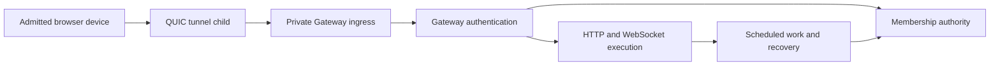

Codex review: needs real behavior proof before merge.

## What this changes

This PR adds OpenClaw ID tunnel transport, local account sign-in, and membership-bound Gateway authentication and scheduled execution.

**Example:** An admitted viewer connects through the OpenClaw ID tunnel to a token-authenticated Gateway.
- **Before:** Current main has membership authority but no working tunnel entrance.
- **After:** The viewer can read through the tunnel without the Gateway token, while chat and administrative operations remain denied.

## Review scores

| Measure | Result | What it means |
|---|---|---|
| **Overall readiness** | 🦐 gold shrimp **(3/6)** | Useful, owner-directed implementation with the previous blocker repaired; partial Gateway evidence does not yet establish every retained-authority or upgrade boundary. |
| **Proof confidence** | 🦐 gold shrimp **(3/6)** | Real behavior proof is necessary before merge. See [Before merge](#before-merge). |
| **Patch quality** | 🦐 gold shrimp **(3/6)** | Security review found an item that needs attention. |

## Product

**Kind:** Feature · **Worth it:** Yes · **Fix scope:** Complete
**User problem:** Owners and members cannot reach a linked Gateway through the OpenClaw ID relay using their admitted browser devices.
**Reason:** Maintainer direction approves the capability and durable-device authority model, while existing access methods and the default-disabled Labs boundary remain available.

## Merge readiness

⛔ **Blocked before merge - 3 items remain**

Keep this maintainer-authored feature open. The previous protocol revocation finding is resolved, and no additional concrete correctness defect was established.

**Priority:** P2
**Reviewed head:** `c546781a4b318e823d0786e1402c6e3990ba56a1`

## Before merge

- [ ] **Add real behavior proof** - Authority-chain proof required: the current-head Gateway trace establishes legitimate enrollment, private-ingress rejection, delegated-device teardown, and refused reconnects and token reuse. It does not show refusal before a held HTTP tool effect, ordinary-ingress token replay after a Labs-disabled restart, or cold-restored jobs and streams after removal, reapproval, or role change. Those paths have supporting tests, and the maintainer explicitly accepted the recorded trace limitation, but that does not waive this review's final-effect gate. Supply redacted production-path output with allowed controls and forbidden effects absent; redact IPs, API keys, phone numbers, and non-public endpoints. After adding proof, update the PR body, then request a new review with `@clawsweeper re-review`. The PR author or someone with repository write access can request it.
- [ ] **Resolve security review attention item** - No additional concrete exploit was established, but required final-effect authority evidence remains incomplete.
- [ ] **Add data-model compatibility proof** - The review found that existing stored data may not work after upgrade. Show that existing data still loads and works with this change.

## Findings

None.

### Tests

- Low-value test `src/gateway/openclaw-id/tunnel-principal.test.ts`: Remove the 'caps members by role and leaves owners uncapped' helper test: it asserts static policy values already exercised through owner, operator, and viewer Gateway authorization scenarios.
- Missing end-to-end proof: Supply production-path allowed/refused final-effect evidence for held HTTP execution, disabled-restart token replay, and cold-restored jobs and streams; stable-to-head preservation is also unshown.

<strong>Agent review details</strong>

### How this fits together

The tunnel authenticates device keys and forwards HTTP and WebSocket traffic through private ingress; Gateway membership and execution owners determine permissions and revalidate retained device grants.

### Technical review

Best possible solution:

Retain the existing membership and execution owners, with device-bound grants verified through their final effects and existing persisted state preserved.

Do we have a high-confidence way to reproduce the issue?

This is a new capability: current main provides membership authority but lacks the tunnel entrance that this PR supplies.

Is this the best way to solve the issue?

The design reuses the membership, authentication, admission, and recovery owners; separating transport custody from membership decisions and retaining process grants independently of mutable payloads serves distinct lifecycle requirements.

AGENTS.md: found and applied where relevant.

Codex review notes: model internal, reasoning medium; reviewed against [8dd41fc95291](https://github.com/openclaw/openclaw/commit/8dd41fc95291553e5885fec09992bd41c3038004).

### Provenance checked

- `OpenClaw ID service and admission` keeps the original intent (428ca7daffc9b805a865700012cae906ae316071: https://github.com/openclaw/openclaw/pull/192335 deliberately landed membership authority without transport and deferred linking until the tunnel stage.)
- `Scheduled operator-source retention` changes intended behavior with a stated reason (d74a4aeb7d62362234570f2e8245830f5edae49f: https://github.com/openclaw/openclaw/pull/176422 retained bounded authenticated authority for conversation continuations; the current PR explicitly extends device-bound retention to independent scheduled work.)
- `Restart recovery and role ceilings` keeps the original intent (56753f7762a72df6d982f2158febc7c7db9a46bd: https://github.com/openclaw/openclaw/pull/193098 preserves original authority and current policy across recovery; the new device source uses the same recovery owner and adds membership revalidation.)

### Testing

Proof path: in-process harness.

### Security

Needs attention: No additional concrete exploit was established, but required final-effect authority evidence remains incomplete.

### Evidence

What I checked:

- **Maintainer direction and accepted tradeoffs:** The complete PR body records owner decisions to retain device authority for durable work and accept the supplied Gateway trace with named remaining proof limitations. The current-head security guard independently identifies the author as a repository administrator; no additional product-direction approval is needed. ([c546781a4b31](https://github.com/openclaw/openclaw/commit/c546781a4b318e823d0786e1402c6e3990ba56a1))
- **Previous blocking repair included:** The reviewed head contains https://github.com/openclaw/openclaw/pull/193990, merged as c6480f78289d0d2cc02b03b0b2b3acea26b03012. The protocol now preserves approval lineage, restricts re-additions to the approver's subtree, and requires the certificate signer to match the current change signer. ([`packages/openclaw-id-protocol/src/authority/apply.ts:352`](https://github.com/openclaw/openclaw/blob/c546781a4b318e823d0786e1402c6e3990ba56a1/packages/openclaw-id-protocol/src/authority/apply.ts#L352), [c546781a4b31](https://github.com/openclaw/openclaw/commit/c546781a4b318e823d0786e1402c6e3990ba56a1))
- **Retained authority checks:** HTTP authority incorporates current membership, and retained principals compare claw, root, listing sequence, owner-device identity, account, and role against the resident membership owner. ([`src/gateway/openclaw-id/tunnel-principal.ts:119`](https://github.com/openclaw/openclaw/blob/c546781a4b318e823d0786e1402c6e3990ba56a1/src/gateway/openclaw-id/tunnel-principal.ts#L119), [c546781a4b31](https://github.com/openclaw/openclaw/commit/c546781a4b318e823d0786e1402c6e3990ba56a1))
- **Gateway proof and its limits:** The trace at https://github.com/openclaw/openclaw/pull/192345#issuecomment-6686314755 exercises private ingress, real membership storage, WebSocket admission, removal effects, and token revocation. The body reports its successful replay on the reviewed head and explicitly excludes held HTTP effects, disabled-restart replay, cold-restored work, and stable upgrades. Both downloaded screenshots were inspected; they show automation warning presentation rather than these authority scenarios. ([c546781a4b31](https://github.com/openclaw/openclaw/commit/c546781a4b318e823d0786e1402c6e3990ba56a1))
- **Persisted-format boundary:** The recovery codec retains the parent-bound source shape and adds a standalone gateway variant; cron storage also retains a private stream process grant. Serialization and owner-level tests support compatibility, but the PR explicitly reports no stable-to-head upgrade run. ([`src/gateway/operator-run-recovery-source.codec.ts:80`](https://github.com/openclaw/openclaw/blob/c546781a4b318e823d0786e1402c6e3990ba56a1/src/gateway/operator-run-recovery-source.codec.ts#L80), [c546781a4b31](https://github.com/openclaw/openclaw/commit/c546781a4b318e823d0786e1402c6e3990ba56a1))
- **Native transport contract:** The child executes the local iroh binding and requires its relay watcher. https://github.com/openclaw/openclaw/pull/193995 is included in the reviewed ancestry; its endpoint-owned cancellation ends the watcher when the endpoint closes. ([`crates/openclaw-iroh-node/src/endpoint.rs:154`](https://github.com/openclaw/openclaw/blob/c546781a4b318e823d0786e1402c6e3990ba56a1/crates/openclaw-iroh-node/src/endpoint.rs#L154), [c546781a4b31](https://github.com/openclaw/openclaw/commit/c546781a4b318e823d0786e1402c6e3990ba56a1))

### PR surface

PR surface statistics unavailable: the file list is incomplete.

### Preflight source

Source unknown. Source comparison at the observed PR snapshot only. Completion is self-reported; body, policy, tests, execution, and report bytes are not verified.

### Labels

Label changes:

- add `rating: 🦐 gold shrimp`: Overall readiness is 🦐 gold shrimp; proof is 🦐 gold shrimp and patch quality is 🦐 gold shrimp.
- remove `rating: 🧂 unranked krab`: Current PR rating is `rating: 🦐 gold shrimp`, so this older rating label is no longer current.

Label justifications:

- `P2`: This is an optional Labs feature with meaningful remote-access value and no established urgent regression.
- `merge-risk: 🚨 security-boundary`: The PR makes authenticated tunnel devices Gateway principals and persists their authority for later execution; ordinary CI cannot establish all final-effect revocation guarantees.
- `rating: 🦐 gold shrimp`: Overall readiness is 🦐 gold shrimp; proof is 🦐 gold shrimp and patch quality is 🦐 gold shrimp.
- `status: 📣 needs proof`: The PR needs real behavior proof before ClawSweeper can clear the contributor ask.

### Rank-up moves

Optional improvements that raise the rating; they are not merge blockers.

- Add final-effect proof for removed or reassigned devices on held HTTP requests and restored jobs and streams, including saved-token replay after a Labs-disabled restart.
- Demonstrate a latest-stable-to-head upgrade preserving existing jobs, settings, and stored authority.

### Rating scale

6/6 🦀 challenger crab · 5/6 🦞 diamond lobster · 4/6 🐚 platinum hermit · 3/6 🦐 gold shrimp · 2/6 🦪 silver shellfish · 1/6 🧂 unranked krab. Overall follows the weaker of proof and patch quality; ✨ marks media proof (a screenshot, video, or linked artifact) that directly shows the changed behavior.

### Workflow

ClawSweeper edits this one comment on every review. Comment `@clawsweeper re-review` for a fresh review only. Repair and merge execution lanes are retired.

### History

Review history (9 earlier review cycles; latest 8 shown)

<!-- clawsweeper-review-history v=1 total=9 -->
- reviewed 2026-11-03T23:00:51.461Z sha e164242c35030d4e68ae83785798df8bbdd6f16a :: needs real behavior proof before merge. :: [P1] Preserve tunnel-token restrictions across disabled restarts | [P3] Qualify the identity-header rule with its Labs condition
- reviewed 2026-11-04T09:11:09.990Z sha 530a604759f913e0403097e90395d738852dc2eb :: needs real behavior proof before merge. :: [P1] Preserve tunnel-token restrictions across disabled restarts
- reviewed 2026-11-05T00:30:25.668Z sha 90495705a31348baa9673641873d28a50115951b :: needs real behavior proof before merge. :: [P1] Retain live tunnel membership in HTTP authority checks | [P2] Migrate all service fixtures to the required Gateway getter
- reviewed 2026-11-05T04:42:24.652Z sha 47a51663f8fe3257d24a470810e2d5d708f0762c :: needs real behavior proof before merge. :: none
- reviewed 2026-11-05T22:32:47.882Z sha 609efde7166e7bbb0141c43f1db1fb1979716587 :: needs real behavior proof before merge. :: none
- reviewed 2026-11-06T01:05:03.355Z sha c434aeda6ef3f73172df427fd191a044e4f3213b :: needs real behavior proof before merge. :: none
- reviewed 2026-11-06T06:47:43.156Z sha e8b2ef97f5b518c570dbbb442833e2e00d62c9da :: needs real behavior proof before merge. :: [P1] Include the protocol revocation repair before exposing tunnel statements
- reviewed 2026-11-06T06:58:10.063Z sha bc27bd1a940fb5ac36a9ccb40303d7a5a32459a1 :: needs real behavior proof before merge. :: [P1] Include the protocol revocation repair before exposing tunnel statements

_Reviewed November 6, 2026, 9:14 AM ET / 14:14 UTC (Revision 10)._

<!-- clawsweeper-security:security-sensitive item=192345 sha=c546781a4b318e823d0786e1402c6e3990ba56a1 confidence=high updated_at=2026-11-06T14:07:15Z reviewed_at=2026-11-06T14:14:10.323Z lease_owner=github-run-42231005061-1 lease_comment_id=6686730690 source_revision=288da7e6b07d558d93c0dd8c8dbd59cb9c9069072e4264579b9f950de0f424fa -->
<!-- clawsweeper-verdict:needs-human item=192345 sha=c546781a4b318e823d0786e1402c6e3990ba56a1 confidence=high updated_at=2026-11-06T14:07:15Z reviewed_at=2026-11-06T14:14:10.323Z lease_owner=github-run-42231005061-1 lease_comment_id=6686730690 source_revision=288da7e6b07d558d93c0dd8c8dbd59cb9c9069072e4264579b9f950de0f424fa hold=security findings=0 -->
<!-- clawsweeper-review-state:blocked item=192345 sha=c546781a4b318e823d0786e1402c6e3990ba56a1 v=1 -->

<!-- clawsweeper-review-version item=192345 reviewed_at=2026-11-06T14:14:10.323Z sha=c546781a4b318e823d0786e1402c6e3990ba56a1 source_revision=288da7e6b07d558d93c0dd8c8dbd59cb9c9069072e4264579b9f950de0f424fa lease_owner=github-run-42231005061-1 lease_comment_id=6686730690 v=1 -->

<!-- clawsweeper-review item=192345 -->