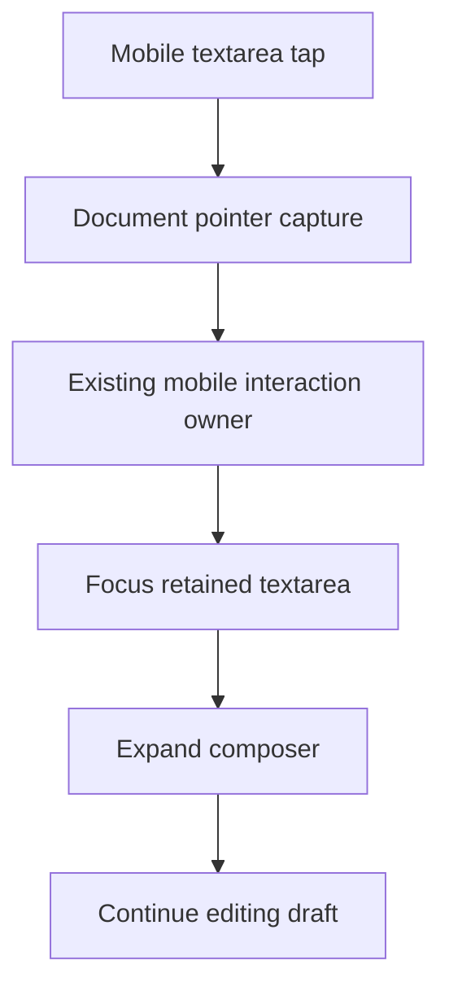

Codex review: needs maintainer review before merge.

## What this changes

This PR focuses the mobile composer’s existing textarea during the initial pointer gesture before expanding the editor.

**Example:** Tap the compact mobile composer, then type “First tap is ready to type”.
- **Before:** The composer can expand before native focus, leaving the software keyboard closed.
- **After:** The handler focuses the textarea before expansion, preserving the draft without sending it.

## Review scores

| Measure | Result | What it means |
|---|---|---|
| **Overall readiness** | 🦐 gold shrimp **(3/6)** | A useful, minimal repair with no actionable code finding; validation supports the focus-ordering invariant at the browser-harness boundary. |
| **Proof confidence** | 🦐 gold shrimp **(3/6)** | This collaborator-authored bot PR is outside the ordinary contributor proof gate; its reported browser runs exercise the production composer with a mock Gateway, while the inspected linked media covers earlier agent-creation behavior. |
| **Patch quality** | 🐚 platinum hermit **(4/6)** | No actionable review findings were identified. |

## Product

**Kind:** Bug fix · **Worth it:** Yes · **Fix scope:** Complete
**User problem:** Tapping the compact mobile composer can expand the editor without opening the keyboard.
**Reason:** First-tap editing is an expected composer behavior, and the maintainer-authored repair preserves the existing interaction design with a narrowly scoped change.

## Regression provenance

Possible regression — suspected (reviewed change). No predecessor PR is attributed.

## Merge readiness

✅ **Ready for maintainer review**

Keep open: this maintainer-authored PR addresses a current mobile focus-ordering defect with a minimal change, and no introduced runtime defect was found.

**Priority:** P2
**Reviewed head:** `d3eb91121e0eafdf793de621b20f8dc957e8eacc`

## Before merge

None.

## Findings

None.

### Tests

- Missing end-to-end proof: A physical iPhone run showing the keyboard opening on the first compact-composer tap remains unverified; the supplied browser tests establish focus ordering instead.

<strong>Agent review details</strong>

### How this fits together

The Control UI’s existing mobile interaction owner receives pointer and focus events, controls composer expansion, and retains the textarea used for drafting messages.

### Technical review

Best possible solution:

Retain the synchronous focus call in the existing interaction owner and merge after the existing exact-head checks pass.

Do we have a high-confidence way to reproduce the issue?

Source inspection establishes expansion before explicit focus on current main, and the PR reports a red-to-green browser regression; this review did not execute target code.

Is this the best way to solve the issue?

The change repairs ordering at the existing owner without new state, listeners, timers, or competing focus policy, while retaining disabled/read-only protection and drawer recovery.

AGENTS.md: found and applied where relevant.

Codex review notes: model internal, reasoning medium; reviewed against [013240515205](https://github.com/openclaw/openclaw/commit/013240515205573248c27ab6b8eec7303f0da1a8).

### Provenance checked

- `Mobile composer pointer activation` changes intended behavior with a stated reason (413d2fc66983d396ff1e9281f568954ef3c83de6: The mobile hunk in https://github.com/openclaw/openclaw/pull/175291 restored editing after drawer closure even when no new focusin event occurs; the interaction owner originated in https://github.com/openclaw/openclaw/pull/176498.)

### Testing

Proof path: in-process harness.

### Security

None.

### Evidence

What I checked:

- **Minimal production repair:** The introduced diff adds synchronous focus before changeEditing while preserving the mobile-only, primary-button, textarea-identity, and editable checks. ([`ui/src/pages/chat/components/chat-composer-mobile-interaction.tsx:182`](https://github.com/openclaw/openclaw/blob/d3eb91121e0eafdf793de621b20f8dc957e8eacc/ui/src/pages/chat/components/chat-composer-mobile-interaction.tsx#L182), [d3eb91121e0e](https://github.com/openclaw/openclaw/commit/d3eb91121e0eafdf793de621b20f8dc957e8eacc))
- **Current main retains the ordering defect:** Fetched main expands the composer in pointerdown without explicitly focusing it first; the separate composer-chrome helper leaves interactive textarea gestures to native handling. ([`ui/src/pages/chat/components/chat-composer-mobile-interaction.tsx:182`](https://github.com/openclaw/openclaw/blob/013240515205573248c27ab6b8eec7303f0da1a8/ui/src/pages/chat/components/chat-composer-mobile-interaction.tsx#L182), [013240515205](https://github.com/openclaw/openclaw/commit/013240515205573248c27ab6b8eec7303f0da1a8))
- **Earlier recovery behavior is preserved:** https://github.com/openclaw/openclaw/pull/175291 removed the already-focused condition to restore editing after drawer closure; this PR retains that behavior rather than restoring the condition. ([`ui/src/pages/chat/components/chat-composer-mobile-interaction.tsx:179`](https://github.com/openclaw/openclaw/blob/413d2fc66983d396ff1e9281f568954ef3c83de6/ui/src/pages/chat/components/chat-composer-mobile-interaction.tsx#L179), [413d2fc66983](https://github.com/openclaw/openclaw/commit/413d2fc66983d396ff1e9281f568954ef3c83de6))
- **Focused regression coverage:** The new production-bundle browser case checks focus during pointerdown, editing activation, subsequent typing, and absence of chat.send; the existing caret/menu suite gains the ordering assertion and WebKit inclusion. Passing results and the red baseline are contributor-reported, not independently executed in this read-only review. ([`ui/src/e2e/chat-composer-pointer-activation.e2e.test.ts:255`](https://github.com/openclaw/openclaw/blob/d3eb91121e0eafdf793de621b20f8dc957e8eacc/ui/src/e2e/chat-composer-pointer-activation.e2e.test.ts#L255), [d3eb91121e0e](https://github.com/openclaw/openclaw/commit/d3eb91121e0eafdf793de621b20f8dc957e8eacc))
- **Prepared media belongs to earlier agent-creation work:** The three inspected screenshots depict selector, Claws, and agent-creation changes from https://github.com/openclaw/openclaw/pull/175291. The associated creation video could not be inspected: preparation reports “ffprobe failed: spawnSync ffprobe ENOENT”; the fallback fetch returned “Cache miss”. These artifacts do not establish this PR’s keyboard behavior.
- **Exact-head merge and CI state:** GitHub reports the reviewed head as mergeable with mergeable_state blocked; the CI gate remains pending and one real-Gateway UI job is still running, with no completed failing check observed. ([d3eb91121e0e](https://github.com/openclaw/openclaw/commit/d3eb91121e0eafdf793de621b20f8dc957e8eacc))

Likely related people:

- **Vyctor H. Brzezowski:** Raw commit 1bc029e59c6cef775559b6603091316560b00760 adds ui/src/pages/chat/components/chat-composer-mobile-interaction.tsx:174 relative to its recorded parents. This identifies author metadata, not feature responsibility or a PR merger. (role: source-line author; confidence: high; commits: [1bc029e59c6c](https://github.com/openclaw/openclaw/commit/1bc029e59c6cef775559b6603091316560b00760); files: `ui/src/pages/chat/components/chat-composer-mobile-interaction.tsx`)

### PR surface

Source +2, Tests +33, Docs +6. Total +41 across 5 files. Added test files: 0.

View PR surface stats

| Area | Files | Added | Removed | Net |
|---|---:|---:|---:|---:|
| Source | 2 | 5 | 3 | +2 |
| Tests | 2 | 33 | 0 | +33 |
| Docs | 1 | 6 | 0 | +6 |
| Config | 0 | 0 | 0 | 0 |
| Generated | 0 | 0 | 0 | 0 |
| Other | 0 | 0 | 0 | 0 |
| **Total** | **5** | **44** | **3** | **+41** |

### Labels

Label changes:

- add `P2`: A focused mobile composer interaction defect impedes drafting without evidence of data loss, message loss, or a blocked onboarding flow.
- add `rating: 🦐 gold shrimp`: Overall readiness is 🦐 gold shrimp; proof is 🦐 gold shrimp and patch quality is 🐚 platinum hermit.
- add `status: 👀 ready for maintainer look`: ClawSweeper has no concrete contributor-facing blocker left for this PR.

Label justifications:

- `P2`: A focused mobile composer interaction defect impedes drafting without evidence of data loss, message loss, or a blocked onboarding flow.
- `rating: 🦐 gold shrimp`: Overall readiness is 🦐 gold shrimp; proof is 🦐 gold shrimp and patch quality is 🐚 platinum hermit.
- `status: 👀 ready for maintainer look`: ClawSweeper has no concrete contributor-facing blocker left for this PR.

### Rating scale

6/6 🦀 challenger crab · 5/6 🦞 diamond lobster · 4/6 🐚 platinum hermit · 3/6 🦐 gold shrimp · 2/6 🦪 silver shellfish · 1/6 🧂 unranked krab. Overall follows the weaker of proof and patch quality; ✨ marks media proof (a screenshot, video, or linked artifact) that directly shows the changed behavior.

### Workflow

ClawSweeper edits this one comment on every review. Comment `@clawsweeper re-review` for a fresh review only. Repair and merge execution lanes are retired.

_Reviewed October 22, 2026, 6:19 PM ET / 22:19 UTC._

<!-- clawsweeper-verdict:needs-human item=181021 sha=d3eb91121e0eafdf793de621b20f8dc957e8eacc confidence=high updated_at=2026-10-22T22:15:45Z reviewed_at=2026-10-22T22:19:00.951Z lease_owner=github-run-39863477237-1 lease_comment_id=6352489403 source_revision=dd523e7e49a799ecd5946763477b24e2d2feca0f72ac130fceb29c9b94894e80 hold=not_opted_in findings=0 -->
<!-- clawsweeper-review-state:ready item=181021 sha=d3eb91121e0eafdf793de621b20f8dc957e8eacc v=1 -->

<!-- clawsweeper-review-version item=181021 reviewed_at=2026-10-22T22:19:00.951Z sha=d3eb91121e0eafdf793de621b20f8dc957e8eacc source_revision=dd523e7e49a799ecd5946763477b24e2d2feca0f72ac130fceb29c9b94894e80 lease_owner=github-run-39863477237-1 lease_comment_id=6352489403 v=1 -->

<!-- clawsweeper-review item=181021 -->