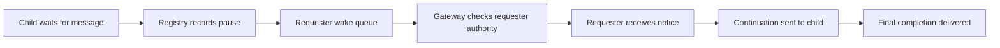

Codex review: needs maintainer review before merge. _Reviewed September 30, 2026, 1:11 AM ET / 05:11 UTC (Revision 11)._

# ClawSweeper review

## What this changes

The branch records a child’s pause notice, wakes its requesting agent with continuation details, binds the resulting Gateway turn to that requester, and updates documentation and tests.

## Merge readiness

✅ **Ready for maintainer review**

Current main still leaves a requester waiting when a child pauses for a message. This PR addresses that distinct behavior, and the reviewed head has no supported blocking finding.

**Priority:** P1
**Reviewed head:** `9f18654196c13093f15c1d3325c0e6e16f2ec46c`

## Review scores

| Measure | Result | What it means |
|---|---|---|
| **Overall readiness** | 🐚 platinum hermit **(4/6)** | The patch has strong live and final-effect proof for a complex lifecycle change, with no supported blocking finding. |
| **Proof confidence** | 🦞 diamond lobster **(5/6)** | Sufficient (terminal): The recorded isolated live Gateway/provider run exercises the changed registry wake through a child pause, requester notice, sessions.send continuation and one final completion; the source test asserts those results. A Gateway/SQLite harness with simulated provider execution checks denial before effects for foreign and reset requesters. The final head leaves the reviewed production paths unchanged. The optional JSON field uses an unchanged codec, and the reported v2026.9.6 round trip plus the published codec support existing-state compatibility. |
| **Patch quality** | 🐚 platinum hermit **(4/6)** | No actionable review findings were identified. |

## Verification

| Check | Result | Evidence |
|---|---|---|
| **Real behavior** | Verified | Sufficient (terminal): The recorded isolated live Gateway/provider run exercises the changed registry wake through a child pause, requester notice, sessions.send continuation and one final completion; the source test asserts those results. A Gateway/SQLite harness with simulated provider execution checks denial before effects for foreign and reset requesters. The final head leaves the reviewed production paths unchanged. The optional JSON field uses an unchanged codec, and the reported v2026.9.6 round trip plus the published codec support existing-state compatibility. |
| **Evidence reviewed** | 8 items | Current main lacks the pause wake: The current-main requester wake still treats unsettled descendants as a reason to wait and has no pause-notice branch. Pause intent and delivery owner: The branch records a bounded notice on the child’s existing durable wake state, selects that child for a pause wake, and keeps its completion cohort armed. Final-effect authority binding: Requester admission matches the run, target session and source; Gateway preparation and its input-owner guard invoke the captured live assertion. |
| **Findings** | None | None. |
| **Security** | None | None. |

## How this fits together

Subagents report their state to a registry, which schedules messages back to the agent that requested their work. A paused child can then receive a continuation through sessions.send and later deliver its final result.

## Before merge

None.

<strong>Agent review details</strong>

### Security

None.

### PR surface

Source +315, Tests +1032, Docs +11. Total +1358 across 40 files.

View PR surface stats

| Area | Files | Added | Removed | Net |
|---|---:|---:|---:|---:|
| Source | 19 | 426 | 111 | +315 |
| Tests | 20 | 1122 | 90 | +1032 |
| Docs | 1 | 17 | 6 | +11 |
| Config | 0 | 0 | 0 | 0 |
| Generated | 0 | 0 | 0 | 0 |
| Other | 0 | 0 | 0 | 0 |
| **Total** | **40** | **1565** | **207** | **+1358** |

### Review metrics

| Metric | Value | Why it matters |
|---|---|---|
| **Code and test growth** | production +315, tests and test support +1032 lines | The PR body records maintainer acceptance of production growth for durable delivery and Gateway authority proof. |

### Technical review

Best possible solution:

Keep one durable pause notice per paused child, preserve its later completion, and enforce requester authority at Gateway input admission.

Do we have a high-confidence way to reproduce the issue?

Yes. The current-main wake path waits on the paused child, and the PR records the original pause-wake regression failing before the fix; I did not execute it in this read-only review.

Is this the best way to solve the issue?

Yes. The branch uses the existing registry, requester-settle delivery and Gateway admission owners, with focused compatibility and final-effect evidence.

AGENTS.md: found and applied where relevant.

Codex review notes: model internal, reasoning high; reviewed against [bcd3cace1911](https://github.com/openclaw/openclaw/commit/bcd3cace19112307bc86d2811020a552717eea0b).

### Labels

Label changes:

- remove `proof: telegram-e2e`: Current Telegram visible-proof status is not_needed.

Label justifications:

- `P1`: A paused child can leave its requesting agent idle during an active workflow.
- `merge-risk: 🚨 compatibility`: The optional persisted notice crosses an upgrade boundary; the reported published-reader round trip and released codec support the accepted rollback behavior.
- `merge-risk: 🚨 message-delivery`: The change schedules an additional requester message while preserving later completion, a path covered by the recorded live flow.
- `merge-risk: 🚨 security-boundary`: The change carries requester authority into a Gateway turn; final-effect tests cover foreign targets and requester reset.
- `rating: 🐚 platinum hermit`: Overall readiness is 🐚 platinum hermit; proof is 🦞 diamond lobster and patch quality is 🐚 platinum hermit.
- `status: 👀 ready for maintainer look`: ClawSweeper has no concrete contributor-facing blocker left for this PR. Sufficient (terminal): The recorded isolated live Gateway/provider run exercises the changed registry wake through a child pause, requester notice, sessions.send continuation and one final completion; the source test asserts those results. A Gateway/SQLite harness with simulated provider execution checks denial before effects for foreign and reset requesters. The final head leaves the reviewed production paths unchanged. The optional JSON field uses an unchanged codec, and the reported v2026.9.6 round trip plus the published codec support existing-state compatibility.
- `proof: sufficient`: Contributor real behavior proof is sufficient. The recorded isolated live Gateway/provider run exercises the changed registry wake through a child pause, requester notice, sessions.send continuation and one final completion; the source test asserts those results. A Gateway/SQLite harness with simulated provider execution checks denial before effects for foreign and reset requesters. The final head leaves the reviewed production paths unchanged. The optional JSON field uses an unchanged codec, and the reported v2026.9.6 round trip plus the published codec support existing-state compatibility.

### Evidence

What I checked:

- **Current main lacks the pause wake:** The current-main requester wake still treats unsettled descendants as a reason to wait and has no pause-notice branch. ([`src/agents/subagents/announce/subagent-announce.requester-settle-wake.ts:226`](https://github.com/openclaw/openclaw/blob/bcd3cace19112307bc86d2811020a552717eea0b/src/agents/subagents/announce/subagent-announce.requester-settle-wake.ts#L226), [bcd3cace1911](https://github.com/openclaw/openclaw/commit/bcd3cace19112307bc86d2811020a552717eea0b))
- **Pause intent and delivery owner:** The branch records a bounded notice on the child’s existing durable wake state, selects that child for a pause wake, and keeps its completion cohort armed. ([`src/agents/subagents/registry/subagent-registry-run-pause.ts:28`](https://github.com/openclaw/openclaw/blob/9f18654196c13093f15c1d3325c0e6e16f2ec46c/src/agents/subagents/registry/subagent-registry-run-pause.ts#L28), [9f18654196c1](https://github.com/openclaw/openclaw/commit/9f18654196c13093f15c1d3325c0e6e16f2ec46c))
- **Final-effect authority binding:** Requester admission matches the run, target session and source; Gateway preparation and its input-owner guard invoke the captured live assertion. ([`src/agents/subagents/requester-cron-authority.ts:603`](https://github.com/openclaw/openclaw/blob/9f18654196c13093f15c1d3325c0e6e16f2ec46c/src/agents/subagents/requester-cron-authority.ts#L603), [9f18654196c1](https://github.com/openclaw/openclaw/commit/9f18654196c13093f15c1d3325c0e6e16f2ec46c))
- **Forbidden requester proof:** The Gateway test checks foreign-target and requester-reset denials against real admission and SQLite effects, including no execution start, transcript change, pending input or accepted dedupe entry. ([`src/gateway/server.requester-pause-authority.test.ts:285`](https://github.com/openclaw/openclaw/blob/9f18654196c13093f15c1d3325c0e6e16f2ec46c/src/gateway/server.requester-pause-authority.test.ts#L285), [9f18654196c1](https://github.com/openclaw/openclaw/commit/9f18654196c13093f15c1d3325c0e6e16f2ec46c))
- **Live flow proof:** The recorded live Gateway/provider run observed a pause reply containing the child’s marker, resumed that child through sessions.send, and observed one later completion; the test asserts those outcomes. ([`src/agents/subagents/announce/subagent-yield-pause.live.test.ts:13`](https://github.com/openclaw/openclaw/blob/9f18654196c13093f15c1d3325c0e6e16f2ec46c/src/agents/subagents/announce/subagent-yield-pause.live.test.ts#L13), [9f18654196c1](https://github.com/openclaw/openclaw/commit/9f18654196c13093f15c1d3325c0e6e16f2ec46c))
- **Published reader compatibility:** The v2026.9.6 codec validates canonical execution, completion and delivery state while reading and writing the complete JSON payload; it does not reject an additional wake field. The PR body also reports a public-row and parent-only-row round trip with that published codec. ([`src/agents/subagents/registry/subagent-registry.store.codec.ts:52`](https://github.com/openclaw/openclaw/blob/eb377ac59e6c9fd6c7705028034812becf00271b/src/agents/subagents/registry/subagent-registry.store.codec.ts#L52), [eb377ac59e6c](https://github.com/openclaw/openclaw/commit/eb377ac59e6c9fd6c7705028034812becf00271b))

Likely related people:

- **steipete:** Suggested for follow-up; no historical authorship or introduction is verified. (role: unverified routing candidate; confidence: low)
- **Vito Cappello:** Suggested for follow-up; no historical authorship or introduction is verified. (role: unverified routing candidate; confidence: low)
- **RoboClaw:** Suggested for follow-up; no historical authorship or introduction is verified. (role: unverified routing candidate; confidence: low)

### Rating scale

| Score | Internal tier | Crab rank | Meaning |
|---:|:---:|---|---|
| **6/6** | S | 🦀 challenger crab | Exceptional readiness |
| **5/6** | A | 🦞 diamond lobster | Very strong readiness |
| **4/6** | B | 🐚 platinum hermit | Good normal PR; ordinary maintainer review |
| **3/6** | C | 🦐 gold shrimp | Useful, but confidence is limited |
| **2/6** | D | 🦪 silver shellfish | Proof or implementation needs work |
| **1/6** | F | 🧂 unranked krab | Not merge-ready |
| N/A | NA | 🌊 off-meta tidepool | Rating does not apply |

Overall follows the weaker of proof and patch quality.
Shiny media proof means a screenshot, video, or linked artifact directly shows the changed behavior. Runtime, network, CSP, and security claims still need visible diagnostics.

### Workflow

- ClawSweeper keeps one durable marker-backed review comment per issue or PR.
- Re-runs edit this comment so the latest verdict, findings, and automation markers stay together instead of adding duplicate bot comments.
- A fresh review can be triggered by eligible `@clawsweeper re-review` comments, exact-item GitHub events, scheduled/background review runs, or manual workflow dispatch.
- PR/issue authors and users with repository write access can comment `@clawsweeper re-review` or `@clawsweeper re-run` on an open PR or issue to request a fresh review only.
- Maintainers can also comment `@clawsweeper review` to request a fresh review only.
- Fresh-review commands do not start repair, autofix, rebase, CI repair, or automerge.
- Maintainer-only repair and merge flows require explicit commands such as `@clawsweeper autofix`, `@clawsweeper automerge`, `@clawsweeper fix ci`, or `@clawsweeper address review`.
- Maintainers can comment `@clawsweeper explain` to ask for more context, or `@clawsweeper stop` to stop active automation.

### History

Review history (10 earlier review cycles; latest 8 shown)

<!-- clawsweeper-review-history v=1 total=10 -->
- reviewed 2026-09-29T10:38:40.662Z sha 218131976afe6690f641ca1d42f76586e8c4a477 :: needs real behavior proof before merge. :: none
- reviewed 2026-09-29T20:34:41.895Z sha 218131976afe6690f641ca1d42f76586e8c4a477 :: needs real behavior proof before merge. :: none
- reviewed 2026-09-30T01:49:50.039Z sha 218131976afe6690f641ca1d42f76586e8c4a477 :: needs real behavior proof before merge. :: none
- reviewed 2026-09-30T02:10:30.084Z sha b44100c4f2b1088ad8b90f3b6771274406fefbe5 :: blocked before merge. :: none
- reviewed 2026-09-30T02:18:35.244Z sha b44100c4f2b1088ad8b90f3b6771274406fefbe5 :: blocked before merge. :: none
- reviewed 2026-09-30T02:43:03.584Z sha 2adbe8c136d6904ee62ce72145c33e370985a5ff :: needs maintainer review before merge. :: none
- reviewed 2026-09-30T03:21:38.167Z sha f467702291f8ca43512bfb362b99e326f9fee1e5 :: needs maintainer review before merge. :: none
- reviewed 2026-09-30T04:12:27.891Z sha 20585636b1cb85418e3fe3358d4d36c1005cdb95 :: needs maintainer review before merge. :: none

<!-- clawsweeper-verdict:needs-human item=161114 sha=9f18654196c13093f15c1d3325c0e6e16f2ec46c confidence=high updated_at=2026-09-30T05:07:26Z reviewed_at=2026-09-30T05:11:12.986Z lease_owner=github-run-36671876415-1 lease_comment_id=5904483859 source_revision=4cbe9773b62058f1f9672a8222ab2143524ae367cefbb71eed01a12e2eb1116d live_verification=absent -->
<!-- clawsweeper-review-state:ready item=161114 sha=9f18654196c13093f15c1d3325c0e6e16f2ec46c v=1 -->

<!-- clawsweeper-review-version item=161114 reviewed_at=2026-09-30T05:11:12.986Z sha=9f18654196c13093f15c1d3325c0e6e16f2ec46c source_revision=4cbe9773b62058f1f9672a8222ab2143524ae367cefbb71eed01a12e2eb1116d lease_owner=github-run-36671876415-1 lease_comment_id=5904483859 v=1 -->

<!-- clawsweeper-review item=161114 -->