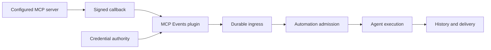

Codex review: needs real behavior proof before merge.

## What this changes

Adds an opt-in plugin that starts existing Automations from authenticated MCP event webhooks.

**Example:** The deployments MCP server emits deployment.changed for project website.
- **Before:** Starting an Automation requires polling or a separate webhook sender.
- **After:** An Automation subscribes with {"project":"website"} and receives the signed event alongside its saved instructions.

## Review scores

| Measure | Result | What it means |
|---|---|---|
| **Overall readiness** | 🧂 unranked krab **(1/6)** | Useful sponsored direction and a resolved prior finding, but available evidence does not establish the material authority boundary or current upgrade compatibility. |
| **Proof confidence** | 🧂 unranked krab **(1/6)** | Real behavior proof is necessary before merge. See [Before merge](#before-merge). |
| **Patch quality** | 🦐 gold shrimp **(3/6)** | Security review found an item that needs attention. |

## Product

**Kind:** Feature · **Worth it:** Yes · **Fix scope:** Complete
**User problem:** Configured MCP servers cannot start an Automation when an event occurs without polling or separate webhook infrastructure.
**Reason:** Collaborator authorship establishes direction for the scoped webhook feature and its new contracts; outbound poll/push remains separate work.

## Merge readiness

⛔ **Blocked before merge - 4 items remain**

Keep open: this collaborator-authored feature fills a missing MCP-to-Automation path, and the prior cleanup finding is resolved.

**Priority:** P2
**Reviewed head:** `646cb29036c131791dfb4a5e73eb54c6b8c71035`

## Before merge

- [ ] **Add real behavior proof** - Authority-chain proof required: exercise the published credential/source, callback ingress, and Automation execution owners together through an isolated Gateway, showing allowed execution and another requester's rejection, plus invalidation of old signed callbacks and queued claims after revocation or same-byte reconnection, including restart, before model or tool I/O. The inspected screenshots demonstrate editor controls, and boundary tests substitute credential authority or Automation execution; the body explicitly says joined acceptance has not run. Supply redacted logs or terminal output tied to the reviewed revision, removing IPs, keys, phone numbers, and non-public endpoints. After adding proof, update the PR body; ClawSweeper should re-review automatically. If it does not, the PR author or someone with repository write access can comment `@clawsweeper re-review`.
- [ ] **Resolve security review attention item** - No concrete authorization bypass was established, but the retained-authority boundary still needs final-effect validation.
- [ ] **Resolve merge risk** - Retained subscription and queued-event authority crosses requester and credential lifetimes; its safety at final execution remains unestablished.
- [ ] **Add data-model compatibility proof** - The review found that existing stored data may not work after upgrade. Show that existing data still loads and works with this change.

## Findings

None.

### Tests

- Missing end-to-end proof: Missing a production MCP callback-to-Automation execution trace with requester isolation and revoked queued-work rejection, plus a current-stable upgrade with settings and data intact.

<strong>Agent review details</strong>

### How this fits together

The plugin translates configured MCP subscriptions and signed callbacks into durable ingress claims, which Automation admission transfers into run receipts, agent execution, history, and delivery.

### Technical review

Best possible solution:

Finish the opt-in adapter through the existing credential, ingress, and Automation owners, preserving their authority and durable receipt contracts.

Do we have a high-confidence way to reproduce the issue?

This is a feature request: inspected current-main contracts lack native MCP event schedules, and no target code was executed.

Is this the best way to solve the issue?

The plugin placement and shared-owner admission design fit the capability gap; the cleanup repair now addresses the previously identified cause.

AGENTS.md: found and applied where relevant.

Codex review notes: model internal, reasoning medium; reviewed against [531730658a10](https://github.com/openclaw/openclaw/commit/531730658a1099d03450c85cb68d4971a5c8f88e).

### Merge-risk options

**Maintainer options:**
1. **Validate the retained authority boundary (recommended)**  
   Complete allowed and nearest-forbidden execution evidence through the production owners before merging.
2. **Keep the draft paused**  
   Retain the feature work while an authorized environment for boundary validation is unavailable.

### Provenance checked

- `Requester-scoped MCP connections` keeps the original intent (https://github.com/openclaw/openclaw/pull/122166: Isolate authenticated requesters' credentials and reject missing requester identity instead of borrowing operator credentials.)
- `Durable Automation admission` keeps the original intent (https://github.com/openclaw/openclaw/pull/122948: Prevent duplicate execution and stale mutations through exact durable ownership and atomic receipt transitions.)
- `Logical source identity` keeps the original intent (https://github.com/openclaw/openclaw/pull/112387: Separate durable source incarnation from process restart generation so stale sources reject without dropping legitimate restart work.)
- `Service-owned scheduling` keeps the original intent (https://github.com/openclaw/openclaw/pull/156130: Long-lived plugin work must use active service authority after its originating tool caller closes.)
- `OAuth refresh continuity` keeps the original intent (https://github.com/openclaw/openclaw/pull/141477: Canonical credential settlement must fence stale refresh writers while preserving legitimate completed rotation.)
- `Worker-owned auth writes` keeps the original intent (https://github.com/openclaw/openclaw/pull/165644: Move canonical credential writes to workers while retaining native commit custody and incremental host publication.)

### Testing

Proof path: in-process harness.

### Security

Needs attention: No concrete authorization bypass was established, but the retained-authority boundary still needs final-effect validation.

### Evidence

What I checked:

- **Reviewed identity and keep-open guard:** REST confirms collaborator authorship, draft status, and the checkout's published head. Initial mergeability was false/dirty; the final response was null/unknown, so current mergeability remains unsettled. ([646cb29036c1](https://github.com/openclaw/openclaw/commit/646cb29036c131791dfb4a5e73eb54c6b8c71035))
- **Current main lacks event admission:** Fetched main's Automation schedule schema supports at, every, cron, on-exit, and stream, but no plugin event schedule; its MCP client capabilities also provide no Events integration. ([`packages/gateway-protocol/src/schema/cron.ts:157`](https://github.com/openclaw/openclaw/blob/531730658a1099d03450c85cb68d4971a5c8f88e/packages/gateway-protocol/src/schema/cron.ts#L157), [531730658a10](https://github.com/openclaw/openclaw/commit/531730658a1099d03450c85cb68d4971a5c8f88e))
- **Prior cleanup finding resolved:** Retirement and cleanup now retain their recovery wakeups in finally blocks, including failed bookkeeping and deletion after unsubscribe. Added boundary cases cover all three failure phases; no tests were executed during this read-only review. ([`extensions/mcp-events/src/service.ts:515`](https://github.com/openclaw/openclaw/blob/646cb29036c131791dfb4a5e73eb54c6b8c71035/extensions/mcp-events/src/service.ts#L515), [646cb29036c1](https://github.com/openclaw/openclaw/commit/646cb29036c131791dfb4a5e73eb54c6b8c71035))
- **Existing owners retained:** The host binds source preparation to the persisted Automation creator and calling plugin, revalidates canonical credential authority, and checks the exact ingress claim inside the Automation activation transaction. ([`src/cron/store/event-ingress.ts`](https://github.com/openclaw/openclaw/blob/646cb29036c131791dfb4a5e73eb54c6b8c71035/src/cron/store/event-ingress.ts), [646cb29036c1](https://github.com/openclaw/openclaw/commit/646cb29036c131791dfb4a5e73eb54c6b8c71035))
- **Supplied visual and compatibility evidence:** Both downloaded screenshots were inspected and show the timed editor and new Event controls. The unchanged body, source identity b3bac4d3a551f66348e0dd3ada88c41713421a0e34a744c9608d6ddf1ee4a3c5, identifies mocked-Gateway UI evidence, states joined acceptance remains pending, and limits compatibility evidence to an older candidate using v2026.9.8 store owners. ([646cb29036c1](https://github.com/openclaw/openclaw/commit/646cb29036c131791dfb4a5e73eb54c6b8c71035))
- **Distinct outbound transport follow-up:** https://github.com/openclaw/openclaw/issues/166586 requests outbound poll/push. Its author explicitly accepts the same plugin and Automations owners while retaining the requirement to avoid public callback infrastructure; this webhook PR does not supersede that request. Public docs: [`docs/automation/mcp-events.md`](https://docs.openclaw.ai/automation/mcp-events). ([`docs/automation/mcp-events.md`](https://docs.openclaw.ai/automation/mcp-events), [646cb29036c1](https://github.com/openclaw/openclaw/commit/646cb29036c131791dfb4a5e73eb54c6b8c71035))

Likely related people:

- **Peter Steinberger:** Raw commit 50026f10310362156a1ad0fa3786675b3eef27a0 adds src/agents/mcp-connection-resolver.ts:298 relative to its recorded parents. This identifies author metadata, not feature responsibility or a PR merger. (role: source-line author; confidence: high; commits: [50026f103103](https://github.com/openclaw/openclaw/commit/50026f10310362156a1ad0fa3786675b3eef27a0); files: `src/agents/mcp-connection-resolver.ts`)
- **Ayaan Zaidi:** Raw commit 834561ad672381365e5359f1e76726290982a39c adds src/agents/mcp-connection-resolver.ts:263 relative to its recorded parents. This identifies author metadata, not feature responsibility or a PR merger. (role: source-line author; confidence: high; commits: [834561ad6723](https://github.com/openclaw/openclaw/commit/834561ad672381365e5359f1e76726290982a39c); files: `src/agents/mcp-connection-resolver.ts`)

### PR surface

PR surface statistics unavailable: the file list is incomplete.

### Review metrics

| Metric | Value | Why it matters |
|---|---|---|
| **Plugin configuration additions** | 2 settings | callbackOrigin supplies required callback infrastructure; maxPendingEvents controls bounded intake and defaults to 10,000. |
| **Persistent contract additions** | 1 schedule variant and 2 credential metadata fields | Event schedules, MCP OAuth authorizationId, and auth-profile authorizationLifetimes extend existing durable formats without introducing a new table. |

### Labels

Label changes:

No label changes.

Label justifications:

- `P2`: This is a useful opt-in integration with limited blast radius, rather than an urgent regression in an established workflow.
- `merge-risk: 🚨 compatibility`: The PR adds plugin APIs and persisted event and credential-lifetime contracts; collaborator authorship establishes direction, while compatibility validation remains required.
- `merge-risk: 🚨 security-boundary`: Signed callbacks and durable claims consume retained requester authority, making final-effect rejection across revocation and replacement material.
- `rating: 🧂 unranked krab`: Overall readiness is 🧂 unranked krab; proof is 🧂 unranked krab and patch quality is 🦐 gold shrimp.
- `status: 📣 needs proof`: The PR needs real behavior proof before ClawSweeper can clear the contributor ask.
- `proof: 📸 screenshot`: Contributor real behavior proof includes screenshot evidence.

### Rank-up moves

Optional improvements that raise the rating; they are not merge blockers.

- Add final-effect proof for another requester and prove revocation or same-byte reconnection invalidates old callbacks and queued claims across restart before model or tool I/O.

### Rating scale

6/6 🦀 challenger crab · 5/6 🦞 diamond lobster · 4/6 🐚 platinum hermit · 3/6 🦐 gold shrimp · 2/6 🦪 silver shellfish · 1/6 🧂 unranked krab. Overall follows the weaker of proof and patch quality; ✨ marks media proof (a screenshot, video, or linked artifact) that directly shows the changed behavior.

### Workflow

ClawSweeper edits this one comment on every review. Comment `@clawsweeper re-review` for a fresh review only. Repair and merge execution lanes are retired.

### History

Review history (4 earlier review cycles)

<!-- clawsweeper-review-history v=1 total=4 -->
- reviewed 2026-10-05T06:52:10.946Z sha 1572758f8b486c9138c3e0b317f3596dae45d908 :: needs real behavior proof before merge. :: none
- reviewed 2026-10-05T07:36:20.616Z sha 5b462ed1c69c45a445f6452e9f4ffa038e7ee246 :: needs real behavior proof before merge. :: none
- reviewed 2026-10-10T03:46:39.421Z sha 5b462ed1c69c45a445f6452e9f4ffa038e7ee246 :: needs real behavior proof before merge. :: [P2] Preserve cleanup recovery across bookkeeping and deletion failures
- reviewed 2026-10-10T04:48:24.567Z sha 5b462ed1c69c45a445f6452e9f4ffa038e7ee246 :: needs real behavior proof before merge. :: [P2] Preserve cleanup recovery across bookkeeping and deletion failures

_Reviewed October 11, 2026, 5:30 PM ET / 21:30 UTC (Revision 5)._

<!-- clawsweeper-security:security-sensitive item=165399 sha=646cb29036c131791dfb4a5e73eb54c6b8c71035 confidence=high updated_at=2026-10-11T21:22:45Z reviewed_at=2026-10-11T21:30:24.495Z lease_owner=github-run-38176039365-1 lease_comment_id=6113914255 source_revision=b3bac4d3a551f66348e0dd3ada88c41713421a0e34a744c9608d6ddf1ee4a3c5 -->
<!-- clawsweeper-verdict:needs-human item=165399 sha=646cb29036c131791dfb4a5e73eb54c6b8c71035 confidence=high updated_at=2026-10-11T21:22:45Z reviewed_at=2026-10-11T21:30:24.495Z lease_owner=github-run-38176039365-1 lease_comment_id=6113914255 source_revision=b3bac4d3a551f66348e0dd3ada88c41713421a0e34a744c9608d6ddf1ee4a3c5 hold=security findings=0 -->
<!-- clawsweeper-review-state:blocked item=165399 sha=646cb29036c131791dfb4a5e73eb54c6b8c71035 v=1 -->

<!-- clawsweeper-review-version item=165399 reviewed_at=2026-10-11T21:30:24.495Z sha=646cb29036c131791dfb4a5e73eb54c6b8c71035 source_revision=b3bac4d3a551f66348e0dd3ada88c41713421a0e34a744c9608d6ddf1ee4a3c5 lease_owner=github-run-38176039365-1 lease_comment_id=6113914255 v=1 -->

<!-- clawsweeper-review item=165399 -->