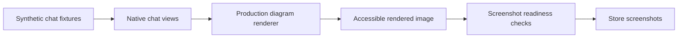

Codex review: needs maintainer review before merge.

## What this changes

This PR adds matching diagrams to Android and iOS screenshot fixtures and waits for rendered diagram accessibility elements before capture.

**Example:** Capture the native chat screenshot containing Draft → Review → Ship.
- **Before:** The scene contains no diagram and readiness checks cannot establish successful diagram rendering.
- **After:** The scene includes the flowchart and capture waits for the renderer’s Mermaid diagram element.

## Review scores

| Measure | Result | What it means |
|---|---|---|
| **Overall readiness** | 🦐 gold shrimp **(3/6)** | The patch is focused and source-consistent, with supporting test claims but incomplete native qualification. |
| **Proof confidence** | 🦐 gold shrimp **(3/6)** | This maintainer-authored fixture PR is outside the ordinary contributor proof gate; its reported tests and synthetic ADB probe support the change, while the inspected linked screenshots demonstrate web rendering rather than the native capture paths. |
| **Patch quality** | 🐚 platinum hermit **(4/6)** | No actionable review findings were identified. |

## Product

**Kind:** Test only · **Worth it:** Yes · **Fix scope:** Complete
**User problem:** Native screenshot captures cannot qualify diagram rendering when their chat fixtures contain no diagram.
**Reason:** Maintainer authorship establishes direction, and the change adds meaningful native rendering coverage without expanding the product surface.

## Merge readiness

✅ **Ready for maintainer review**

Keep open: this maintainer-authored draft adds useful native screenshot coverage for the linked renderer migration, and no definite introduced code defect was found.

**Priority:** P3
**Reviewed head:** `d9dbf4d1dc3ed477743a30ef4f224b5f3824161c`

## Before merge

None.

## Findings

None.

### Tests

- Missing end-to-end proof: The recorded draft hold still needs Android and iOS native captures showing the seeded flowchart after successful rendering, including Apple Swift/WebKit execution; these were not demonstrated by the reported tests or synthetic ADB probe.

<strong>Agent review details</strong>

### How this fits together

Local screenshot fixtures supply synthetic chat messages to the native production renderers; Android ADB checks and iOS UI tests determine when store screenshots can be captured.

### Technical review

Best possible solution:

Keep diagram fixtures and successful-render waits in the existing screenshot owners, separate from the renderer replacement.

Do we have a high-confidence way to reproduce the issue?

This is a coverage improvement rather than a reported product malfunction; source inspection confirms that the original screenshot scenes lacked diagrams.

Is this the best way to solve the issue?

The diff is a small, complete extension of existing fixture and readiness owners, with no redundant renderer, wrapper, state, or test scaffolding.

AGENTS.md: found and applied where relevant.

Codex review notes: model internal, reasoning medium; reviewed against [b7861d6b56cd](https://github.com/openclaw/openclaw/commit/b7861d6b56cd3897637282c8a93fb5bc8572e0f0).

### Provenance checked

- `iOS screenshot fixture separation` keeps the original intent (377f6181a91b5e541360859ded9371799667e418: Provide local screenshot fixture behavior separately from Apple Review demo behavior.)
- `Android deterministic screenshot readiness` keeps the original intent (f163f32f850c9df40a7ec8d06fce4f2d81e2c56a: Capture production screens with deterministic local fixtures and wait for scene readiness.)
- `iOS composer interaction before capture` keeps the original intent (https://github.com/openclaw/openclaw/pull/120723: Ensure tapping the composer retains keyboard focus and permits typing before screenshot capture.)
- `Android latest-reply fixture content` keeps the original intent (68ec50d643383090974fa89fc15b7e22efecb4fe: Show a conversation in the screenshot fixture rather than an empty chat.)

### Testing

Proof path: unit tests only.

### Security

None.

### Evidence

What I checked:

- **Pinned introduced change:** The introduced diff changes only fixture messages and existing capture readiness checks; comparing these paths with fetched main confirms that the additions remain absent from main. ([d9dbf4d1dc3e](https://github.com/openclaw/openclaw/commit/d9dbf4d1dc3ed477743a30ef4f224b5f3824161c))
- **Android readiness matches renderer output:** ChatMermaidBlock exposes the Mermaid diagram content description only for a successful rendered bitmap; the new phone-chat check therefore excludes loading and source-only output. ([`apps/android/app/src/main/java/ai/openclaw/app/ui/chat/ChatMermaidBlock.kt:135`](https://github.com/openclaw/openclaw/blob/d9dbf4d1dc3ed477743a30ef4f224b5f3824161c/apps/android/app/src/main/java/ai/openclaw/app/ui/chat/ChatMermaidBlock.kt#L135), [d9dbf4d1dc3e](https://github.com/openclaw/openclaw/commit/d9dbf4d1dc3ed477743a30ef4f224b5f3824161c))
- **Apple readiness matches renderer output:** ChatMermaidBlockView labels its successful rendered-image button Mermaid diagram, matching the added UI-test wait while preserving the existing composer-focus check. ([`apps/shared/OpenClawKit/Sources/OpenClawChatUI/ChatMermaidBlockView.swift:92`](https://github.com/openclaw/openclaw/blob/d9dbf4d1dc3ed477743a30ef4f224b5f3824161c/apps/shared/OpenClawKit/Sources/OpenClawChatUI/ChatMermaidBlockView.swift#L92), [d9dbf4d1dc3e](https://github.com/openclaw/openclaw/commit/d9dbf4d1dc3ed477743a30ef4f224b5f3824161c))
- **Fixture boundaries preserved:** The iOS empty-chat branch still returns no seed messages, and the separate Apple Review demo fixture is unchanged. ([`apps/ios/Sources/Chat/AppleReviewDemoChatTransport.swift:107`](https://github.com/openclaw/openclaw/blob/d9dbf4d1dc3ed477743a30ef4f224b5f3824161c/apps/ios/Sources/Chat/AppleReviewDemoChatTransport.swift#L107), [d9dbf4d1dc3e](https://github.com/openclaw/openclaw/commit/d9dbf4d1dc3ed477743a30ef4f224b5f3824161c))
- **Linked renderer work and inspected media:** https://github.com/openclaw/openclaw/pull/184482 targets this PR’s head as its base and explicitly distinguishes its mobile-web screenshots from pending native qualification; all four prepared images were inspected and show web diagrams rather than the changed native fixtures.
- **Current workflow state:** GitHub confirms the reviewed head remains a cleanly mergeable draft authored by a collaborator; the body records native qualification as pending. ([d9dbf4d1dc3e](https://github.com/openclaw/openclaw/commit/d9dbf4d1dc3ed477743a30ef4f224b5f3824161c))

### PR surface

Source +12, Tests +1, Other +7. Total +20 across 4 files. Added test files: 0.

View PR surface stats

| Area | Files | Added | Removed | Net |
|---|---:|---:|---:|---:|
| Source | 2 | 14 | 2 | +12 |
| Tests | 1 | 1 | 0 | +1 |
| Docs | 0 | 0 | 0 | 0 |
| Config | 0 | 0 | 0 | 0 |
| Generated | 0 | 0 | 0 | 0 |
| Other | 1 | 7 | 0 | +7 |
| **Total** | **4** | **22** | **2** | **+20** |

### Labels

Label changes:

- add `P3`: This improves screenshot qualification without changing normal user behavior or addressing an urgent production failure.
- add `rating: 🦐 gold shrimp`: Overall readiness is 🦐 gold shrimp; proof is 🦐 gold shrimp and patch quality is 🐚 platinum hermit.
- add `status: 👀 ready for maintainer look`: ClawSweeper has no concrete contributor-facing blocker left for this PR.

Label justifications:

- `P3`: This improves screenshot qualification without changing normal user behavior or addressing an urgent production failure.
- `rating: 🦐 gold shrimp`: Overall readiness is 🦐 gold shrimp; proof is 🦐 gold shrimp and patch quality is 🐚 platinum hermit.
- `status: 👀 ready for maintainer look`: ClawSweeper has no concrete contributor-facing blocker left for this PR.

### Rank-up moves

Optional improvements that raise the rating; they are not merge blockers.

- Complete the native screenshot qualification already recorded in the draft hold.

### Rating scale

6/6 🦀 challenger crab · 5/6 🦞 diamond lobster · 4/6 🐚 platinum hermit · 3/6 🦐 gold shrimp · 2/6 🦪 silver shellfish · 1/6 🧂 unranked krab. Overall follows the weaker of proof and patch quality; ✨ marks media proof (a screenshot, video, or linked artifact) that directly shows the changed behavior.

### Workflow

ClawSweeper edits this one comment on every review. Comment `@clawsweeper re-review` for a fresh review only. Repair and merge execution lanes are retired.

_Reviewed October 27, 2026, 4:34 AM ET / 08:34 UTC._

<!-- clawsweeper-verdict:needs-human item=185676 sha=d9dbf4d1dc3ed477743a30ef4f224b5f3824161c confidence=high updated_at=2026-10-27T08:31:53Z reviewed_at=2026-10-27T08:34:48.971Z lease_owner=github-run-40473970275-1 lease_comment_id=6437205324 source_revision=2827d95c1701940a4e2358cf2ade28704419a01a4d7198c73d1022f47c32478f hold=not_opted_in findings=0 -->
<!-- clawsweeper-review-state:ready item=185676 sha=d9dbf4d1dc3ed477743a30ef4f224b5f3824161c v=1 -->

<!-- clawsweeper-review-version item=185676 reviewed_at=2026-10-27T08:34:48.971Z sha=d9dbf4d1dc3ed477743a30ef4f224b5f3824161c source_revision=2827d95c1701940a4e2358cf2ade28704419a01a4d7198c73d1022f47c32478f lease_owner=github-run-40473970275-1 lease_comment_id=6437205324 v=1 -->

<!-- clawsweeper-review item=185676 -->