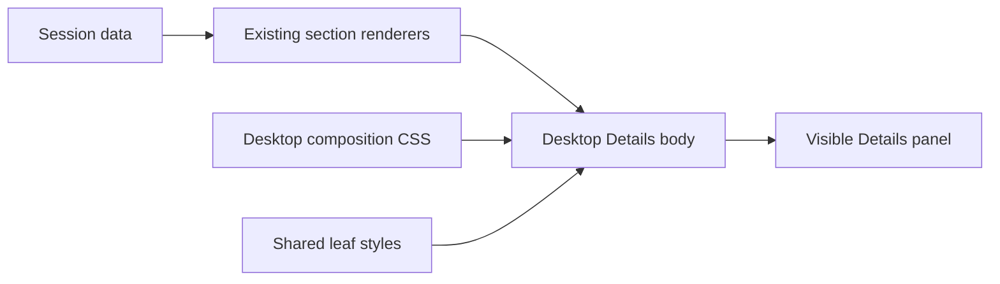

Codex review: needs maintainer review before merge.

## What this changes

This PR aligns desktop Details row heights, text, icons, headings, separators, and trailing controls.

**Example:** Viewing desktop Details in Chromium at 1440×1500.
- **Before:** Single-line rows range from 24 to 32 px, with text starting at different horizontal positions.
- **After:** Single-line rows use 30 px heights and share a panel-relative text axis at x=41.

## Review scores

| Measure | Result | What it means |
|---|---|---|
| **Overall readiness** | 🐚 platinum hermit **(4/6)** | The visual change is supported by direct screenshot proof and passing UI shards, with no actionable source finding; unresolved E2E attribution limits merge confidence. |
| **Proof confidence** | 🦞 diamond lobster **(5/6)** ✨ media proof bonus | Sufficient (screenshot): Inspected dark and light before-and-after browser screenshots of the real Details components using the session-design fixture in Chromium at 1440×1500; they demonstrate the changed alignment, typography, separators, and controls, and the subsequent commit leaves production CSS unchanged. |
| **Patch quality** | 🐚 platinum hermit **(4/6)** | No actionable review findings were identified. |

## Product

**Kind:** Preference · **Worth it:** Yes · **Fix scope:** Complete
**User problem:** Desktop Details sections have inconsistent row heights, text axes, typography, and control alignment.
**Reason:** The maintainer-authored direction supplies the owner decision, and the inspected screenshots show a coherent improvement within the existing desktop styling boundary.

## Merge readiness

✅ **Ready for maintainer review**

Keep this maintainer-authored PR open. The earlier geometry finding is fixed, the CSS-budget overage is explicitly accepted, and no introduced defect remains established; separate E2E failures still need attribution.

**Priority:** P3
**Reviewed head:** `ab194a11daeb59c7f1f1cc2c083718b5fabace15`

## Before merge

None.

## Findings

None.

<strong>Agent review details</strong>

### How this fits together

The desktop Details composition styles existing session section renderers, turning session data into People, Environment, pull request, process, output, progress, and automation rows.

### Technical review

Best possible solution:

Keep desktop composition CSS as the layout owner and retain the browser checks through its actual scroll container.

Do we have a high-confidence way to reproduce the issue?

Current-main CSS establishes the differing section metrics, and the supplied before screenshots show their visible effects; no local runtime reproduction was run.

Is this the best way to solve the issue?

Desktop-scoped CSS uses the existing presentation owner, and the test adjustment preserves useful behavioral checks without freezing the former visual dimensions.

AGENTS.md: found and applied where relevant.

Codex review notes: model internal, reasoning medium; reviewed against [2fe0a234f29b](https://github.com/openclaw/openclaw/commit/2fe0a234f29b8b0d42e9fa6a274720aaaba77745).

### Provenance checked

- `Desktop row metrics, heading geometry, and icon placement` changes intended behavior with a stated reason (33b16c7ef875e94b387f61a78fdb4942333e45ac: Organize compact, readable Details sections while retaining native renderers and accessible actions.)
- `Compact task-progress typography` changes intended behavior with a stated reason (ce1fd810bba5c767abcc5521130444286665011e: Keep saved progress available through a compact checklist with separate desktop and mobile presentation.)
- `Task marker and wrapped-description alignment` keeps the original intent (6160b254974cfaa1d1e5ddbad69c1961bd5b21b7: Align status markers with the first text line and connect steps without changing progress state or interactions.)
- `Branch-row readability and publication controls` keeps the original intent (01b890d9c6409c5c4f5886f054a25f738a67574b: Keep branch identity with Environment and place diff counts and publication actions below it while preserving the publication owner.)

### Testing

Proof path: shipped entry point.

### Security

None.

### Evidence

What I checked:

- **Introduced change and current main:** The pinned introduced diff contains desktop styling changes and a browser-test adjustment; fetched main retains the previous row metrics and typography. ([`ui/src/styles/chat/details-desktop.css:20`](https://github.com/openclaw/openclaw/blob/ab194a11daeb59c7f1f1cc2c083718b5fabace15/ui/src/styles/chat/details-desktop.css#L20), [ab194a11daeb](https://github.com/openclaw/openclaw/commit/ab194a11daeb59c7f1f1cc2c083718b5fabace15))
- **Earlier geometry finding resolved:** The test now mounts ChatDetailsDesktopBody with its actual content gutters, checks overflow at the scroll owner, and retains alignment, clipping, non-overlap, keyboard, publication, and dismissal assertions. All three current-head checks-ui shards passed. ([`ui/src/pages/chat/components/chat-pull-requests.browser.test.tsx:171`](https://github.com/openclaw/openclaw/blob/ab194a11daeb59c7f1f1cc2c083718b5fabace15/ui/src/pages/chat/components/chat-pull-requests.browser.test.tsx#L171), [ab194a11daeb](https://github.com/openclaw/openclaw/commit/ab194a11daeb59c7f1f1cc2c083718b5fabace15))
- **Accepted CSS-budget tradeoff:** The maintainer-authored PR body explicitly accepts the CSS-budget overage and waives no other PR-caused failing check. Current-head performance annotations report total CSS raw and gzip growth, matching that accepted tradeoff. ([`ui/src/styles/chat/details-desktop.css:551`](https://github.com/openclaw/openclaw/blob/ab194a11daeb59c7f1f1cc2c083718b5fabace15/ui/src/styles/chat/details-desktop.css#L551), [ab194a11daeb](https://github.com/openclaw/openclaw/commit/ab194a11daeb59c7f1f1cc2c083718b5fabace15))
- **Inspected visual proof:** Inspected the four prepared dark/light before-and-after screenshots linked in the PR body; they show the changed desktop alignment, progress typography, separators, and trailing glyph positions using the session-design browser fixture. ([ab194a11daeb](https://github.com/openclaw/openclaw/commit/ab194a11daeb59c7f1f1cc2c083718b5fabace15))
- **Feature history and preserved contracts:** Reviewed the compact Details direction in https://github.com/openclaw/openclaw/pull/176424, saved progress presentation in https://github.com/openclaw/openclaw/pull/176406, first-line marker alignment in https://github.com/openclaw/openclaw/pull/182716, and branch readability in https://github.com/openclaw/openclaw/pull/171995. Scoped history also followed the browser test's earlier .ts name. ([`ui/src/styles/chat/task-progress-details.css:271`](https://github.com/openclaw/openclaw/blob/2fe0a234f29b8b0d42e9fa6a274720aaaba77745/ui/src/styles/chat/task-progress-details.css#L271), [2fe0a234f29b](https://github.com/openclaw/openclaw/commit/2fe0a234f29b8b0d42e9fa6a274720aaaba77745))
- **Remaining CI attribution:** Current-head E2E annotations report a mobile sidebar menu width mismatch and an unexpected cloud placement badge: https://github.com/openclaw/openclaw/actions/runs/41227297186/job/124614317772 and https://github.com/openclaw/openclaw/actions/runs/41227297186/job/124614317764. Inspection does not establish either failure as diff-caused or inherited, so no author repair is assigned. Full job-log downloads were blocked by the network allowlist; annotations remained readable. ([`ui/src/e2e/sidebar-session-stability.e2e.test.ts:119`](https://github.com/openclaw/openclaw/blob/ab194a11daeb59c7f1f1cc2c083718b5fabace15/ui/src/e2e/sidebar-session-stability.e2e.test.ts#L119), [ab194a11daeb](https://github.com/openclaw/openclaw/commit/ab194a11daeb59c7f1f1cc2c083718b5fabace15))

Likely related people:

- **Vyctor H. Brzezowski:** Raw commit 33b16c7ef875e94b387f61a78fdb4942333e45ac adds ui/src/styles/chat/details-desktop.css:14 relative to its recorded parents. This identifies author metadata, not feature responsibility or a PR merger. (role: source-line author; confidence: high; commits: [33b16c7ef875](https://github.com/openclaw/openclaw/commit/33b16c7ef875e94b387f61a78fdb4942333e45ac); files: `ui/src/styles/chat/details-desktop.css`)

### PR surface

Source +101, Tests +1. Total +102 across 3 files. Added test files: 0.

View PR surface stats

| Area | Files | Added | Removed | Net |
|---|---:|---:|---:|---:|
| Source | 2 | 111 | 10 | +101 |
| Tests | 1 | 5 | 4 | +1 |
| Docs | 0 | 0 | 0 | 0 |
| Config | 0 | 0 | 0 | 0 |
| Generated | 0 | 0 | 0 | 0 |
| Other | 0 | 0 | 0 | 0 |
| **Total** | **3** | **116** | **14** | **+102** |

### Labels

Label changes:

- add `rating: 🐚 platinum hermit`: Overall readiness is 🐚 platinum hermit; proof is 🦞 diamond lobster and patch quality is 🐚 platinum hermit.
- add `status: 👀 ready for maintainer look`: ClawSweeper has no concrete contributor-facing blocker left for this PR.
- remove `rating: 🦪 silver shellfish`: Current PR rating is `rating: 🐚 platinum hermit`, so this older rating label is no longer current.
- remove `status: ⏳ waiting on author`: Current PR status label is `status: 👀 ready for maintainer look`.

Label justifications:

- `P3`: This is desktop visual consistency work without a demonstrated broken core workflow.
- `rating: 🐚 platinum hermit`: Overall readiness is 🐚 platinum hermit; proof is 🦞 diamond lobster and patch quality is 🐚 platinum hermit.
- `status: 👀 ready for maintainer look`: ClawSweeper has no concrete contributor-facing blocker left for this PR.
- `proof: sufficient`: Contributor real behavior proof is sufficient.
- `proof: 📸 screenshot`: Contributor real behavior proof includes screenshot evidence.

### Rating scale

6/6 🦀 challenger crab · 5/6 🦞 diamond lobster · 4/6 🐚 platinum hermit · 3/6 🦐 gold shrimp · 2/6 🦪 silver shellfish · 1/6 🧂 unranked krab. Overall follows the weaker of proof and patch quality; ✨ marks media proof (a screenshot, video, or linked artifact) that directly shows the changed behavior.

### Workflow

ClawSweeper edits this one comment on every review. Comment `@clawsweeper re-review` for a fresh review only. Repair and merge execution lanes are retired.

### History

Review history (1 earlier review cycle)

<!-- clawsweeper-review-history v=1 total=1 -->
- reviewed 2026-10-31T16:27:39.602Z sha 67fb48d3137bd9ba461f5bcc4c249fcd97bd53b1 :: needs changes before merge. :: [P2] Update the retained branch-row geometry expectation | [P2] Consolidate the CSS additions to satisfy the asset budget

_Reviewed October 31, 2026, 2:07 PM ET / 18:07 UTC (Revision 2)._

<!-- clawsweeper-verdict:needs-human item=189537 sha=ab194a11daeb59c7f1f1cc2c083718b5fabace15 confidence=high updated_at=2026-10-31T18:04:10Z reviewed_at=2026-10-31T18:07:59.535Z lease_owner=github-run-41227473028-1 lease_comment_id=6547150994 source_revision=61d5a6310aea75417bb6e31ee9145b4a84e105bb48457f4af9081bee503fc0f4 hold=not_opted_in findings=0 -->
<!-- clawsweeper-review-state:ready item=189537 sha=ab194a11daeb59c7f1f1cc2c083718b5fabace15 v=1 -->

<!-- clawsweeper-review-version item=189537 reviewed_at=2026-10-31T18:07:59.535Z sha=ab194a11daeb59c7f1f1cc2c083718b5fabace15 source_revision=61d5a6310aea75417bb6e31ee9145b4a84e105bb48457f4af9081bee503fc0f4 lease_owner=github-run-41227473028-1 lease_comment_id=6547150994 v=1 -->

<!-- clawsweeper-review item=189537 -->