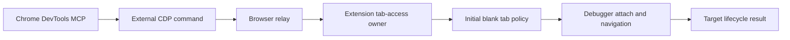

Codex review: needs maintainer review before merge. _Reviewed August 28, 2026, 9:02 PM ET / August 29, 2026, 01:02 UTC._

# ClawSweeper review

## What this changes

The PR restores Chrome DevTools MCP page creation through the browser extension relay by admitting only the operation’s initial blank tab until it navigates or is safely cleaned up.

## Regression provenance

Possible regression — probable (reproduction; reviewed change). No predecessor PR is attributed.

## Merge readiness

⚠️ **Ready for maintainer review - 3 items remain**

Keep open for maintainer handling. Current main still rejects the initial blank target created by blank-first CDP clients; this branch adds a scoped extension-owned creation, attachment, and cleanup flow, with no introduced blocking defect found.

**Priority:** P1
**Reviewed head:** `eb8f8d8e22c26d2ba500ac78577877bc2c665f1f`
**Owner decision:** Required. See [Decision needed](#decision-needed).

## Review scores

| Measure | Result | What it means |
|---|---|---|
| **Overall readiness** | 🐚 platinum hermit **(4/6)** | The repair is well-covered and structurally coherent, with a material browser-access boundary still requiring maintainer acceptance. |
| **Proof confidence** | 🌊 off-meta tidepool | Not applicable: The PR is member-authored; its body reports real Chrome/MCP after-fix evidence, while this read-only environment could not retrieve external artifacts. |
| **Patch quality** | 🐚 platinum hermit **(4/6)** | No actionable review findings were identified. |

## Verification

| Check | Result | Evidence |
|---|---|---|
| **Real behavior** | Not applicable | Not applicable: The PR is member-authored; its body reports real Chrome/MCP after-fix evidence, while this read-only environment could not retrieve external artifacts. |
| **Evidence reviewed** | 8 items | Current-main gap: Current main applies ordinary tab eligibility to the created blank tab, then separately attempts attachment; it has no operation-owned initial-blank provenance. Current-main creation sequence: Current main creates the target and subsequently calls the separate attachment path, which explains the blank-first failure described in the linked issue. Scoped repair owner: The branch records private creation provenance, permits only that record’s initial about:blank target, validates a pending destination independently, and limits rollback to the still-current tab identity. |
| **Findings** | None | None. |
| **Security** | None | None. |

## How this fits together

The browser extension relay translates external CDP commands into authenticated Chrome extension actions. Page creation starts with a blank tab, then requires debugger attachment, navigation, and eventual target cleanup.

## Decision needed

| Question | Recommendation |
|---|---|
| Should the signed-in-browser policy admit only a relay operation’s own initial about:blank tab until navigation or cleanup completes? | **Accept the bounded design:** Accept the operation-scoped exception because provenance, destination checks, lifecycle expiry, and guarded rollback constrain it to MCP creation. |

Why: The code and focused negative-path coverage support the narrow design, but accepting this browser-control boundary is a maintainer security decision rather than an automation repair task.

## Before merge

- [ ] **Resolve merge risk (P1)** - This changes which ephemeral initial document may reach Chrome debugger attachment in a signed-in profile; the exception is tightly scoped, but its access-boundary tradeoff needs explicit maintainer acceptance before merge.
- [ ] **Complete next step (P2)** - No repair work remains to automate; the remaining gate is maintainer acceptance of the browser access boundary.

<strong>Agent review details</strong>

### Security

None.

### PR surface

Source +446, Tests +885, Docs +13. Total +1344 across 19 files.

View PR surface stats

| Area | Files | Added | Removed | Net |
|---|---:|---:|---:|---:|
| Source | 12 | 610 | 164 | +446 |
| Tests | 6 | 888 | 3 | +885 |
| Docs | 1 | 13 | 0 | +13 |
| Config | 0 | 0 | 0 | 0 |
| Generated | 0 | 0 | 0 | 0 |
| Other | 0 | 0 | 0 | 0 |
| **Total** | **19** | **1511** | **167** | **+1344** |

### Review metrics

| Metric | Value | Why it matters |
|---|---|---|
| **Production versus test delta** | production +537/-155; tests/test support +961/-12; docs +13 | The bug repair adds a lifecycle owner and rollback boundary, making its substantial production growth relevant to merge review. |

### Merge-risk options

**Maintainer options:**
1. **Complete scoped boundary review (recommended)**  
   Confirm that operation-bound blank provenance and its negative-path coverage are acceptable before merging.
2. **Accept the bounded exception**  
   Merge with explicit maintainer acceptance that this transient initial-blank admission is the intended signed-in-browser policy.

### Technical review

Best possible solution:

Land the owner-boundary repair after the browser/security owner accepts the transient initial-blank exception and exact-head gates remain green.

Do we have a high-confidence way to reproduce the issue?

Yes. The linked issue supplies a concrete blank-first Chrome DevTools MCP flow, and the branch exercises create, navigate, inspect, detach, and close through the relay and extension policy.

Is this the best way to solve the issue?

Yes. Keeping provenance, grouping, attachment, and rollback in the extension tab-access owner avoids a global blank allowlist or client-specific workaround.

AGENTS.md: found and applied where relevant.

Codex review notes: model internal, reasoning high; reviewed against [52e43a4a4fee](https://github.com/openclaw/openclaw/commit/52e43a4a4feec44d4b14ac14eccce68095ef2b82).

### Labels

Label changes:

- add `rating: 🐚 platinum hermit`: Overall readiness is 🐚 platinum hermit; proof is 🌊 off-meta tidepool and patch quality is 🐚 platinum hermit.
- remove `rating: 🦐 gold shrimp`: Current PR rating is `rating: 🐚 platinum hermit`, so this older rating label is no longer current.

Label justifications:

- `P1`: The current behavior blocks browser automation clients from creating pages and leaves unusable grouped tabs behind.
- `merge-risk: 🚨 security-boundary`: The PR changes the narrowly eligible set of tabs that may reach Chrome debugger attachment in a signed-in browser.
- `rating: 🐚 platinum hermit`: Overall readiness is 🐚 platinum hermit; proof is 🌊 off-meta tidepool and patch quality is 🐚 platinum hermit.
- `status: 👀 ready for maintainer look`: ClawSweeper has no concrete contributor-facing blocker left for this PR. Not applicable: The PR is member-authored; its body reports real Chrome/MCP after-fix evidence, while this read-only environment could not retrieve external artifacts.

### Evidence

What I checked:

- **Current-main gap:** Current main applies ordinary tab eligibility to the created blank tab, then separately attempts attachment; it has no operation-owned initial-blank provenance. ([`extensions/browser/chrome-extension/modules/tab-access.js:45`](https://github.com/openclaw/openclaw/blob/52e43a4a4fee/extensions/browser/chrome-extension/modules/tab-access.js#L45), [52e43a4a4fee](https://github.com/openclaw/openclaw/commit/52e43a4a4fee))
- **Current-main creation sequence:** Current main creates the target and subsequently calls the separate attachment path, which explains the blank-first failure described in the linked issue. ([`extensions/browser/src/browser/extension-relay/relay-bridge.ts:949`](https://github.com/openclaw/openclaw/blob/52e43a4a4fee/extensions/browser/src/browser/extension-relay/relay-bridge.ts#L949), [52e43a4a4fee](https://github.com/openclaw/openclaw/commit/52e43a4a4fee))
- **Scoped repair owner:** The branch records private creation provenance, permits only that record’s initial about:blank target, validates a pending destination independently, and limits rollback to the still-current tab identity. ([`extensions/browser/chrome-extension/modules/tab-access.js:81`](https://github.com/openclaw/openclaw/blob/eb8f8d8e22c2/extensions/browser/chrome-extension/modules/tab-access.js#L81), [eb8f8d8e22c2](https://github.com/openclaw/openclaw/commit/eb8f8d8e22c2))
- **Lifecycle coverage:** The relay retains target identity after debugger detachment so the CDP client can close the created target, while connection loss clears retained identity. ([`extensions/browser/src/browser/extension-relay/relay-bridge.ts:966`](https://github.com/openclaw/openclaw/blob/eb8f8d8e22c2/extensions/browser/src/browser/extension-relay/relay-bridge.ts#L966), [eb8f8d8e22c2](https://github.com/openclaw/openclaw/commit/eb8f8d8e22c2))
- **Integration-shaped regression coverage:** The new test drives blank-first creation through relay and extension policy, then navigates, evaluates, detaches, and closes; adjacent cases fence restricted destinations and worker restart. ([`extensions/browser/chrome-extension/background.initial-target.test.ts:132`](https://github.com/openclaw/openclaw/blob/eb8f8d8e22c2/extensions/browser/chrome-extension/background.initial-target.test.ts#L132), [eb8f8d8e22c2](https://github.com/openclaw/openclaw/commit/eb8f8d8e22c2))
- **Documented contract:** The updated browser-extension documentation describes narrow initial-blank admission, lifecycle expiry, and conservative rollback consistently with the implementation. Public docs: [`docs/tools/chrome-extension.md`](https://docs.openclaw.ai/tools/chrome-extension). ([`docs/tools/chrome-extension.md:122`](https://docs.openclaw.ai/tools/chrome-extension), [eb8f8d8e22c2](https://github.com/openclaw/openclaw/commit/eb8f8d8e22c2))

Likely related people:

- **steipete:** Merged the external CDP and all-tabs access work that owns the affected browser relay and tab-access paths. (role: feature owner; confidence: high; commits: [d6801f23d4e5](https://github.com/openclaw/openclaw/commit/d6801f23d4e5f42793bd330495750f396a867ecd), [8362f74c995b](https://github.com/openclaw/openclaw/commit/8362f74c995b0cad040303394e70f54da78ef733); files: `extensions/browser/chrome-extension/modules/tab-access.js`, `extensions/browser/src/browser/extension-relay/relay-bridge.ts`)
- **Piyush Bag:** Recent continuity work in the browser relay area is attributable to commit 91888cf68bcac293a56b942074da0621546401f1. (role: recent area contributor; confidence: medium; commits: [91888cf68bca](https://github.com/openclaw/openclaw/commit/91888cf68bcac293a56b942074da0621546401f1); files: `extensions/browser/src/browser/extension-relay/relay-bridge.ts`)

### Rank-up moves

Optional improvements that raise the rating; they are not merge blockers.

- Obtain scoped browser/security-owner acceptance of the initial-blank access boundary.

### Rating scale

| Score | Internal tier | Crab rank | Meaning |
|---:|:---:|---|---|
| **6/6** | S | 🦀 challenger crab | Exceptional readiness |
| **5/6** | A | 🦞 diamond lobster | Very strong readiness |
| **4/6** | B | 🐚 platinum hermit | Good normal PR; ordinary maintainer review |
| **3/6** | C | 🦐 gold shrimp | Useful, but confidence is limited |
| **2/6** | D | 🦪 silver shellfish | Proof or implementation needs work |
| **1/6** | F | 🧂 unranked krab | Not merge-ready |
| N/A | NA | 🌊 off-meta tidepool | Rating does not apply |

Overall follows the weaker of proof and patch quality.
Shiny media proof means a screenshot, video, or linked artifact directly shows the changed behavior. Runtime, network, CSP, and security claims still need visible diagnostics.

### Workflow

- ClawSweeper keeps one durable marker-backed review comment per issue or PR.
- Re-runs edit this comment so the latest verdict, findings, and automation markers stay together instead of adding duplicate bot comments.
- A fresh review can be triggered by eligible `@clawsweeper re-review` comments, exact-item GitHub events, scheduled/background review runs, or manual workflow dispatch.
- PR/issue authors and users with repository write access can comment `@clawsweeper re-review` or `@clawsweeper re-run` on an open PR or issue to request a fresh review only.
- Maintainers can also comment `@clawsweeper review` to request a fresh review only.
- Fresh-review commands do not start repair, autofix, rebase, CI repair, or automerge.
- Maintainer-only repair and merge flows require explicit commands such as `@clawsweeper autofix`, `@clawsweeper automerge`, `@clawsweeper fix ci`, or `@clawsweeper address review`.
- Maintainers can comment `@clawsweeper explain` to ask for more context, or `@clawsweeper stop` to stop active automation.

### History

Review history (1 earlier review cycle)

<!-- clawsweeper-review-history v=1 total=1 -->
- reviewed 2026-08-29T00:31:47.236Z sha eb8f8d8e22c26d2ba500ac78577877bc2c665f1f :: needs maintainer review before merge. :: none

<!-- clawsweeper-verdict:needs-human item=132232 sha=eb8f8d8e22c26d2ba500ac78577877bc2c665f1f confidence=high updated_at=2026-08-29T00:57:21Z reviewed_at=2026-08-29T01:02:44.528Z lease_owner=github-run-33224908523-1 lease_comment_id=5459327381 source_revision=89ba1a10b2826242255ca764406bbb5ca29d3baeac9da54c92c5bcf529fd1ee1 live_verification=absent -->

<!-- clawsweeper-review-version item=132232 reviewed_at=2026-08-29T01:02:44.528Z sha=eb8f8d8e22c26d2ba500ac78577877bc2c665f1f source_revision=89ba1a10b2826242255ca764406bbb5ca29d3baeac9da54c92c5bcf529fd1ee1 lease_owner=github-run-33224908523-1 lease_comment_id=5459327381 v=1 -->

<!-- clawsweeper-review item=132232 -->