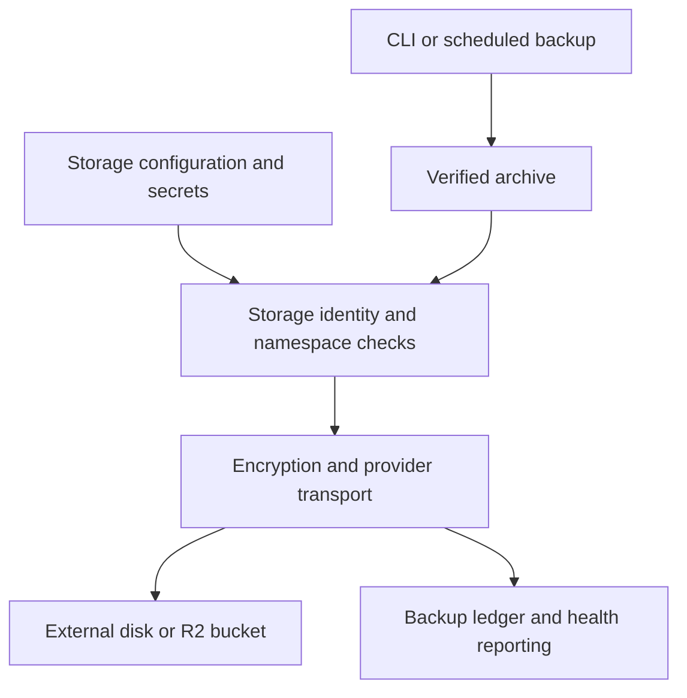

Codex review: blocked before merge. _Reviewed October 1, 2026, 4:27 AM ET / 08:27 UTC (Revision 13)._

# ClawSweeper review

## What this changes

Adds named external-disk and Cloudflare R2 destinations for encrypted backups, scheduling, retention, recovery, and backup health reporting.

## Merge readiness

⛔ **Blocked before merge - 1 item remains**

This PR remains useful: current main lacks managed storage-location backups. The prior conflict blocker is resolved, the namespace and upgrade proof remains applicable, and this review found no actionable correctness blocker.

**Priority:** P2
**Reviewed head:** `32cb03228a7f3408d817b6e2eeb35bbfcbe26849`

## Review scores

| Measure | Result | What it means |
|---|---|---|
| **Overall readiness** | 🐚 platinum hermit **(4/6)** | A useful, coherent implementation with strong real behavior and upgrade evidence and no remaining actionable finding. |
| **Proof confidence** | 🦞 diamond lobster **(5/6)** | Sufficient (live_output): Real macOS disk and R2 runs exercise the CLI, Gateway schedule, encrypted upload, verification, restore, and disconnected-disk refusal. The live takeover trace shows displaced-owner rejection before multipart publication and cleanup, with matching production source retained at this head. Published-driver proof preserves existing schedule arguments and ledger bytes; the schedule builder, codec, and survivor helper remain unchanged. |
| **Patch quality** | 🐚 platinum hermit **(4/6)** | No actionable review findings were identified. |

## Verification

| Check | Result | Evidence |
|---|---|---|
| **Real behavior** | Verified | Sufficient (live_output): Real macOS disk and R2 runs exercise the CLI, Gateway schedule, encrypted upload, verification, restore, and disconnected-disk refusal. The live takeover trace shows displaced-owner rejection before multipart publication and cleanup, with matching production source retained at this head. Published-driver proof preserves existing schedule arguments and ledger bytes; the schedule builder, codec, and survivor helper remain unchanged. |
| **Evidence reviewed** | 10 items | Pinned introduction and conflict resolution: Reviewed the introduced delta from the pinned base to the exact head. The current manifest contract list retains main's canonical owner and includes storageProviders; PluginManifestContracts derives from that list. Live GitHub reads confirm the same head is mergeable. The supplied stale test merge was not used to infer merged behavior. Still necessary on current main: The fetched main revision's backup command still creates local archives without the offsite dispatch, and its source tree has no src/storage directory. No merged replacement was established; the supplied latest-release context does not establish this capability as shipped. Namespace authority reaches publication and deletion: Backup creation passes namespace assertions into storage mutation preconditions. Storage rechecks after consuming the archive producer and immediately before provider deletion. The CLI regressions exercise takeover through encrypted filesystem publication and retention; the R2 regression checks abort rather than multipart completion. |
| **Findings** | None | None. |
| **Security** | None | None. |

## How this fits together

The backup subsystem captures OpenClaw state and workspaces into verified archives. The new storage owner encrypts and transfers those archives through filesystem or plugin providers, while the existing backup ledger feeds CLI, Doctor, and Systems reporting.

## Before merge

- [ ] **Review config compatibility** - Confirm compatibility and upgrade impact for the changed config or default surface before merge.

<strong>Agent review details</strong>

### Security

None.

### PR surface

PR surface statistics unavailable: the file list is incomplete.

### Review metrics

| Metric | Value | Why it matters |
|---|---|---|
| **Public surface** | 1 optional config root; 3 operator-read RPCs; 4 SDK types | The new surface is documented, opt-in, and separates generic storage ownership from provider transport. |
| **Production versus test growth** | Production +3,873 lines; tests +3,745 lines | Net TypeScript/JavaScript growth under src, extensions, ui/src, packages, and test supports the stated storage, backup, and health capabilities; scripts and generated native models are excluded. |

### Stored data model

Persistent data-model change detected: `durable storage schema: packages/gateway-protocol/src/schema/storage.ts`, `durable storage schema: src/plugins/storage-provider-manifest.ts`, `durable storage schema: src/plugins/storage-provider-registry.ts`, `durable storage schema: src/storage/encryption.ts`, `durable storage schema: src/storage/filesystem.ts`, `durable storage schema: src/storage/keys.ts`, and 13 more. Migration or upgrade compatibility proof is recorded; maintainers should verify it before merge.

### Technical review

Best possible solution:

Keep one generic storage owner for encryption and identity, plugin-owned transports, and the existing backup capture and ledger owners.

Do we have a high-confidence way to reproduce the issue?

Not applicable to the feature proposal; real disk and R2 execution evidence exercises the added behavior and the previously reported namespace defects.

Is this the best way to solve the issue?

Yes: the reviewed design reuses archive capture and ledger owners, keeps vendor transport in a plugin, and supplies compatibility and final-effect proof.

AGENTS.md: found and applied where relevant.

Codex review notes: model internal, reasoning medium; reviewed against [92457bebe2e1](https://github.com/openclaw/openclaw/commit/92457bebe2e1daac2b7880facdb84d3d0ae1a7a8).

### Labels

Label changes:

- remove `merge-risk: 🚨 compatibility`: Current PR review selected no merge-risk labels.
- remove `merge-risk: 🚨 security-boundary`: Current PR review selected no merge-risk labels.

Label justifications:

- `P2`: This is an opt-in operator backup improvement without evidence of an urgent existing-user regression.
- `rating: 🐚 platinum hermit`: Overall readiness is 🐚 platinum hermit; proof is 🦞 diamond lobster and patch quality is 🐚 platinum hermit.
- `status: 👀 ready for maintainer look`: ClawSweeper has no concrete contributor-facing blocker left for this PR. Sufficient (live_output): Real macOS disk and R2 runs exercise the CLI, Gateway schedule, encrypted upload, verification, restore, and disconnected-disk refusal. The live takeover trace shows displaced-owner rejection before multipart publication and cleanup, with matching production source retained at this head. Published-driver proof preserves existing schedule arguments and ledger bytes; the schedule builder, codec, and survivor helper remain unchanged.
- `proof: sufficient`: Contributor real behavior proof is sufficient. Real macOS disk and R2 runs exercise the CLI, Gateway schedule, encrypted upload, verification, restore, and disconnected-disk refusal. The live takeover trace shows displaced-owner rejection before multipart publication and cleanup, with matching production source retained at this head. Published-driver proof preserves existing schedule arguments and ledger bytes; the schedule builder, codec, and survivor helper remain unchanged.

### Evidence

What I checked:

- **Pinned introduction and conflict resolution:** Reviewed the introduced delta from the pinned base to the exact head. The current manifest contract list retains main's canonical owner and includes storageProviders; PluginManifestContracts derives from that list. Live GitHub reads confirm the same head is mergeable. The supplied stale test merge was not used to infer merged behavior. ([`src/plugins/manifest-contract-keys.ts:25`](https://github.com/openclaw/openclaw/blob/32cb03228a7f3408d817b6e2eeb35bbfcbe26849/src/plugins/manifest-contract-keys.ts#L25), [32cb03228a7f](https://github.com/openclaw/openclaw/commit/32cb03228a7f3408d817b6e2eeb35bbfcbe26849))
- **Still necessary on current main:** The fetched main revision's backup command still creates local archives without the offsite dispatch, and its source tree has no src/storage directory. No merged replacement was established; the supplied latest-release context does not establish this capability as shipped. ([`src/commands/backup.ts:17`](https://github.com/openclaw/openclaw/blob/92457bebe2e1daac2b7880facdb84d3d0ae1a7a8/src/commands/backup.ts#L17), [92457bebe2e1](https://github.com/openclaw/openclaw/commit/92457bebe2e1daac2b7880facdb84d3d0ae1a7a8))
- **Namespace authority reaches publication and deletion:** Backup creation passes namespace assertions into storage mutation preconditions. Storage rechecks after consuming the archive producer and immediately before provider deletion. The CLI regressions exercise takeover through encrypted filesystem publication and retention; the R2 regression checks abort rather than multipart completion. ([`src/commands/backup-remote.ts:104`](https://github.com/openclaw/openclaw/blob/32cb03228a7f3408d817b6e2eeb35bbfcbe26849/src/commands/backup-remote.ts#L104), [32cb03228a7f](https://github.com/openclaw/openclaw/commit/32cb03228a7f3408d817b6e2eeb35bbfcbe26849))
- **Real runtime proof and preserved coverage:** The captured PR body records real macOS filesystem and R2 backup, verify, restore, disconnected-disk refusal, and scheduled Gateway execution. Its live R2 takeover trace records rejection of the displaced installation, publication by the replacement, and zero incomplete multipart uploads. GitHub source reads verified that locations.ts, backup-remote.ts, backup-namespace.ts, s3-backend.ts, and backup-command.ts are byte-identical between the live-tested d16947af2945cfc1a1d64b8918f7df34017ae27b head and the reviewed head. ([`src/storage/locations.ts:274`](https://github.com/openclaw/openclaw/blob/32cb03228a7f3408d817b6e2eeb35bbfcbe26849/src/storage/locations.ts#L274), [32cb03228a7f](https://github.com/openclaw/openclaw/commit/32cb03228a7f3408d817b6e2eeb35bbfcbe26849))
- **Existing-state upgrade compatibility:** The published openclaw@2026.9.7 driver installed the candidate and preserved the original Git schedule ID, declaration key, argv, ledger fields, and raw manifest bytes. Storage remained unconfigured and Cloudflare unloaded. Source reads verified that the schedule builder, ledger codec, and backup-schedule survivor helper remain byte-identical to the successfully exercised 0ad893e9ba74ca28ba46cd9aba194dd81cd2f22e revision. The additive codec requires no SQL schema migration. ([`src/state/backup-run-records.contract.ts:76`](https://github.com/openclaw/openclaw/blob/32cb03228a7f3408d817b6e2eeb35bbfcbe26849/src/state/backup-run-records.contract.ts#L76), [32cb03228a7f](https://github.com/openclaw/openclaw/commit/32cb03228a7f3408d817b6e2eeb35bbfcbe26849))
- **Documented takeover boundary:** The maintainer-authored design and backup guides restrict deliberate namespace takeover to stopped or retired installations and disclose the residual provider round-trip window. Concurrent installations should use separate namespaces; the reviewed change preserves these semantics. Public docs: [`docs/cli/backup.md`](https://docs.openclaw.ai/cli/backup). ([`docs/cli/backup.md:133`](https://docs.openclaw.ai/cli/backup), [32cb03228a7f](https://github.com/openclaw/openclaw/commit/32cb03228a7f3408d817b6e2eeb35bbfcbe26849))

Likely related people:

- **steipete:** Suggested for follow-up; no historical authorship or introduction is verified. (role: unverified routing candidate; confidence: low)
- **obviyus:** Suggested for follow-up; no historical authorship or introduction is verified. (role: unverified routing candidate; confidence: low)

### Rating scale

| Score | Internal tier | Crab rank | Meaning |
|---:|:---:|---|---|
| **6/6** | S | 🦀 challenger crab | Exceptional readiness |
| **5/6** | A | 🦞 diamond lobster | Very strong readiness |
| **4/6** | B | 🐚 platinum hermit | Good normal PR; ordinary maintainer review |
| **3/6** | C | 🦐 gold shrimp | Useful, but confidence is limited |
| **2/6** | D | 🦪 silver shellfish | Proof or implementation needs work |
| **1/6** | F | 🧂 unranked krab | Not merge-ready |
| N/A | NA | 🌊 off-meta tidepool | Rating does not apply |

Overall follows the weaker of proof and patch quality.
Shiny media proof means a screenshot, video, or linked artifact directly shows the changed behavior. Runtime, network, CSP, and security claims still need visible diagnostics.

### Workflow

- ClawSweeper keeps one durable marker-backed review comment per issue or PR.
- Re-runs edit this comment so the latest verdict, findings, and automation markers stay together instead of adding duplicate bot comments.
- A fresh review can be triggered by eligible `@clawsweeper re-review` comments, exact-item GitHub events, scheduled/background review runs, or manual workflow dispatch.
- PR/issue authors and users with repository write access can comment `@clawsweeper re-review` or `@clawsweeper re-run` on an open PR or issue to request a fresh review only.
- Maintainers can also comment `@clawsweeper review` to request a fresh review only.
- Fresh-review commands do not start repair, autofix, rebase, CI repair, or automerge.
- Maintainer-only repair and merge flows require explicit commands such as `@clawsweeper autofix`, `@clawsweeper automerge`, `@clawsweeper fix ci`, or `@clawsweeper address review`.
- Maintainers can comment `@clawsweeper explain` to ask for more context, or `@clawsweeper stop` to stop active automation.

### History

Review history (12 earlier review cycles; latest 8 shown)

<!-- clawsweeper-review-history v=1 total=12 -->
- reviewed 2026-09-30T19:09:32.034Z sha 0ad893e9ba74ca28ba46cd9aba194dd81cd2f22e :: needs real behavior proof before merge. :: [P1] Fence retention deletes against namespace takeover
- reviewed 2026-09-30T20:38:30.394Z sha c2dd36537eef310e0ca538b65881607818bfc999 :: needs real behavior proof before merge. :: [P1] Fence backup writes and deletes against namespace takeover
- reviewed 2026-10-01T00:22:46.794Z sha a96283e2ec6bfb4c4812d617294d83cfbe232049 :: needs real behavior proof before merge. :: [P1] Fence backup writes and deletes after namespace takeover
- reviewed 2026-10-01T01:17:59.024Z sha a96283e2ec6bfb4c4812d617294d83cfbe232049 :: needs real behavior proof before merge. :: [P1] Fence publication and pruning after namespace takeover
- reviewed 2026-10-01T02:40:24.545Z sha 37d80ff29be4ca852a1ea8dbf7354cc42adf2ea9 :: needs real behavior proof before merge. :: [P1] Fence publication and pruning after namespace takeover
- reviewed 2026-10-01T04:33:01.707Z sha d16947af2945cfc1a1d64b8918f7df34017ae27b :: blocked before merge. :: none
- reviewed 2026-10-01T05:54:16.840Z sha d16947af2945cfc1a1d64b8918f7df34017ae27b :: blocked before merge. :: none
- reviewed 2026-10-01T08:06:17.668Z sha e589b16e50208c22b4233325969dabe9ba1ec816 :: blocked before merge. :: none

<!-- clawsweeper-verdict:needs-human item=161913 sha=32cb03228a7f3408d817b6e2eeb35bbfcbe26849 confidence=high updated_at=2026-10-01T08:22:48Z reviewed_at=2026-10-01T08:27:34.821Z lease_owner=github-run-36835714969-1 lease_comment_id=5927614933 source_revision=44884f99ababd007055bdd1adb56dc25f52828f3935b7548b4e8ed17de1be822 live_verification=absent -->
<!-- clawsweeper-review-state:blocked item=161913 sha=32cb03228a7f3408d817b6e2eeb35bbfcbe26849 v=1 -->

<!-- clawsweeper-review-version item=161913 reviewed_at=2026-10-01T08:27:34.821Z sha=32cb03228a7f3408d817b6e2eeb35bbfcbe26849 source_revision=44884f99ababd007055bdd1adb56dc25f52828f3935b7548b4e8ed17de1be822 lease_owner=github-run-36835714969-1 lease_comment_id=5927614933 v=1 -->

<!-- clawsweeper-review item=161913 -->