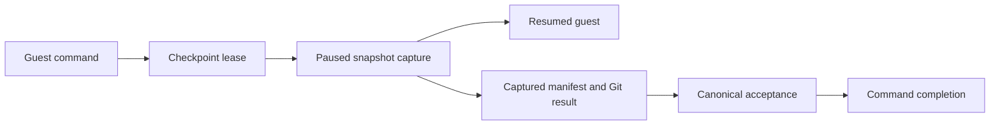

Codex review: needs maintainer review before merge.

## What this changes

This PR resumes eligible btrfs sandboxes after snapshot capture while canonical synchronization continues.

**Example:** A command edits a provisioned btrfs workspace containing 62,000 files.
- **Before:** Reported median guest pause was 1,619.63 ms.
- **After:** Reported median pause is 194.23 ms, while median command completion increases from 2,374.14 to 3,038.07 ms.

## Review scores

| Measure | Result | What it means |
|---|---|---|
| **Overall readiness** | 🦐 gold shrimp **(3/6)** | Useful, coherent implementation with the prior blocker repaired and meaningful native measurements; the declared native fallback validation remains incomplete. |
| **Proof confidence** | 🦐 gold shrimp **(3/6)** | Real behavior proof is not required for maintainer- or bot-authored pull requests. |
| **Patch quality** | 🐚 platinum hermit **(4/6)** | No actionable review findings were identified. |

## Product

**Kind:** Performance · **Worth it:** Yes · **Fix scope:** Complete
**User problem:** Background guest processes freeze for seconds while changed workspaces are scanned and synchronized.
**Reason:** Native measurements show a substantial freeze reduction, and the maintainer-authored proposal records the accompanying command-latency and CPU increase.

## Merge readiness

✅ **Ready for maintainer review**

Keep open: this maintainer-authored PR addresses a concrete sandbox freeze, and the previous import-cycle finding is fixed; no new actionable code defect was found.

**Priority:** P2
**Reviewed head:** `32b8f86f7fc49989f7ae6ab5c1346831b82b5be6`

## Before merge

None.

## Findings

None.

### Tests

- Missing end-to-end proof: Complete the declared native btrfs nested-subvolume checkpoint run, showing preserved canonical contents, resumed guest execution, and capture cleanup.

<strong>Agent review details</strong>

### How this fits together

Sandbox command finalization exports private workspace changes through the leased checkpoint owner into the canonical managed worktree.

### Technical review

Best possible solution:

Keep capture and canonical acceptance under the existing checkpoint lease, using atomic snapshots where complete and durable Git capture elsewhere.

Do we have a high-confidence way to reproduce the issue?

Current-main source keeps changed-workspace scanning inside quiescence, and the submitted native parent comparison records the resulting guest pauses; no target code was executed during this review.

Is this the best way to solve the issue?

The change reuses existing snapshot, lease, staging, and acceptance owners; its fallback and cleanup serve the same invariant without adding another state owner.

AGENTS.md: found and applied where relevant.

Codex review notes: model internal, reasoning medium; reviewed against [d290127ec675](https://github.com/openclaw/openclaw/commit/d290127ec6750ac3b3504d44ab50b7cee5f92ec7).

### Provenance checked

- `Checkpoint pause and publication ordering` changes intended behavior with a stated reason (https://github.com/openclaw/openclaw/pull/152641: Private managed projections preserve accepted guest edits through fenced reconciliation.)
- `Unchanged-command admission` keeps the original intent (https://github.com/openclaw/openclaw/pull/195120: Avoid pauses for unchanged commands while keeping per-command canonical publication and recovery custody.)
- `Persisted checkpoint manifests and fingerprints` keeps the original intent (https://github.com/openclaw/openclaw/pull/184581: Reuse content-addressed manifests and per-projection fingerprint blobs without changing existing manifest identities.)
- `Native filesystem subprocess ownership` keeps the original intent (https://github.com/openclaw/openclaw/pull/146906: Use native cloning through supervised subprocesses with live input admission and settled cleanup.)

### Testing

Proof path: in-process harness.

### Security

None.

### Evidence

What I checked:

- **Current main retains the freeze:** Current main scans and settles changed checkpoints inside projection quiescence; it has no atomic capture callback. ([`src/gateway/worker-environments/local-workspace-checkpoint.ts:103`](https://github.com/openclaw/openclaw/blob/d290127ec6750ac3b3504d44ab50b7cee5f92ec7/src/gateway/worker-environments/local-workspace-checkpoint.ts#L103), [d290127ec675](https://github.com/openclaw/openclaw/commit/d290127ec6750ac3b3504d44ab50b7cee5f92ec7))
- **Snapshot lifecycle and complete fallback:** Capture is restricted to btrfs subvolume roots; incomplete snapshots re-pause and use the existing live-tree capture under the same lease. ([`src/gateway/worker-environments/local-workspace-checkpoint.ts:48`](https://github.com/openclaw/openclaw/blob/32b8f86f7fc49989f7ae6ab5c1346831b82b5be6/src/gateway/worker-environments/local-workspace-checkpoint.ts#L48), [32b8f86f7fc4](https://github.com/openclaw/openclaw/commit/32b8f86f7fc49989f7ae6ab5c1346831b82b5be6))
- **Canonical consistency remains awaited:** The ordinary path resumes after durable Git staging, and finalization still awaits canonical reconciliation and acceptance. ([`src/gateway/worker-environments/local-workspace-state.ts:355`](https://github.com/openclaw/openclaw/blob/32b8f86f7fc49989f7ae6ab5c1346831b82b5be6/src/gateway/worker-environments/local-workspace-state.ts#L355), [32b8f86f7fc4](https://github.com/openclaw/openclaw/commit/32b8f86f7fc49989f7ae6ab5c1346831b82b5be6))
- **Previous finding resolved:** The final commit moves LocalWorkspaceCapture into the existing leaf types module and updates all five consumers directly, without a checkpoint re-export. ([`src/gateway/worker-environments/local-workspace-types.ts:6`](https://github.com/openclaw/openclaw/blob/32b8f86f7fc49989f7ae6ab5c1346831b82b5be6/src/gateway/worker-environments/local-workspace-types.ts#L6), [32b8f86f7fc4](https://github.com/openclaw/openclaw/commit/32b8f86f7fc49989f7ae6ab5c1346831b82b5be6))
- **Native results and recorded tradeoff:** The maintainer-authored body reports five counterbalanced native Podman/btrfs pairs, successful canonical and subsequent guest reads, 88% lower median pause, and 28% higher median command latency and CPU; it explicitly leaves native nested-subvolume fallback proof in progress. ([32b8f86f7fc4](https://github.com/openclaw/openclaw/commit/32b8f86f7fc49989f7ae6ab5c1346831b82b5be6))
- **Proof exercises the real owner and transport:** The committed benchmark binds production checkpoint finalization, runs real Podman commands, and checks canonical bytes and subsequent guest reads; it does not run a model or full Gateway. ([`scripts/perf/local-workspace-checkpoint-measure.ts:1219`](https://github.com/openclaw/openclaw/blob/32b8f86f7fc49989f7ae6ab5c1346831b82b5be6/scripts/perf/local-workspace-checkpoint-measure.ts#L1219), [32b8f86f7fc4](https://github.com/openclaw/openclaw/commit/32b8f86f7fc49989f7ae6ab5c1346831b82b5be6))

Likely related people:

- **Shakker:** Raw commit 4c3fd8a08b56e644d226fea787a31a23c780f131 adds src/agents/sandbox/local-workspace-quiescence.ts:344 relative to its recorded parents. This identifies author metadata, not feature responsibility or a PR merger. (role: source-line author; confidence: medium; commits: [4c3fd8a08b56](https://github.com/openclaw/openclaw/commit/4c3fd8a08b56e644d226fea787a31a23c780f131); files: `src/agents/sandbox/local-workspace-quiescence.ts`)
- **RoboClaw:** Raw commit 28d8ee4f096b5d4cd99489e12d7a495a97750599 adds src/agents/sandbox/local-workspace-quiescence.ts:203 relative to its recorded parents. This identifies author metadata, not feature responsibility or a PR merger. (role: source-line author; confidence: medium; commits: [28d8ee4f096b](https://github.com/openclaw/openclaw/commit/28d8ee4f096b5d4cd99489e12d7a495a97750599); files: `src/agents/sandbox/local-workspace-quiescence.ts`)

### PR surface

Source +199, Tests +245, Docs +197, Other +259. Total +900 across 20 files. Added test files: 1.

View PR surface stats

| Area | Files | Added | Removed | Net |
|---|---:|---:|---:|---:|
| Source | 10 | 341 | 142 | +199 |
| Tests | 6 | 356 | 111 | +245 |
| Docs | 2 | 201 | 4 | +197 |
| Config | 0 | 0 | 0 | 0 |
| Generated | 0 | 0 | 0 | 0 |
| Other | 2 | 304 | 45 | +259 |
| **Total** | **20** | **1202** | **302** | **+900** |

### Preflight source

Source unknown. Source comparison at the observed PR snapshot only. Completion is self-reported; body, policy, tests, execution, and report bytes are not verified.

### Review metrics

| Metric | Value | Why it matters |
|---|---|---|
| **Production versus regression-test growth** | Production +199 lines; tests +245 lines | Growth covers snapshot lifecycle, complete fallback, fingerprint identity, recovery ordering, and private-artifact permissions while retaining one operation owner. |

### Labels

Label changes:

- add `P2`: Reduces disruptive freezes for changed commands in eligible local btrfs sandboxes, with a measured and disclosed completion-cost tradeoff.
- add `rating: 🦐 gold shrimp`: Overall readiness is 🦐 gold shrimp; proof is 🦐 gold shrimp and patch quality is 🐚 platinum hermit.
- add `status: 👀 ready for maintainer look`: ClawSweeper has no concrete contributor-facing blocker left for this PR.

Label justifications:

- `P2`: Reduces disruptive freezes for changed commands in eligible local btrfs sandboxes, with a measured and disclosed completion-cost tradeoff.
- `rating: 🦐 gold shrimp`: Overall readiness is 🦐 gold shrimp; proof is 🦐 gold shrimp and patch quality is 🐚 platinum hermit.
- `status: 👀 ready for maintainer look`: ClawSweeper has no concrete contributor-facing blocker left for this PR.

### Rating scale

6/6 🦀 challenger crab · 5/6 🦞 diamond lobster · 4/6 🐚 platinum hermit · 3/6 🦐 gold shrimp · 2/6 🦪 silver shellfish · 1/6 🧂 unranked krab. Overall follows the weaker of proof and patch quality; ✨ marks media proof (a screenshot, video, or linked artifact) that directly shows the changed behavior.

### Workflow

ClawSweeper edits this one comment on every review. Comment `@clawsweeper re-review` for a fresh review only. Repair and merge execution lanes are retired.

### History

Review history (2 earlier review cycles)

<!-- clawsweeper-review-history v=1 total=2 -->
- reviewed 2026-11-10T12:33:28.914Z sha 27056207350f971db12612001f6ddf25c7bd8fba :: needs maintainer review before merge. :: none
- reviewed 2026-11-10T14:09:18.126Z sha 64147937916763407221bef031a138af43dd40a8 :: needs changes before merge. :: [P2] Move the capture type into a leaf contract to break import cycles

_Reviewed November 10, 2026, 9:26 AM ET / 14:26 UTC (Revision 3)._

<!-- clawsweeper-verdict:needs-human item=196662 sha=32b8f86f7fc49989f7ae6ab5c1346831b82b5be6 confidence=high updated_at=2026-11-10T14:21:47Z reviewed_at=2026-11-10T14:26:45.891Z lease_owner=github-run-42833136138-1 lease_comment_id=6769673925 source_revision=81b62c3c1545fbb6ce7e9fb1cc9fd45fa85a594f1f69fb6f7fac4d3b48262dae hold=not_opted_in findings=0 -->
<!-- clawsweeper-review-state:ready item=196662 sha=32b8f86f7fc49989f7ae6ab5c1346831b82b5be6 v=1 -->

<!-- clawsweeper-review-version item=196662 reviewed_at=2026-11-10T14:26:45.891Z sha=32b8f86f7fc49989f7ae6ab5c1346831b82b5be6 source_revision=81b62c3c1545fbb6ce7e9fb1cc9fd45fa85a594f1f69fb6f7fac4d3b48262dae lease_owner=github-run-42833136138-1 lease_comment_id=6769673925 v=1 -->

<!-- clawsweeper-review item=196662 -->