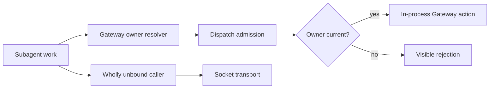

Codex review: needs maintainer review before merge. _Reviewed August 28, 2026, 9:03 PM ET / August 29, 2026, 01:03 UTC._

# ClawSweeper review

## What this changes

The branch retains Gateway-instance resolver ownership through subagent settlement, native spawning, and in-process dispatch so closed or mismatched owners reject rather than use ambient routing or a socket.

## Regression provenance

Possible regression — suspected (reviewed change). No predecessor PR is attributed.

## Merge readiness

⚠️ **Ready for maintainer review - 2 items remain**

Keep open. Current main still treats a resolver that returns no context as absent, allowing the native spawn path to select socket transport; this branch preserves the rejecting owner binding and adds focused fences for delayed dispatch and session commits. No introduced correctness or security defect was found; exact-head CI was still in progress in the captured state.

**Priority:** P1
**Reviewed head:** `5445fcf81564b0f38cee30f199eb93becbddaae8`

## Review scores

| Measure | Result | What it means |
|---|---|---|
| **Overall readiness** | 🐚 platinum hermit **(4/6)** | The patch is a focused, net-neutral owner-boundary repair with relevant regression coverage and no identified defect. |
| **Proof confidence** | 🌊 off-meta tidepool | Not applicable: This maintainer-owned PR is exempt from the external-contributor proof gate; its focused boundary tests directly cover rejection before socket dispatch and before a delayed session commit. |
| **Patch quality** | 🐚 platinum hermit **(4/6)** | No actionable review findings were identified. |

## Verification

| Check | Result | Evidence |
|---|---|---|
| **Real behavior** | Not applicable | Not applicable: This maintainer-owned PR is exempt from the external-contributor proof gate; its focused boundary tests directly cover rejection before socket dispatch and before a delayed session commit. |
| **Evidence reviewed** | 8 items | Current-main defect: Current main invokes the resolver to decide whether in-process dispatch exists; a retained resolver that now returns undefined is therefore treated as no binding and can reach the out-of-process route. Native transport repair: The PR selects in-process dispatch whenever a resolver is present, then supplies that resolver to the dispatcher; a closed resolver now rejects before the socket fallback. Batch ownership repair: Mismatched or partly unbound settlement entries now retain a rejecting resolver, while empty and wholly unbound batches remain unbound. |
| **Findings** | None | None. |
| **Security** | None | None. |

## How this fits together

Subagent work is admitted by a Gateway instance and later dispatched either directly in-process or through a standalone socket. The resolver binds retained work to that instance, and delayed work must reject when that owner is no longer current.

## Before merge

- [ ] **Resolve merge risk (P1)** - The captured exact-head CI gate was still in progress, so merge readiness is not established by this review.
- [ ] **Complete next step (P2)** - No mechanical repair is indicated; retain the protected maintainer-owned PR for exact-head CI completion and maintainer acceptance.

<strong>Agent review details</strong>

### Security

None.

### PR surface

Source 0, Tests +121. Total +121 across 7 files.

View PR surface stats

| Area | Files | Added | Removed | Net |
|---|---:|---:|---:|---:|
| Source | 4 | 37 | 37 | 0 |
| Tests | 3 | 197 | 76 | +121 |
| Docs | 0 | 0 | 0 | 0 |
| Config | 0 | 0 | 0 | 0 |
| Generated | 0 | 0 | 0 | 0 |
| Other | 0 | 0 | 0 | 0 |
| **Total** | **7** | **234** | **113** | **+121** |

### Review metrics

| Metric | Value | Why it matters |
|---|---|---|
| **Production versus test delta** | production +37/-37 (net 0); tests +197/-76 (net +121) | Production consolidates existing checks into a single owner assertion while regression coverage expands across resolver sources and delayed commits. |

### Merge-risk options

**Maintainer options:**
1. **Decide the mitigation before merge**  
   Land the canonical resolver-presence distinction with its admission-time revalidation, after the exact-head gate completes green.
2. **Pause or close**  
   Do not merge this PR until maintainers decide whether the risk is worth taking.

### Technical review

Best possible solution:

Land the canonical resolver-presence distinction with its admission-time revalidation, after the exact-head gate completes green.

Do we have a high-confidence way to reproduce the issue?

Yes, by source inspection: on current main a resolver returning undefined makes native spawning select the socket route; the focused regression tests model each retained resolver source and the post-await commit transition.

Is this the best way to solve the issue?

Yes. Preserving resolver presence at the producer and capturing it at dispatch admission distinguishes an absent owner from a retired one without adding another routing or authorization path.

AGENTS.md: found and applied where relevant.

Codex review notes: model internal, reasoning high; reviewed against [204faa53f69c](https://github.com/openclaw/openclaw/commit/204faa53f69c13aeb5aa41283de78a0b896cf23d).

### Labels

Label justifications:

- `P1`: Current main can route retained subagent work through a different Gateway transport after its owning instance retires.
- `rating: 🐚 platinum hermit`: Overall readiness is 🐚 platinum hermit; proof is 🌊 off-meta tidepool and patch quality is 🐚 platinum hermit.
- `status: 👀 ready for maintainer look`: ClawSweeper has no concrete contributor-facing blocker left for this PR. Not applicable: This maintainer-owned PR is exempt from the external-contributor proof gate; its focused boundary tests directly cover rejection before socket dispatch and before a delayed session commit.

### Evidence

What I checked:

- **Current-main defect:** Current main invokes the resolver to decide whether in-process dispatch exists; a retained resolver that now returns undefined is therefore treated as no binding and can reach the out-of-process route. ([`src/agents/subagents/spawn/subagent-spawn-gateway.ts:63`](https://github.com/openclaw/openclaw/blob/204faa53f69c/src/agents/subagents/spawn/subagent-spawn-gateway.ts#L63), [204faa53f69c](https://github.com/openclaw/openclaw/commit/204faa53f69c))
- **Native transport repair:** The PR selects in-process dispatch whenever a resolver is present, then supplies that resolver to the dispatcher; a closed resolver now rejects before the socket fallback. ([`src/agents/subagents/spawn/subagent-spawn-gateway.ts:64`](https://github.com/openclaw/openclaw/blob/5445fcf81564/src/agents/subagents/spawn/subagent-spawn-gateway.ts#L64), [5445fcf81564](https://github.com/openclaw/openclaw/commit/5445fcf81564))
- **Batch ownership repair:** Mismatched or partly unbound settlement entries now retain a rejecting resolver, while empty and wholly unbound batches remain unbound. ([`src/plugins/runtime/gateway-request-scope.ts:81`](https://github.com/openclaw/openclaw/blob/5445fcf81564/src/plugins/runtime/gateway-request-scope.ts#L81), [5445fcf81564](https://github.com/openclaw/openclaw/commit/5445fcf81564))
- **Delayed-effect fence:** The dispatcher captures the explicit or scoped resolver at admission and reuses its current-instance assertion for raw session mutation commits. ([`src/gateway/server-plugin-in-process-dispatch.ts:135`](https://github.com/openclaw/openclaw/blob/5445fcf81564/src/gateway/server-plugin-in-process-dispatch.ts#L135), [5445fcf81564](https://github.com/openclaw/openclaw/commit/5445fcf81564))
- **Sibling lifecycle contract:** The established lifecycle dispatcher falls back to the global runtime only when no resolver exists; a retained resolver resolving undefined rejects. ([`src/gateway/server-recovery-runtime-context.ts:43`](https://github.com/openclaw/openclaw/blob/5445fcf81564/src/gateway/server-recovery-runtime-context.ts#L43), [5445fcf81564](https://github.com/openclaw/openclaw/commit/5445fcf81564))
- **Regression coverage:** Focused tests cover caller, captured, and scoped closed bindings with no socket call, plus explicit/scoped post-await session-commit rejection. ([`src/agents/subagents/spawn/subagent-spawn-gateway.test.ts:30`](https://github.com/openclaw/openclaw/blob/5445fcf81564/src/agents/subagents/spawn/subagent-spawn-gateway.test.ts#L30), [5445fcf81564](https://github.com/openclaw/openclaw/commit/5445fcf81564))

Likely related people:

- **steipete:** Peter Steinberger authored both the current-main dispatch surface and the functional repair commit. (role: current and preceding area contributor; confidence: high; commits: [0c35375958a1](https://github.com/openclaw/openclaw/commit/0c35375958a1767c5d28174d0485d8a1e6bc012e), [f6b4e16a8473](https://github.com/openclaw/openclaw/commit/f6b4e16a8473778faf58a042f79b547e9fe3bc4e); files: `src/gateway/server-plugin-in-process-dispatch.ts`, `src/agents/subagents/spawn/subagent-spawn-gateway.ts`, `src/plugins/runtime/gateway-request-scope.ts`)
- **vincentkoc:** The merged predecessor that established subagent completion resolver ownership credits Vincent Koc, and this repair preserves that ownership boundary. (role: prior lifecycle contributor; confidence: medium; commits: [f2297701dd34](https://github.com/openclaw/openclaw/commit/f2297701dd345247d9e3ae8fa6516a6c1aaf75fb); files: `src/agents/subagents/registry/subagent-gateway-context-binding.test.ts`, `src/plugins/runtime/gateway-request-scope.ts`)

### Rank-up moves

Optional improvements that raise the rating; they are not merge blockers.

- Wait for the exact-head required CI gate to finish green before landing.

### Rating scale

| Score | Internal tier | Crab rank | Meaning |
|---:|:---:|---|---|
| **6/6** | S | 🦀 challenger crab | Exceptional readiness |
| **5/6** | A | 🦞 diamond lobster | Very strong readiness |
| **4/6** | B | 🐚 platinum hermit | Good normal PR; ordinary maintainer review |
| **3/6** | C | 🦐 gold shrimp | Useful, but confidence is limited |
| **2/6** | D | 🦪 silver shellfish | Proof or implementation needs work |
| **1/6** | F | 🧂 unranked krab | Not merge-ready |
| N/A | NA | 🌊 off-meta tidepool | Rating does not apply |

Overall follows the weaker of proof and patch quality.
Shiny media proof means a screenshot, video, or linked artifact directly shows the changed behavior. Runtime, network, CSP, and security claims still need visible diagnostics.

### Workflow

- ClawSweeper keeps one durable marker-backed review comment per issue or PR.
- Re-runs edit this comment so the latest verdict, findings, and automation markers stay together instead of adding duplicate bot comments.
- A fresh review can be triggered by eligible `@clawsweeper re-review` comments, exact-item GitHub events, scheduled/background review runs, or manual workflow dispatch.
- PR/issue authors and users with repository write access can comment `@clawsweeper re-review` or `@clawsweeper re-run` on an open PR or issue to request a fresh review only.
- Maintainers can also comment `@clawsweeper review` to request a fresh review only.
- Fresh-review commands do not start repair, autofix, rebase, CI repair, or automerge.
- Maintainer-only repair and merge flows require explicit commands such as `@clawsweeper autofix`, `@clawsweeper automerge`, `@clawsweeper fix ci`, or `@clawsweeper address review`.
- Maintainers can comment `@clawsweeper explain` to ask for more context, or `@clawsweeper stop` to stop active automation.

### History

Review history (4 earlier review cycles)

<!-- clawsweeper-review-history v=1 total=4 -->
- reviewed 2026-08-28T20:55:38.938Z sha e40722da478fdccba419e38b27d3db055b3152c3 :: needs maintainer review before merge. :: none
- reviewed 2026-08-28T21:09:18.939Z sha e40722da478fdccba419e38b27d3db055b3152c3 :: needs maintainer review before merge. :: none
- reviewed 2026-08-28T21:25:11.064Z sha e40722da478fdccba419e38b27d3db055b3152c3 :: needs maintainer review before merge. :: none
- reviewed 2026-08-28T22:01:28.987Z sha 0ebabfb16a2d2e3cd767fc4dfd346b6d1019446d :: needs maintainer review before merge. :: none

<!-- clawsweeper-verdict:needs-human item=132090 sha=5445fcf81564b0f38cee30f199eb93becbddaae8 confidence=high updated_at=2026-08-29T01:00:06Z reviewed_at=2026-08-29T01:03:52.280Z lease_owner=github-run-33224977335-1 lease_comment_id=5459341267 source_revision=e54b544f73bd5ade4b4cafb91561d3149a502fc6c37c1830266ae58f1108bb9b live_verification=absent -->

<!-- clawsweeper-review-version item=132090 reviewed_at=2026-08-29T01:03:52.280Z sha=5445fcf81564b0f38cee30f199eb93becbddaae8 source_revision=e54b544f73bd5ade4b4cafb91561d3149a502fc6c37c1830266ae58f1108bb9b lease_owner=github-run-33224977335-1 lease_comment_id=5459341267 v=1 -->

<!-- clawsweeper-review item=132090 -->