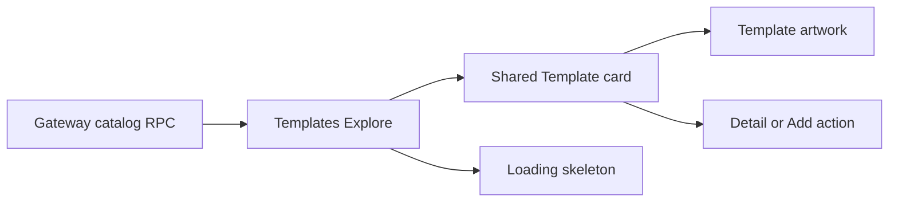

Codex review: needs maintainer review before merge.

## What this changes

This PR gives Template cards standalone artwork, horizontal content, and a responsive two-column catalog layout.

**Example:** Browse Featured Templates at 1440×900.
- **Before:** Four narrow cards appear in one row with small artwork on colored backplates.
- **After:** Four horizontal cards form a 2×2 grid with larger standalone artwork and right-aligned Add buttons.

## Review scores

| Measure | Result | What it means |
|---|---|---|
| **Overall readiness** | 🐚 platinum hermit **(4/6)** | A focused presentation change with directly inspected visual evidence, useful browser coverage, and passing exact-head gates. |
| **Proof confidence** | 🐚 platinum hermit **(4/6)** ✨ media proof bonus | Sufficient (screenshot): Inspected before/after browser screenshots exercise the actual Control UI card renderer with synthetic catalog data at 1440×900 and demonstrate the changed artwork, identity placement, grid, and Add visibility; mocked Gateway data is appropriate for this presentation-only change. |
| **Patch quality** | 🦞 diamond lobster **(5/6)** | No actionable review findings were identified. |

## Product

**Kind:** Preference · **Worth it:** Yes · **Fix scope:** Complete
**User problem:** Small backplated artwork and dense cards give Template identity and descriptions limited visual space.
**Reason:** The supplied maintainer-authorship facts establish direction, and the inspected result delivers that direction with limited implementation cost.

## Merge readiness

✅ **Ready for maintainer review**

Keep open: this maintainer-directed visual improvement is focused, supported by inspected screenshots, and has no actionable findings; exact-head CI passes.

**Priority:** P3
**Reviewed head:** `5caa1646a2006a8b7fca58e4a6dfe80ffc22d3cc`

## Before merge

None.

## Findings

None.

<strong>Agent review details</strong>

### How this fits together

The Control UI receives Template catalog entries through Gateway RPC and renders discovery cards, loading placeholders, and package artwork.

### Technical review

Best possible solution:

Use the existing Template card, artwork component, and matching skeleton to deliver the approved layout.

Do we have a high-confidence way to reproduce the issue?

The supplied before screenshot and base CSS establish the existing presentation; this is an intentional design change rather than a reported runtime defect.

Is this the best way to solve the issue?

The patch uses the existing presentation owners, removes superseded reflow rules, and adds no production state or parallel renderer.

AGENTS.md: found and applied where relevant.

Codex review notes: model internal, reasoning medium; reviewed against [cf9a9839e03b](https://github.com/openclaw/openclaw/commit/cf9a9839e03ba76b526d9f61fe453e3ccc8a93a9).

### Provenance checked

- `Card identity, artwork, and narrow-card reflow` changes intended behavior with a stated reason (https://github.com/openclaw/openclaw/pull/179787: Move names below artwork on narrow cards to prevent fragmented wrapping; later shared styling carried this behavior forward.)
- `Reserved card and skeleton geometry` keeps the original intent (2159567b9ffc17a770579d7e6487836789c67be5: Keep loaded cards aligned with their placeholders and reveal first-screen artwork with the text.)
- `Overview shelf size` changes intended behavior with a stated reason (413d2fc66983d396ff1e9281f568954ef3c83de6: Present discovery shelves in the catalog layout; the new design explicitly requests four cards per overview section.)
- `Shared package artwork backplates` changes intended behavior with a stated reason (c1ecbca6ca505a0cae0af575fd55ca859144c1f3: Share package presentation and preserve the then-approved appearance across preview and review surfaces.)

### Testing

Proof path: shipped entry point.

### Security

None.

### Evidence

What I checked:

- **Introduced change and current main:** The pinned introduced diff changes the existing renderer and stylesheet; fetched main retains the original production layout. ([`ui/src/pages/agents-home/templates-explore.tsx:62`](https://github.com/openclaw/openclaw/blob/5caa1646a2006a8b7fca58e4a6dfe80ffc22d3cc/ui/src/pages/agents-home/templates-explore.tsx#L62), [5caa1646a200](https://github.com/openclaw/openclaw/commit/5caa1646a2006a8b7fca58e4a6dfe80ffc22d3cc))
- **Visual evidence inspected:** All four supplied images were inspected locally; the clean before/after pair shows matching synthetic content, standalone custom and fallback artwork, a 2×2 grid, and visible Add controls. ([5caa1646a200](https://github.com/openclaw/openclaw/commit/5caa1646a2006a8b7fca58e4a6dfe80ffc22d3cc))
- **Loading invariant preserved:** https://github.com/openclaw/openclaw/pull/199866 explains the reserved card geometry and artwork reveal budget; this PR updates both card and skeleton together and retains the existing placement checks. ([`ui/src/pages/agents-home/templates-explore.tsx:152`](https://github.com/openclaw/openclaw/blob/2159567b9ffc17a770579d7e6487836789c67be5/ui/src/pages/agents-home/templates-explore.tsx#L152), [2159567b9ffc](https://github.com/openclaw/openclaw/commit/2159567b9ffc17a770579d7e6487836789c67be5))
- **Earlier narrow-card design:** https://github.com/openclaw/openclaw/pull/179787 used container queries to prevent names breaking into tiny fragments; this PR deliberately replaces that layout with wider cards and single-line ellipsis. ([`ui/src/styles/templates-catalog.css:601`](https://github.com/openclaw/openclaw/blob/cf9a9839e03ba76b526d9f61fe453e3ccc8a93a9/ui/src/styles/templates-catalog.css#L601), [cf9a9839e03b](https://github.com/openclaw/openclaw/commit/cf9a9839e03ba76b526d9f61fe453e3ccc8a93a9))
- **Exact-head gates:** The reviewed head has successful CI, dependency-review, and security-sensitive-review statuses, and GitHub reports a clean mergeable PR. ([5caa1646a200](https://github.com/openclaw/openclaw/commit/5caa1646a2006a8b7fca58e4a6dfe80ffc22d3cc))
- **Policy and inspection limits:** Root and UI guidance were applied; no maintainer-notes directory exists. The installed Solid cheatsheet is absent, and an older history object could not be read with lazy fetching disabled; available source, history, and linked PR explanations establish the relevant contracts. ([`ui/AGENTS.md:1`](https://github.com/openclaw/openclaw/blob/5caa1646a2006a8b7fca58e4a6dfe80ffc22d3cc/ui/AGENTS.md#L1), [5caa1646a200](https://github.com/openclaw/openclaw/commit/5caa1646a2006a8b7fca58e4a6dfe80ffc22d3cc))

Likely related people:

- **Patrick Erichsen:** Raw commit 2159567b9ffc17a770579d7e6487836789c67be5 adds ui/src/pages/agents-home/templates-explore.tsx:62 relative to its recorded parents. This identifies author metadata, not feature responsibility or a PR merger. (role: source-line author; confidence: high; commits: [2159567b9ffc](https://github.com/openclaw/openclaw/commit/2159567b9ffc17a770579d7e6487836789c67be5); files: `ui/src/pages/agents-home/templates-explore.tsx`)
- **Peter Steinberger:** Raw commit f0d7334db0e520239529177f82851a6224d030e8 adds ui/src/pages/agents-home/claws-explore.tsx:108 relative to its recorded parents. This identifies author metadata, not feature responsibility or a PR merger. (role: source-line author; confidence: medium; commits: [f0d7334db0e5](https://github.com/openclaw/openclaw/commit/f0d7334db0e520239529177f82851a6224d030e8); files: `ui/src/pages/agents-home/claws-explore.tsx`)

### PR surface

Source -4, Tests +74. Total +70 across 4 files. Added test files: 0.

View PR surface stats

| Area | Files | Added | Removed | Net |
|---|---:|---:|---:|---:|
| Source | 2 | 59 | 63 | -4 |
| Tests | 2 | 89 | 15 | +74 |
| Docs | 0 | 0 | 0 | 0 |
| Config | 0 | 0 | 0 | 0 |
| Generated | 0 | 0 | 0 | 0 |
| Other | 0 | 0 | 0 | 0 |
| **Total** | **4** | **148** | **78** | **+70** |

### Preflight source

Source unknown. Source comparison at the observed PR snapshot only. Completion is self-reported; body, policy, tests, execution, and report bytes are not verified.

### Labels

Label changes:

- add `P3`: This is a bounded catalog presentation improvement without a demonstrated broken core workflow.
- add `proof: sufficient`: Contributor real behavior proof is sufficient.
- add `proof: 📸 screenshot`: Contributor real behavior proof includes screenshot evidence.
- add `rating: 🐚 platinum hermit`: Overall readiness is 🐚 platinum hermit; proof is 🐚 platinum hermit and patch quality is 🦞 diamond lobster.
- add `status: 👀 ready for maintainer look`: ClawSweeper has no concrete contributor-facing blocker left for this PR.

Label justifications:

- `P3`: This is a bounded catalog presentation improvement without a demonstrated broken core workflow.
- `rating: 🐚 platinum hermit`: Overall readiness is 🐚 platinum hermit; proof is 🐚 platinum hermit and patch quality is 🦞 diamond lobster.
- `status: 👀 ready for maintainer look`: ClawSweeper has no concrete contributor-facing blocker left for this PR.
- `proof: sufficient`: Contributor real behavior proof is sufficient.
- `proof: 📸 screenshot`: Contributor real behavior proof includes screenshot evidence.

### Rating scale

6/6 🦀 challenger crab · 5/6 🦞 diamond lobster · 4/6 🐚 platinum hermit · 3/6 🦐 gold shrimp · 2/6 🦪 silver shellfish · 1/6 🧂 unranked krab. Overall follows the weaker of proof and patch quality; ✨ marks media proof (a screenshot, video, or linked artifact) that directly shows the changed behavior.

### Workflow

ClawSweeper edits this one comment on every review. Comment `@clawsweeper re-review` for a fresh review only. Repair and merge execution lanes are retired.

_Reviewed November 19, 2026, 1:25 AM ET / 06:25 UTC._

<!-- clawsweeper-verdict:needs-human item=201656 sha=5caa1646a2006a8b7fca58e4a6dfe80ffc22d3cc confidence=high updated_at=2026-11-19T06:22:38Z reviewed_at=2026-11-19T06:25:34.286Z lease_owner=github-run-44471573762-1 lease_comment_id=7001527218 source_revision=fafe6c2ee4e4301b993b77ad9e6d15526e3b5ee7ff24143bd935e5dc965c4e07 hold=not_opted_in findings=0 -->
<!-- clawsweeper-review-state:ready item=201656 sha=5caa1646a2006a8b7fca58e4a6dfe80ffc22d3cc v=1 -->

<!-- clawsweeper-review-version item=201656 reviewed_at=2026-11-19T06:25:34.286Z sha=5caa1646a2006a8b7fca58e4a6dfe80ffc22d3cc source_revision=fafe6c2ee4e4301b993b77ad9e6d15526e3b5ee7ff24143bd935e5dc965c4e07 lease_owner=github-run-44471573762-1 lease_comment_id=7001527218 v=1 -->

<!-- clawsweeper-review item=201656 -->