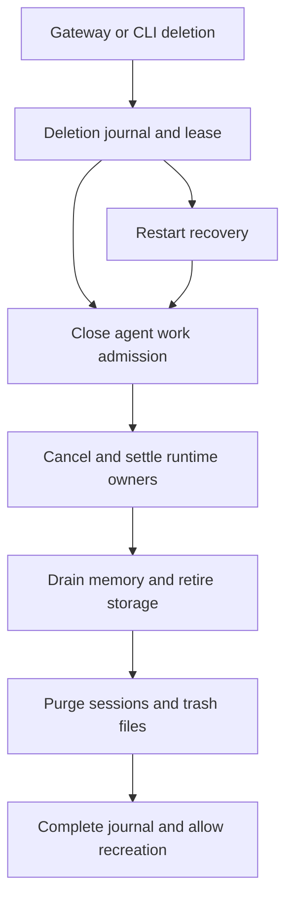

Codex review: needs changes before merge.

## What this changes

This PR drains agent-owned work before retiring storage and resumes interrupted deletion after restart.

**Example:** Delete agent agentlife4 during a shell turn running sleep 30, then recreate the same agent.
- **Before:** Deletion returned success with no removed paths, the turn continued, and recreation remained blocked by pending cleanup.
- **After:** The turn aborted, seven paths were trashed, and the recreated agent answered reborn.

## Review scores

| Measure | Result | What it means |
|---|---|---|
| **Overall readiness** | 🐚 platinum hermit **(4/6)** | A useful lifecycle repair supported by live Gateway behavior, authority-loss traces, and released-writer upgrade evidence, with no new blocking code finding. |
| **Proof confidence** | 🦞 diamond lobster **(5/6)** | Sufficient (logs): Recorded real-provider Gateway flows exercise mid-turn deletion, recreation, surviving-agent work, and ordinary Stop; production-owner logs separately prove refusal after journal replacement, completion, and lease revocation. The later integration retains these owners, and unrelated UI parity images were not counted as deletion proof. |
| **Patch quality** | 🐚 platinum hermit **(4/6)** | No actionable review findings were identified. |

## Product

**Kind:** Bug fix · **Worth it:** Yes · **Fix scope:** Complete
**User problem:** Deleting an agent during a turn can report success while execution continues, cleanup remains pending, and recreating the agent fails.
**Reason:** The demonstrated lifecycle failure warrants repair, and maintainer authorship establishes direction for the durable draining phase.

## Merge readiness

⛔ **Needs changes before merge - 1 item remains**

Keep open: this maintainer-authored PR fixes a demonstrated active-deletion failure that current main still has, and no new blocking patch defect was found.

**Priority:** P2
**Reviewed head:** `b62417774a44610061fd95988ec03e12d9f0f856`

## Before merge

- [ ] **Complete next step** - Resolve the confirmed GitHub conflict and qualify the optional-identity, session-wire-speed, and test-types failures in run 38183516423; repair demonstrated PR-caused failures and retain independently established inherited failures through the authorized native landing path.

## Findings

None.

<strong>Agent review details</strong>

### How this fits together

Gateway and CLI deletion enter the agent lifecycle owner, which coordinates admission, cancellation, memory settlement, database retirement, and filesystem cleanup through a durable journal.

### Technical review

Best possible solution:

Complete agent-scoped draining and restart recovery through the existing lifecycle and storage owners before retiring durable data.

Do we have a high-confidence way to reproduce the issue?

Current-main source still retires storage without first draining active agent work, matching the reported real-Gateway baseline; this read-only review did not rerun it.

Is this the best way to solve the issue?

Yes: the repair uses existing cancellation and storage owners, retains accepted settlement, scopes cancellation to the deleted agent, and records restart continuation without adding configuration.

AGENTS.md: found and applied where relevant.

Codex review notes: model internal, reasoning medium; reviewed against [8a39ccbb2245](https://github.com/openclaw/openclaw/commit/8a39ccbb22457a001dbcc43f776cccc68b903bf5).

### Provenance checked

- `Transactional deletion and recreation fences` keeps the original intent (8a5b4af660748aef0c95c47e21be52375b00482c: https://github.com/openclaw/openclaw/pull/111678 established durable deletion ownership, cleanup retries, and protection against inherited command authority on ID reuse.)
- `Memory and reader retirement ordering` changes intended behavior with a stated reason (40d284f9a6aaa6b11f6d9d7bc1db253781d7ef76: https://github.com/openclaw/openclaw/pull/159013 closes deleted-agent resources while preserving surviving physical owners; this PR explains why memory settlement must precede database retirement.)
- `Plugin-state comparison mutations` keeps the original intent (01e189266093d01ebe4973229c9a2c5dcc1f42ba: https://github.com/openclaw/openclaw/pull/168635 sought fewer repeated observations while preserving TTL and quota contracts; the introduced diff reuses canonical mutation functions inside the existing comparison transaction.)
- `Ordinary Stop and session drain bounds` keeps the original intent (80e18aafb9e6e36ec6a721e5a0312f3df6cf0768: The merged change made Stop reach OpenAI-compatible HTTP work; this PR retains that cancellation path and confines additional unbounded local settlement to agent deletion.)

### Testing

Proof path: shipped entry point.

### Security

None.

### Evidence

What I checked:

- **Current main still lacks active-work draining:** The fetched main deletion handler begins database retirement without the PR's preceding agent-wide runtime drain; its ordering matches the reported live baseline failure. ([`src/gateway/server-methods/agents.ts:475`](https://github.com/openclaw/openclaw/blob/8a39ccbb22457a001dbcc43f776cccc68b903bf5/src/gateway/server-methods/agents.ts#L475), [8a39ccbb2245](https://github.com/openclaw/openclaw/commit/8a39ccbb22457a001dbcc43f776cccc68b903bf5))
- **Drain before retirement:** The reviewed implementation drains exact agent-owned runs and closes the memory owner before advancing the journal to retiring; RPC and restart recovery use the same deletion implementation. ([`src/gateway/server-methods/agents-delete.ts:158`](https://github.com/openclaw/openclaw/blob/b62417774a44610061fd95988ec03e12d9f0f856/src/gateway/server-methods/agents-delete.ts#L158), [b62417774a44](https://github.com/openclaw/openclaw/commit/b62417774a44610061fd95988ec03e12d9f0f856))
- **Live authority refusal evidence:** The discussion at https://github.com/openclaw/openclaw/pull/168199#issuecomment-6107382256 supplies six production-owner traces covering replaced, completed, and revoked deletion authority for unkeyed and protected work: accepted cancellation settles and the later work item remains uncancelled. ([`src/gateway/server-methods/agents-delete-drain.test.ts`](https://github.com/openclaw/openclaw/blob/b62417774a44610061fd95988ec03e12d9f0f856/src/gateway/server-methods/agents-delete-drain.test.ts), [b62417774a44](https://github.com/openclaw/openclaw/commit/b62417774a44610061fd95988ec03e12d9f0f856))
- **Released-writer upgrade compatibility:** The full body and https://github.com/openclaw/openclaw/pull/168199#issuecomment-6114697286 record successful copied-state upgrades from v2026.9.9 and v2026.10.1 on parent bea9bb26328cd431e30fac56ec6d617254f4511d, preserving keeper settings, session JSON, transcript bytes, workspace contents, and integrity. A targeted parent-to-head diff confirms the deletion journal, recovery, and phase-installation owners are unchanged. ([`src/state/openclaw-state-db-schema-additive.ts:136`](https://github.com/openclaw/openclaw/blob/b62417774a44610061fd95988ec03e12d9f0f856/src/state/openclaw-state-db-schema-additive.ts#L136), [b62417774a44](https://github.com/openclaw/openclaw/commit/b62417774a44610061fd95988ec03e12d9f0f856))
- **Complete CI disposition remains unresolved:** REST job reads for https://github.com/openclaw/openclaw/actions/runs/38183516423 confirm ten failed roots plus the aggregate gate, with security-fast passing. The current body explicitly leaves optional connection identity, session wire speed, and check-test-types-core-2 unqualified; passing baseline replays are not claimed as inheritance evidence. ([b62417774a44](https://github.com/openclaw/openclaw/commit/b62417774a44610061fd95988ec03e12d9f0f856))
- **Confirmed current-head conflict:** Fresh REST reads retain the reviewed head and report mergeable=false and mergeable_state=dirty. ([b62417774a44](https://github.com/openclaw/openclaw/commit/b62417774a44610061fd95988ec03e12d9f0f856))

Likely related people:

- **Chris Eckert:** Raw commit 40d284f9a6aaa6b11f6d9d7bc1db253781d7ef76 adds src/agents/agent-delete-databases.ts:41 relative to its recorded parents. This identifies author metadata, not feature responsibility or a PR merger. (role: source-line author; confidence: medium; commits: [40d284f9a6aa](https://github.com/openclaw/openclaw/commit/40d284f9a6aaa6b11f6d9d7bc1db253781d7ef76); files: `src/agents/agent-delete-databases.ts`)

### PR surface

PR surface statistics unavailable: the file list is incomplete.

### Review metrics

| Metric | Value | Why it matters |
|---|---|---|
| **Persisted contract addition** | One nullable journal column: phase TEXT | The additive column has no default or constraints, retains shared schema version 20, and preserves legacy retirement semantics. |

### Labels

Label changes:

- add `rating: 🐚 platinum hermit`: Overall readiness is 🐚 platinum hermit; proof is 🦞 diamond lobster and patch quality is 🐚 platinum hermit.
- remove `rating: 🦞 diamond lobster`: Current PR rating is `rating: 🐚 platinum hermit`, so this older rating label is no longer current.

Label justifications:

- `P2`: Active agent deletion can leave cleanup pending and prevent same-name recreation; the failure is limited to this lifecycle operation.
- `rating: 🐚 platinum hermit`: Overall readiness is 🐚 platinum hermit; proof is 🦞 diamond lobster and patch quality is 🐚 platinum hermit.
- `status: ⏳ waiting on author`: ClawSweeper has contributor-facing work open and is waiting for author action.
- `proof: sufficient`: Contributor real behavior proof is sufficient.

### Rating scale

6/6 🦀 challenger crab · 5/6 🦞 diamond lobster · 4/6 🐚 platinum hermit · 3/6 🦐 gold shrimp · 2/6 🦪 silver shellfish · 1/6 🧂 unranked krab. Overall follows the weaker of proof and patch quality; ✨ marks media proof (a screenshot, video, or linked artifact) that directly shows the changed behavior.

### Workflow

ClawSweeper edits this one comment on every review. Comment `@clawsweeper re-review` for a fresh review only. Repair and merge execution lanes are retired.

### History

Review history (28 earlier review cycles; latest 8 shown)

<!-- clawsweeper-review-history v=1 total=28 -->
- reviewed 2026-10-11T18:05:14.659Z sha f936fa017c7e7263039007b2286b68dad2b11919 :: needs changes before merge. :: none
- reviewed 2026-10-11T19:20:05.804Z sha 4afc4143d41e9ef65068799ca88780b66d1cba2e :: needs changes before merge. :: none
- reviewed 2026-10-11T21:04:08.267Z sha f19e6bb0cd4d40608782986ae833248c8f4ae008 :: needs changes before merge. :: none
- reviewed 2026-10-11T21:30:29.945Z sha e5ed235e0a4e34ddd62b580573cc42c740cd4ed7 :: needs changes before merge. :: [P2] Preserve the agent owner on completed process records
- reviewed 2026-10-11T22:16:22.484Z sha 1e7680ae1227bdd36b66591c800442fc3a600a2c :: needs maintainer review before merge. :: none
- reviewed 2026-10-11T22:44:58.047Z sha bea9bb26328cd431e30fac56ec6d617254f4511d :: needs changes before merge. :: none
- reviewed 2026-10-11T22:53:39.404Z sha bea9bb26328cd431e30fac56ec6d617254f4511d :: needs changes before merge. :: none
- reviewed 2026-10-11T23:27:37.462Z sha b62417774a44610061fd95988ec03e12d9f0f856 :: needs changes before merge. :: none

_Reviewed October 11, 2026, 8:13 PM ET / October 12, 2026, 00:13 UTC (Revision 29)._

<!-- clawsweeper-verdict:needs-changes item=168199 sha=b62417774a44610061fd95988ec03e12d9f0f856 confidence=high updated_at=2026-10-12T00:06:14Z reviewed_at=2026-10-12T00:13:39.604Z lease_owner=github-run-38186678321-1 lease_comment_id=6115410818 source_revision=d2ac9cd9eb214879b96fa84f9e9fe9cbcbc3eb3b2956a4270c4d08872ab15ad6 -->
<!-- clawsweeper-review-state:needs-changes item=168199 sha=b62417774a44610061fd95988ec03e12d9f0f856 v=1 -->

<!-- clawsweeper-review-version item=168199 reviewed_at=2026-10-12T00:13:39.604Z sha=b62417774a44610061fd95988ec03e12d9f0f856 source_revision=d2ac9cd9eb214879b96fa84f9e9fe9cbcbc3eb3b2956a4270c4d08872ab15ad6 lease_owner=github-run-38186678321-1 lease_comment_id=6115410818 v=1 -->

<!-- clawsweeper-review item=168199 -->