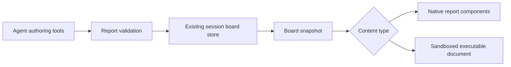

Codex review: needs maintainer review before merge. _Reviewed September 5, 2026, 4:12 PM ET / 20:12 UTC._

# ClawSweeper review

## What this changes

Adds structured dashboard reports rendered directly in the Control UI, reuses existing widget lifecycle controllers, and moves mock dashboard fixtures out of production.

## Merge readiness

✅ **Ready for maintainer review**

This remains a useful implementation candidate for the linked feature request. No blocking introduced defect was found; current main lacks the native report renderer, and the related merged dashboard optimizations do not supersede it.

**Priority:** P2
**Reviewed head:** `b940ec041a4b9409f0f75b5d475b314fe12ce0c8`

## Review scores

| Measure | Result | What it means |
|---|---|---|
| **Overall readiness** | 🐚 platinum hermit **(4/6)** | A coherent, bounded feature with useful production-browser evidence and no supported blocking correctness finding. |
| **Proof confidence** | 🐚 platinum hermit **(4/6)** | Sufficient (live_output): The captured production-browser measurements exercise native report rendering through real board storage and handlers, reporting zero iframe contexts and document-free updates; inspected E2E source covers retained elements and safe link navigation. Transport/bootstrap mocks are disclosed, and screenshot appearance could not be independently inspected. |
| **Patch quality** | 🐚 platinum hermit **(4/6)** | No actionable review findings were identified. |

## Verification

| Check | Result | Evidence |
|---|---|---|
| **Real behavior** | Verified | Sufficient (live_output): The captured production-browser measurements exercise native report rendering through real board storage and handlers, reporting zero iframe contexts and document-free updates; inspected E2E source covers retained elements and safe link navigation. Transport/bootstrap mocks are disclosed, and screenshot appearance could not be independently inspected. |
| **Evidence reviewed** | 8 items | Pinned change ownership: Reviewed the introduced delta from ac53dc9687cae714e648791268573ad2e00278ea to the pinned head. The final commit changes only chat-pane-board.test.ts, preserving the production tree used for the reported measurements. The supplied stale test merge was not used to infer removals from main. Bounded native rendering: The shared validator rejects unknown fields, restricts links to HTTP(S), and bounds report size and block contents. The renderer uses fixed Lit templates, escaped data, and links with noopener noreferrer; saved data cannot select a custom-element tag or executable action. Existing persistence and authority boundaries: Both authoring paths reach board.widget.put. Its existing request authority check precedes the synchronous store write; report validation runs before widget rows are updated. Existing content-owner checks reject implicit conversion of saved HTML or registered-source widgets. No new schema, credential, capability ticket, or authorization-bearing value is introduced. |
| **Findings** | None | None. |
| **Security** | None | None. |

## How this fits together

Agent tools write named widgets into a session’s board store, and the Control UI renders board snapshots. This change lets bounded report data render as native components while executable documents retain their existing sandbox.

## Before merge

None.

<strong>Agent review details</strong>

### Security

None.

### PR surface

Source +105, Tests +701, Docs +91, Other 0. Total +897 across 39 files.

View PR surface stats

| Area | Files | Added | Removed | Net |
|---|---:|---:|---:|---:|
| Source | 19 | 621 | 516 | +105 |
| Tests | 16 | 937 | 236 | +701 |
| Docs | 3 | 118 | 27 | +91 |
| Config | 0 | 0 | 0 | 0 |
| Generated | 0 | 0 | 0 | 0 |
| Other | 1 | 1 | 1 | 0 |
| **Total** | **39** | **1677** | **780** | **+897** |

### Review metrics

| Metric | Value | Why it matters |
|---|---|---|
| **Report authoring contract** | 1 optional report argument; 5 block types; 24 blocks within the existing 8 KiB budget | The new capability is bounded and reuses the existing widget-write operation without a configuration option or protocol method. |

### Root-cause cluster

Relationship: `fixed_by_candidate`
Canonical: https://github.com/openclaw/openclaw/issues/139263
Summary: This PR implements the linked native-report request; the earlier dashboard optimizations concern distinct loading work.

Members:
- `canonical`: https://github.com/openclaw/openclaw/issues/139263 - The request specifies the native report blocks, authoring paths, and preservation of existing document widgets.
- `adjacent_distinct`: https://github.com/openclaw/openclaw/pull/138860 - Merged work optimizes named-session resolution.
- `adjacent_distinct`: https://github.com/openclaw/openclaw/pull/139055 - Merged work removes redundant resolution and history requests.

Proposal only: this assessment does not dispatch repair, suppress jobs, mutate sibling items, close, or merge anything.

### Technical review

Best possible solution:

Keep passive reports on the bounded native renderer and existing board storage, while retaining sandboxed HTML and registered sources for interactive content.

Do we have a high-confidence way to reproduce the issue?

Not applicable as a bug reproduction: this adds a requested capability. Current-main source confirms that generic native reports are absent.

Is this the best way to solve the issue?

Yes. A fixed data renderer fits passive reports more narrowly than expanding an executable rendering surface; existing HTML and registered A2UI paths still require document frames.

AGENTS.md: found and applied where relevant.

Codex review notes: model internal, reasoning medium; reviewed against [e8fbf33b32be](https://github.com/openclaw/openclaw/commit/e8fbf33b32bea82769237675b99e03355ba3a50e).

### Labels

Label changes:

- add `P2`: This is a bounded dashboard capability improvement with no demonstrated urgent regression.
- add `proof: sufficient`: Contributor real behavior proof is sufficient. The captured production-browser measurements exercise native report rendering through real board storage and handlers, reporting zero iframe contexts and document-free updates; inspected E2E source covers retained elements and safe link navigation. Transport/bootstrap mocks are disclosed, and screenshot appearance could not be independently inspected.
- add `rating: 🐚 platinum hermit`: Overall readiness is 🐚 platinum hermit; proof is 🐚 platinum hermit and patch quality is 🐚 platinum hermit.
- add `status: 👀 ready for maintainer look`: ClawSweeper has no concrete contributor-facing blocker left for this PR. Sufficient (live_output): The captured production-browser measurements exercise native report rendering through real board storage and handlers, reporting zero iframe contexts and document-free updates; inspected E2E source covers retained elements and safe link navigation. Transport/bootstrap mocks are disclosed, and screenshot appearance could not be independently inspected.

Label justifications:

- `P2`: This is a bounded dashboard capability improvement with no demonstrated urgent regression.
- `rating: 🐚 platinum hermit`: Overall readiness is 🐚 platinum hermit; proof is 🐚 platinum hermit and patch quality is 🐚 platinum hermit.
- `status: 👀 ready for maintainer look`: ClawSweeper has no concrete contributor-facing blocker left for this PR. Sufficient (live_output): The captured production-browser measurements exercise native report rendering through real board storage and handlers, reporting zero iframe contexts and document-free updates; inspected E2E source covers retained elements and safe link navigation. Transport/bootstrap mocks are disclosed, and screenshot appearance could not be independently inspected.
- `proof: sufficient`: Contributor real behavior proof is sufficient. The captured production-browser measurements exercise native report rendering through real board storage and handlers, reporting zero iframe contexts and document-free updates; inspected E2E source covers retained elements and safe link navigation. Transport/bootstrap mocks are disclosed, and screenshot appearance could not be independently inspected.

### Evidence

What I checked:

- **Pinned change ownership:** Reviewed the introduced delta from ac53dc9687cae714e648791268573ad2e00278ea to the pinned head. The final commit changes only chat-pane-board.test.ts, preserving the production tree used for the reported measurements. The supplied stale test merge was not used to infer removals from main. ([`ui/src/pages/chat/chat-pane-board.test.ts`](https://github.com/openclaw/openclaw/blob/b940ec041a4b9409f0f75b5d475b314fe12ce0c8/ui/src/pages/chat/chat-pane-board.test.ts), [b940ec041a4b](https://github.com/openclaw/openclaw/commit/b940ec041a4b9409f0f75b5d475b314fe12ce0c8))
- **Bounded native rendering:** The shared validator rejects unknown fields, restricts links to HTTP(S), and bounds report size and block contents. The renderer uses fixed Lit templates, escaped data, and links with noopener noreferrer; saved data cannot select a custom-element tag or executable action. ([`src/boards/board-report.ts:73`](https://github.com/openclaw/openclaw/blob/b940ec041a4b9409f0f75b5d475b314fe12ce0c8/src/boards/board-report.ts#L73), [b940ec041a4b](https://github.com/openclaw/openclaw/commit/b940ec041a4b9409f0f75b5d475b314fe12ce0c8))
- **Existing persistence and authority boundaries:** Both authoring paths reach board.widget.put. Its existing request authority check precedes the synchronous store write; report validation runs before widget rows are updated. Existing content-owner checks reject implicit conversion of saved HTML or registered-source widgets. No new schema, credential, capability ticket, or authorization-bearing value is introduced. ([`src/boards/board-store.ts:201`](https://github.com/openclaw/openclaw/blob/b940ec041a4b9409f0f75b5d475b314fe12ce0c8/src/boards/board-store.ts#L201), [b940ec041a4b](https://github.com/openclaw/openclaw/commit/b940ec041a4b9409f0f75b5d475b314fe12ce0c8))
- **Compatibility and regression coverage:** Inspected tests cover report creation, update and database reopen, invalid-input rejection without mutation, registered source kinds named report, escaped rendering, finite chart geometry, and in-place browser updates. The existing progress store remains the lifecycle owner, and passive previews admit only the explicitly marked core report renderer alongside existing HTML. ([`src/canvas/widget-tool.report.test.ts:78`](https://github.com/openclaw/openclaw/blob/b940ec041a4b9409f0f75b5d475b314fe12ce0c8/src/canvas/widget-tool.report.test.ts#L78), [b940ec041a4b](https://github.com/openclaw/openclaw/commit/b940ec041a4b9409f0f75b5d475b314fe12ce0c8))
- **Current-main necessity and release check:** At the supplied fetched main revision, the native widget registry contains session:progress but no session:report renderer. The new board-report.ts path is also absent from v2026.9.2. The supplied related merged PRs address session lookup and redundant dashboard requests, not native report rendering. ([`ui/src/lib/board/widgets/index.ts:27`](https://github.com/openclaw/openclaw/blob/e8fbf33b32bea82769237675b99e03355ba3a50e/ui/src/lib/board/widgets/index.ts#L27), [e8fbf33b32be](https://github.com/openclaw/openclaw/commit/e8fbf33b32bea82769237675b99e03355ba3a50e))
- **Reported production-browser evidence:** The captured PR body and https://github.com/openclaw/openclaw/pull/139306#issuecomment-5554266364 report 32 comparison loads using the production browser bundle, real SQLite, board handlers, ticketed HTTP and sandbox hosting, with mocked WebSocket/bootstrap traffic. Native reports used zero iframe contexts and updated without another document load. Timings are explicitly mixed. The screenshot attachment fetches failed in this review environment, so their appearance was not independently inspected; no target tests or scripts were executed. ([`ui/src/e2e/native-report-widget.e2e.test.ts:92`](https://github.com/openclaw/openclaw/blob/844c146098d5a89993e17c22d94a6b37991945c8/ui/src/e2e/native-report-widget.e2e.test.ts#L92), [844c146098d5](https://github.com/openclaw/openclaw/commit/844c146098d5a89993e17c22d94a6b37991945c8))

Likely related people:

- **steipete:** Suggested for follow-up; no historical authorship or introduction is verified. (role: unverified routing candidate; confidence: low)
- **Patrick Erichsen:** Suggested for follow-up; no historical authorship or introduction is verified. (role: unverified routing candidate; confidence: low)

### Rating scale

| Score | Internal tier | Crab rank | Meaning |
|---:|:---:|---|---|
| **6/6** | S | 🦀 challenger crab | Exceptional readiness |
| **5/6** | A | 🦞 diamond lobster | Very strong readiness |
| **4/6** | B | 🐚 platinum hermit | Good normal PR; ordinary maintainer review |
| **3/6** | C | 🦐 gold shrimp | Useful, but confidence is limited |
| **2/6** | D | 🦪 silver shellfish | Proof or implementation needs work |
| **1/6** | F | 🧂 unranked krab | Not merge-ready |
| N/A | NA | 🌊 off-meta tidepool | Rating does not apply |

Overall follows the weaker of proof and patch quality.
Shiny media proof means a screenshot, video, or linked artifact directly shows the changed behavior. Runtime, network, CSP, and security claims still need visible diagnostics.

### Workflow

- ClawSweeper keeps one durable marker-backed review comment per issue or PR.
- Re-runs edit this comment so the latest verdict, findings, and automation markers stay together instead of adding duplicate bot comments.
- A fresh review can be triggered by eligible `@clawsweeper re-review` comments, exact-item GitHub events, scheduled/background review runs, or manual workflow dispatch.
- PR/issue authors and users with repository write access can comment `@clawsweeper re-review` or `@clawsweeper re-run` on an open PR or issue to request a fresh review only.
- Maintainers can also comment `@clawsweeper review` to request a fresh review only.
- Fresh-review commands do not start repair, autofix, rebase, CI repair, or automerge.
- Maintainer-only repair and merge flows require explicit commands such as `@clawsweeper autofix`, `@clawsweeper automerge`, `@clawsweeper fix ci`, or `@clawsweeper address review`.
- Maintainers can comment `@clawsweeper explain` to ask for more context, or `@clawsweeper stop` to stop active automation.

<!-- clawsweeper-verdict:needs-human item=139306 sha=b940ec041a4b9409f0f75b5d475b314fe12ce0c8 confidence=high updated_at=2026-09-05T20:09:37Z reviewed_at=2026-09-05T20:12:50.040Z lease_owner=github-run-33989188880-1 lease_comment_id=5554469287 source_revision=36f1d2a8e60b439fc87cdbbcf8c31f0c1824b696c4f2c2770713f501a390e096 live_verification=absent -->
<!-- clawsweeper-review-state:ready item=139306 sha=b940ec041a4b9409f0f75b5d475b314fe12ce0c8 v=1 -->

<!-- clawsweeper-review-version item=139306 reviewed_at=2026-09-05T20:12:50.040Z sha=b940ec041a4b9409f0f75b5d475b314fe12ce0c8 source_revision=36f1d2a8e60b439fc87cdbbcf8c31f0c1824b696c4f2c2770713f501a390e096 lease_owner=github-run-33989188880-1 lease_comment_id=5554469287 v=1 -->

<!-- clawsweeper-review item=139306 -->