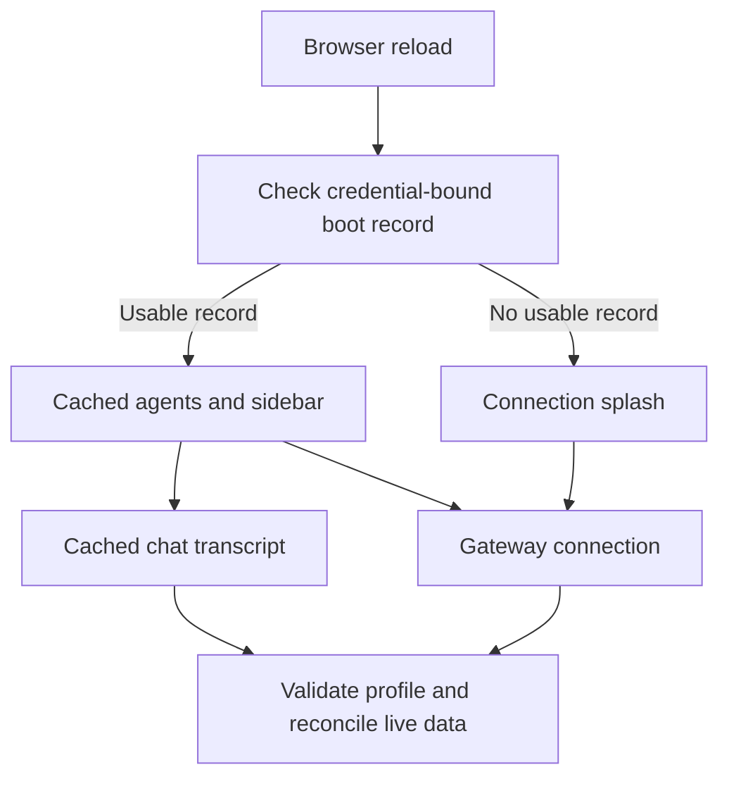

Codex review: blocked before merge. _Reviewed September 7, 2026, 9:17 PM ET / September 8, 2026, 01:17 UTC._

# ClawSweeper review

## What this changes

The Control UI restores cached agents, sidebar sessions, and chat while connecting, then reconciles them with live Gateway data.

## Merge readiness

⛔ **Blocked before merge - 2 items remain**

Keep open: current main still gates the initial shell on connection, so this remains useful work. Earlier findings are fixed or explicitly dispositioned, and no new blocking defect was found. The recorded transcript-scoping deferral does not require another decision.

**Priority:** P2
**Reviewed head:** `3fc9da4b0d75c33e5f66f1d78dd3a4e7d2fdc1e5`

## Review scores

| Measure | Result | What it means |
|---|---|---|
| **Overall readiness** | 🐚 platinum hermit **(4/6)** | Useful runtime evidence and focused lifecycle coverage support a good patch with an explicitly accepted, separately tracked limitation. |
| **Proof confidence** | 🦞 diamond lobster **(5/6)** | Sufficient (live_output): Supplied instrumented browser observations exercise bootstrap, roster restoration, and transcript startup against an isolated real Gateway, showing shell and rows before hello and subsequent cursor reuse. Screenshot retrieval failed here; inspected boundary tests supplement the retained runtime evidence. |
| **Patch quality** | 🐚 platinum hermit **(4/6)** | No actionable review findings were identified. |

## Verification

| Check | Result | Evidence |
|---|---|---|
| **Real behavior** | Verified | Sufficient (live_output): Supplied instrumented browser observations exercise bootstrap, roster restoration, and transcript startup against an isolated real Gateway, showing shell and rows before hello and subsequent cursor reuse. Screenshot retrieval failed here; inspected boundary tests supplement the retained runtime evidence. |
| **Evidence reviewed** | 8 items | Verified introduced scope: The local merge-base-to-head diff contains all 81 changed paths, including the test helper omitted from the bounded introduction list. Review used this introduced delta, not endpoint drift. Still necessary on main: Fetched main still returns the connection splash during initial connection. The boot-record module is absent from both fetched main and the latest release tree inspected; no merged replacement is established. Credential-bound admission and retirement: Bootstrap requires a matching browser-held credential and excludes password/bootstrap startup. Profile mismatch synchronously removes boot records and invalidates transcript projections before subsequent subscribers resume; cached presentation does not grant Gateway request authority. |
| **Findings** | None | None. |
| **Security** | None | None. |

## How this fits together

The Control UI receives session and identity data from the Gateway and retains browser caches between visits. This change lets those caches populate the interface before connection, while live responses replace cached state.

## Before merge

- [ ] **Resolve merge risk (P1)** - A browser used with multiple Gateways can display another Gateway's cached transcript for a shared session key before hello. This advances an existing limitation; the recorded maintainer decision defers isolation to https://github.com/openclaw/openclaw/issues/141690.
- [ ] **Review config compatibility** - Confirm compatibility and upgrade impact for the changed config or default surface before merge.

<strong>Agent review details</strong>

### Security

None.

### PR surface

PR surface statistics unavailable: the file list is incomplete.

### Review metrics

| Metric | Value | Why it matters |
|---|---|---|
| **Production and test growth** | Production net +1,289 lines; tests and support net +2,887 lines | Production growth implements two bounded browser stores and their reconciliation lifecycle; the larger test contribution exercises persistence and connection boundaries. |
| **Persistent cache bounds** | 2 new stores; 30-day expiry; roster capped at 200 rows, 1.5 MiB, and 6 scopes | These bounds define the accepted browser-storage footprint and retention behavior. |

### Stored data model

Persistent data-model change detected: `serialized state: ui/src/pages/chat/session-snapshot-database.ts`, `serialized state: ui/src/pages/chat/session-snapshot-invalidation.ts`, `serialized state: ui/src/pages/chat/session-snapshot-store.ts`, `unknown-data-model-change: ui/src/pages/chat/session-snapshot-store.ts`, `unknown-truncated-pull-files`. Migration or upgrade compatibility proof is recorded; maintainers should verify it before merge.

### Merge-risk options

**Maintainer options:**
1. **Honor the recorded transcript-scope deferral (recommended)**  
   Retain the accepted warm reload while keeping cross-Gateway snapshot isolation tracked in https://github.com/openclaw/openclaw/issues/141690.

### Technical review

Best possible solution:

Retain the accepted bounded warm-reload design and complete Gateway-scoped transcript isolation through the existing follow-up.

Do we have a high-confidence way to reproduce the issue?

Not applicable as a bug reproduction: this adds warm startup behavior, supported by supplied before/after browser observations and current-main splash gating.

Is this the best way to solve the issue?

Yes. The branch reuses the existing transcript cache, bounds new roster storage, and preserves live reconciliation; the remaining transcript-isolation work already has an accepted separate owner.

AGENTS.md: found and applied where relevant.

Codex review notes: model internal, reasoning medium; reviewed against [02fe272b1055](https://github.com/openclaw/openclaw/commit/02fe272b105525469adadae586bd56cf7abcb074).

### Labels

Label justifications:

- `P2`: This improves repeat-load responsiveness without evidence of an urgent broken workflow.
- `merge-risk: 🚨 session-state`: Prewarming can expose an existing cross-Gateway transcript mix-up earlier, under an explicitly accepted follow-up.
- `rating: 🐚 platinum hermit`: Overall readiness is 🐚 platinum hermit; proof is 🦞 diamond lobster and patch quality is 🐚 platinum hermit.
- `status: 👀 ready for maintainer look`: ClawSweeper has no concrete contributor-facing blocker left for this PR. Sufficient (live_output): Supplied instrumented browser observations exercise bootstrap, roster restoration, and transcript startup against an isolated real Gateway, showing shell and rows before hello and subsequent cursor reuse. Screenshot retrieval failed here; inspected boundary tests supplement the retained runtime evidence.
- `proof: sufficient`: Contributor real behavior proof is sufficient. Supplied instrumented browser observations exercise bootstrap, roster restoration, and transcript startup against an isolated real Gateway, showing shell and rows before hello and subsequent cursor reuse. Screenshot retrieval failed here; inspected boundary tests supplement the retained runtime evidence.

### Evidence

What I checked:

- **Verified introduced scope:** The local merge-base-to-head diff contains all 81 changed paths, including the test helper omitted from the bounded introduction list. Review used this introduced delta, not endpoint drift. ([3fc9da4b0d75](https://github.com/openclaw/openclaw/commit/3fc9da4b0d75c33e5f66f1d78dd3a4e7d2fdc1e5))
- **Still necessary on main:** Fetched main still returns the connection splash during initial connection. The boot-record module is absent from both fetched main and the latest release tree inspected; no merged replacement is established. ([`ui/src/app/app-root.ts:574`](https://github.com/openclaw/openclaw/blob/02fe272b105525469adadae586bd56cf7abcb074/ui/src/app/app-root.ts#L574), [02fe272b1055](https://github.com/openclaw/openclaw/commit/02fe272b105525469adadae586bd56cf7abcb074))
- **Credential-bound admission and retirement:** Bootstrap requires a matching browser-held credential and excludes password/bootstrap startup. Profile mismatch synchronously removes boot records and invalidates transcript projections before subsequent subscribers resume; cached presentation does not grant Gateway request authority. ([`ui/src/app/bootstrap.ts:226`](https://github.com/openclaw/openclaw/blob/3fc9da4b0d75c33e5f66f1d78dd3a4e7d2fdc1e5/ui/src/app/bootstrap.ts#L226), [3fc9da4b0d75](https://github.com/openclaw/openclaw/commit/3fc9da4b0d75c33e5f66f1d78dd3a4e7d2fdc1e5))
- **Prior findings checked:** Incognito rows are filtered at persistence and restoration. Gateway readiness aborts the roster wait, fixtures supply the required boot record, and live results replace cached rows without preserving stale presentation. The supplied discussion explicitly accepts the existing short-link semantics. ([`ui/src/lib/sessions/session-roster-cache.reader.ts:76`](https://github.com/openclaw/openclaw/blob/3fc9da4b0d75c33e5f66f1d78dd3a4e7d2fdc1e5/ui/src/lib/sessions/session-roster-cache.reader.ts#L76), [3fc9da4b0d75](https://github.com/openclaw/openclaw/commit/3fc9da4b0d75c33e5f66f1d78dd3a4e7d2fdc1e5))
- **Accepted persistence design and follow-up:** The supplied comment at https://github.com/openclaw/openclaw/pull/141121#issuecomment-5573804534 records acceptance of the bounded cache design. The body and https://github.com/openclaw/openclaw/issues/141690 explicitly record the decision to defer Gateway-scoped transcript keys. The extracted key helper preserves the existing agent/session-only key. ([`ui/src/pages/chat/session-snapshot-key.ts:44`](https://github.com/openclaw/openclaw/blob/3fc9da4b0d75c33e5f66f1d78dd3a4e7d2fdc1e5/ui/src/pages/chat/session-snapshot-key.ts#L44), [3fc9da4b0d75](https://github.com/openclaw/openclaw/commit/3fc9da4b0d75c33e5f66f1d78dd3a4e7d2fdc1e5))
- **Real reload observations:** The supplied body records an instrumented persistent-browser reload against an isolated Gateway with a mock provider: shell at 38 ms, sidebar rows at 81 ms before hello at 83 ms, stored transcript at 143 ms, and cursor-bearing startup at 151 ms. The separate CDP measurements exercise fallback and do not establish a universal transcript speedup. Linked screenshots could not be fetched here; the textual runtime observations remain available.

Likely related people:

- **Peter Steinberger:** Suggested for follow-up; no historical authorship or introduction is verified. (role: unverified routing candidate; confidence: low)
- **Jesse Merhi:** Suggested for follow-up; no historical authorship or introduction is verified. (role: unverified routing candidate; confidence: low)

### Rating scale

| Score | Internal tier | Crab rank | Meaning |
|---:|:---:|---|---|
| **6/6** | S | 🦀 challenger crab | Exceptional readiness |
| **5/6** | A | 🦞 diamond lobster | Very strong readiness |
| **4/6** | B | 🐚 platinum hermit | Good normal PR; ordinary maintainer review |
| **3/6** | C | 🦐 gold shrimp | Useful, but confidence is limited |
| **2/6** | D | 🦪 silver shellfish | Proof or implementation needs work |
| **1/6** | F | 🧂 unranked krab | Not merge-ready |
| N/A | NA | 🌊 off-meta tidepool | Rating does not apply |

Overall follows the weaker of proof and patch quality.
Shiny media proof means a screenshot, video, or linked artifact directly shows the changed behavior. Runtime, network, CSP, and security claims still need visible diagnostics.

### Workflow

- ClawSweeper keeps one durable marker-backed review comment per issue or PR.
- Re-runs edit this comment so the latest verdict, findings, and automation markers stay together instead of adding duplicate bot comments.
- A fresh review can be triggered by eligible `@clawsweeper re-review` comments, exact-item GitHub events, scheduled/background review runs, or manual workflow dispatch.
- PR/issue authors and users with repository write access can comment `@clawsweeper re-review` or `@clawsweeper re-run` on an open PR or issue to request a fresh review only.
- Maintainers can also comment `@clawsweeper review` to request a fresh review only.
- Fresh-review commands do not start repair, autofix, rebase, CI repair, or automerge.
- Maintainer-only repair and merge flows require explicit commands such as `@clawsweeper autofix`, `@clawsweeper automerge`, `@clawsweeper fix ci`, or `@clawsweeper address review`.
- Maintainers can comment `@clawsweeper explain` to ask for more context, or `@clawsweeper stop` to stop active automation.

### History

Review history (8 earlier review cycles)

<!-- clawsweeper-review-history v=1 total=8 -->
- reviewed 2026-09-07T10:10:06.773Z sha a05df90ef9216a6aa4040895aebee1735c49a7da :: blocked before merge. :: [P1] Exclude Incognito sessions before persisting the roster | [P2] Validate short-link destinations beyond the cached subset | [P2] Release the roster wait when the Gateway becomes ready | [P2] Provide the required boot record in the sidebar fixtures
- reviewed 2026-09-07T11:27:48.634Z sha a05df90ef9216a6aa4040895aebee1735c49a7da :: blocked before merge. :: [P1] Exclude Incognito sessions before persisting the roster | [P2] Validate short-link destinations beyond the cached subset | [P2] Release the roster wait when the Gateway becomes ready | [P2] Provide the required boot record in the sidebar fixtures
- reviewed 2026-09-07T12:40:31.554Z sha a05df90ef9216a6aa4040895aebee1735c49a7da :: blocked before merge. :: [P1] Exclude Incognito sessions before persisting the roster | [P2] Validate short-link destinations beyond the cached subset | [P2] Release the roster wait when the Gateway becomes ready | [P2] Provide the required boot record in the sidebar fixtures
- reviewed 2026-09-07T16:45:07.278Z sha 8a4f77be7dca984d7170149aeb0000ecc05ae0d7 :: blocked before merge. :: [P1] Exclude Incognito sessions before persisting the roster | [P2] Validate short-link destinations beyond the cached subset | [P2] Release the roster wait when the Gateway becomes ready
- reviewed 2026-09-07T17:17:40.053Z sha e0485a4971acd1f6788689e9f4acebb5df3fe4ac :: blocked before merge. :: none
- reviewed 2026-09-07T19:21:34.218Z sha 68b5fb27aba5bd22c87cf2095771764b18514f36 :: blocked before merge. :: none
- reviewed 2026-09-07T19:47:34.031Z sha 491b8bf880a296d80b203d11e8458f8ead007d2f :: blocked before merge. :: none
- reviewed 2026-09-08T00:36:54.420Z sha 36453b3dabfdb9d72c1b6aa9daaeec758ee75057 :: blocked before merge. :: none

<!-- clawsweeper-verdict:needs-human item=141121 sha=3fc9da4b0d75c33e5f66f1d78dd3a4e7d2fdc1e5 confidence=high updated_at=2026-09-08T01:13:55Z reviewed_at=2026-09-08T01:17:03.397Z lease_owner=github-run-34175809188-1 lease_comment_id=5577576769 source_revision=8c6f0dd4b6da920aa10014fc436ab66d5050c615ea8d17f33376bdae70fbe87b live_verification=absent -->
<!-- clawsweeper-review-state:blocked item=141121 sha=3fc9da4b0d75c33e5f66f1d78dd3a4e7d2fdc1e5 v=1 -->

<!-- clawsweeper-review-version item=141121 reviewed_at=2026-09-08T01:17:03.397Z sha=3fc9da4b0d75c33e5f66f1d78dd3a4e7d2fdc1e5 source_revision=8c6f0dd4b6da920aa10014fc436ab66d5050c615ea8d17f33376bdae70fbe87b lease_owner=github-run-34175809188-1 lease_comment_id=5577576769 v=1 -->

<!-- clawsweeper-review item=141121 -->