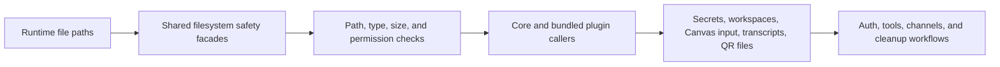

Codex review: needs real behavior proof before merge. _Reviewed July 25, 2026, 6:08 AM ET / 10:08 UTC._

# ClawSweeper review

## What this changes

The branch replaces several duplicated core and plugin filesystem helpers with shared safe facades, adds a bounded Canvas JSONL read, and makes Zalo QR refreshes overwrite a stable private per-profile temporary file.

## Merge readiness

⛔ **Blocked until real behavior proof from a real setup is added - 4 items remain**

The filesystem-facade refactor appears focused and the supplied CI evidence is positive, but this protected PR still lacks inspectable after-fix runtime proof for its one user-visible claim: two Zalo QR refreshes must reuse the same file and restore mode `0600`. Keep it open for that evidence and final owner review rather than treating test and CI summaries as proof of the live file behavior.

**Priority:** P2
**Reviewed head:** `12d29b9edfa89facbdad3a9367fd4a8451a59ca2`

## Review scores

| Measure | Result | What it means |
|---|---|---|
| **Overall readiness** | 🦪 silver shellfish **(2/6)** | The proposed refactor has useful automated validation, but the required real behavior proof for its Zalo file-permission claim is still missing. |
| **Proof confidence** | 🦪 silver shellfish **(2/6)** | Needs real behavior proof before merge: The PR supplies focused tests and CI summaries, including an automated Zalo regression test, but no inspectable after-fix terminal output, runtime log, recording, or artifact from a real Zalo QR refresh. Please redact private paths, tokens, endpoints, and identifiers; updating the PR body should trigger review automatically, or a maintainer can request `@clawsweeper re-review`. After adding proof, update the PR body; ClawSweeper should re-review automatically. If it does not, the PR author or someone with repository write access can comment `@clawsweeper re-review`. |
| **Patch quality** | 🦐 gold shrimp **(3/6)** | No actionable review findings were identified. |

## Verification

| Check | Result | Evidence |
|---|---|---|
| **Real behavior** | Needs proof | Needs real behavior proof before merge: The PR supplies focused tests and CI summaries, including an automated Zalo regression test, but no inspectable after-fix terminal output, runtime log, recording, or artifact from a real Zalo QR refresh. Please redact private paths, tokens, endpoints, and identifiers; updating the PR body should trigger review automatically, or a maintainer can request `@clawsweeper re-review`. After adding proof, update the PR body; ClawSweeper should re-review automatically. If it does not, the PR author or someone with repository write access can comment `@clawsweeper re-review`. |
| **Evidence reviewed** | 4 items | Zalo behavior is covered by an automated regression test: The added test writes two QR payloads for one profile, loosens the existing file mode between writes, then verifies the same path is reused, contents are overwritten, and POSIX mode returns to 0600. Zalo writer enforces the claimed permission behavior: The changed writer uses mode 0600 on write and explicitly chmods the stable profile-derived path after each write, which addresses pre-existing loose modes on overwrite. Canvas input now has an explicit bounded-read contract: The Canvas tool replaces an unbounded read with the shared regular-file reader and a 16 MiB maximum; the adjacent test exercises rejection above that limit. |
| **Findings** | None | None. |
| **Security** | None | None. |

## How this fits together

Core services and bundled plugins use local files for secrets, OAuth credentials, agent scratch workspaces, Canvas input, and transcript artifacts. This change routes selected reads, writes, path checks, and cleanup through shared filesystem-safety facades before those callers continue their existing authentication, tool, channel, and retention workflows.

## Before merge

- [ ] **Add real behavior proof** - Needs real behavior proof before merge: The PR supplies focused tests and CI summaries, including an automated Zalo regression test, but no inspectable after-fix terminal output, runtime log, recording, or artifact from a real Zalo QR refresh. Please redact private paths, tokens, endpoints, and identifiers; updating the PR body should trigger review automatically, or a maintainer can request `@clawsweeper re-review`. After adding proof, update the PR body; ClawSweeper should re-review automatically. If it does not, the PR author or someone with repository write access can comment `@clawsweeper re-review`.
- [ ] **Resolve merge risk (P1)** - The shared helper substitutions affect secret reads, regular-file validation, temporary workspace creation, and root-confined deletion; final owner review should confirm that each caller intentionally accepts the shared helper’s error and filesystem-object contract.
- [ ] **Resolve merge risk (P1)** - The user-visible Zalo permission repair is only demonstrated by an automated test in the supplied material, so a real run remains necessary before merge.
- [ ] **Complete next step (P2)** - The remaining blocker is contributor-provided real behavior evidence plus final compatibility and security-boundary owner review, not a narrow mechanical repair for automation.

<strong>Agent review details</strong>

### Security

None.

### PR surface

Source -136, Tests +57. Total -79 across 17 files.

View PR surface stats

| Area | Files | Added | Removed | Net |
|---|---:|---:|---:|---:|
| Source | 15 | 123 | 259 | -136 |
| Tests | 2 | 58 | 1 | +57 |
| Docs | 0 | 0 | 0 | 0 |
| Config | 0 | 0 | 0 | 0 |
| Generated | 0 | 0 | 0 | 0 |
| Other | 0 | 0 | 0 | 0 |
| **Total** | **17** | **181** | **260** | **-79** |

### Review metrics

| Metric | Value | Why it matters |
|---|---|---|
| **Bounded Canvas input** | 1 new 16 MiB maximum | This is a behavior change from an unbounded Canvas JSONL read and needs confirmation that the limit is intentional for existing users. |

### Stored data model

Persistent data-model change detected: `durable storage schema: src/gateway/worker-environments/workspace-sync-local.ts`, `migration/backfill/repair: extensions/canvas/doctor-contract-api.ts`, `migration/backfill/repair: extensions/policy/src/doctor/policy-runtime.ts`, `migration/backfill/repair: src/commands/doctor-auth-flat-profiles.ts`, `serialized state: extensions/canvas/src/tool.test.ts`, `serialized state: extensions/canvas/src/tool.ts`, and 7 more. Confirm migration or upgrade compatibility proof before merge.

### Merge-risk options

**Maintainer options:**
1. **Add real Zalo file-behavior proof (recommended)**  
   Before merge, attach redacted terminal output or runtime logs that show a second QR refresh overwrites the same per-profile path and restores POSIX mode `0600`.
2. **Pause for owner contract review**  
   If live proof cannot be captured safely, pause until the relevant owners explicitly accept the changed filesystem-helper behavior at every affected boundary.

### Technical review

Best possible solution:

Keep the owner-boundary facade refactor, add redacted runtime proof showing two Zalo QR refreshes reuse one path and end at mode `0600`, then complete final review of the shared helper contract at the affected secret, workspace, Canvas, and transcript callers.

Do we have a high-confidence way to reproduce the issue?

Not applicable as a conventional issue reproduction: this is chiefly a refactor. The Zalo behavior has focused automated coverage, but the supplied material does not yet show a high-confidence real runtime reproduction of the claimed overwrite-and-permission improvement.

Is this the best way to solve the issue?

Yes, conditionally: moving duplicate filesystem logic to existing owner facades is the maintainable direction, provided the changed callers intentionally preserve their prior contracts and the Zalo behavior is proven in a real setup.

AGENTS.md: found and applied where relevant.

Codex review notes: model internal, reasoning high; reviewed against [3b1212b39716](https://github.com/openclaw/openclaw/commit/3b1212b39716a2bdcedf3b3ccbde2cd637f6e407).

### Labels

Label justifications:

- `P2`: This is a broad but bounded internal refactor with one local-file behavior change and no established urgent regression.
- `merge-risk: 🚨 compatibility`: Shared filesystem readers and path checks can change existing behavior for missing files, file types, permissions, and oversized Canvas input.
- `merge-risk: 🚨 security-boundary`: The diff changes secret-file access, private temporary-file permissions, root-confined deletion, and regular-file validation.
- `rating: 🦪 silver shellfish`: Overall readiness is 🦪 silver shellfish; proof is 🦪 silver shellfish and patch quality is 🦐 gold shrimp.
- `status: 📣 needs proof`: The PR needs real behavior proof before ClawSweeper can clear the contributor ask. Needs real behavior proof before merge: The PR supplies focused tests and CI summaries, including an automated Zalo regression test, but no inspectable after-fix terminal output, runtime log, recording, or artifact from a real Zalo QR refresh. Please redact private paths, tokens, endpoints, and identifiers; updating the PR body should trigger review automatically, or a maintainer can request `@clawsweeper re-review`. After adding proof, update the PR body; ClawSweeper should re-review automatically. If it does not, the PR author or someone with repository write access can comment `@clawsweeper re-review`.

### Evidence

What I checked:

- **Zalo behavior is covered by an automated regression test:** The added test writes two QR payloads for one profile, loosens the existing file mode between writes, then verifies the same path is reused, contents are overwritten, and POSIX mode returns to 0600. ([`extensions/zalouser/src/qr-temp-file.test.ts:12`](https://github.com/openclaw/openclaw/blob/12d29b9edfa8/extensions/zalouser/src/qr-temp-file.test.ts#L12), [12d29b9edfa8](https://github.com/openclaw/openclaw/commit/12d29b9edfa8))
- **Zalo writer enforces the claimed permission behavior:** The changed writer uses mode 0600 on write and explicitly chmods the stable profile-derived path after each write, which addresses pre-existing loose modes on overwrite. ([`extensions/zalouser/src/qr-temp-file.ts:17`](https://github.com/openclaw/openclaw/blob/12d29b9edfa8/extensions/zalouser/src/qr-temp-file.ts#L17), [12d29b9edfa8](https://github.com/openclaw/openclaw/commit/12d29b9edfa8))
- **Canvas input now has an explicit bounded-read contract:** The Canvas tool replaces an unbounded read with the shared regular-file reader and a 16 MiB maximum; the adjacent test exercises rejection above that limit. ([`extensions/canvas/src/tool.ts:34`](https://github.com/openclaw/openclaw/blob/12d29b9edfa8/extensions/canvas/src/tool.ts#L34), [12d29b9edfa8](https://github.com/openclaw/openclaw/commit/12d29b9edfa8))
- **PR evidence remains test and CI oriented:** The PR body lists focused tests, a changed-file gate, and autoreview, but provides no inspectable terminal transcript, runtime log, recording, or artifact showing the Zalo QR overwrite and permission repair in a real setup. ([12d29b9edfa8](https://github.com/openclaw/openclaw/commit/12d29b9edfa8))

Likely related people:

- **steipete:** Authored all three commits on the proposed filesystem-facade and Zalo QR path; no independent current-main ownership trail was available in the supplied read-only evidence. (role: recent area contributor; confidence: low; commits: [9a145198cdfc](https://github.com/openclaw/openclaw/commit/9a145198cdfc48977c13030a99f9e822111f6b5f), [7f7fd041e0c1](https://github.com/openclaw/openclaw/commit/7f7fd041e0c1d1f17f0b2cfeceed1ee2c1a1e346), [12d29b9edfa8](https://github.com/openclaw/openclaw/commit/12d29b9edfa89facbdad3a9367fd4a8451a59ca2); files: `src/infra/tmp-openclaw-dir.ts`, `extensions/zalouser/src/qr-temp-file.ts`, `extensions/canvas/src/tool.ts`)

### Rank-up moves

Optional improvements that raise the rating; they are not merge blockers.

- Attach a redacted terminal transcript or runtime log showing two refreshes use the same QR path and leave it at mode `0600`.
- Have the relevant owners confirm the shared helper error and filesystem-object contracts are intended at the migrated boundaries.

### Rating scale

| Score | Internal tier | Crab rank | Meaning |
|---:|:---:|---|---|
| **6/6** | S | 🦀 challenger crab | Exceptional readiness |
| **5/6** | A | 🦞 diamond lobster | Very strong readiness |
| **4/6** | B | 🐚 platinum hermit | Good normal PR; ordinary maintainer review |
| **3/6** | C | 🦐 gold shrimp | Useful, but confidence is limited |
| **2/6** | D | 🦪 silver shellfish | Proof or implementation needs work |
| **1/6** | F | 🧂 unranked krab | Not merge-ready |
| N/A | NA | 🌊 off-meta tidepool | Rating does not apply |

Overall follows the weaker of proof and patch quality.
Shiny media proof means a screenshot, video, or linked artifact directly shows the changed behavior. Runtime, network, CSP, and security claims still need visible diagnostics.

### Workflow

- ClawSweeper keeps one durable marker-backed review comment per issue or PR.
- Re-runs edit this comment so the latest verdict, findings, and automation markers stay together instead of adding duplicate bot comments.
- A fresh review can be triggered by eligible `@clawsweeper re-review` comments, exact-item GitHub events, scheduled/background review runs, or manual workflow dispatch.
- PR/issue authors and users with repository write access can comment `@clawsweeper re-review` or `@clawsweeper re-run` on an open PR or issue to request a fresh review only.
- Maintainers can also comment `@clawsweeper review` to request a fresh review only.
- Fresh-review commands do not start repair, autofix, rebase, CI repair, or automerge.
- Maintainer-only repair and merge flows require explicit commands such as `@clawsweeper autofix`, `@clawsweeper automerge`, `@clawsweeper fix ci`, or `@clawsweeper address review`.
- Maintainers can comment `@clawsweeper explain` to ask for more context, or `@clawsweeper stop` to stop active automation.

### History

Review history (1 earlier review cycle)

<!-- clawsweeper-review-history v=1 total=1 -->
- reviewed 2026-07-25T09:48:21.578Z sha 7f7fd041e0c1d1f17f0b2cfeceed1ee2c1a1e346 :: needs real behavior proof before merge. :: none

<!-- clawsweeper-verdict:needs-human item=113596 sha=12d29b9edfa89facbdad3a9367fd4a8451a59ca2 confidence=medium updated_at=2026-07-25T10:07:19Z reviewed_at=2026-07-25T10:08:40.210Z lease_owner=github-run-30153883032-1 lease_comment_id=5078094419 source_revision=1b0e201a00f89516fd79b484de81a1e4674f39b0a24760b4bc7fd20e997d2692 -->

<!-- clawsweeper-review-version item=113596 reviewed_at=2026-07-25T10:08:40.210Z sha=12d29b9edfa89facbdad3a9367fd4a8451a59ca2 source_revision=1b0e201a00f89516fd79b484de81a1e4674f39b0a24760b4bc7fd20e997d2692 lease_owner=github-run-30153883032-1 lease_comment_id=5078094419 v=1 -->

<!-- clawsweeper-review item=113596 -->