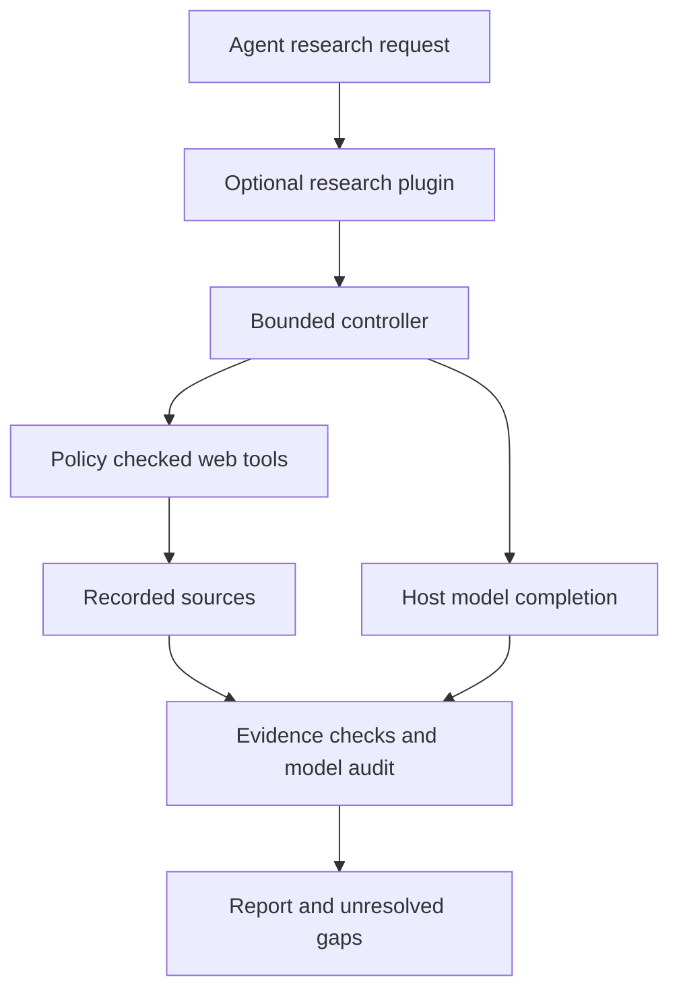

Codex review: needs real behavior proof before merge.

## What this changes

Adds an optional deep_research plugin that plans searches, checks source quotations and calculations, and returns a bounded report.

**Example:** Ask “How long is the river?” using a source stating “The measured river length is 12 km.”
- **Before:** The agent must coordinate research and citation checks itself.
- **After:** The optional tool orchestrates research and returns the finding with its recorded source and unresolved gaps.

## Review scores

| Measure | Result | What it means |
|---|---|---|
| **Overall readiness** | 🧂 unranked krab **(1/6)** | Useful plugin direction and bounded orchestration, with two concrete defects and mocked authority evidence that does not satisfy the final-effect gate. |
| **Proof confidence** | 🧂 unranked krab **(1/6)** | Real behavior proof is necessary before merge. See [Before merge](#before-merge). |
| **Patch quality** | 🦐 gold shrimp **(3/6)** | Security review found an item that needs attention. |

## Product

**Kind:** Feature · **Worth it:** Yes · **Fix scope:** Partial
**User problem:** Users want bounded, cited research through their configured API model without manually coordinating repeated searches and evidence checks.
**Reason:** Maintainer authorship establishes direction, and the optional plugin adds explicit budgets and evidence checks through existing APIs; the broader linked request also asks for visual reports.

## Merge readiness

⛔ **Blocked before merge - 5 items remain**

Keep this PR open: the maintainer-authored plugin adds useful portable research, but its search adapter rejects supported provider responses and its error handling hides actionable model denials.

**Priority:** P2
**Reviewed head:** `ea2a98e7e0af5c49c54184440a7e46b363214810`

## Before merge

- [ ] **Add real behavior proof** - Authority-chain proof required: supplied fixtures mock completion, Gateway dispatch, and invocation authority. Provide production-owner evidence that an allowed requester reaches model/search/fetch I/O, while a requester denied the selected model or web tools and one revoked during awaited preparation is rejected before I/O. Redact credentials and non-public endpoints from traces. After adding proof, update the PR body, then request a new review with `@clawsweeper re-review`. The PR author or someone with repository write access can request it.
- [ ] **Accept citation URLs from answer-shaped search responses (P2)** - With Google configured for web_search, the canonical tool returns kind: "answer" with citations rather than results; synthesized Perplexity responses can use the same form. This required-results parser rejects those successful responses, explore records “Search unavailable,” and an ordinary web-only request finishes without retrieving any sources. Consume citation URLs from the supported answer branch as well as URLs from the results branch, then fetch and verify the underlying pages.
- [ ] **Preserve actionable model-policy failures (P2)** - When a request supplies model without the existing override permission, runtime.llm.complete throws LLM_COMPLETION_NOT_AUTHORIZED with a specific override denial. This catch discards that distinction and returns a partial report saying only that the model did not produce a complete response. Retrying cannot fix the request, and users are not told to omit the override and use the configured model. Preserve a safe error classification and give the corresponding recovery action instead of converting authorization/setup failures into generic model-output failures.
- [ ] **Resolve security concern: Verify authority at nested network effects** - Source uses host-owned invocation assertions and policy-checked APIs, which is appropriate; the remaining uncertainty is whether registered execution carries the original requester and revocation through awaited host preparation to actual model, search, and fetch dispatch.
- [ ] **Resolve merge risk** - Before merge, establish that callers denied the selected model or web tools, and callers revoked during awaited preparation, cannot reach the corresponding final network effect through this new orchestration path.

## Findings

- [P2] Accept citation URLs from answer-shaped search responses — `extensions/deep-research/src/tool.ts:109-113`
- [P2] Preserve actionable model-policy failures — `extensions/deep-research/src/portable.ts:184-186`
- [medium] Verify authority at nested network effects — `extensions/deep-research/src/tool.ts:61`

### Tests

- Low-value test `extensions/deep-research/src/tool.test.ts`: Replace the happy-path mocked runtime call-shape assertions with owner-bound integration coverage: canned Gateway envelopes cannot establish policy enforcement or compatibility with actual normalized search responses.
- Missing end-to-end proof: Missing final-effect authority coverage through registered execution for allowed, denied, and revoked model/web access; the feature tests also do not demonstrate base-fail/head-pass regressions for the identified defects.

<strong>Agent review details</strong>

### How this fits together

The plugin sits between agent tool calls and existing host-owned model completions and web tools, converting a research request into a cited report.

### Technical review

Best possible solution:

Keep research plugin-owned, consume both supported search success forms, and preserve actionable completion failures.

Do we have a high-confidence way to reproduce the issue?

Source establishes both defects: an answer-shaped web_search response fails the required results schema, and an unauthorized model override loses its specific denial in the controller catch.

Is this the best way to solve the issue?

The optional plugin is a suitable owner for bounded orchestration, but its adapters must honor existing host contracts rather than narrowing successful search output or erasing recoverable errors.

Full review comments:

- [P2] Accept citation URLs from answer-shaped search responses — `extensions/deep-research/src/tool.ts:109-113`
  With Google configured for web_search, the canonical tool returns kind: "answer" with citations rather than results; synthesized Perplexity responses can use the same form. This required-results parser rejects those successful responses, explore records “Search unavailable,” and an ordinary web-only request finishes without retrieving any sources. Consume citation URLs from the supported answer branch as well as URLs from the results branch, then fetch and verify the underlying pages.
  Confidence: 0.99
- [P2] Preserve actionable model-policy failures — `extensions/deep-research/src/portable.ts:184-186`
  When a request supplies model without the existing override permission, runtime.llm.complete throws LLM_COMPLETION_NOT_AUTHORIZED with a specific override denial. This catch discards that distinction and returns a partial report saying only that the model did not produce a complete response. Retrying cannot fix the request, and users are not told to omit the override and use the configured model. Preserve a safe error classification and give the corresponding recovery action instead of converting authorization/setup failures into generic model-output failures.
  Confidence: 0.97

Overall correctness: patch is incorrect
Overall confidence: 0.96

AGENTS.md: found and applied where relevant.

Codex review notes: model internal, reasoning medium; reviewed against [0e687614fd9a](https://github.com/openclaw/openclaw/commit/0e687614fd9a8b4bca9dde731e1d34348f07366c).

### Merge-risk options

**Maintainer options:**
1. **Prove requester authority through the real owners (recommended)**  
   Exercise allowed and denied model/web requests through registered plugin execution and real host dispatch, including revocation during preparation, and record whether final I/O occurs.

### Provenance checked

- `Generated plugin inventory and reference counts` keeps the original intent (e4433bd4d559fa5659eb00a12e742d7ba4d7552d: The previous optional-plugin addition refreshed generated inventory; this PR extends the same manifest-derived listing.)

### Testing

Proof path: unit tests only.

### Security

Needs attention: No concrete authorization bypass was established, but final-effect authority evidence is required for the new nested execution path.

### Evidence

Security concerns:

- [medium] Verify authority at nested network effects — `extensions/deep-research/src/tool.ts:61`
  Source uses host-owned invocation assertions and policy-checked APIs, which is appropriate; the remaining uncertainty is whether registered execution carries the original requester and revocation through awaited host preparation to actual model, search, and fetch dispatch.
  Confidence: 0.88

What I checked:

- **Introduced change:** The pinned introduction adds the research plugin and generated documentation; current main has no extensions/deep-research entry. ([`extensions/deep-research/index.ts:11`](https://github.com/openclaw/openclaw/blob/ea2a98e7e0af5c49c54184440a7e46b363214810/extensions/deep-research/index.ts#L11), [ea2a98e7e0af](https://github.com/openclaw/openclaw/commit/ea2a98e7e0af5c49c54184440a7e46b363214810))
- **Search contract mismatch:** The adapter requires results, while the canonical web_search contract also returns answer responses with citations; Google emits this supported form. ([`src/agents/tools/web-search-output.ts:329`](https://github.com/openclaw/openclaw/blob/0e687614fd9a8b4bca9dde731e1d34348f07366c/src/agents/tools/web-search-output.ts#L329), [0e687614fd9a](https://github.com/openclaw/openclaw/commit/0e687614fd9a8b4bca9dde731e1d34348f07366c))
- **Actionable denial discarded:** The host rejects an unauthorized model override with a specific authorization error, but the controller replaces completion exceptions with a generic incomplete-response message. ([`extensions/deep-research/src/portable.ts:184`](https://github.com/openclaw/openclaw/blob/ea2a98e7e0af5c49c54184440a7e46b363214810/extensions/deep-research/src/portable.ts#L184), [ea2a98e7e0af](https://github.com/openclaw/openclaw/commit/ea2a98e7e0af5c49c54184440a7e46b363214810))
- **Authority evidence:** The tool passes its originating session and agent into nested Gateway calls and uses invocation assertions; supplied tests mock both Gateway dispatch and completion, so they do not establish rejection before actual provider or web I/O. ([`extensions/deep-research/src/tool.test.ts:9`](https://github.com/openclaw/openclaw/blob/ea2a98e7e0af5c49c54184440a7e46b363214810/extensions/deep-research/src/tool.test.ts#L9), [ea2a98e7e0af](https://github.com/openclaw/openclaw/commit/ea2a98e7e0af5c49c54184440a7e46b363214810))
- **Maintainer direction and discussion:** The author is a MEMBER, the PR remains a cleanly mergeable draft at the reviewed head, and its body supplies deterministic validation without final-effect authority evidence; discussion contains only bot status comments. ([ea2a98e7e0af](https://github.com/openclaw/openclaw/commit/ea2a98e7e0af5c49c54184440a7e46b363214810))
- **Policy and history:** Root, extension, docs, and SDK guidance were applied; no maintainer-notes directory exists. Main history identifies the completion API introduction and subsequent shared ownership. Some older blobs prevented local follow/blame; GitHub commit patches independently verified the cited owner-authored lines. ([`AGENTS.md:1`](https://github.com/openclaw/openclaw/blob/0e687614fd9a8b4bca9dde731e1d34348f07366c/AGENTS.md#L1), [0e687614fd9a](https://github.com/openclaw/openclaw/commit/0e687614fd9a8b4bca9dde731e1d34348f07366c))

### PR surface

Source +825, Tests +341, Docs +66, Config +19, Other +10. Total +1261 across 18 files. Added test files: 3.

View PR surface stats

| Area | Files | Added | Removed | Net |
|---|---:|---:|---:|---:|
| Source | 7 | 825 | 0 | +825 |
| Tests | 3 | 341 | 0 | +341 |
| Docs | 5 | 68 | 2 | +66 |
| Config | 2 | 19 | 0 | +19 |
| Generated | 0 | 0 | 0 | 0 |
| Other | 1 | 10 | 0 | +10 |
| **Total** | **18** | **1263** | **2** | **+1261** |

### Labels

Label changes:

No label changes.

Label justifications:

- `P2`: The optional feature has a reproducible source-level provider compatibility defect and an actionable-error defect with limited blast radius.
- `merge-risk: 🚨 security-boundary`: The plugin introduces nested session-bound model and web effects, but the supplied mocks do not establish forbidden-principal or revocation rejection at final I/O.
- `rating: 🧂 unranked krab`: Overall readiness is 🧂 unranked krab; proof is 🧂 unranked krab and patch quality is 🦐 gold shrimp.
- `status: 📣 needs proof`: The PR needs real behavior proof before ClawSweeper can clear the contributor ask.

### Rank-up moves

Optional improvements that raise the rating; they are not merge blockers.

- Add final-effect proof for requesters denied the selected model or web tools, including revocation during preparation before provider or web I/O.

### Rating scale

6/6 🦀 challenger crab · 5/6 🦞 diamond lobster · 4/6 🐚 platinum hermit · 3/6 🦐 gold shrimp · 2/6 🦪 silver shellfish · 1/6 🧂 unranked krab. Overall follows the weaker of proof and patch quality; ✨ marks media proof (a screenshot, video, or linked artifact) that directly shows the changed behavior.

### Workflow

ClawSweeper edits this one comment on every review. Comment `@clawsweeper re-review` for a fresh review only. Repair and merge execution lanes are retired.

_Reviewed October 16, 2026, 3:36 AM ET / 07:36 UTC._

<!-- clawsweeper-security:security-sensitive item=173964 sha=ea2a98e7e0af5c49c54184440a7e46b363214810 confidence=high updated_at=2026-10-16T07:31:07Z reviewed_at=2026-10-16T07:36:36.493Z lease_owner=github-run-38867566936-1 lease_comment_id=6210431862 source_revision=40a9f1edfc5aa45e73784aff4eb0c947bcf339dfc6d549c1b9528150d8529895 -->
<!-- clawsweeper-verdict:needs-human item=173964 sha=ea2a98e7e0af5c49c54184440a7e46b363214810 confidence=high updated_at=2026-10-16T07:31:07Z reviewed_at=2026-10-16T07:36:36.493Z lease_owner=github-run-38867566936-1 lease_comment_id=6210431862 source_revision=40a9f1edfc5aa45e73784aff4eb0c947bcf339dfc6d549c1b9528150d8529895 hold=security findings=2 -->
<!-- clawsweeper-review-state:blocked item=173964 sha=ea2a98e7e0af5c49c54184440a7e46b363214810 v=1 -->

<!-- clawsweeper-review-version item=173964 reviewed_at=2026-10-16T07:36:36.493Z sha=ea2a98e7e0af5c49c54184440a7e46b363214810 source_revision=40a9f1edfc5aa45e73784aff4eb0c947bcf339dfc6d549c1b9528150d8529895 lease_owner=github-run-38867566936-1 lease_comment_id=6210431862 v=1 -->

<!-- clawsweeper-review item=173964 -->