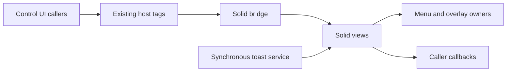

Codex review: needs changes before merge.

## What this changes

This PR moves shared Control UI pickers, dialogs, and toast rendering from Lit to Solid 2 while retaining their existing host tags and caller APIs.

**Example:** Open the Research agent selector in command-palette settings.
- **Before:** Lit and Web Awesome render the selected agent and available choices.
- **After:** Solid renders the same choices through the existing openclaw-agent-select host.

## Review scores

| Measure | Result | What it means |
|---|---|---|
| **Overall readiness** | 🦪 silver shellfish **(2/6)** | Visual and integration evidence supports the migration, but the confirmed keyboard-selection regression prevents readiness. |
| **Proof confidence** | 🦞 diamond lobster **(5/6)** ✨ media proof bonus | Sufficient (screenshot): Inspected before/after browser captures cover the migrated controls and desktop/mobile command-palette integration; the complete body records built-app consumer scenarios, while the latest commit changes only test consumers. |
| **Patch quality** | 🦪 silver shellfish **(2/6)** | 1 actionable review finding remain. |

## Product

**Kind:** Refactor · **Worth it:** Yes · **Fix scope:** Complete
**User problem:** Shared controls still depend on the legacy renderer while surrounding Control UI surfaces migrate to Solid.
**Reason:** Maintainer authorship establishes direction, and the cutover retains shared component boundaries and caller-owned effects.

## Merge readiness

⛔ **Needs changes before merge - 3 items remain**

Keep this PR open: the maintainer-directed migration is useful, but the previously reported ArrowUp selection regression remains.

**Priority:** P2
**Reviewed head:** `f87ae5022d02ad7246e9d9e397b594db85582a6b`

## Before merge

- [ ] **Preserve the enabled selected choice when ArrowUp opens the picker (P2)** - With enabled choices Alpha, Beta, and Gamma and value Beta, ArrowUp on the closed trigger initializes Beta through the menu subscription, then this callback overwrites the highlight with Gamma. Enter consequently commits Gamma. The base prioritizes the enabled stored choice and uses the last row only as a fallback. Preserve that priority and cover ArrowUp reopening with an enabled current value. This repeats the unresolved prior finding; the latest commit leaves this production hunk unchanged.
- [ ] **Complete next step** - Resolve the GitHub-reported merge conflict and classify the collaborator-scroll failures in the current real-Gateway job against base evidence before assigning any additional code repair.
- [ ] **Explain or restore the original intent of Generic picker selection and search** - 932ae87ede92448e3e3d08d161faebb140d05904: Shared search preserves caller-owned selection, and the base opening logic prioritizes an enabled stored choice.

## Findings

- [P2] Preserve the enabled selected choice when ArrowUp opens the picker — `ui/src/components/select-picker-view.tsx:123-126`

### Provenance

- `Generic picker selection and search` changes intended behavior without addressing why it exists (932ae87ede92448e3e3d08d161faebb140d05904: Shared search preserves caller-owned selection, and the base opening logic prioritizes an enabled stored choice.)

<strong>Agent review details</strong>

### How this fits together

Shared controls receive caller-owned choices, values, and callbacks, render browser interactions, and return selections or dialog outcomes to existing domain owners.

### Technical review

Best possible solution:

Retain the Solid migration and restore enabled-selection priority when ArrowUp opens the shared picker.

Do we have a high-confidence way to reproduce the issue?

Source establishes the ArrowUp regression by tracing opening publication, selected-value initialization, and the subsequent last-row override; no target code was executed.

Is this the best way to solve the issue?

The existing bridge, menu, overlay, and synchronous domain owners are appropriate for this migration, with a focused selection-priority correction required.

Full review comments:

- [P2] Preserve the enabled selected choice when ArrowUp opens the picker — `ui/src/components/select-picker-view.tsx:123-126`
  With enabled choices Alpha, Beta, and Gamma and value Beta, ArrowUp on the closed trigger initializes Beta through the menu subscription, then this callback overwrites the highlight with Gamma. Enter consequently commits Gamma. The base prioritizes the enabled stored choice and uses the last row only as a fallback. Preserve that priority and cover ArrowUp reopening with an enabled current value. This repeats the unresolved prior finding; the latest commit leaves this production hunk unchanged.
  Confidence: 0.98

Overall correctness: patch is incorrect
Overall confidence: 0.95

AGENTS.md: found and applied where relevant.

Codex review notes: model internal, reasoning medium; reviewed against [a00fb480d3cf](https://github.com/openclaw/openclaw/commit/a00fb480d3cf7d5c7d396ac8c752ad7e32e7d5ee).

### Provenance checked

- `Shared agent selection` keeps the original intent (c780d8b1c02a3c2baa12ee62d478f24e4827d9c2: https://github.com/openclaw/openclaw/pull/112488 unified avatar-aware controls while retaining caller-owned values and effects.)
- `Promise dialogs` keeps the original intent (292b304fd3def2934ffd476a27f810e561b415c0: The shared promise-modal host owns settlement and cleanup; the migrated views retain that owner and pending-submit cancellation behavior.)
- `Toast lifecycle` keeps the original intent (39ddf710f0f3f873c7fb2e73f8127bf649f9b018: The shared toast provides Undo and dismissal outcomes; subsequent lifecycle work preserves paused deadlines and modal placement.)
- `Nested Lit and Solid mounting` changes intended behavior with a stated reason (7c06f398aee52ee7f7c3a3e82b22e353fe129b2b: The retained boundary preserves owner context; this PR explains replacing nested top-level rendering with an owned root to avoid premature parent settlement.)
- `Appearance rendering` keeps the original intent (c1258c0864823070c771f04e8f1af1df314683c8: Shared appearance controls retain their host tags, callback contract, glyph handling, and existing selection owner.)
- `Agent emoji selection` keeps the original intent (0cf4182dc9ececb0c8168c57d1a1e5320abb27cd: The searchable emoji picker populates the existing identity draft rather than owning persistence.)

### Testing

Proof path: shipped entry point.

### Security

None.

### Evidence

Acceptance criteria:

- pnpm --dir ui test src/components/select-picker.behavior.browser.test.ts --project browser --maxWorkers=1
- OPENCLAW_UI_WEBKIT=1 pnpm --dir ui test src/components/select-picker.behavior.browser.test.ts --project webkit --maxWorkers=1
- git diff --check

What I checked:

- **Introduced changes and current main:** The pinned merge-base-to-head diff establishes the Solid cutover; fetched main still contains the Lit shared picker implementation. ([`ui/src/components/select-picker.ts:1`](https://github.com/openclaw/openclaw/blob/f87ae5022d02ad7246e9d9e397b594db85582a6b/ui/src/components/select-picker.ts#L1), [f87ae5022d02](https://github.com/openclaw/openclaw/commit/f87ae5022d02ad7246e9d9e397b594db85582a6b))
- **Remaining keyboard regression:** The opening callback unconditionally highlights the last enabled option for ArrowUp, overriding the enabled stored selection initialized by the shared menu adapter. ([`ui/src/components/select-picker-view.tsx:123`](https://github.com/openclaw/openclaw/blob/f87ae5022d02ad7246e9d9e397b594db85582a6b/ui/src/components/select-picker-view.tsx#L123), [f87ae5022d02](https://github.com/openclaw/openclaw/commit/f87ae5022d02ad7246e9d9e397b594db85582a6b))
- **Original selection contract:** Main prioritizes the enabled stored choice for either opening arrow; the last option is only a fallback. The original searchable-picker contribution preserves caller-owned selection: https://github.com/openclaw/openclaw/pull/141894. ([`ui/src/components/select-picker.ts:154`](https://github.com/openclaw/openclaw/blob/a00fb480d3cf7d5c7d396ac8c752ad7e32e7d5ee/ui/src/components/select-picker.ts#L154), [a00fb480d3cf](https://github.com/openclaw/openclaw/commit/a00fb480d3cf7d5c7d396ac8c752ad7e32e7d5ee))
- **Prior finding reassessment:** The latest commit repairs both archive suites with observable Solid readiness waits while retaining Undo and partial-error assertions; it does not change the picker opening logic. ([`ui/src/pages/sessions/sessions-page.archive-outcome.test.ts:159`](https://github.com/openclaw/openclaw/blob/f87ae5022d02ad7246e9d9e397b594db85582a6b/ui/src/pages/sessions/sessions-page.archive-outcome.test.ts#L159), [f87ae5022d02](https://github.com/openclaw/openclaw/commit/f87ae5022d02ad7246e9d9e397b594db85582a6b))
- **Inspected visual evidence:** Read the complete PR body and inspected all supplied before/after pairs and desktop/mobile command-palette captures; they support the visual cutover and show the expressly accepted agent-menu spacing and confirmation-text differences. ([f87ae5022d02](https://github.com/openclaw/openclaw/commit/f87ae5022d02ad7246e9d9e397b594db85582a6b))
- **Current merge state:** GitHub reports mergeable=false and mergeable_state=dirty for the reviewed head. ([f87ae5022d02](https://github.com/openclaw/openclaw/commit/f87ae5022d02ad7246e9d9e397b594db85582a6b))

Likely related people:

- **Peter Steinberger:** Raw commit 9394889ffad185678828ca6c8e5dd631f5406436 adds ui/src/lib/toast.ts:137 relative to its recorded parents. This identifies author metadata, not feature responsibility or a PR merger. (role: source-line author; confidence: high; commits: [9394889ffad1](https://github.com/openclaw/openclaw/commit/9394889ffad185678828ca6c8e5dd631f5406436); files: `ui/src/lib/toast.ts`)
- **Vyctor H. Brzezowski:** Raw commit b977ccb21e2b4b8bff05729548ea1b1558a74a33 adds ui/src/lib/toast.ts:26 relative to its recorded parents. This identifies author metadata, not feature responsibility or a PR merger. (role: source-line author; confidence: medium; commits: [b977ccb21e2b](https://github.com/openclaw/openclaw/commit/b977ccb21e2b4b8bff05729548ea1b1558a74a33); files: `ui/src/lib/toast.ts`)

### PR surface

PR surface statistics unavailable: the file list is incomplete.

### Labels

Label changes:

No label changes.

Label justifications:

- `P2`: The remaining defect changes keyboard selection in shared controls, with no evidence of an urgent production outage.
- `rating: 🦪 silver shellfish`: Overall readiness is 🦪 silver shellfish; proof is 🦞 diamond lobster and patch quality is 🦪 silver shellfish.
- `status: ⏳ waiting on author`: ClawSweeper has contributor-facing work open and is waiting for author action.
- `proof: sufficient`: Contributor real behavior proof is sufficient.
- `proof: 📸 screenshot`: Contributor real behavior proof includes screenshot evidence.

### Rating scale

6/6 🦀 challenger crab · 5/6 🦞 diamond lobster · 4/6 🐚 platinum hermit · 3/6 🦐 gold shrimp · 2/6 🦪 silver shellfish · 1/6 🧂 unranked krab. Overall follows the weaker of proof and patch quality; ✨ marks media proof (a screenshot, video, or linked artifact) that directly shows the changed behavior.

### Workflow

ClawSweeper edits this one comment on every review. Comment `@clawsweeper re-review` for a fresh review only. Repair and merge execution lanes are retired.

### History

Review history (7 earlier review cycles)

<!-- clawsweeper-review-history v=1 total=7 -->
- reviewed 2026-10-12T23:41:37.846Z sha 85e254d074beb1401d8a9315056fdec1ad5193ae :: needs changes before merge. :: none
- reviewed 2026-10-13T00:15:15.859Z sha 85e254d074beb1401d8a9315056fdec1ad5193ae :: needs changes before merge. :: [P2] Route the new view imports through the existing Lit interop owner
- reviewed 2026-10-13T00:34:06.269Z sha 85e254d074beb1401d8a9315056fdec1ad5193ae :: needs changes before merge. :: [P2] Route the new view imports through the Lit interop owner | [P2] Migrate the remaining agent-picker test consumers | [P2] Preserve the command-palette trigger grid through the new wrapper
- reviewed 2026-10-13T01:05:18.415Z sha feef9059a630e4f9e3159a22cf194d7b207ba4cc :: needs changes before merge. :: [P2] Exclude the drawer itself from the nested Escape guard | [P2] Keep toast registration within the chat-send line-cap allowance
- reviewed 2026-10-13T01:32:33.482Z sha f914f6454ee6a968a4007d1dffbaafcebd19d794 :: needs changes before merge. :: [P2] Keep toast registration within the chat-test line-cap allowance | [P2] Keep both shell files within their existing line caps
- reviewed 2026-10-13T02:13:07.338Z sha 9ba774fc103cc556211f2a8ff54d32c63b98395c :: needs maintainer review before merge. :: none
- reviewed 2026-10-13T02:44:08.160Z sha 377495d11d04d65e34cf949a9216989849224c1d :: needs changes before merge. :: [P2] Preserve the enabled selected choice when ArrowUp opens the picker | [P2] Wait for the lazy toast view in both archive outcome suites

_Reviewed October 12, 2026, 11:27 PM ET / October 13, 2026, 03:27 UTC (Revision 8)._

<!-- clawsweeper-verdict:needs-changes item=170387 sha=f87ae5022d02ad7246e9d9e397b594db85582a6b confidence=high updated_at=2026-10-13T03:20:43Z reviewed_at=2026-10-13T03:27:27.131Z lease_owner=github-run-38341173100-1 lease_comment_id=6137455317 source_revision=6081439b7dc80d8e454990bd30eb27b3ae7ef76d04dae92f0da7fae8da868ed4 -->
<!-- clawsweeper-review-state:needs-changes item=170387 sha=f87ae5022d02ad7246e9d9e397b594db85582a6b v=1 -->

<!-- clawsweeper-review-version item=170387 reviewed_at=2026-10-13T03:27:27.131Z sha=f87ae5022d02ad7246e9d9e397b594db85582a6b source_revision=6081439b7dc80d8e454990bd30eb27b3ae7ef76d04dae92f0da7fae8da868ed4 lease_owner=github-run-38341173100-1 lease_comment_id=6137455317 v=1 -->

<!-- clawsweeper-review item=170387 -->