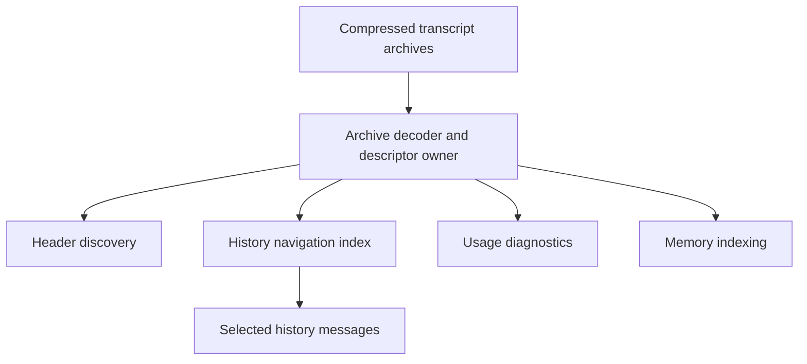

Codex review: needs maintainer review before merge.

## What this changes

This PR replaces decompressed archive-cache files with direct streaming reads for discovery, history, diagnostics, and memory indexing.

**Example:** Diagnostic reads inspect 300 compressed archives containing 325,252,990 decoded bytes.
- **Before:** The reported baseline retains 300 plaintext cache files.
- **After:** The reported fixed Gateway retains zero plaintext files while archives remain readable.

## Review scores

| Measure | Result | What it means |
|---|---|---|
| **Overall readiness** | 🦐 gold shrimp **(3/6)** | The focused patch has no identified actionable defect and relevant regression coverage; execution confidence rests on reported Gateway results rather than inspectable captures. |
| **Proof confidence** | 🦐 gold shrimp **(3/6)** | This maintainer-authored PR is outside the ordinary contributor proof gate; its body reports final-head macOS Gateway diagnostics under ENOSPC, late-corruption history fallback, large-archive pagination, memory indexing, and a real model turn, without an attached raw capture. |
| **Patch quality** | 🐚 platinum hermit **(4/6)** | No actionable review findings were identified. |

## Product

**Kind:** Bug fix · **Worth it:** Yes · **Fix scope:** Complete
**User problem:** Reading retained conversations fills shared temporary storage with complete decompressed archive copies.
**Reason:** The measured storage defect warrants repair, and the maintainer-authored direction explicitly accepts repeated decompression to eliminate plaintext disk allocation.

## Merge readiness

✅ **Ready for maintainer review**

Keep this PR open: it addresses a verified temporary-storage defect, and the latest commit resolves the previous fallback finding; no remaining actionable defect was identified.

**Priority:** P2
**Reviewed head:** `0b57a97ae8e49d5108fb8e269ecf26111a8cb849`

## Before merge

None.

## Findings

None.

<strong>Agent review details</strong>

### How this fits together

Retained transcript archives feed header discovery, history navigation and payload reads, usage diagnostics, and memory indexing through the shared archive decoder.

### Technical review

Best possible solution:

Land the direct-decoding cutover with readable-generation fallback, source-bound cursors, and the existing decoded-size ceiling intact.

Do we have a high-confidence way to reproduce the issue?

Current-main source establishes complete plaintext accumulation with age-only cleanup, corroborated by repeated measurements on an official release; this review ran no target code.

Is this the best way to solve the issue?

Removing plaintext production addresses the root cause without eviction races or new configuration, and the latest revision preserves the previously missing corruption fallback.

AGENTS.md: found and applied where relevant.

Codex review notes: model internal, reasoning medium; reviewed against [37706a74a811](https://github.com/openclaw/openclaw/commit/37706a74a81129f8ec85289399a2703abf98c2b4).

### Provenance checked

- `Plaintext materialization` changes intended behavior with a stated reason (b5251c4274f0b58f613b7d451b5cec37e3e248a5: Restore compressed history and usage readability through source-validated plaintext paths.)
- `Streaming decoder and expansion ceiling` keeps the original intent (352e51e78c697a1a71613a2a6f357a12adb66498: Read valid expanding archives with bounded streaming memory and retain a 4 GiB decoded ceiling.)
- `Incremental archive navigation` changes intended behavior with a stated reason (12785be2ff02a11e6587399ea3a0ac6ea2a4be36: Bound source preparation and payload pages while retaining branch, reset, and full-result behavior.)
- `Transcript read ownership` keeps the original intent (932846b521c0a9fc0eba711f346621cd3398bcf7: Separate read-only owners while preserving validation, ordering, fences, and cleanup.)
- `Readable reset-archive fallback` keeps the original intent (b9e8e6d66ea6683afd933ca50e25b0f2f056a973: Recover retained history when the active transcript is unavailable.)

### Testing

Proof path: in-process harness.

### Security

None.

### Evidence

What I checked:

- **Current-main storage defect:** Fetched main still materializes complete plaintext archives and reclaims them only by age; SquareXRay reports repeated regeneration of 495 copies consuming 623 MB on a 1 GiB tmpfs in https://github.com/openclaw/openclaw/issues/193193. ([`src/config/sessions/archive-compression.ts:111`](https://github.com/openclaw/openclaw/blob/37706a74a81129f8ec85289399a2703abf98c2b4/src/config/sessions/archive-compression.ts#L111), [37706a74a811](https://github.com/openclaw/openclaw/commit/37706a74a81129f8ec85289399a2703abf98c2b4))
- **Complete reader cutover:** The introduced diff removes the materializer, disk writer, TTL sweep, and stale-copy scrub, and migrates their production callers; retained cache-shaped path helpers still identify existing usage rollups. ([`src/config/sessions/archive-compression.ts:108`](https://github.com/openclaw/openclaw/blob/0b57a97ae8e49d5108fb8e269ecf26111a8cb849/src/config/sessions/archive-compression.ts#L108), [0b57a97ae8e4](https://github.com/openclaw/openclaw/commit/0b57a97ae8e49d5108fb8e269ecf26111a8cb849))
- **Previous finding resolved:** The latest commit retains matching generations and retries older archives after decode corruption; regression coverage exercises incremental fallback and preserves corruption errors for exact-path reads, addressing https://github.com/openclaw/openclaw/pull/193548#discussion_r4482347281. ([`src/gateway/session-transcript-index.fs.test.ts:161`](https://github.com/openclaw/openclaw/blob/0b57a97ae8e49d5108fb8e269ecf26111a8cb849/src/gateway/session-transcript-index.fs.test.ts#L161), [0b57a97ae8e4](https://github.com/openclaw/openclaw/commit/0b57a97ae8e49d5108fb8e269ecf26111a8cb849))
- **Accepted decompression tradeoff:** The maintainer-authored body explicitly accepts repeated decompression during backward and resumed reads to eliminate plaintext allocation. Source confirms prefix replay between source pages, as discussed at https://github.com/openclaw/openclaw/pull/193548#discussion_r4482616753; this accepted cost is not raised again as a blocker. ([`src/gateway/session-transcript-index.fs.ts:223`](https://github.com/openclaw/openclaw/blob/0b57a97ae8e49d5108fb8e269ecf26111a8cb849/src/gateway/session-transcript-index.fs.ts#L223), [0b57a97ae8e4](https://github.com/openclaw/openclaw/commit/0b57a97ae8e49d5108fb8e269ecf26111a8cb849))
- **Original contracts and related alternatives:** https://github.com/openclaw/openclaw/pull/104795 restored compressed readability through materialization; https://github.com/openclaw/openclaw/pull/192743 removed background Usage materialization only. The cache-budget alternatives remain distinct implementations of the same report, and HeMiaolin explains eviction and pagination hazards in the withdrawn https://github.com/openclaw/openclaw/pull/193292. ([`src/config/sessions/archive-compression.ts`](https://github.com/openclaw/openclaw/blob/b5251c4274f0b58f613b7d451b5cec37e3e248a5/src/config/sessions/archive-compression.ts), [b5251c4274f0](https://github.com/openclaw/openclaw/commit/b5251c4274f0b58f613b7d451b5cec37e3e248a5))
- **Validation state:** Exact-head checks remain pending, with no completed failing check in the retrieved results; cancelled automation and neutral CodeQL configuration coverage do not establish a patch defect. The checkout remained clean, and no target code or tests were executed. ([0b57a97ae8e4](https://github.com/openclaw/openclaw/commit/0b57a97ae8e49d5108fb8e269ecf26111a8cb849))

Likely related people:

- **Peter Steinberger:** Raw commit 12785be2ff02a11e6587399ea3a0ac6ea2a4be36 adds src/gateway/session-transcript-index.fs.ts:305 relative to its recorded parents. This identifies author metadata, not feature responsibility or a PR merger. (role: source-line author; confidence: high; commits: [12785be2ff02](https://github.com/openclaw/openclaw/commit/12785be2ff02a11e6587399ea3a0ac6ea2a4be36); files: `src/gateway/session-transcript-index.fs.ts`)
- **Ayaan Zaidi:** Raw commit 352e51e78c697a1a71613a2a6f357a12adb66498 adds src/config/sessions/archive-compression.ts:76 relative to its recorded parents. This identifies author metadata, not feature responsibility or a PR merger. (role: source-line author; confidence: high; commits: [352e51e78c69](https://github.com/openclaw/openclaw/commit/352e51e78c697a1a71613a2a6f357a12adb66498); files: `src/config/sessions/archive-compression.ts`)
- **Vincent Koc:** Raw commit 932846b521c0a9fc0eba711f346621cd3398bcf7 adds src/gateway/session-transcript-archive-reader.ts:178 relative to its recorded parents. This identifies author metadata, not feature responsibility or a PR merger. (role: source-line author; confidence: high; commits: [932846b521c0](https://github.com/openclaw/openclaw/commit/932846b521c0a9fc0eba711f346621cd3398bcf7); files: `src/gateway/session-transcript-archive-reader.ts`)

### PR surface

Source +25, Tests +13, Docs +4. Total +42 across 12 files. Added test files: 0.

View PR surface stats

| Area | Files | Added | Removed | Net |
|---|---:|---:|---:|---:|
| Source | 8 | 282 | 257 | +25 |
| Tests | 3 | 98 | 85 | +13 |
| Docs | 1 | 6 | 2 | +4 |
| Config | 0 | 0 | 0 | 0 |
| Generated | 0 | 0 | 0 | 0 |
| Other | 0 | 0 | 0 | 0 |
| **Total** | **12** | **386** | **344** | **+42** |

### Preflight source

Source unknown. Source comparison at the observed PR snapshot only. Completion is self-reported; body, policy, tests, execution, and report bytes are not verified.

### Review metrics

| Metric | Value | Why it matters |
|---|---|---|
| **Production versus test changes** | Production +282/-257; tests +98/-85 | The modest growth provides decoded positional reads, descriptor ownership, and corruption fallback while deleting plaintext-cache machinery. |

### Root-cause cluster

Relationship: `fixed_by_candidate`
Canonical: https://github.com/openclaw/openclaw/issues/193193
Summary: These submissions address the same retained plaintext-cache footprint; the earlier merged streaming change covered background Usage scans.

Members:
- `canonical`: https://github.com/openclaw/openclaw/issues/193193 - Measured report identifies the same materializer and aggregate temporary-storage growth.
- `same_root_cause`: https://github.com/openclaw/openclaw/pull/193228 - Alternative introduces byte and entry budgets for the same plaintext cache.
- `same_root_cause`: https://github.com/openclaw/openclaw/pull/193343 - Alternative bounds aggregate plaintext-cache bytes.
- `same_root_cause`: https://github.com/openclaw/openclaw/pull/193292 - Withdrawn budget implementation documents eviction-related readability and pagination regressions.
- `partial_overlap`: https://github.com/openclaw/openclaw/pull/192743 - Merged streaming change removes background Usage materialization while retaining the readers changed here.

Proposal only: this assessment does not dispatch repair, suppress jobs, mutate sibling items, close, or merge anything.

### Labels

Label changes:

- add `status: 👀 ready for maintainer look`: ClawSweeper has no concrete contributor-facing blocker left for this PR.
- remove `status: ⏳ waiting on author`: Current PR status label is `status: 👀 ready for maintainer look`.

Label justifications:

- `P2`: The linked report establishes substantial shared temporary-storage pressure on archive-heavy deployments without an observed outage or data loss.
- `rating: 🦐 gold shrimp`: Overall readiness is 🦐 gold shrimp; proof is 🦐 gold shrimp and patch quality is 🐚 platinum hermit.
- `status: 👀 ready for maintainer look`: ClawSweeper has no concrete contributor-facing blocker left for this PR.

### Rating scale

6/6 🦀 challenger crab · 5/6 🦞 diamond lobster · 4/6 🐚 platinum hermit · 3/6 🦐 gold shrimp · 2/6 🦪 silver shellfish · 1/6 🧂 unranked krab. Overall follows the weaker of proof and patch quality; ✨ marks media proof (a screenshot, video, or linked artifact) that directly shows the changed behavior.

### Workflow

ClawSweeper edits this one comment on every review. Comment `@clawsweeper re-review` for a fresh review only. Repair and merge execution lanes are retired.

### History

Review history (1 earlier review cycle)

<!-- clawsweeper-review-history v=1 total=1 -->
- reviewed 2026-11-05T15:34:52.867Z sha 651b9e31a688317419dd41e896116af98f47d1f5 :: needs changes before merge. :: [P2] Preserve older-archive fallback after a selected archive fails decoding

_Reviewed November 5, 2026, 10:55 AM ET / 15:55 UTC (Revision 2)._

<!-- clawsweeper-verdict:needs-human item=193548 sha=0b57a97ae8e49d5108fb8e269ecf26111a8cb849 confidence=high updated_at=2026-11-05T15:51:10Z reviewed_at=2026-11-05T15:55:27.778Z lease_owner=github-run-42059055557-1 lease_comment_id=6662289440 source_revision=a97ed4aad7dafb10ede030d21f1c0c12491b645f1eaac095b91390af2fe5fcda hold=not_opted_in findings=0 -->
<!-- clawsweeper-review-state:ready item=193548 sha=0b57a97ae8e49d5108fb8e269ecf26111a8cb849 v=1 -->

<!-- clawsweeper-review-version item=193548 reviewed_at=2026-11-05T15:55:27.778Z sha=0b57a97ae8e49d5108fb8e269ecf26111a8cb849 source_revision=a97ed4aad7dafb10ede030d21f1c0c12491b645f1eaac095b91390af2fe5fcda lease_owner=github-run-42059055557-1 lease_comment_id=6662289440 v=1 -->

<!-- clawsweeper-review item=193548 -->