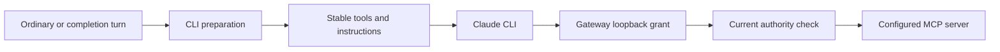

Codex review: blocked before merge.

## What this changes

This PR gives ordinary managed Claude CLI turns and child completions one OpenClaw-mediated tool surface while preserving configured MCP access.

**Example:** A Claude CLI parent spawns a child, receives its completion, and calls probe__echo with KIWI.
- **Before:** The completion changes the tool surface and can start a fresh native conversation with no cache reuse.
- **After:** The completion resumes the parent with the same tool catalog, and the configured server returns probe:KIWI through OpenClaw.

## Review scores

| Measure | Result | What it means |
|---|---|---|
| **Overall readiness** | 🦐 gold shrimp **(3/6)** | Strong supplied production and authority evidence supports the focused repair; public-description cleanup remains, and the broader linked issue is only partly addressed. |
| **Proof confidence** | 🦞 diamond lobster **(5/6)** | Sufficient (live_output): Supplied built-Gateway WebChat runs with real Claude Code exercise ordinary turns, spawning, completion, configured stdio MCP calls, and subsequent turns with a stable parent catalog and cache reuse. A v2026.10.5 upgrade exercises the same stored state. The real HTTP transport harness additionally proves allowed requests and rejection before configured-server I/O after grant revocation or completion reassignment, plus sandboxed Workshop refusal. The latest change only replaces synchronization in that harness, and its ordering was verified against the pinned SDK. |
| **Patch quality** | 🐚 platinum hermit **(4/6)** | Security review found an item that needs attention. |

## Product

**Kind:** Bug fix · **Worth it:** Yes · **Fix scope:** Partial
**User problem:** A child completion can replace a managed Claude parent's tool prefix, discard native conversation continuity, and rebuild the prompt cache.
**Reason:** The scoped Claude repair has demonstrated value and recorded isolation direction; the broader linked cache-stability issue correctly remains Related rather than closed.

## Merge readiness

⛔ **Blocked before merge - 3 items remain**

This PR provides a useful repair for managed Claude CLI cache churn, and the previous synchronization finding is resolved.

**Priority:** P2
**Reviewed head:** `1f3498d51eb4d29a098556016cc2fe7e784a68cc`

## Before merge

- [ ] **\[P3\] Remove private session links from the public PR body (P3)** - The Work sessions section publishes private session URLs, including their session identifiers. Remove those links and the AI workflow disclosure above them; retain the technical evidence and verified human credit without exposing private work-session locations.
- [ ] **Resolve security concern: Private work-session locations are publicly disclosed** - The finding concerns disclosure of private locations and identifiers; it does not establish that their underlying session contents are publicly accessible.
- [ ] **Complete next step** - A maintainer must review and approve the security-sensitive changes on head 1f3498d51eb4d29a098556016cc2fe7e784a68cc.

## Findings

- [P3] [P3] Remove private session links from the public PR body — `PR body:68-73`
- [low] Private work-session locations are publicly disclosed — `PR body:72`

<strong>Agent review details</strong>

### How this fits together

CLI preparation converts session policy into Claude arguments, prompts, and a loopback grant; Gateway tool resolution enforces that grant before dispatching configured MCP requests.

### Technical review

Best possible solution:

Retain the existing mediated projection and session MCP runtime as the owners of stable definitions, current authority, and cleanup.

Do we have a high-confidence way to reproduce the issue?

Current main still selects different default ordinary and completion surfaces; independent discussion and supplied live baseline results establish the resulting reset and cache miss, although no target code was executed during this review.

Is this the best way to solve the issue?

Using the existing mediated policy projection is coherent; the configured-server bridge, complete instructions, transcript filter, and retained Workshop shape address concrete consequences of that cutover.

Full review comments:

- [P3] [P3] Remove private session links from the public PR body — `PR body:68-73`
  The Work sessions section publishes private session URLs, including their session identifiers. Remove those links and the AI workflow disclosure above them; retain the technical evidence and verified human credit without exposing private work-session locations.
  Confidence: 1

Overall correctness: patch is correct
Overall confidence: 0.93

AGENTS.md: found and applied where relevant.

Codex review notes: model internal, reasoning medium; reviewed against [42a73b62bb18](https://github.com/openclaw/openclaw/commit/42a73b62bb18abd0dc6b68fca0daf50f62331f79).

### Provenance checked

- `Completion tool mediation and stable catalogs` keeps the original intent (72f5840c11922793dfacad33c9fc1c0bd3e8b175: Completion turns required policy-filtered tools without exposing native tools that bypass requester caps; https://github.com/openclaw/openclaw/pull/176892 subsequently retained definitions while gating execution.)
- `Ordinary Claude native customization` changes intended behavior with a stated reason (unknown: Existing ordinary turns used native settings and tools; the current PR explicitly documents their removal from managed turns and records VACInc's isolation direction.)
- `Bootstrap routing` keeps the original intent (e92bfd892a741c56b18e6373ae5b229369fd3c0b: CLI runs must receive the bootstrap ritual only when their effective tools can complete it; moving routing after final projection preserves that purpose.)
- `Workshop personal-library authority` keeps the original intent (75bcd267f5e72086fa5361e263b0f6cb1248adc6: Personal libraries require caller-bound authoring authority; retained internal-turn shapes refuse personal calls and preserve the existing unsandboxed workspace rule.)
- `Orphaned Claude tool-use detection` keeps the original intent (16b510807bdc9f8ce471a4cb4abd9d16ea341822: Incomplete tool conversations must not resume; excluding diagnostic request echoes preserves detection of actual unanswered conversation calls.)

### Testing

Proof path: shipped entry point.

### Security

Needs attention: The runtime authority path has suitable positive and negative evidence; the remaining concern is public-description privacy.

### Evidence

Security concerns:

- [low] Private work-session locations are publicly disclosed — `PR body:72`
  The finding concerns disclosure of private locations and identifiers; it does not establish that their underlying session contents are publicly accessible.
  Confidence: 1

What I checked:

- **Introduced change and current main:** The pinned introduced diff adds ordinaryClaudeMediation to the existing exact-tool projection; fetched main retains the earlier policy. The central managed-turn change remains necessary. ([`src/agents/cli-runner/prepare-tool-policy.ts:97`](https://github.com/openclaw/openclaw/blob/1f3498d51eb4d29a098556016cc2fe7e784a68cc/src/agents/cli-runner/prepare-tool-policy.ts#L97), [1f3498d51eb4](https://github.com/openclaw/openclaw/commit/1f3498d51eb4d29a098556016cc2fe7e784a68cc))
- **Previous finding resolved:** The latest commit removes the fixed sleep and waits for replies to pings sent after tools/list_changed on the same SSE streams. ([`src/gateway/mcp-http.configured-mcp-authority.test.ts:168`](https://github.com/openclaw/openclaw/blob/1f3498d51eb4d29a098556016cc2fe7e784a68cc/src/gateway/mcp-http.configured-mcp-authority.test.ts#L168), [1f3498d51eb4](https://github.com/openclaw/openclaw/commit/1f3498d51eb4d29a098556016cc2fe7e784a68cc))
- **Pinned dependency confirms synchronization:** OpenClaw imports @modelcontextprotocol/client 2.3.1, and the new proof depends on its notification dispatch. At that tag, debounceMs=0 invokes refresh immediately, and autoRefresh=false invokes onChanged before awaiting anything; notification and request handlers preserve dispatch order. This supports the ping barrier. No AGENTS.md appeared in the dependency tree. ([`packages/client/src/client/client.ts:2593`](https://github.com/modelcontextprotocol/typescript-sdk/blob/fcef852f6cdafea07f36cf6fae69b37c8adf85be/packages/client/src/client/client.ts#L2593), [fcef852f6cda](https://github.com/modelcontextprotocol/typescript-sdk/commit/fcef852f6cdafea07f36cf6fae69b37c8adf85be))
- **Final-effect authority coverage:** The loopback propagates current grant and completion-lineage checks into configured-server requests. The supplied production-path HTTP harness exercises allowed calls and rejection after revocation or reassignment during catalog refresh for tools, resources, and prompts, plus sandboxed Workshop refusal. ([`src/gateway/mcp-http.configured-mcp-authority.test.ts:426`](https://github.com/openclaw/openclaw/blob/1f3498d51eb4d29a098556016cc2fe7e784a68cc/src/gateway/mcp-http.configured-mcp-authority.test.ts#L426), [1f3498d51eb4](https://github.com/openclaw/openclaw/commit/1f3498d51eb4d29a098556016cc2fe7e784a68cc))
- **Live behavior and stable-release upgrade:** The full PR body supplies built-Gateway WebChat and real Claude Code results: identical parent tool hashes, retained probe:KIWI access, and high completion cache reuse. Its v2026.10.5 upgrade preserves session identity, model, configuration, and stored history, with one native-session reset. History reseeding and saved-key authentication failures are explicitly reproduced on main too. The downloaded screenshot was inspected and shows an unrelated restart flow, so it was not counted as cache proof. ([1f3498d51eb4](https://github.com/openclaw/openclaw/commit/1f3498d51eb4d29a098556016cc2fe7e784a68cc))
- **Discussion and accepted isolation direction:** holgergruenhagen and cassthebandit documented configured-server loss on an earlier revision; the current bridge addresses that regression. VACInc's recorded security approval supports the isolation direction, but predates the current head and does not satisfy its fresh approval gate. ([1f3498d51eb4](https://github.com/openclaw/openclaw/commit/1f3498d51eb4d29a098556016cc2fe7e784a68cc))

### PR surface

Source +437, Tests +1592, Docs +26. Total +2055 across 33 files. Added test files: 4.

View PR surface stats

| Area | Files | Added | Removed | Net |
|---|---:|---:|---:|---:|
| Source | 20 | 507 | 70 | +437 |
| Tests | 12 | 1600 | 8 | +1592 |
| Docs | 1 | 28 | 2 | +26 |
| Config | 0 | 0 | 0 | 0 |
| Generated | 0 | 0 | 0 | 0 |
| Other | 0 | 0 | 0 | 0 |
| **Total** | **33** | **2135** | **80** | **+2055** |

### Labels

Label changes:

- add `rating: 🦐 gold shrimp`: Overall readiness is 🦐 gold shrimp; proof is 🦞 diamond lobster and patch quality is 🐚 platinum hermit.
- remove `rating: 🐚 platinum hermit`: Current PR rating is `rating: 🦐 gold shrimp`, so this older rating label is no longer current.

Label justifications:

- `P2`: The repair addresses repeatable cache rebuilding and conversation discontinuity in managed Claude CLI completion workflows.
- `merge-risk: 🚨 compatibility`: Managed ordinary turns intentionally stop loading Claude-native customization and switch configured MCP access to OpenClaw mediation; the direction is recorded, documented, and covered by supplied upgrade evidence.
- `rating: 🦐 gold shrimp`: Overall readiness is 🦐 gold shrimp; proof is 🦞 diamond lobster and patch quality is 🐚 platinum hermit.
- `status: ⏳ waiting on author`: ClawSweeper has contributor-facing work open and is waiting for author action.
- `proof: sufficient`: Contributor real behavior proof is sufficient.

### Rating scale

6/6 🦀 challenger crab · 5/6 🦞 diamond lobster · 4/6 🐚 platinum hermit · 3/6 🦐 gold shrimp · 2/6 🦪 silver shellfish · 1/6 🧂 unranked krab. Overall follows the weaker of proof and patch quality; ✨ marks media proof (a screenshot, video, or linked artifact) that directly shows the changed behavior.

### Workflow

ClawSweeper edits this one comment on every review. Comment `@clawsweeper re-review` for a fresh review only. Repair and merge execution lanes are retired.

### History

Review history (14 earlier review cycles; latest 8 shown)

<!-- clawsweeper-review-history v=1 total=14 -->
- reviewed 2026-10-19T19:33:45.155Z sha bf6e20403ea05f22eec34f2973f79c8344a475b6 :: needs real behavior proof before merge. :: [P2] Preserve upstream MCP instructions when replacing native connections | [P2] Preserve authorized workspace Workshop calls on internal turns
- reviewed 2026-10-20T03:04:47.876Z sha 213dd44de55336fa1770b2b26f9c00679dd4fea1 :: needs real behavior proof before merge. :: [P1] Apply the final authority guard to resource and prompt requests | [P2] Preserve complete upstream server instructions
- reviewed 2026-10-20T03:44:29.494Z sha 956b30d3321cbe2919b6d577feba679fe655dd83 :: needs real behavior proof before merge. :: none
- reviewed 2026-10-20T04:02:14.820Z sha ff09c14ef2054c350d7add9a349538ba85ac7062 :: needs changes before merge. :: none
- reviewed 2026-10-20T04:15:51.226Z sha 54904aeca7cf4d44332498ebae10f3c3a7c9a695 :: needs changes before merge. :: none
- reviewed 2026-10-20T04:28:01.555Z sha 54904aeca7cf4d44332498ebae10f3c3a7c9a695 :: needs changes before merge. :: none
- reviewed 2026-10-20T05:45:52.960Z sha 54904aeca7cf4d44332498ebae10f3c3a7c9a695 :: needs changes before merge. :: none
- reviewed 2026-10-20T12:20:05.404Z sha e0fa4a6905177bf13ba02522442a3cb723b1a004 :: needs changes before merge. :: [P3] [P3] Wait for catalog invalidation instead of sleeping

_Reviewed October 20, 2026, 8:39 AM ET / 12:39 UTC (Revision 15)._

<!-- clawsweeper-security:security-sensitive item=172026 sha=1f3498d51eb4d29a098556016cc2fe7e784a68cc confidence=high updated_at=2026-10-20T12:32:05Z reviewed_at=2026-10-20T12:39:36.531Z lease_owner=github-run-39422927077-1 lease_comment_id=6290895212 source_revision=99865c786a523ee49ea7b386c9caeee17cdbcedb8cf1b7956ddcf5086fa75173 -->
<!-- clawsweeper-verdict:needs-human item=172026 sha=1f3498d51eb4d29a098556016cc2fe7e784a68cc confidence=high updated_at=2026-10-20T12:32:05Z reviewed_at=2026-10-20T12:39:36.531Z lease_owner=github-run-39422927077-1 lease_comment_id=6290895212 source_revision=99865c786a523ee49ea7b386c9caeee17cdbcedb8cf1b7956ddcf5086fa75173 hold=security findings=1 -->
<!-- clawsweeper-review-state:blocked item=172026 sha=1f3498d51eb4d29a098556016cc2fe7e784a68cc v=1 -->

<!-- clawsweeper-review-version item=172026 reviewed_at=2026-10-20T12:39:36.531Z sha=1f3498d51eb4d29a098556016cc2fe7e784a68cc source_revision=99865c786a523ee49ea7b386c9caeee17cdbcedb8cf1b7956ddcf5086fa75173 lease_owner=github-run-39422927077-1 lease_comment_id=6290895212 v=1 -->

<!-- clawsweeper-review item=172026 -->