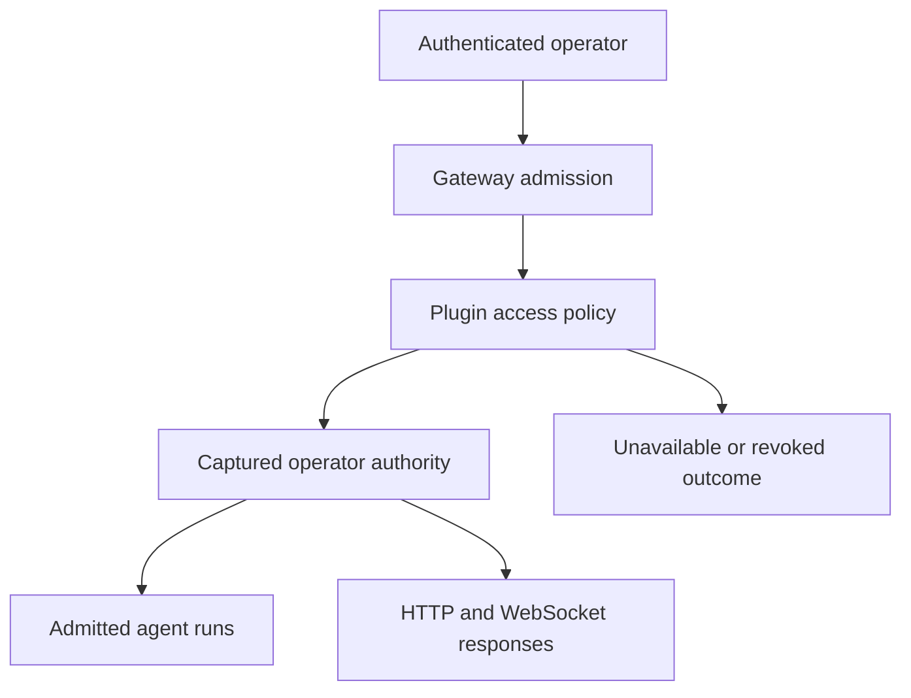

Codex review: needs maintainer review before merge.

## What this changes

This PR separates temporary policy evaluation failures from revocation and carries that distinction through operator runs, WebSocket responses, and HTTP authentication.

**Example:** An authorized visitor's policy assertion throws "Plugin invocation scope is closed".
- **Before:** The Gateway permanently invalidates the captured authority, disconnects the client, and invalidates descendant runs.
- **After:** The affected operation returns UNAVAILABLE while the authority remains usable after recovery; genuine revocation still ends access.

## Review scores

| Measure | Result | What it means |
|---|---|---|
| **Overall readiness** | 🧂 unranked krab **(1/6)** | The source repair is coherent and earlier findings are resolved, but required real-behavior proof remains uncovered. |
| **Proof confidence** | 🧂 unranked krab **(1/6)** | Real behavior proof is not required for maintainer- or bot-authored pull requests. |
| **Patch quality** | 🐚 platinum hermit **(4/6)** | No actionable review findings were identified. |

## Product

**Kind:** Bug fix · **Worth it:** Yes · **Fix scope:** Complete
**User problem:** Authorized operators lose their connection and admitted work when a policy check encounters an internal exception.
**Reason:** The maintainer-approved direction preserves useful work while continuing to refuse operations whose access cannot be evaluated.

## Merge readiness

✅ **Ready for maintainer review**

Keep open: this maintainer-directed repair addresses a current source failure, and no blocking code defect remains after checking the earlier findings and the accepted logging exception.

**Priority:** P1
**Reviewed head:** `ed77b3583db8e57dc9d562ee95dce78208470fc6`

## Before merge

None.

## Findings

None.

### Tests

- Missing end-to-end proof: Supply redacted logs, terminal output, or a recording from an isolated running Gateway with a real agent and model showing policy failure, recovery on the same admitted authority, and subsequent genuine revocation.

<strong>Agent review details</strong>

### How this fits together

Plugin access policies supply grant assertions and cancellation signals to Gateway admission; authenticated requests and admitted runs consume them before protected operations and responses.

### Technical review

Best possible solution:

Retain the existing grant owner and propagate unavailable outcomes without discarding the original authority or permitting the failed operation.

Do we have a high-confidence way to reproduce the issue?

Current main visibly turns any policy assertion exception into permanent invalidation, and the submitted regression exercises the reported closed-scope trigger; no target code was executed during this review.

Is this the best way to solve the issue?

The patch repairs the distinction at the existing policy owner and preserves it through affected consumers without introducing another authority owner, cache, configuration option, or stored format.

AGENTS.md: found and applied where relevant.

Codex review notes: model internal, reasoning medium; reviewed against [1b9518af272b](https://github.com/openclaw/openclaw/commit/1b9518af272b2b0a0a5ceb14cce1e685272f0fb9).

### Provenance checked

- `Captured grant revocation` changes intended behavior with a stated reason (552b54b86c133ad9773cade18b272dd0a081ee67: End visitor authority when its original invitation, identity, or plugin lifetime ends.)
- `Policy failure cause classification` changes intended behavior with a stated reason (7154e4efb11bf33fdd7b9fc4ccbe3333f0bcf585: Distinguish invalidation causes and stop automatic reconnect loops; unknown failures remained terminal.)
- `Delegated run authority` keeps the original intent (715077a3befb5bb1239a8b0ebb52980e957ad316: Keep accepted queued and child work bound to its original operator and permission ceiling.)
- `Request preparation and handler entry` keeps the original intent (3ed226a746a8efd223a35a81790014c41ff044a3: Keep asynchronous preparation inside the Gateway lifetime and make the final handoff to execution synchronous.)
- `Policy diagnostic redaction` changes intended behavior with a stated reason (379569e40380c29d0c2197bb244e2591e1581bc1: The maintainer explicitly confirms redacted inner exception names and messages as the task-specific logging requirement.)

### Testing

Proof path: in-process harness.

### Security

None.

### Evidence

What I checked:

- **Current main still conflates exceptions with revocation:** Current main invalidates the captured grant whenever its policy assertion throws; the original fail-closed owner was introduced in https://github.com/openclaw/openclaw/pull/154461 and later gained cause classification in https://github.com/openclaw/openclaw/pull/197299. ([`src/gateway/operator-access-policy.ts:268`](https://github.com/openclaw/openclaw/blob/1b9518af272b2b0a0a5ceb14cce1e685272f0fb9/src/gateway/operator-access-policy.ts#L268), [1b9518af272b](https://github.com/openclaw/openclaw/commit/1b9518af272b2b0a0a5ceb14cce1e685272f0fb9))
- **Failure remains a refusal without becoming permanent revocation:** The patched owner preserves definitive denial and aborted-grant handling, reevaluates an unsignaled grant, and throws unavailable without aborting healthy captured authority. ([`src/gateway/operator-access-policy.ts:272`](https://github.com/openclaw/openclaw/blob/ed77b3583db8e57dc9d562ee95dce78208470fc6/src/gateway/operator-access-policy.ts#L272), [ed77b3583db8](https://github.com/openclaw/openclaw/commit/ed77b3583db8e57dc9d562ee95dce78208470fc6))
- **Earlier transport and consumer findings are addressed:** Handler-start tracking distinguishes pre-execution retries from uncertain write outcomes; the shared HTTP finisher returns 503, cookie revalidation propagates unavailable, absent visitor grants use the required-role denial, and wrapper extraction includes the shared error dependency. ([`src/gateway/server-methods.ts:635`](https://github.com/openclaw/openclaw/blob/ed77b3583db8e57dc9d562ee95dce78208470fc6/src/gateway/server-methods.ts#L635), [ed77b3583db8](https://github.com/openclaw/openclaw/commit/ed77b3583db8e57dc9d562ee95dce78208470fc6))
- **Maintainer explicitly resolves the logging objection:** The maintainer explicitly retains redacted inner exception names and messages as the task-specific contract in https://github.com/openclaw/openclaw/pull/198245#issuecomment-6855942376; the previous raw-log finding therefore requires no source change. ([`src/gateway/operator-access-policy.ts:40`](https://github.com/openclaw/openclaw/blob/ed77b3583db8e57dc9d562ee95dce78208470fc6/src/gateway/operator-access-policy.ts#L40), [ed77b3583db8](https://github.com/openclaw/openclaw/commit/ed77b3583db8e57dc9d562ee95dce78208470fc6))
- **Meaningful integration coverage with explicit proof limits:** The lineage regression exercises real invocation-scope closure, four admitted descendants, model authority, recovery, and subsequent revocation using synthetic policy state; the author explicitly distinguishes this from a live-provider end-to-end run. ([`src/gateway/operator-run-authority.policy-recovery.test.ts:29`](https://github.com/openclaw/openclaw/blob/ed77b3583db8e57dc9d562ee95dce78208470fc6/src/gateway/operator-run-authority.policy-recovery.test.ts#L29), [ed77b3583db8](https://github.com/openclaw/openclaw/commit/ed77b3583db8e57dc9d562ee95dce78208470fc6))
- **Prepared screenshots cover a different change:** Both inspected images originate from https://github.com/openclaw/openclaw/pull/197299 and show reconnecting versus terminal access denial, rather than this PR's policy-failure recovery. ([7154e4efb11b](https://github.com/openclaw/openclaw/commit/7154e4efb11bf33fdd7b9fc4ccbe3333f0bcf585))

Likely related people:

- **Peter Steinberger:** Raw commit 2444aae8f8f9e593f4801127eab4b37d3703c4c6 adds src/gateway/operator-access-policy.ts:242 relative to its recorded parents. This identifies author metadata, not feature responsibility or a PR merger. (role: source-line author; confidence: high; commits: [2444aae8f8f9](https://github.com/openclaw/openclaw/commit/2444aae8f8f9e593f4801127eab4b37d3703c4c6); files: `src/gateway/operator-access-policy.ts`)
- **Shakker:** Raw commit 552b54b86c133ad9773cade18b272dd0a081ee67 adds src/gateway/operator-access-policy.ts:142 relative to its recorded parents. This identifies author metadata, not feature responsibility or a PR merger. (role: source-line author; confidence: high; commits: [552b54b86c13](https://github.com/openclaw/openclaw/commit/552b54b86c133ad9773cade18b272dd0a081ee67); files: `src/gateway/operator-access-policy.ts`)
- **Jason (Json):** Raw commit b8c316977b6064262be4d11d706ade3c0d8edf69 adds src/gateway/channel-operator-revocation.ts:32 relative to its recorded parents. This identifies author metadata, not feature responsibility or a PR merger. (role: source-line author; confidence: medium; commits: [b8c316977b60](https://github.com/openclaw/openclaw/commit/b8c316977b6064262be4d11d706ade3c0d8edf69); files: `src/gateway/channel-operator-revocation.ts`)

### PR surface

Source +205, Tests +400, Docs +9, Other +1. Total +615 across 30 files. Added test files: 1.

View PR surface stats

| Area | Files | Added | Removed | Net |
|---|---:|---:|---:|---:|
| Source | 16 | 273 | 68 | +205 |
| Tests | 12 | 485 | 85 | +400 |
| Docs | 1 | 17 | 8 | +9 |
| Config | 0 | 0 | 0 | 0 |
| Generated | 0 | 0 | 0 | 0 |
| Other | 1 | 1 | 0 | +1 |
| **Total** | **30** | **776** | **161** | **+615** |

### Preflight source

Source unknown. Source comparison at the observed PR snapshot only. Completion is self-reported; body, policy, tests, execution, and report bytes are not verified.

### Review metrics

| Metric | Value | Why it matters |
|---|---|---|
| **Production versus test growth** | Production +273/-68; tests and test support +485/-85 | Production growth carries one failure classification through existing authority and transport owners; added coverage protects distinct lineage, retry, HTTP, and cookie boundaries. |

### Labels

Label changes:

- add `status: 👀 ready for maintainer look`: ClawSweeper has no concrete contributor-facing blocker left for this PR.
- remove `status: ⏳ waiting on author`: Current PR status label is `status: 👀 ready for maintainer look`.

Label justifications:

- `P1`: A temporary plugin exception can disconnect authorized operators and invalidate their admitted agent work.
- `merge-risk: 🚨 compatibility`: The maintainer-directed change deliberately makes plugin exceptions unavailable outcomes; definitive denial uses ended authority or an absent required grant, with the bundled consumer and SDK documentation updated together.
- `rating: 🧂 unranked krab`: Overall readiness is 🧂 unranked krab; proof is 🧂 unranked krab and patch quality is 🐚 platinum hermit.
- `status: 👀 ready for maintainer look`: ClawSweeper has no concrete contributor-facing blocker left for this PR.

### Rating scale

6/6 🦀 challenger crab · 5/6 🦞 diamond lobster · 4/6 🐚 platinum hermit · 3/6 🦐 gold shrimp · 2/6 🦪 silver shellfish · 1/6 🧂 unranked krab. Overall follows the weaker of proof and patch quality; ✨ marks media proof (a screenshot, video, or linked artifact) that directly shows the changed behavior.

### Workflow

ClawSweeper edits this one comment on every review. Comment `@clawsweeper re-review` for a fresh review only. Repair and merge execution lanes are retired.

### History

Review history (5 earlier review cycles)

<!-- clawsweeper-review-history v=1 total=5 -->
- reviewed 2026-11-13T11:54:48.179Z sha 379569e40380c29d0c2197bb244e2591e1581bc1 :: needs changes before merge. :: [P2] Avoid advertising a safe retry after a mutation has committed | [P2] Carry the unavailable outcome through HTTP authentication
- reviewed 2026-11-13T12:39:31.763Z sha 9f0a7d05ab2a9fc31286b56b666acf0232e92138 :: needs maintainer review before merge. :: none
- reviewed 2026-11-13T12:46:33.988Z sha 9f0a7d05ab2a9fc31286b56b666acf0232e92138 :: needs maintainer review before merge. :: none
- reviewed 2026-11-13T13:34:22.366Z sha 7010ba500068cff1d49f9e211873871107b16008 :: needs changes before merge. :: [P2] [P2] Translate unavailable errors during HTTP revalidation | [P2] [P2] Preserve unavailable responses for plugin-cookie authentication | [P2] [P2] Preserve definitive Visitor Access admission denials | [P2] [P2] Include the new import in the extracted PR wrapper
- reviewed 2026-11-13T14:28:43.494Z sha ed77b3583db8e57dc9d562ee95dce78208470fc6 :: needs changes before merge. :: [P2] Preserve raw policy diagnostics until log egress

_Reviewed November 13, 2026, 9:40 AM ET / 14:40 UTC (Revision 6)._

<!-- clawsweeper-verdict:needs-human item=198245 sha=ed77b3583db8e57dc9d562ee95dce78208470fc6 confidence=high updated_at=2026-11-13T14:33:56Z reviewed_at=2026-11-13T14:40:11.899Z lease_owner=github-run-43443700402-1 lease_comment_id=6855945130 source_revision=97908d74dd9c70ea9bc90784478f56942c67852658af1d8e52c630a699bc4a94 hold=not_opted_in findings=0 -->
<!-- clawsweeper-review-state:ready item=198245 sha=ed77b3583db8e57dc9d562ee95dce78208470fc6 v=1 -->

<!-- clawsweeper-review-version item=198245 reviewed_at=2026-11-13T14:40:11.899Z sha=ed77b3583db8e57dc9d562ee95dce78208470fc6 source_revision=97908d74dd9c70ea9bc90784478f56942c67852658af1d8e52c630a699bc4a94 lease_owner=github-run-43443700402-1 lease_comment_id=6855945130 v=1 -->

<!-- clawsweeper-review item=198245 -->