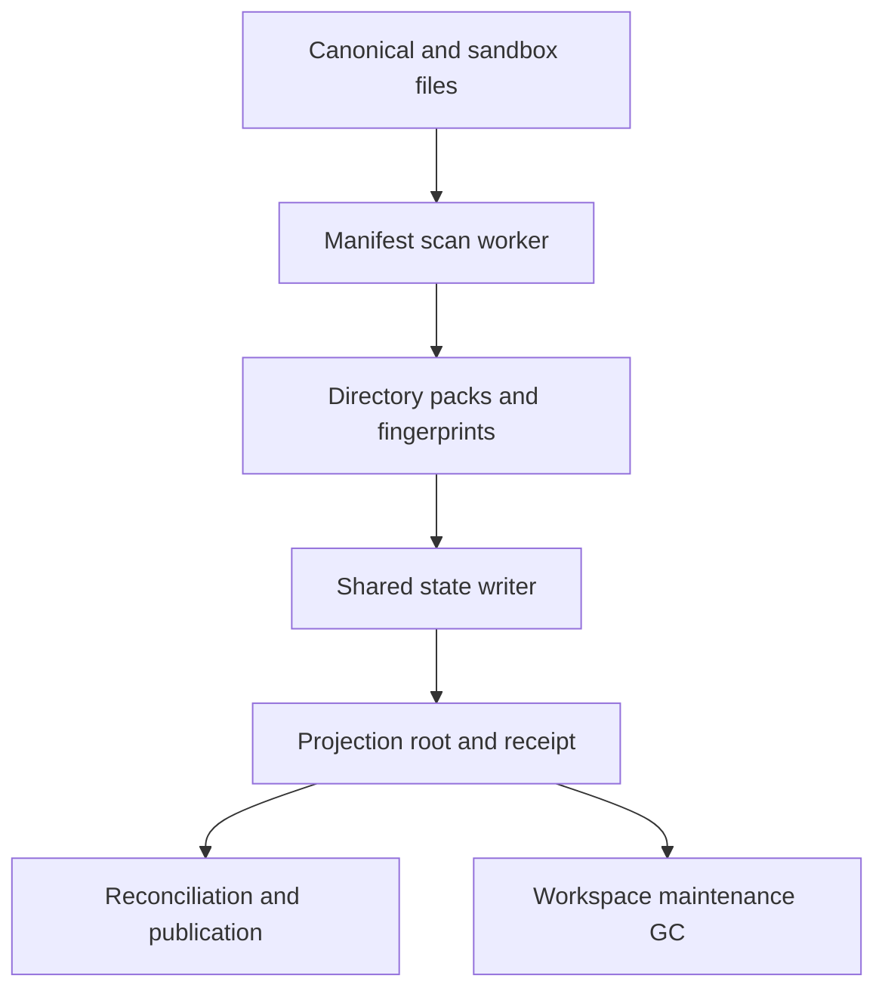

Codex review: needs changes before merge.

## What this changes

This PR shares workspace inventories through content-addressed directory packs and persisted scan fingerprints in state schema 35.

**Example:** Thirty projections repeatedly load overlapping workspace inventories.
- **Before:** The reported v31 rotating-load median is 129.342 ms, with duplicated per-projection storage.
- **After:** The reported directory-pack median is 68.482 ms, with shared immutable packs and unchanged manifest references.

## Review scores

| Measure | Result | What it means |
|---|---|---|
| **Overall readiness** | 🦐 gold shrimp **(3/6)** | Useful, coherent implementation with substantial conversion coverage and no new actionable finding; performance acceptance remains incomplete. |
| **Proof confidence** | 🦐 gold shrimp **(3/6)** | This maintainer-authored PR is outside the ordinary contributor proof gate; supplied real-data conversion and worker measurements are substantial, but the body explicitly marks the all-action performance acceptance gate incomplete. |
| **Patch quality** | 🐚 platinum hermit **(4/6)** | No actionable review findings were identified. |

## Product

**Kind:** Performance · **Worth it:** Yes · **Fix scope:** Complete
**User problem:** Large managed workspaces duplicate inventories and occupy the shared writer during baseline replacement.
**Reason:** The maintainer-selected direction has concrete storage and rotating-load gains, with the broader performance acceptance hold explicitly preserved.

## Merge readiness

⛔ **Needs changes before merge - 1 item remains**

Keep open: this maintainer-authored PR provides useful storage improvements absent from main; no actionable introduced defect was found, but the author’s landing pause, reported conflicts, and failed CI gate remain.

**Priority:** P2
**Reviewed head:** `01fb8948949423ca84352dd11fa0b86270efeb85`

## Before merge

- [ ] **Complete next step** - Resolve GitHub’s reported merge conflicts and validate the affected integration changes.

## Findings

None.

### Tests

- Missing end-to-end proof: The declared clean all-action synthetic comparison remains incomplete for canonical, projection, and replacement actions across the read-only and publication boundaries.

<strong>Agent review details</strong>

### How this fits together

Managed workspace reconciliation scans canonical and sandbox files, prepares immutable inventory content in workers, and publishes accepted roots and recovery receipts through the existing shared-state writer.

### Technical review

Best possible solution:

Retain the directory-pack implementation and existing reconciliation owner, then satisfy the declared performance acceptance rule before landing.

Do we have a high-confidence way to reproduce the issue?

Current main stores complete per-worktree node inventories, and the supplied measurements establish duplicated storage and expensive replacement; no target code was executed during this review.

Is this the best way to solve the issue?

Directory-level sharing preserves existing digest and receipt contracts while removing the earlier cache design, but incomplete all-action measurements prevent confirming the full performance acceptance claim.

AGENTS.md: found and applied where relevant.

Codex review notes: model internal, reasoning medium; reviewed against [ce503a58dad3](https://github.com/openclaw/openclaw/commit/ce503a58dad3b06cfba1cc357bab3e5a0435f024).

### Provenance checked

- `Persistent manifests and checkpoint recovery` changes intended behavior with a stated reason (7ef85325b7c718f7ec27ecf496fe09a92a080d94: Persist incremental checkpoints while retaining atomic acceptance, pending receipts, and full-manifest publication.)
- `Manifest snapshot decoding` keeps the original intent (6b3cf0c1f95ef1dd974ff029fb1c68af76af1a9e: Release encoded inventory rows before asynchronous filesystem discovery to reduce retained memory.)
- `Worker-owned full-tree preparation` keeps the original intent (7462184039f5d1c22519b883aea97bfc97f1b7cd: Avoid Gateway stalls by building and preparing complete baseline trees in the existing read worker.)

### Testing

Proof path: in-process harness.

### Security

None.

### Evidence

What I checked:

- **Pinned change and current main:** The introduced comparison is 49aa6fca9a21fb21e31adb6c6e372451ba097b6a to the reviewed head; fetched main still declares shared-state schema 34 and reads per-worktree manifest nodes. ([`src/state/openclaw-schema-versions.ts:41`](https://github.com/openclaw/openclaw/blob/ce503a58dad3b06cfba1cc357bab3e5a0435f024/src/state/openclaw-schema-versions.ts#L41), [ce503a58dad3](https://github.com/openclaw/openclaw/commit/ce503a58dad3b06cfba1cc357bab3e5a0435f024))
- **Explicit landing pause:** The full PR body explicitly says STOP: the final all-action synthetic gate is invalid because host-load qualification prevented completion; the partial measurements do not authorize landing. ([01fb89489494](https://github.com/openclaw/openclaw/commit/01fb8948949423ca84352dd11fa0b86270efeb85))
- **Migration evidence and accepted tradeoffs:** The body reports backed-up 33→34→35 conversion of 193 projections with exact equivalence, GC, and reload without missing packs; the maintainer discussion selects that migration scope and discloses older-writer refusal and backup-based rollback. ([`src/state/openclaw-state-db-schema-v35-workspace-cas.ts:17`](https://github.com/openclaw/openclaw/blob/01fb8948949423ca84352dd11fa0b86270efeb85/src/state/openclaw-state-db-schema-v35-workspace-cas.ts#L17), [01fb89489494](https://github.com/openclaw/openclaw/commit/01fb8948949423ca84352dd11fa0b86270efeb85))
- **Incremental preparation repaired:** The earlier review’s full-inventory preparation concern is addressed: incremental scans prepare packs selected from delta.records, with a production-owner regression covering acceptance, GC, and complete reload. ([`src/gateway/worker-environments/local-workspace-manifest-scan.ts:558`](https://github.com/openclaw/openclaw/blob/01fb8948949423ca84352dd11fa0b86270efeb85/src/gateway/worker-environments/local-workspace-manifest-scan.ts#L558), [01fb89489494](https://github.com/openclaw/openclaw/commit/01fb8948949423ca84352dd11fa0b86270efeb85))
- **Final commit authority retained:** Projection publication retains transaction-local reconciliation lease and registry-predicate checks; immutable preparation does not itself publish a projection root or authorize filesystem effects. ([`src/gateway/worker-environments/local-workspace-store.worker.ts:77`](https://github.com/openclaw/openclaw/blob/01fb8948949423ca84352dd11fa0b86270efeb85/src/gateway/worker-environments/local-workspace-store.worker.ts#L77), [01fb89489494](https://github.com/openclaw/openclaw/commit/01fb8948949423ca84352dd11fa0b86270efeb85))
- **Conflict and CI state:** GitHub reports mergeable=false and mergeable_state=dirty for the reviewed head; the linked CI run confirms three failed extension bundles and the aggregate gate, while the body attributes those failures to inherited behavior. ([01fb89489494](https://github.com/openclaw/openclaw/commit/01fb8948949423ca84352dd11fa0b86270efeb85))

### PR surface

PR surface statistics unavailable: the file list is incomplete.

### Review metrics

| Metric | Value | Why it matters |
|---|---|---|
| **Persistent format** | State 34→35; two tables and four nullable BLOB columns; agent schema remains 37 | The change requires forward migration and backup-based rollback, with online conversion owned by reconciliation. |
| **Benchmark controls** | Two benchmark-only environment controls | OPENCLAW_BENCH_COMMIT and OPENCLAW_BENCH_COUNT_SQL select publication and instrumentation boundaries without adding product configuration. |

### Labels

Label changes:

- add `merge-risk: 🚨 compatibility`: Schema 35 deliberately refuses older writers and requires a verified backup plus matching build for rollback; the maintainer-authored change explicitly accepts this contract.
- add `status: ⏳ waiting on author`: ClawSweeper has contributor-facing work open and is waiting for author action.

Label justifications:

- `P2`: Large-workspace storage and writer contention are meaningful improvements with a bounded affected surface.
- `merge-risk: 🚨 compatibility`: Schema 35 deliberately refuses older writers and requires a verified backup plus matching build for rollback; the maintainer-authored change explicitly accepts this contract.
- `rating: 🦐 gold shrimp`: Overall readiness is 🦐 gold shrimp; proof is 🦐 gold shrimp and patch quality is 🐚 platinum hermit.
- `status: ⏳ waiting on author`: ClawSweeper has contributor-facing work open and is waiting for author action.

### Rank-up moves

Optional improvements that raise the rating; they are not merge blockers.

- Complete the declared all-action performance comparison under its qualifying host conditions.

### Rating scale

6/6 🦀 challenger crab · 5/6 🦞 diamond lobster · 4/6 🐚 platinum hermit · 3/6 🦐 gold shrimp · 2/6 🦪 silver shellfish · 1/6 🧂 unranked krab. Overall follows the weaker of proof and patch quality; ✨ marks media proof (a screenshot, video, or linked artifact) that directly shows the changed behavior.

### Workflow

ClawSweeper edits this one comment on every review. Comment `@clawsweeper re-review` for a fresh review only. Repair and merge execution lanes are retired.

### History

Review history (2 earlier review cycles)

<!-- clawsweeper-review-history v=1 total=2 -->
- reviewed 2026-10-26T12:09:15.814Z sha bd4a655fd1fe1ed98b86fcbf4432ce41c62c801d :: blocked before merge. :: none
- reviewed 2026-10-26T17:35:54.612Z sha a13c55b19c6220be34a089b9ed610935d97b29b8 :: needs maintainer review before merge. :: none

_Reviewed October 26, 2026, 10:14 PM ET / October 27, 2026, 02:14 UTC (Revision 3)._

<!-- clawsweeper-verdict:needs-changes item=184581 sha=01fb8948949423ca84352dd11fa0b86270efeb85 confidence=high updated_at=2026-10-27T02:09:58Z reviewed_at=2026-10-27T02:14:59.100Z lease_owner=github-run-40436790064-1 lease_comment_id=6431990607 source_revision=fd6217e220d6637f4f05db51a47315ef9db0090593432d3cd5ca02a5a00bbd28 -->
<!-- clawsweeper-review-state:needs-changes item=184581 sha=01fb8948949423ca84352dd11fa0b86270efeb85 v=1 -->

<!-- clawsweeper-review-version item=184581 reviewed_at=2026-10-27T02:14:59.100Z sha=01fb8948949423ca84352dd11fa0b86270efeb85 source_revision=fd6217e220d6637f4f05db51a47315ef9db0090593432d3cd5ca02a5a00bbd28 lease_owner=github-run-40436790064-1 lease_comment_id=6431990607 v=1 -->

<!-- clawsweeper-review item=184581 -->