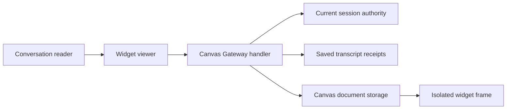

Codex review: needs changes before merge.

## What this changes

Allows conversation readers to open saved inline widgets after verifying their saved receipts and current conversation access.

**Example:** A reader with operator.sessions.read opens cv_saved_widget in agent:main:saved-widget.
- **Before:** The viewer displays “Widget sandbox host is unavailable” without requesting the document.
- **After:** The viewer sends the conversation key, and the Gateway returns the widget only when its saved receipt and current access permit it.

## Review scores

| Measure | Result | What it means |
|---|---|---|
| **Overall readiness** | 🐚 platinum hermit **(4/6)** | Useful, coherent repair with inspected UI evidence and production-owner authorization observations; CI attribution remains a separate landing action. |
| **Proof confidence** | 🐚 platinum hermit **(4/6)** | Sufficient (live_output): The inspected Chromium before/after screenshots exercise saved-widget rendering, and the exact-head production-dispatcher response observations show allowed HTML disclosure and rejection before HTML disclosure for private, unbound, and mid-load-revoked reads; the supplied harness uses real document and session owners with mocked browser transport. |
| **Patch quality** | 🐚 platinum hermit **(4/6)** | No actionable review findings were identified. |

## Product

**Kind:** Bug fix · **Worth it:** Yes · **Fix scope:** Complete
**User problem:** Conversation readers see a sandbox error and cannot open an existing inline widget even though they can read its conversation.
**Reason:** The maintainer-authored direction restores useful saved content while explicitly preserving private-conversation, unbound-document, and revocation boundaries.

## Merge readiness

⛔ **Needs changes before merge - 1 item remains**

Keep this PR open: it provides useful, maintainer-approved conversation-scoped widget access, and the previous finding is fixed; no introduced defect was found, but failed CI checks still need attribution.

**Priority:** P2
**Reviewed head:** `fb656ec202c272f9f5944ec4da17c20925cb5fdb`

## Before merge

- [ ] **Complete next step** - Attribute the two failed PR-card E2E checks to this change or an independently evidenced outside cause, and fix any demonstrated diff-caused failure.

## Findings

None.

<strong>Agent review details</strong>

### How this fits together

The Control UI requests stored widget HTML through the Canvas Gateway handler, which combines session visibility, transcript receipts, document storage, and the existing isolated widget sandbox.

### Technical review

Best possible solution:

Land conversation-bound saved-widget reads with receipt verification, current-access revalidation, and the existing isolated renderer after resolving CI attribution.

Do we have a high-confidence way to reproduce the issue?

Current main deterministically returns the misleading sandbox error before requesting a widget when the reader lacks global read scope, matching the supplied baseline screenshot and linked report.

Is this the best way to solve the issue?

The repair uses existing session visibility, history, and sandbox owners rather than granting document access from an unverified conversation key.

AGENTS.md: found and applied where relevant.

Codex review notes: model internal, reasoning medium; reviewed against [0d537f1ff727](https://github.com/openclaw/openclaw/commit/0d537f1ff727289ee30794eb380e89baeff9876a).

### Provenance checked

- `Stored-widget authorization` changes intended behavior with a stated reason (428e4793bd5ffeeaa08bbbab6a25ae2e49196308: Authenticated Gateway reads replaced browser authentication failures while retaining isolated widget execution.)
- `Canonical scope documentation` changes intended behavior with a stated reason (c183920e8fbc19cf8289826ff3e69fd0813da3b6: The earlier file-preview repair admitted caller-owned previews to session readers while explicitly retaining broader access for stored documents.)
- `Widget lifetime and retained content` keeps the original intent (04d8503ee8ab97218b3283968293d079b1a8b219: Solid owns renderer resources while synchronous document identity, read admission, retries, and private-port authority preserve reconnect behavior.)
- `Transcript matching and worker ownership` keeps the original intent (628bf6d583eac9e96520c05495b4f31fded4881f: Transcript reads moved behind the existing worker owner to preserve Gateway responsiveness and physical-source authority.)

### Testing

Proof path: in-process harness.

### Security

None.

### Evidence

What I checked:

- **Conversation-bound authorization:** Narrow readers retain the existing session-read owner, require a successful saved widget receipt, and recheck authority after HTML loading and sandbox startup before responding. ([`src/gateway/server-methods/canvas.ts:99`](https://github.com/openclaw/openclaw/blob/fb656ec202c272f9f5944ec4da17c20925cb5fdb/src/gateway/server-methods/canvas.ts#L99), [fb656ec202c2](https://github.com/openclaw/openclaw/commit/fb656ec202c272f9f5944ec4da17c20925cb5fdb))
- **Receipt and history boundaries:** Matching recognizes direct and canonical nested-tool receipts, rejects error and unrelated results, and requires active transcript membership; archive fallback uses the existing history owner's selection. ([`src/sessions/transcript-visible-record.ts:97`](https://github.com/openclaw/openclaw/blob/fb656ec202c272f9f5944ec4da17c20925cb5fdb/src/sessions/transcript-visible-record.ts#L97), [fb656ec202c2](https://github.com/openclaw/openclaw/commit/fb656ec202c272f9f5944ec4da17c20925cb5fdb))
- **Previous finding resolved:** The canonical scope guide now documents conversation-bound saved-widget reads while preserving document-ID-only access for broad readers: https://docs.openclaw.ai/gateway/operator-scopes. ([`docs/gateway/operator-scopes.md:96`](https://docs.openclaw.ai/gateway/operator-scopes), [fb656ec202c2](https://github.com/openclaw/openclaw/commit/fb656ec202c272f9f5944ec4da17c20925cb5fdb))
- **Supplied behavior and authority evidence:** Inspected before/after screenshots show the error replaced by the saved widget. The body records exact-head real-dispatcher HTML responses for allowed readers and no HTML for private, unbound, pending, or mid-load-revoked reads. Video preparation failed with “ffprobe failed: spawnSync ffprobe ENOENT”; browser retrieval returned a cache miss, so the recording was not independently inspected. ([fb656ec202c2](https://github.com/openclaw/openclaw/commit/fb656ec202c272f9f5944ec4da17c20925cb5fdb))
- **Current main still needs the repair:** Current main retains the broad-read viewer gate and document-ID-only handler. The linked report establishes the permission-dependent failure: https://github.com/openclaw/openclaw/issues/174975. ([`ui/src/components/canvas-widget-view.tsx:241`](https://github.com/openclaw/openclaw/blob/0d537f1ff727289ee30794eb380e89baeff9876a/ui/src/components/canvas-widget-view.tsx#L241), [0d537f1ff727](https://github.com/openclaw/openclaw/commit/0d537f1ff727289ee30794eb380e89baeff9876a))
- **CI attribution remains unresolved:** Exact-head failures concern PR-card labels and dismiss controls in https://github.com/openclaw/openclaw/actions/runs/38999015497. The pinned base passed in https://github.com/openclaw/openclaw/actions/runs/38997425647 and the merge base passed in https://github.com/openclaw/openclaw/actions/runs/38989444704; these failures cannot currently be classified as inherited or diff-caused. ([`ui/src/e2e/chat-pull-requests.e2e.test.ts:193`](https://github.com/openclaw/openclaw/blob/fb656ec202c272f9f5944ec4da17c20925cb5fdb/ui/src/e2e/chat-pull-requests.e2e.test.ts#L193), [fb656ec202c2](https://github.com/openclaw/openclaw/commit/fb656ec202c272f9f5944ec4da17c20925cb5fdb))

### PR surface

Source +322, Tests +739, Docs +3. Total +1064 across 16 files. Added test files: 2.

View PR surface stats

| Area | Files | Added | Removed | Net |
|---|---:|---:|---:|---:|
| Source | 10 | 384 | 62 | +322 |
| Tests | 4 | 741 | 2 | +739 |
| Docs | 2 | 6 | 3 | +3 |
| Config | 0 | 0 | 0 | 0 |
| Generated | 0 | 0 | 0 | 0 |
| Other | 0 | 0 | 0 | 0 |
| **Total** | **16** | **1131** | **67** | **+1064** |

### Review metrics

| Metric | Value | Why it matters |
|---|---|---|
| **Production versus test LOC** | Production +384/-62; tests +741/-2 | Production growth adds conversation authorization and pending-result recovery; the larger test addition exercises real dispatcher, storage, branch, archive, and revocation contracts. |

### Labels

Label changes:

- add `proof: sufficient`: Contributor real behavior proof is sufficient.
- add `rating: 🐚 platinum hermit`: Overall readiness is 🐚 platinum hermit; proof is 🐚 platinum hermit and patch quality is 🐚 platinum hermit.
- add `status: ⏳ waiting on author`: ClawSweeper has contributor-facing work open and is waiting for author action.
- remove `rating: 🧂 unranked krab`: Current PR rating is `rating: 🐚 platinum hermit`, so this older rating label is no longer current.
- remove `status: 📣 needs proof`: Current PR status label is `status: ⏳ waiting on author`.

Label justifications:

- `P2`: Saved-widget viewing is broken for conversation readers while surrounding conversation access continues to work.
- `merge-risk: 🚨 security-boundary`: The maintainer-approved change admits session-only readers to stored HTML; saved-receipt binding and final-response denial evidence address the resulting disclosure boundary.
- `rating: 🐚 platinum hermit`: Overall readiness is 🐚 platinum hermit; proof is 🐚 platinum hermit and patch quality is 🐚 platinum hermit.
- `status: ⏳ waiting on author`: ClawSweeper has contributor-facing work open and is waiting for author action.
- `proof: sufficient`: Contributor real behavior proof is sufficient.

### Rating scale

6/6 🦀 challenger crab · 5/6 🦞 diamond lobster · 4/6 🐚 platinum hermit · 3/6 🦐 gold shrimp · 2/6 🦪 silver shellfish · 1/6 🧂 unranked krab. Overall follows the weaker of proof and patch quality; ✨ marks media proof (a screenshot, video, or linked artifact) that directly shows the changed behavior.

### Workflow

ClawSweeper edits this one comment on every review. Comment `@clawsweeper re-review` for a fresh review only. Repair and merge execution lanes are retired.

### History

Review history (1 earlier review cycle)

<!-- clawsweeper-review-history v=1 total=1 -->
- reviewed 2026-10-17T03:22:53.676Z sha b76ace69aeee5015f9535c215759c4841d89f210 :: needs real behavior proof before merge. :: [P3] Update the canonical stored-Canvas scope documentation

_Reviewed October 16, 2026, 11:57 PM ET / October 17, 2026, 03:57 UTC (Revision 2)._

<!-- clawsweeper-verdict:needs-changes item=175025 sha=fb656ec202c272f9f5944ec4da17c20925cb5fdb confidence=high updated_at=2026-10-17T03:52:51Z reviewed_at=2026-10-17T03:57:52.916Z lease_owner=github-run-39000414969-1 lease_comment_id=6229282950 source_revision=b2fd9c8e102c15ea7d8c099f22680bfafcc99ad25c455ba3bd8b8a283e28ddfc -->
<!-- clawsweeper-review-state:needs-changes item=175025 sha=fb656ec202c272f9f5944ec4da17c20925cb5fdb v=1 -->

<!-- clawsweeper-review-version item=175025 reviewed_at=2026-10-17T03:57:52.916Z sha=fb656ec202c272f9f5944ec4da17c20925cb5fdb source_revision=b2fd9c8e102c15ea7d8c099f22680bfafcc99ad25c455ba3bd8b8a283e28ddfc lease_owner=github-run-39000414969-1 lease_comment_id=6229282950 v=1 -->

<!-- clawsweeper-review item=175025 -->