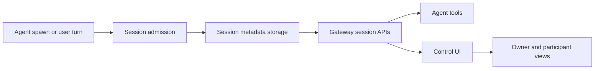

Codex review: needs maintainer review before merge. _Reviewed August 17, 2026, 4:19 AM ET / 08:19 UTC._

# ClawSweeper review

## What this changes

Adds immutable agent attribution, mutable session owners, participant history, assignment controls, and an authenticated “involving me” session filter across Gateway, SQLite, agent tools, and the Control UI.

## Merge readiness

⚠️ **Ready for maintainer review - 3 items remain**

Keep open for maintainer review. This maintainer-owned, protected PR adds a compatibility-sensitive session model, but the exact PR head could not be materialized locally because the promisor remote could not resolve; that prevents an independent verdict on the full 127-file patch and upgrade path.

**Priority:** P2
**Reviewed head:** `3c5a3e2c8507d5cca08947e83d393e0741999ee3`
**Owner decision:** Required. See [Decision needed](#decision-needed).

## Review scores

| Measure | Result | What it means |
|---|---|---|
| **Overall readiness** | 🦐 gold shrimp **(3/6)** | The supplied proof is strong, but independent patch confidence is limited by unavailable exact-head source and incomplete checks. |
| **Proof confidence** | 🌊 off-meta tidepool | Not applicable: This maintainer-authored PR supplies live screenshots and recordings, while the external-contributor proof gate does not apply. |
| **Patch quality** | 🦐 gold shrimp **(3/6)** | No actionable review findings were identified. |

## Verification

| Check | Result | Evidence |
|---|---|---|
| **Real behavior** | Not applicable | Not applicable: This maintainer-authored PR supplies live screenshots and recordings, while the external-contributor proof gate does not apply. |
| **Evidence reviewed** | 5 items | Current ownership baseline: Current main derives the people facet from immutable createdActor, so the proposed owner projection changes the established session-list owner boundary. Current in-process caller boundary: Current main dispatches built-in agent tool requests with synthetic scopes but no trusted agent-tool caller field; the PR’s authorization repair must be reviewed on the exact head. Feature-history owner: The current session list and actor-projection lines are attributed to Peter Steinberger in recent main history, providing a routing signal for the ownership projection. |
| **Findings** | None | None. |
| **Security** | None | None. |

## How this fits together

Session creation and turn admission write metadata to per-agent SQLite stores. Gateway session APIs project it to agent tools and the Control UI, where operators view responsibility and session participation.

## Decision needed

| Question | Recommendation |
|---|---|
| Should this maintainer-owned session-ownership model proceed after an exact-head review of its authorization and SQLite upgrade boundaries? | **Hold for exact-head review:** Make the PR head available to inspect and verify the persistence and authorization paths before merge. |

Why: The supplied context shows intended product direction and live proof, but unavailable exact-head source prevents an independent assessment of the full compatibility-sensitive implementation.

## Before merge

- [ ] **Resolve merge risk (P1)** - The patch changes persistent session metadata, Gateway protocol surfaces, and client projections; older SQLite-store behavior and every native protocol consumer need exact-head upgrade verification before merge.
- [ ] **Resolve merge risk (P1)** - The current environment could not fetch the exact PR head, so the authorization boundary and 47 omitted changed files were not independently reviewed.

<strong>Agent review details</strong>

### Security

None.

### Review metrics

| Metric | Value | Why it matters |
|---|---|---|
| **Production versus test growth** | reported production +1,923/-147; tests +1,211 | This substantial feature spans persisted session state, Gateway protocol, and multiple clients, so exact-head upgrade review is material before merge. |

### Stored data model

Persistent data-model change detected: `database schema: src/config/sessions/session-accessor.sqlite-owner-projection.ts`, `database schema: src/config/sessions/session-accessor.sqlite-owner.test.ts`, `persistent cache schema: src/config/sessions/session-accessor.sqlite-owner.ts`, `serialized state: packages/gateway-protocol/src/schema/sessions-row.test.ts`, `serialized state: packages/gateway-protocol/src/schema/sessions-row.ts`, `serialized state: packages/gateway-protocol/src/schema/sessions.ts`, and 58 more. Confirm migration or upgrade compatibility proof before merge.

### Merge-risk options

**Maintainer options:**
1. **Verify the exact head before merge (recommended)**  
   Review the exact PR head’s older-store reopen behavior, authenticated assignment authorization, and generated protocol consumers before landing.
2. **Accept the maintained migration risk**  
   Merge after maintainer acceptance of the supplied live proof and additive-schema rationale despite the unavailable independent source check.

### Technical review

Best possible solution:

Restore exact-head availability, then review the owner-assignment authorization path, older-store lazy schema behavior, session-list visibility/filtering, and generated native protocol consumers before accepting the feature.

Do we have a high-confidence way to reproduce the issue?

Not applicable: this PR introduces a maintainer-directed session capability rather than repairing a reported current-main defect.

Is this the best way to solve the issue?

Unclear: separating immutable provenance from mutable responsibility is coherent with current main’s createdActor boundary, but the exact implementation could not be inspected to establish that it is the best safe path.

AGENTS.md: found and applied where relevant.

Codex review notes: model internal, reasoning high; reviewed against [d6b2e14f6333](https://github.com/openclaw/openclaw/commit/d6b2e14f6333d6c064c998c46ecda3b2ece5239a).

### Labels

Label changes:

- add `rating: 🦐 gold shrimp`: Overall readiness is 🦐 gold shrimp; proof is 🌊 off-meta tidepool and patch quality is 🦐 gold shrimp.
- remove `rating: 🐚 platinum hermit`: Current PR rating is `rating: 🦐 gold shrimp`, so this older rating label is no longer current.

Label justifications:

- `P2`: The PR adds a substantial session-responsibility feature but does not establish an emergency user outage.
- `merge-risk: 🚨 compatibility`: It adds Gateway protocol and additive SQLite behavior consumed by existing session stores and native clients.
- `merge-risk: 🚨 session-state`: It persists and projects mutable owners and participant metadata for sessions.
- `rating: 🦐 gold shrimp`: Overall readiness is 🦐 gold shrimp; proof is 🌊 off-meta tidepool and patch quality is 🦐 gold shrimp.
- `status: 👀 ready for maintainer look`: ClawSweeper has no concrete contributor-facing blocker left for this PR. Not applicable: This maintainer-authored PR supplies live screenshots and recordings, while the external-contributor proof gate does not apply.

### Evidence

What I checked:

- **Current ownership baseline:** Current main derives the people facet from immutable createdActor, so the proposed owner projection changes the established session-list owner boundary. ([`src/gateway/session-utils-list.ts:104`](https://github.com/openclaw/openclaw/blob/d6b2e14f6333/src/gateway/session-utils-list.ts#L104), [d6b2e14f6333](https://github.com/openclaw/openclaw/commit/d6b2e14f6333))
- **Current in-process caller boundary:** Current main dispatches built-in agent tool requests with synthetic scopes but no trusted agent-tool caller field; the PR’s authorization repair must be reviewed on the exact head. ([`src/agents/tools/in-process-gateway.ts:27`](https://github.com/openclaw/openclaw/blob/d6b2e14f6333/src/agents/tools/in-process-gateway.ts#L27), [d6b2e14f6333](https://github.com/openclaw/openclaw/commit/d6b2e14f6333))
- **Feature-history owner:** The current session list and actor-projection lines are attributed to Peter Steinberger in recent main history, providing a routing signal for the ownership projection. ([`src/gateway/session-utils-row.ts:72`](https://github.com/openclaw/openclaw/blob/e84a45e28ecf/src/gateway/session-utils-row.ts#L72), [e84a45e28ecf](https://github.com/openclaw/openclaw/commit/e84a45e28ecf))
- **Exact-head inspection unavailable:** The checkout is on current main and attempted access to PR head 3c5a3e2c8507d5cca08947e83d393e0741999ee3 required its promisor remote, which failed DNS resolution. The supplied diff is truncated to 80 of 127 files, so it cannot replace exact-head inspection.
- **Provided real-flow evidence:** The PR body provides screenshots and recordings for spawn receipts, assignment, participant display, and filtering, but they could not be independently downloaded in this environment after network resolution failed. ([3c5a3e2c8507](https://github.com/openclaw/openclaw/commit/3c5a3e2c8507))

Likely related people:

- **steipete:** Current-main blame attributes the session-list and session-row ownership projection to Peter Steinberger, and the supplied PR history shows continued ownership of this session model. (role: recent session-area contributor; confidence: high; commits: [e84a45e28ecf](https://github.com/openclaw/openclaw/commit/e84a45e28ecf44dec085b94589c3fcc5c17c12cb), [3c5a3e2c8507](https://github.com/openclaw/openclaw/commit/3c5a3e2c8507d5cca08947e83d393e0741999ee3); files: `src/gateway/session-utils-list.ts`, `src/gateway/session-utils-row.ts`, `src/config/sessions/session-accessor.sqlite-entry-store.ts`)

### Rank-up moves

Optional improvements that raise the rating; they are not merge blockers.

- Make the exact PR head available for an independent authorization, storage-upgrade, and native-protocol review.
- Wait for the remaining exact-head checks before merge.

### Rating scale

| Score | Internal tier | Crab rank | Meaning |
|---:|:---:|---|---|
| **6/6** | S | 🦀 challenger crab | Exceptional readiness |
| **5/6** | A | 🦞 diamond lobster | Very strong readiness |
| **4/6** | B | 🐚 platinum hermit | Good normal PR; ordinary maintainer review |
| **3/6** | C | 🦐 gold shrimp | Useful, but confidence is limited |
| **2/6** | D | 🦪 silver shellfish | Proof or implementation needs work |
| **1/6** | F | 🧂 unranked krab | Not merge-ready |
| N/A | NA | 🌊 off-meta tidepool | Rating does not apply |

Overall follows the weaker of proof and patch quality.
Shiny media proof means a screenshot, video, or linked artifact directly shows the changed behavior. Runtime, network, CSP, and security claims still need visible diagnostics.

### Workflow

- ClawSweeper keeps one durable marker-backed review comment per issue or PR.
- Re-runs edit this comment so the latest verdict, findings, and automation markers stay together instead of adding duplicate bot comments.
- A fresh review can be triggered by eligible `@clawsweeper re-review` comments, exact-item GitHub events, scheduled/background review runs, or manual workflow dispatch.
- PR/issue authors and users with repository write access can comment `@clawsweeper re-review` or `@clawsweeper re-run` on an open PR or issue to request a fresh review only.
- Maintainers can also comment `@clawsweeper review` to request a fresh review only.
- Fresh-review commands do not start repair, autofix, rebase, CI repair, or automerge.
- Maintainer-only repair and merge flows require explicit commands such as `@clawsweeper autofix`, `@clawsweeper automerge`, `@clawsweeper fix ci`, or `@clawsweeper address review`.
- Maintainers can comment `@clawsweeper explain` to ask for more context, or `@clawsweeper stop` to stop active automation.

### History

Review history (7 earlier review cycles)

<!-- clawsweeper-review-history v=1 total=7 -->
- reviewed 2026-08-17T05:10:40.830Z sha 8b0bd770fb386ba7dc0d83a80979f52201680b7f :: found issues before merge. :: [P2] Separate authenticated profiles from channel sender IDs
- reviewed 2026-08-17T05:40:06.806Z sha 101dfd56dfcfb58ebd91fc565454a9387764f893 :: found issues before merge. :: [P2] Keep channel sender IDs out of the authenticated participant filter
- reviewed 2026-08-17T06:40:33.727Z sha 10c5266b602fb3fe102f519b55197129ec4f2c73 :: found issues before merge. :: [P2] Keep channel sender IDs out of the authenticated participant filter
- reviewed 2026-08-17T07:32:55.907Z sha 9af47a736e625145a1db9563ed82b141e7f97399 :: needs maintainer review before merge. :: none
- reviewed 2026-08-17T07:46:40.620Z sha 7a90aae4bf582f9bb4a8ffb30813a195224c1bde :: needs maintainer review before merge. :: none
- reviewed 2026-08-17T07:55:49.055Z sha 1d5b1d3295671d8d3fadd3c25281c0bc30da77e9 :: needs maintainer review before merge. :: none
- reviewed 2026-08-17T08:10:41.625Z sha a8918424d1f60afc1570cdb694b32362964b6e21 :: needs maintainer review before merge. :: none

<!-- clawsweeper-verdict:needs-human item=125057 sha=3c5a3e2c8507d5cca08947e83d393e0741999ee3 confidence=medium updated_at=2026-08-17T08:18:11Z reviewed_at=2026-08-17T08:19:56.478Z lease_owner=github-run-32009560325-1 lease_comment_id=5313561194 source_revision=4820a36baea9a2470b70b09a11154599629f8788f7444b405f9c1c85a0bca190 -->

<!-- clawsweeper-review-version item=125057 reviewed_at=2026-08-17T08:19:56.478Z sha=3c5a3e2c8507d5cca08947e83d393e0741999ee3 source_revision=4820a36baea9a2470b70b09a11154599629f8788f7444b405f9c1c85a0bca190 lease_owner=github-run-32009560325-1 lease_comment_id=5313561194 v=1 -->

<!-- clawsweeper-review item=125057 -->