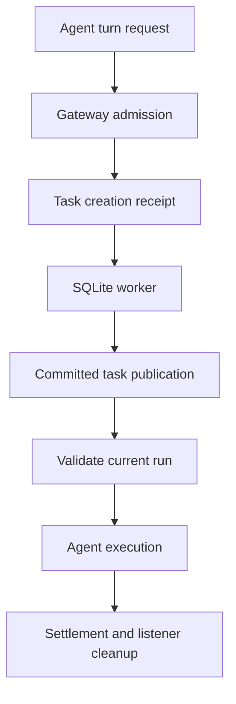

Codex review: blocked before merge. _Reviewed September 22, 2026, 10:03 PM ET / September 23, 2026, 02:03 UTC._

# ClawSweeper review

## What this changes

Moves Gateway task-owner persistence into the existing SQLite worker so starting agent turns can yield while the database is busy.

## Merge readiness

⛔ **Blocked before merge - 3 items remain**

The contention fix remains useful on current main, but a rejected follow-up receipt can leak its new lifecycle listener.

**Priority:** P1
**Reviewed head:** `a30914519dafa03b1710277a0e06a0ccb3ed4da7`

## Review scores

| Measure | Result | What it means |
|---|---|---|
| **Overall readiness** | 🦐 gold shrimp **(3/6)** | The worker integration has substantial focused coverage, but the rejected-receipt lifetime needs repair. |
| **Proof confidence** | 🌊 off-meta tidepool | Not applicable: Maintainer-authored proof exemption applies. The reported synthetic Gateway-dispatch checks exercise the real task worker and contention boundary with mocked provider execution; deployed recovery is explicitly unproven. No stored-data format or migration contract changes. |
| **Patch quality** | 🦐 gold shrimp **(3/6)** | 1 actionable review finding remain. |

## Verification

| Check | Result | Evidence |
|---|---|---|
| **Real behavior** | Not applicable | Not applicable: Maintainer-authored proof exemption applies. The reported synthetic Gateway-dispatch checks exercise the real task worker and contention boundary with mocked provider execution; deployed recovery is explicitly unproven. No stored-data format or migration contract changes. |
| **Evidence reviewed** | 8 items | Reviewed introduction boundary: Reviewed the pinned merge-base-to-head changes. The supplied stale test merge was not used to attribute base-branch changes or claim that merging removes current-main behavior. Current-main necessity: Fetched main still binds task owners through withTaskRegistryMutation and updateTask synchronously. The latest-release source object could not be retrieved, so no shipped-fix claim is made. New retained listener: Running-task creation now installs a module-retained lineage listener. Successful creation transfers cleanup responsibility to receipt settlement or binding release; the creation catch only handles creation failures. |
| **Findings** | 1 actionable finding | [P2] Release lineage when follow-up registration rejects a terminal receipt |
| **Security** | None | None. |

## How this fits together

The Gateway records task ownership before starting agent execution. The task registry coordinates durable writes, lifecycle events, cancellation ownership, and eventual cleanup.

## Before merge

- [ ] **Release lineage when follow-up registration rejects a terminal receipt (P2)** - Creation now retains a listener in `listenersByRun`, but `registerSessionFollowupTask` discards the receipt and throws when creation returns a terminal task. Terminal-row reuse is supported by the creation owner, including when the row appears after the earlier tracking lookup. Since `registeredFollowupTask` is assigned only after registration succeeds, outer rejection cleanup cannot call settlement or release. The listener therefore retains its creation context and task until database shutdown. Release this receipt on the terminal rejection path without changing its persisted outcome, and cover that path with a regression.
- [ ] **Complete next step (P2)** - Release rejected terminal receipts and verify that cleanup preserves their existing terminal outcome.
- [ ] **Add data-model compatibility proof** - Confirm migration or upgrade compatibility proof before merge.

## Findings

- [P2] Release lineage when follow-up registration rejects a terminal receipt — `src/tasks/task-executor-create.async.ts:69-75`

<strong>Agent review details</strong>

### Security

None.

### PR surface

Source +341, Tests +819, Docs +8. Total +1168 across 27 files.

View PR surface stats

| Area | Files | Added | Removed | Net |
|---|---:|---:|---:|---:|
| Source | 16 | 439 | 98 | +341 |
| Tests | 10 | 967 | 148 | +819 |
| Docs | 1 | 8 | 0 | +8 |
| Config | 0 | 0 | 0 | 0 |
| Generated | 0 | 0 | 0 | 0 |
| Other | 0 | 0 | 0 | 0 |
| **Total** | **27** | **1414** | **246** | **+1168** |

### Review metrics

| Metric | Value | Why it matters |
|---|---|---|
| **Production versus test growth** | Production +341 net lines; tests and test support +819 net lines | The growth supports asynchronous binding and race coverage, making complete receipt-lifetime cleanup especially important. |

### Stored data model

Persistent data-model change detected: `serialized state: src/tasks/task-executor-transition.async.ts`, `serialized state: src/tasks/task-registry-transition.operation.ts`, `unknown-data-model-change: src/tasks/task-registry-transition.operation.ts`. Confirm migration or upgrade compatibility proof before merge.

### Technical review

Best possible solution:

Keep worker-based binding and give every rejected creation receipt a cleanup path that releases lineage without rewriting terminal task state.

Do we have a high-confidence way to reproduce the issue?

Yes, source establishes the synchronous main-thread persistence path under coordinator contention, and the added regression targets that boundary. This review did not execute it.

Is this the best way to solve the issue?

Yes, using the existing worker and publication owners is the appropriate repair; receipt disposal must also cover follow-up registration rejection.

Full review comments:

- [P2] Release lineage when follow-up registration rejects a terminal receipt — `src/tasks/task-executor-create.async.ts:69-75`
  Creation now retains a listener in `listenersByRun`, but `registerSessionFollowupTask` discards the receipt and throws when creation returns a terminal task. Terminal-row reuse is supported by the creation owner, including when the row appears after the earlier tracking lookup. Since `registeredFollowupTask` is assigned only after registration succeeds, outer rejection cleanup cannot call settlement or release. The listener therefore retains its creation context and task until database shutdown. Release this receipt on the terminal rejection path without changing its persisted outcome, and cover that path with a regression.
  Confidence: 0.88

Overall correctness: patch is incorrect
Overall confidence: 0.88

AGENTS.md: found and applied where relevant.

Codex review notes: model internal, reasoning medium; reviewed against [d5dc4457b4a2](https://github.com/openclaw/openclaw/commit/d5dc4457b4a2aeded40edcfa909b97ed01cd69d0).

### Labels

Label changes:

- add `P1`: The remaining synchronous database wait can freeze unrelated Gateway requests and cancellation during agent startup.
- add `rating: 🦐 gold shrimp`: Overall readiness is 🦐 gold shrimp; proof is 🌊 off-meta tidepool and patch quality is 🦐 gold shrimp.
- add `status: ⏳ waiting on author`: ClawSweeper has contributor-facing work open and is waiting for author action. Not applicable: Maintainer-authored proof exemption applies. The reported synthetic Gateway-dispatch checks exercise the real task worker and contention boundary with mocked provider execution; deployed recovery is explicitly unproven. No stored-data format or migration contract changes.

Label justifications:

- `P1`: The remaining synchronous database wait can freeze unrelated Gateway requests and cancellation during agent startup.
- `rating: 🦐 gold shrimp`: Overall readiness is 🦐 gold shrimp; proof is 🌊 off-meta tidepool and patch quality is 🦐 gold shrimp.
- `status: ⏳ waiting on author`: ClawSweeper has contributor-facing work open and is waiting for author action. Not applicable: Maintainer-authored proof exemption applies. The reported synthetic Gateway-dispatch checks exercise the real task worker and contention boundary with mocked provider execution; deployed recovery is explicitly unproven. No stored-data format or migration contract changes.

### Evidence

Acceptance criteria:

- [P1] pnpm test src/tasks/task-run-owner.test.ts --maxWorkers=1.
- [P1] pnpm test src/gateway/server-methods/agent.task-runtime.test.ts --maxWorkers=1.
- [P1] pnpm test src/gateway/agent-turn/agent-run-dispatch.sqlite.test.ts --maxWorkers=1.
- [P1] git diff --check.

What I checked:

- **Reviewed introduction boundary:** Reviewed the pinned merge-base-to-head changes. The supplied stale test merge was not used to attribute base-branch changes or claim that merging removes current-main behavior. ([a30914519daf](https://github.com/openclaw/openclaw/commit/a30914519dafa03b1710277a0e06a0ccb3ed4da7))
- **Current-main necessity:** Fetched main still binds task owners through withTaskRegistryMutation and updateTask synchronously. The latest-release source object could not be retrieved, so no shipped-fix claim is made. ([`src/tasks/task-run-owner.ts:16`](https://github.com/openclaw/openclaw/blob/d5dc4457b4a2aeded40edcfa909b97ed01cd69d0/src/tasks/task-run-owner.ts#L16), [d5dc4457b4a2](https://github.com/openclaw/openclaw/commit/d5dc4457b4a2aeded40edcfa909b97ed01cd69d0))
- **New retained listener:** Running-task creation now installs a module-retained lineage listener. Successful creation transfers cleanup responsibility to receipt settlement or binding release; the creation catch only handles creation failures. ([`src/tasks/task-executor-create.async.ts:212`](https://github.com/openclaw/openclaw/blob/a30914519dafa03b1710277a0e06a0ccb3ed4da7/src/tasks/task-executor-create.async.ts#L212), [a30914519daf](https://github.com/openclaw/openclaw/commit/a30914519dafa03b1710277a0e06a0ccb3ed4da7))
- **Discarded terminal receipt:** registerSessionFollowupTask discards a successfully returned terminal receipt and throws. Its caller assigns registeredFollowupTask only after successful return, so rejection cleanup cannot release that receipt. Existing task selection permits terminal-row reuse. ([`src/gateway/agent-turn/agent-run-task-tracking.ts:76`](https://github.com/openclaw/openclaw/blob/a30914519dafa03b1710277a0e06a0ccb3ed4da7/src/gateway/agent-turn/agent-run-task-tracking.ts#L76), [a30914519daf](https://github.com/openclaw/openclaw/commit/a30914519dafa03b1710277a0e06a0ccb3ed4da7))
- **Authority and persistence boundaries:** Binding passes current-run assertions through the existing worker admission owner, checks the exact persisted task, waits for publication, and rechecks registration before activation. Cancellation retains its live delegated-authority checks. The patch changes neither stored row format nor the public synchronous plugin runtime contract. ([`src/gateway/agent-turn/agent-run-dispatch.ts:391`](https://github.com/openclaw/openclaw/blob/a30914519dafa03b1710277a0e06a0ccb3ed4da7/src/gateway/agent-turn/agent-run-dispatch.ts#L391), [a30914519daf](https://github.com/openclaw/openclaw/commit/a30914519dafa03b1710277a0e06a0ccb3ed4da7))
- **Scoped validation evidence:** The captured PR body reports 177 focused cases on Node 26.8.2 and explicitly says deployed recovery is unestablished. Inspected tests exercise actual SQLite worker contention through Gateway dispatch, including cancellation, replacement, committed/uncommitted failures, and a 1 MiB record; provider execution is mocked. Tests were not executed during this read-only review. ([`src/gateway/agent-turn/agent-run-dispatch.sqlite.test.ts:46`](https://github.com/openclaw/openclaw/blob/a30914519dafa03b1710277a0e06a0ccb3ed4da7/src/gateway/agent-turn/agent-run-dispatch.sqlite.test.ts#L46), [a30914519daf](https://github.com/openclaw/openclaw/commit/a30914519dafa03b1710277a0e06a0ccb3ed4da7))

Likely related people:

- **steipete:** Suggested for follow-up; no historical authorship or introduction is verified. (role: unverified routing candidate; confidence: low)

### Rank-up moves

Optional improvements that raise the rating; they are not merge blockers.

- Release lineage on terminal follow-up rejection and add coverage proving terminal state remains unchanged.

### Rating scale

| Score | Internal tier | Crab rank | Meaning |
|---:|:---:|---|---|
| **6/6** | S | 🦀 challenger crab | Exceptional readiness |
| **5/6** | A | 🦞 diamond lobster | Very strong readiness |
| **4/6** | B | 🐚 platinum hermit | Good normal PR; ordinary maintainer review |
| **3/6** | C | 🦐 gold shrimp | Useful, but confidence is limited |
| **2/6** | D | 🦪 silver shellfish | Proof or implementation needs work |
| **1/6** | F | 🧂 unranked krab | Not merge-ready |
| N/A | NA | 🌊 off-meta tidepool | Rating does not apply |

Overall follows the weaker of proof and patch quality.
Shiny media proof means a screenshot, video, or linked artifact directly shows the changed behavior. Runtime, network, CSP, and security claims still need visible diagnostics.

### Workflow

- ClawSweeper keeps one durable marker-backed review comment per issue or PR.
- Re-runs edit this comment so the latest verdict, findings, and automation markers stay together instead of adding duplicate bot comments.
- A fresh review can be triggered by eligible `@clawsweeper re-review` comments, exact-item GitHub events, scheduled/background review runs, or manual workflow dispatch.
- PR/issue authors and users with repository write access can comment `@clawsweeper re-review` or `@clawsweeper re-run` on an open PR or issue to request a fresh review only.
- Maintainers can also comment `@clawsweeper review` to request a fresh review only.
- Fresh-review commands do not start repair, autofix, rebase, CI repair, or automerge.
- Maintainer-only repair and merge flows require explicit commands such as `@clawsweeper autofix`, `@clawsweeper automerge`, `@clawsweeper fix ci`, or `@clawsweeper address review`.
- Maintainers can comment `@clawsweeper explain` to ask for more context, or `@clawsweeper stop` to stop active automation.

<!-- clawsweeper-verdict:needs-human item=156064 sha=a30914519dafa03b1710277a0e06a0ccb3ed4da7 confidence=high updated_at=2026-09-23T01:59:52Z reviewed_at=2026-09-23T02:03:48.917Z lease_owner=github-run-35808404292-1 lease_comment_id=5787663367 source_revision=48c1d946d278982b1637e73ec433d6cabfb653d59211ff2de79a27d05b6a3eee live_verification=absent -->
<!-- clawsweeper-review-state:blocked item=156064 sha=a30914519dafa03b1710277a0e06a0ccb3ed4da7 v=1 -->

<!-- clawsweeper-review-version item=156064 reviewed_at=2026-09-23T02:03:48.917Z sha=a30914519dafa03b1710277a0e06a0ccb3ed4da7 source_revision=48c1d946d278982b1637e73ec433d6cabfb653d59211ff2de79a27d05b6a3eee lease_owner=github-run-35808404292-1 lease_comment_id=5787663367 v=1 -->

<!-- clawsweeper-review item=156064 -->