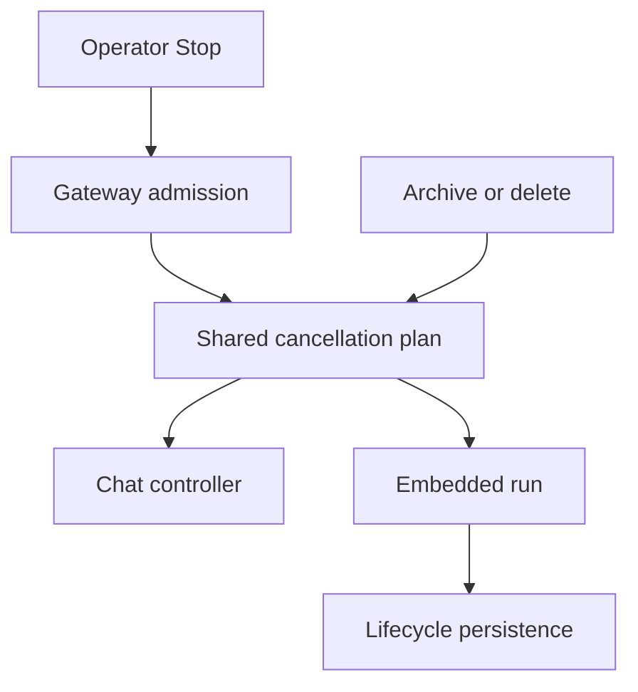

Codex review: needs maintainer review before merge.

## What this changes

Session-wide Stop now cancels controller-less embedded runs and returns their run identity through the shared cancellation owner.

**Example:** Send chat.abort for a session with an active POST /v1/chat/completions request.
- **Before:** Stop reports aborted: true with runIds: [], while the HTTP request continues.
- **After:** Stop returns the embedded run ID, and the HTTP request ends with 500 "agent run was cancelled".

## Review scores

| Measure | Result | What it means |
|---|---|---|
| **Overall readiness** | 🦞 diamond lobster **(5/6)** | Focused repair with shipped-entry-point evidence and meaningful authority regressions; the previous blocker is fixed. |
| **Proof confidence** | 🦞 diamond lobster **(5/6)** | Sufficient (live_output): Supplied real-Gateway output exercises both HTTP endpoints with a held provider request and confirms prompt cancellation, returned run identity, and cleared active state; production-path authority regressions cover forbidden callers, revocation, and the repaired lifecycle drain. |
| **Patch quality** | 🦞 diamond lobster **(5/6)** | No actionable review findings were identified. |

## Product

**Kind:** Bug fix · **Worth it:** Yes · **Fix scope:** Complete
**User problem:** Stop reports success while an OpenAI-compatible HTTP agent request keeps running.
**Reason:** Restores an established cancellation contract without adding configuration or a competing runtime owner.

## Merge readiness

✅ **Ready for maintainer review**

This PR fixes a current-main cancellation gap, and the latest revision resolves the prior authorization finding; no actionable defects remain in the reviewed diff.

**Priority:** P1
**Reviewed head:** `0c52f2a655c35feab6698effe9c59c8e8cc8cd8f`

## Before merge

None.

## Findings

None.

<strong>Agent review details</strong>

### How this fits together

Gateway Stop handlers authorize the session, select live runtime owners, signal cancellation, and await terminal persistence before responding.

### Technical review

Best possible solution:

Use the shared cancellation plan with explicit embedded-run opt-in and live authorization through terminal persistence.

Do we have a high-confidence way to reproduce the issue?

Current-main source shows the missing embedded cancellation path, matching the supplied real-Gateway before/after results; this review ran no target code.

Is this the best way to solve the issue?

The repair extends the existing cancellation owner, preserves non-opted callers, and retains current authority at signalling and commit boundaries.

AGENTS.md: found and applied where relevant.

Codex review notes: model internal, reasoning medium; reviewed against [fc7c5047e59a](https://github.com/openclaw/openclaw/commit/fc7c5047e59a7d7d4ae37b0f8991786d2def1b76).

### Provenance checked

- `Embedded session Stop` changes intended behavior with a stated reason (2900026b333d0181fbcd7e54ce503bddbf36f8fb: Selected channel sessions needed cancellation independent of browser-owned controllers.)
- `Caller and session fencing` keeps the original intent (da27b336c0e96cce29e8417cb82da863a57380bd: Delayed Stop must retain the original caller and admitted session incarnation.)
- `Terminal cancellation persistence` keeps the original intent (bac42185c4750bb72312217d23ceb0c525296701: Acknowledged abort must settle terminal persistence to prevent stranded writers after restart.)
- `Archive and delete draining` keeps the original intent (763399522f65bcf3284de50f3acafc3bf520ddbf: Start cancellation under the lifecycle fence and settle drains outside mutation locks.)

### Testing

Proof path: shipped entry point.

### Security

None.

### Evidence

What I checked:

- **Current main still needs the fix:** Fetched main delegates embedded cancellation to the sessions.abort callback; ordinary session-wide chat.abort does not supply that callback. ([`src/gateway/server-methods/chat-abort-runtime.ts:427`](https://github.com/openclaw/openclaw/blob/fc7c5047e59a7d7d4ae37b0f8991786d2def1b76/src/gateway/server-methods/chat-abort-runtime.ts#L427), [fc7c5047e59a](https://github.com/openclaw/openclaw/commit/fc7c5047e59a7d7d4ae37b0f8991786d2def1b76))
- **Prior finding resolved:** The latest commit forwards lifecycle authorization into the shared plan, which carries it into the delayed cancellation commit guard. ([`src/gateway/server-methods/sessions-lifecycle-drain.ts:206`](https://github.com/openclaw/openclaw/blob/0c52f2a655c35feab6698effe9c59c8e8cc8cd8f/src/gateway/server-methods/sessions-lifecycle-drain.ts#L206), [0c52f2a655c3](https://github.com/openclaw/openclaw/commit/0c52f2a655c35feab6698effe9c59c8e8cc8cd8f))
- **Final-effect authorization coverage:** The production-admission tests cover allowed and forbidden session callers, revocation before signalling, and revocation before persistence; the new drain cases verify unchanged stored state after revocation and successful cancellation with current authority. ([`src/gateway/server-methods/sessions.abort-embedded.test.ts:142`](https://github.com/openclaw/openclaw/blob/0c52f2a655c35feab6698effe9c59c8e8cc8cd8f/src/gateway/server-methods/sessions.abort-embedded.test.ts#L142), [0c52f2a655c3](https://github.com/openclaw/openclaw/commit/0c52f2a655c35feab6698effe9c59c8e8cc8cd8f))
- **Supplied runtime proof:** The complete REST-read body records before/after runs through a real isolated Gateway for both HTTP endpoints, including a delayed Stop, cancellation responses, and cleared active state; it also records passing authority regressions and mutation controls. ([0c52f2a655c3](https://github.com/openclaw/openclaw/commit/0c52f2a655c35feab6698effe9c59c8e8cc8cd8f))
- **Related fixes remain distinct:** https://github.com/openclaw/openclaw/pull/167995 merged cancellation-error classification and explicitly left operator Stop as follow-up; https://github.com/openclaw/openclaw/pull/166753 merged ordinary-command cleanup rather than embedded model cancellation. ([97c7a5e48731](https://github.com/openclaw/openclaw/commit/97c7a5e487313708964bf6a44242df3e67dac37d))
- **Media inspected:** All prepared images were inspected; they show the separate ordinary-command cleanup repair and are not counted as proof of this PR's HTTP cancellation behavior.

Likely related people:

- **Peter Steinberger:** Raw commit ad00ba847d891a95792de8d5ec5de696756c910d adds src/gateway/server-methods/chat-abort-runtime.ts:585 relative to its recorded parents. This identifies author metadata, not feature responsibility or a PR merger. (role: source-line author; confidence: high; commits: [ad00ba847d89](https://github.com/openclaw/openclaw/commit/ad00ba847d891a95792de8d5ec5de696756c910d); files: `src/gateway/server-methods/chat-abort-runtime.ts`)
- **Vincent Koc:** Raw commit da27b336c0e96cce29e8417cb82da863a57380bd adds src/gateway/server-methods/chat-abort-runtime.ts:568 relative to its recorded parents. This identifies author metadata, not feature responsibility or a PR merger. (role: source-line author; confidence: high; commits: [da27b336c0e9](https://github.com/openclaw/openclaw/commit/da27b336c0e96cce29e8417cb82da863a57380bd); files: `src/gateway/server-methods/chat-abort-runtime.ts`)
- **Shakker:** Raw commit 109bd47910990e8a2e12b8f1532e1bbbccf738e5 adds src/gateway/server-methods/chat-abort-runtime.ts:439 relative to its recorded parents. This identifies author metadata, not feature responsibility or a PR merger. (role: source-line author; confidence: high; commits: [109bd4791099](https://github.com/openclaw/openclaw/commit/109bd47910990e8a2e12b8f1532e1bbbccf738e5); files: `src/gateway/server-methods/chat-abort-runtime.ts`)

### PR surface

Source +88, Tests +399, Docs +2. Total +489 across 11 files. Added test files: 0.

View PR surface stats

| Area | Files | Added | Removed | Net |
|---|---:|---:|---:|---:|
| Source | 6 | 220 | 132 | +88 |
| Tests | 2 | 406 | 7 | +399 |
| Docs | 3 | 5 | 3 | +2 |
| Config | 0 | 0 | 0 | 0 |
| Generated | 0 | 0 | 0 | 0 |
| Other | 0 | 0 | 0 | 0 |
| **Total** | **11** | **631** | **142** | **+489** |

### Labels

Label changes:

- add `rating: 🦞 diamond lobster`: Overall readiness is 🦞 diamond lobster; proof is 🦞 diamond lobster and patch quality is 🦞 diamond lobster.
- add `status: 👀 ready for maintainer look`: ClawSweeper has no concrete contributor-facing blocker left for this PR.
- remove `rating: 🦪 silver shellfish`: Current PR rating is `rating: 🦞 diamond lobster`, so this older rating label is no longer current.
- remove `merge-risk: 🚨 security-boundary`: Current PR review selected no merge-risk labels.
- remove `status: ⏳ waiting on author`: Current PR status label is `status: 👀 ready for maintainer look`.

Label justifications:

- `P1`: Operator Stop currently acknowledges cancellation while an HTTP agent request continues consuming provider work.
- `rating: 🦞 diamond lobster`: Overall readiness is 🦞 diamond lobster; proof is 🦞 diamond lobster and patch quality is 🦞 diamond lobster.
- `status: 👀 ready for maintainer look`: ClawSweeper has no concrete contributor-facing blocker left for this PR.
- `proof: sufficient`: Contributor real behavior proof is sufficient.
- `proof: telegram-e2e`: This PR needs Telegram Test Server proof with the repository E2E skill. Session-wide chat.abort can now stop controller-less channel replies, which a Telegram Test Server userbot can observe.

### Rating scale

6/6 🦀 challenger crab · 5/6 🦞 diamond lobster · 4/6 🐚 platinum hermit · 3/6 🦐 gold shrimp · 2/6 🦪 silver shellfish · 1/6 🧂 unranked krab. Overall follows the weaker of proof and patch quality; ✨ marks media proof (a screenshot, video, or linked artifact) that directly shows the changed behavior.

### Workflow

ClawSweeper edits this one comment on every review. Comment `@clawsweeper re-review` for a fresh review only; repair and merge need explicit maintainer commands such as `@clawsweeper autofix` or `@clawsweeper automerge`.

### History

Review history (3 earlier review cycles)

<!-- clawsweeper-review-history v=1 total=3 -->
- reviewed 2026-10-10T01:48:10.412Z sha c56c91b2d145dc749cebb8c4abcd5d25eb1b7975 :: needs real behavior proof before merge. :: none
- reviewed 2026-10-10T01:59:55.392Z sha c56c91b2d145dc749cebb8c4abcd5d25eb1b7975 :: needs real behavior proof before merge. :: none
- reviewed 2026-10-10T02:59:31.985Z sha 8ca6f4421027012f8b4eab5a5b2e84206e9011af :: blocked before merge. :: [P2] [P2] Pass lifecycle authorization into the shared Stop plan

_Reviewed October 10, 2026, 12:10 AM ET / 04:10 UTC (Revision 4)._

<!-- clawsweeper-verdict:needs-human item=168080 sha=0c52f2a655c35feab6698effe9c59c8e8cc8cd8f confidence=high updated_at=2026-10-10T04:06:43Z reviewed_at=2026-10-10T04:10:50.987Z lease_owner=github-run-38022857785-1 lease_comment_id=6093596547 source_revision=c1fb5a4c90cbe69387d73ffe1234817bb147b59347018054de1b6929c6a5c23b live_verification=absent hold=not_opted_in findings=0 -->
<!-- clawsweeper-review-state:ready item=168080 sha=0c52f2a655c35feab6698effe9c59c8e8cc8cd8f v=1 -->

<!-- clawsweeper-review-version item=168080 reviewed_at=2026-10-10T04:10:50.987Z sha=0c52f2a655c35feab6698effe9c59c8e8cc8cd8f source_revision=c1fb5a4c90cbe69387d73ffe1234817bb147b59347018054de1b6929c6a5c23b lease_owner=github-run-38022857785-1 lease_comment_id=6093596547 v=1 -->

<!-- clawsweeper-review item=168080 -->