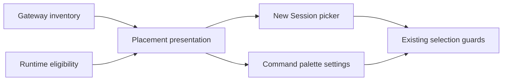

Codex review: needs maintainer review before merge.

## What this changes

This PR adds unavailable-destination warnings and accessible explanations to session selectors and collapses unavailable palette project choices into one row.

**Example:** Paired device has session hosting disabled, with Documentation and Application projects available.
- **Before:** The palette repeats three disabled workspace choices for the computer.
- **After:** The palette shows one Unavailable warning row whose explanation opens through keyboard focus or touch.

## Review scores

| Measure | Result | What it means |
|---|---|---|
| **Overall readiness** | 🦞 diamond lobster **(5/6)** | Focused, visually verified accessibility repair with the prior finding resolved and no remaining actionable defect; pending broader CI remains a normal landing gate. |
| **Proof confidence** | 🦞 diamond lobster **(5/6)** ✨ media proof bonus | Sufficient (screenshot): Inspected desktop and phone before/after screenshots exercise the production Control UI picker and palette with synthetic Gateway inventory, showing warning labels, readable reasons, and one unavailable palette row; supporting browser coverage exercises keyboard and touch activation. |
| **Patch quality** | 🦞 diamond lobster **(5/6)** | No actionable review findings were identified. |

## Product

**Kind:** Bug fix · **Worth it:** Yes · **Fix scope:** Complete
**User problem:** Unavailable computers are difficult to recognize, and repeated disabled palette choices obscure their explanation for keyboard and touch users.
**Reason:** The member-authored direction is approved under the review policy and provides concrete accessibility value within the existing placement contract.

## Merge readiness

✅ **Ready for maintainer review**

Keep this PR open: it delivers a useful accessibility repair absent from current main, and the prior locator finding is fixed with no remaining actionable findings; broader CI is pending.

**Priority:** P2
**Reviewed head:** `d2b07b3a37fda4502b3d970b731550aa87944183`

## Before merge

None.

## Findings

None.

<strong>Agent review details</strong>

### How this fits together

The Control UI renders Gateway inventory and runtime eligibility in New Session and command-palette selectors, while existing placement owners enforce destination selection.

### Technical review

Best possible solution:

Retain the focused presentation repair and corrected sibling-test locator under the normal CI gates.

Do we have a high-confidence way to reproduce the issue?

Current-main source exposes the repeated unavailable palette choices, and inspected browser before/after captures demonstrate the warning and explanation changes without running target code during this review.

Is this the best way to solve the issue?

The patch uses the existing tooltip and selection owners, preserves hosting remediation and working destinations, and fixes the previously identified accessible-name assertion.

AGENTS.md: found and applied where relevant.

Codex review notes: model internal, reasoning medium; reviewed against [ba8025d18e97](https://github.com/openclaw/openclaw/commit/ba8025d18e970b340db4628b18fab605e69a7a2b).

### Provenance checked

- `Compact picker warnings and offline details` changes intended behavior with a stated reason (b9050029efe97266108667536e25b1a806e6dafd: The compact-picker design intentionally hid redundant offline hover cards while showing remediation for blocked devices.)
- `Accessible provider and blocker descriptions` keeps the original intent (361ce472a7ca9987c570abd49cbbf750b05effe8: Provider descriptions identify the backend while preserving control names and selection behavior.)
- `Palette machine and project choices` keeps the original intent (e2bcb1614de060927121bd72de850cee3a08d308: Compact background-session settings reuse the existing targeting and preference owners.)
- `Paired-device hosting remediation` keeps the original intent (8f91e4bb65f2a4cf67aa8f98e348224b28aae194: Already-paired devices need supported configuration and service-install instructions rather than an invalid reconnect command.)

### Testing

Proof path: shipped entry point.

### Security

None.

### Evidence

What I checked:

- **Verified introduced change:** The pinned introduction changes presentation, accessibility, coverage, and documentation without changing runtime eligibility, configuration, or persisted formats. ([`ui/src/pages/new-session/cloud-target.ts:97`](https://github.com/openclaw/openclaw/blob/d2b07b3a37fda4502b3d970b731550aa87944183/ui/src/pages/new-session/cloud-target.ts#L97), [d2b07b3a37fd](https://github.com/openclaw/openclaw/commit/d2b07b3a37fda4502b3d970b731550aa87944183))
- **Current main still needs the repair:** The two production selector modules match their merge-base versions on fetched main, retaining missing warning labels and repeated unavailable palette project choices. ([`ui/src/pages/new-session/palette-session-settings.ts:250`](https://github.com/openclaw/openclaw/blob/ba8025d18e970b340db4628b18fab605e69a7a2b/ui/src/pages/new-session/palette-session-settings.ts#L250), [ba8025d18e97](https://github.com/openclaw/openclaw/commit/ba8025d18e970b340db4628b18fab605e69a7a2b))
- **Prior finding resolved:** The follow-up changes the blocked cloud-row locator to sample-cloud Unavailable while retaining disabled-state, saved-destination, model-catalog, and preference-write assertions. ([`ui/src/e2e/new-session-page.model-catalog.e2e.test.ts:237`](https://github.com/openclaw/openclaw/blob/d2b07b3a37fda4502b3d970b731550aa87944183/ui/src/e2e/new-session-page.model-catalog.e2e.test.ts#L237), [d2b07b3a37fd](https://github.com/openclaw/openclaw/commit/d2b07b3a37fda4502b3d970b731550aa87944183))
- **Selection guards preserved:** The palette still rejects locked or unavailable choices before selection; the shared picker still prevents unavailable activation while allowing its explanation to open. ([`ui/src/pages/new-session/palette-session-settings.ts:233`](https://github.com/openclaw/openclaw/blob/d2b07b3a37fda4502b3d970b731550aa87944183/ui/src/pages/new-session/palette-session-settings.ts#L233), [d2b07b3a37fd](https://github.com/openclaw/openclaw/commit/d2b07b3a37fda4502b3d970b731550aa87944183))
- **Inspected visual evidence:** All eight before/after images in https://github.com/openclaw/openclaw/pull/170456#issuecomment-6135442939 were inspected: prepared desktop images locally and phone images through GitHub reads. They show warnings, readable reasons, and palette deduplication at 1280 and 390 pixels using synthetic Gateway inventory. ([d2b07b3a37fd](https://github.com/openclaw/openclaw/commit/d2b07b3a37fda4502b3d970b731550aa87944183))
- **Current-head validation:** Current-head UI E2E checks passed in https://github.com/openclaw/openclaw/actions/runs/38329624333; broader checks and the CI gate remain pending, with no failed check observed. ([d2b07b3a37fd](https://github.com/openclaw/openclaw/commit/d2b07b3a37fda4502b3d970b731550aa87944183))

### PR surface

Source +50, Tests +95, Docs +3. Total +148 across 9 files. Added test files: 0.

View PR surface stats

| Area | Files | Added | Removed | Net |
|---|---:|---:|---:|---:|
| Source | 5 | 85 | 35 | +50 |
| Tests | 3 | 134 | 39 | +95 |
| Docs | 1 | 3 | 0 | +3 |
| Config | 0 | 0 | 0 | 0 |
| Generated | 0 | 0 | 0 | 0 |
| Other | 0 | 0 | 0 | 0 |
| **Total** | **9** | **222** | **74** | **+148** |

### Review metrics

| Metric | Value | Why it matters |
|---|---|---|
| **Production versus test LOC** | Production +85/-35; tests +134/-39 | Production growth exposes warnings and existing explanations; browser coverage exercises distinct keyboard and touch interactions through the existing fixture. |

### Root-cause cluster

Relationship: `canonical`
Canonical: https://github.com/openclaw/openclaw/pull/170456
Summary: This PR carries the remaining presentation repair from the older branch while keeping the separately merged authority guidance.

Members:
- `partial_overlap`: https://github.com/openclaw/openclaw/pull/153742 - The older branch contains the unavailable-computer presentation work explicitly carried forward here, along with additional changes.
- `adjacent_distinct`: https://github.com/openclaw/openclaw/pull/168641 - The merged change owns the authority-specific missing-harness explanation; this PR changes how existing eligibility reasons appear.

Proposal only: this assessment does not dispatch repair, suppress jobs, mutate sibling items, close, or merge anything.

### Labels

Label changes:

- add `rating: 🦞 diamond lobster`: Overall readiness is 🦞 diamond lobster; proof is 🦞 diamond lobster and patch quality is 🦞 diamond lobster.
- add `status: 👀 ready for maintainer look`: ClawSweeper has no concrete contributor-facing blocker left for this PR.
- remove `rating: 🦐 gold shrimp`: Current PR rating is `rating: 🦞 diamond lobster`, so this older rating label is no longer current.
- remove `status: ⏳ waiting on author`: Current PR status label is `status: 👀 ready for maintainer look`.

Label justifications:

- `P2`: This is a bounded accessibility and destination-picker clarity repair with no change to execution eligibility.
- `rating: 🦞 diamond lobster`: Overall readiness is 🦞 diamond lobster; proof is 🦞 diamond lobster and patch quality is 🦞 diamond lobster.
- `status: 👀 ready for maintainer look`: ClawSweeper has no concrete contributor-facing blocker left for this PR.
- `proof: sufficient`: Contributor real behavior proof is sufficient.
- `proof: 📸 screenshot`: Contributor real behavior proof includes screenshot evidence.

### Rating scale

6/6 🦀 challenger crab · 5/6 🦞 diamond lobster · 4/6 🐚 platinum hermit · 3/6 🦐 gold shrimp · 2/6 🦪 silver shellfish · 1/6 🧂 unranked krab. Overall follows the weaker of proof and patch quality; ✨ marks media proof (a screenshot, video, or linked artifact) that directly shows the changed behavior.

### Workflow

ClawSweeper edits this one comment on every review. Comment `@clawsweeper re-review` for a fresh review only. Repair and merge execution lanes are retired.

### History

Review history (1 earlier review cycle)

<!-- clawsweeper-review-history v=1 total=1 -->
- reviewed 2026-10-13T00:50:38.120Z sha 1b89021ef840261fa2df0228c792a904217dc042 :: needs changes before merge. :: [P2] Update the blocked cloud-row locator in the model-catalog E2E

_Reviewed October 12, 2026, 9:02 PM ET / October 13, 2026, 01:02 UTC (Revision 2)._

<!-- clawsweeper-verdict:needs-human item=170456 sha=d2b07b3a37fda4502b3d970b731550aa87944183 confidence=high updated_at=2026-10-13T00:58:10Z reviewed_at=2026-10-13T01:02:02.582Z lease_owner=github-run-38329756098-1 lease_comment_id=6135724781 source_revision=6577f89f6f6d9d67924287ab058c4091f73a21dec2d14ca05ad08eeb4e784a8c hold=not_opted_in findings=0 -->
<!-- clawsweeper-review-state:ready item=170456 sha=d2b07b3a37fda4502b3d970b731550aa87944183 v=1 -->

<!-- clawsweeper-review-version item=170456 reviewed_at=2026-10-13T01:02:02.582Z sha=d2b07b3a37fda4502b3d970b731550aa87944183 source_revision=6577f89f6f6d9d67924287ab058c4091f73a21dec2d14ca05ad08eeb4e784a8c lease_owner=github-run-38329756098-1 lease_comment_id=6135724781 v=1 -->

<!-- clawsweeper-review item=170456 -->