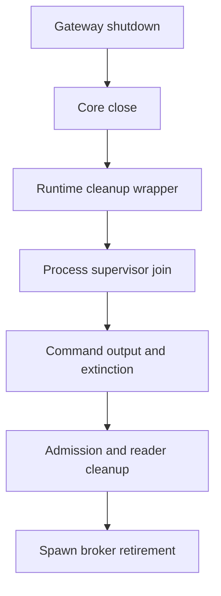

Codex review: needs maintainer review before merge.

## What this changes

This PR joins supervised command cleanup before retiring the Linux Gateway spawn broker after failed core shutdown.

**Example:** A running command prints final-marker when canceled, while Gateway core shutdown fails before process cleanup.
- **Before:** Broker retirement can replace the command result with ERR_SPAWN_BROKER_UNAVAILABLE.
- **After:** The supervisor settles command output and process extinction before broker retirement, within the existing caller deadline.

## Review scores

| Measure | Result | What it means |
|---|---|---|
| **Overall readiness** | 🦐 gold shrimp **(3/6)** | The focused patch appears correct and has meaningful real-process boundary evidence; proof remains a controlled runtime-wrapper fixture. |
| **Proof confidence** | 🦐 gold shrimp **(3/6)** | The host identifies this as maintainer-authored, outside the ordinary contributor proof gate; the supplied Linux measurements exercise real broker, supervisor, relay, and anchor owners with an injected core-close error and report preserved final output and extinction. |
| **Patch quality** | 🐚 platinum hermit **(4/6)** | No actionable review findings were identified. |

## Product

**Kind:** Bug fix · **Worth it:** Yes · **Fix scope:** Complete
**User problem:** A command's final output and result can be lost when failed Gateway cleanup disconnects the spawn broker too early.
**Reason:** Preserving command outcomes restores the existing supervision contract, and the maintainer-authored direction needs no additional product decision.

## Merge readiness

✅ **Ready for maintainer review**

Keep open: this focused fix addresses a shutdown-ordering bug still present on main, with no actionable introduced defect found.

**Priority:** P2
**Reviewed head:** `de5f222feeadccd039c9f315bb94d0f7d98c2ae4`

## Before merge

None.

## Findings

None.

### Tests

- Missing end-to-end proof: The supplied fixture injects core-close failure through the real runtime wrapper and subprocess owners rather than booting a full Gateway.

<strong>Agent review details</strong>

### How this fits together

The Gateway runtime wrapper owns spawn-broker retirement; the process supervisor owns cancellation, command results, output settlement, and process-tree cleanup.

### Technical review

Best possible solution:

Keep the existing supervisor join immediately before broker retirement, retaining the current deadline and failure semantics.

Do we have a high-confidence way to reproduce the issue?

Source confirms that retained core cleanup can bypass the process join and retire its broker before the CLI fallback; the author reports baseline failures, but this read-only review ran no target code.

Is this the best way to solve the issue?

The four-line production change is the smallest complete repair using the existing supervisor and broker owners, without replacing healthy core cleanup or the native-transport CLI fallback.

AGENTS.md: found and applied where relevant.

Codex review notes: model internal, reasoning medium; reviewed against [5ad78d04962b](https://github.com/openclaw/openclaw/commit/5ad78d04962b68ac276aa66b7be14f7ce9ccb0c7).

### Provenance checked

- `Gateway broker lifetime` keeps the original intent (67cedc32e9967d01586c65dc3b18073e9beb5551: Move Linux launches to a lightweight broker while preserving cancellation, output, and relay ownership.)
- `Bounded runtime cleanup` keeps the original intent (a968dc19900db67a0b4230b68d9df5e2d52c13b3: Bound process-owned shutdown waiting while retaining ordered cleanup and original fatal errors.)
- `Background-process documentation` keeps the original intent (20c1a15bb56da3178a32aaa51e1207ad89172ac6: Distinguish ordinary supervised commands from durable systemd-managed processes across Gateway restarts.)
- `Standalone measurement inventory` keeps the original intent (6d0157388723a4aaa80daf493f67404cc6030a76: Register maintained proof commands explicitly so unused-file analysis recognizes their documented entry points.)

### Testing

Proof path: in-process harness.

### Security

None.

### Evidence

What I checked:

- **Pinned production change:** The introduced diff adds the existing supervisor shutdown operation before admission cleanup and broker retirement; it adds no runtime state, timer, or alternative cleanup owner. ([`src/gateway/server.ts:222`](https://github.com/openclaw/openclaw/blob/de5f222feeadccd039c9f315bb94d0f7d98c2ae4/src/gateway/server.ts#L222), [de5f222feead](https://github.com/openclaw/openclaw/commit/de5f222feeadccd039c9f315bb94d0f7d98c2ae4))
- **Current main retains the gap:** Current main's closeBroker proceeds directly to database-admission cleanup without first joining supervised commands. ([`src/gateway/server.ts:219`](https://github.com/openclaw/openclaw/blob/5ad78d04962b68ac276aa66b7be14f7ce9ccb0c7/src/gateway/server.ts#L219), [5ad78d04962b](https://github.com/openclaw/openclaw/commit/5ad78d04962b68ac276aa66b7be14f7ce9ccb0c7))
- **Existing lifecycle owners:** Core close can throw for retained work before its supervisor join; the CLI's process-owner fallback runs later. Supervisor shutdown fences new launches and joins existing process extinction. ([`src/gateway/server-close.ts:648`](https://github.com/openclaw/openclaw/blob/de5f222feeadccd039c9f315bb94d0f7d98c2ae4/src/gateway/server-close.ts#L648), [de5f222feead](https://github.com/openclaw/openclaw/commit/de5f222feeadccd039c9f315bb94d0f7d98c2ae4))
- **Regression and supplied process proof:** The regression checks final stdout, a fulfilled cancellation outcome, and native extinction after core-close failure. The PR body reports five Linux baseline/candidate pairs with lost outcomes changing from 5/5 to 0/5, using the committed runtime-wrapper fixture. ([`src/gateway/server.spawn-broker.test.ts:296`](https://github.com/openclaw/openclaw/blob/de5f222feeadccd039c9f315bb94d0f7d98c2ae4/src/gateway/server.spawn-broker.test.ts#L296), [de5f222feead](https://github.com/openclaw/openclaw/commit/de5f222feeadccd039c9f315bb94d0f7d98c2ae4))
- **Preserved shutdown intent:** https://github.com/openclaw/openclaw/pull/187090 established bounded process-owned waiting while ordered cleanup continues; this PR keeps that wrapper and its fatal-error preservation. ([`src/gateway/server.ts:32`](https://github.com/openclaw/openclaw/blob/a968dc19900db67a0b4230b68d9df5e2d52c13b3/src/gateway/server.ts#L32), [a968dc19900d](https://github.com/openclaw/openclaw/commit/a968dc19900db67a0b4230b68d9df5e2d52c13b3))
- **Feature ownership history:** Available history identifies Peter Steinberger across the original broker integration, retained startup-admission composition, reader retirement, and recent shutdown deadline repair. A deeper content search encountered unavailable historical objects; available commits and current-main blame establish routing without relying on that search. ([`src/gateway/server.ts:220`](https://github.com/openclaw/openclaw/blob/5ad78d04962b68ac276aa66b7be14f7ce9ccb0c7/src/gateway/server.ts#L220), [5ad78d04962b](https://github.com/openclaw/openclaw/commit/5ad78d04962b68ac276aa66b7be14f7ce9ccb0c7))

### PR surface

Source +4, Tests +61, Docs 0, Other +328. Total +393 across 6 files. Added test files: 0.

View PR surface stats

| Area | Files | Added | Removed | Net |
|---|---:|---:|---:|---:|
| Source | 1 | 4 | 0 | +4 |
| Tests | 1 | 62 | 1 | +61 |
| Docs | 1 | 1 | 1 | 0 |
| Config | 0 | 0 | 0 | 0 |
| Generated | 0 | 0 | 0 | 0 |
| Other | 3 | 328 | 0 | +328 |
| **Total** | **6** | **395** | **2** | **+393** |

### Review metrics

| Metric | Value | Why it matters |
|---|---|---|
| **Runtime versus regression growth** | Production +4 lines; tests net +61 lines | The runtime change composes existing owners; the added regression covers command results, final output, and process extinction across a failed close. |

### Labels

Label changes:

- add `P2`: This repairs command-outcome loss during a specific failed Gateway shutdown path.
- add `rating: 🦐 gold shrimp`: Overall readiness is 🦐 gold shrimp; proof is 🦐 gold shrimp and patch quality is 🐚 platinum hermit.
- add `status: 👀 ready for maintainer look`: ClawSweeper has no concrete contributor-facing blocker left for this PR.

Label justifications:

- `P2`: This repairs command-outcome loss during a specific failed Gateway shutdown path.
- `rating: 🦐 gold shrimp`: Overall readiness is 🦐 gold shrimp; proof is 🦐 gold shrimp and patch quality is 🐚 platinum hermit.
- `status: 👀 ready for maintainer look`: ClawSweeper has no concrete contributor-facing blocker left for this PR.

### Rating scale

6/6 🦀 challenger crab · 5/6 🦞 diamond lobster · 4/6 🐚 platinum hermit · 3/6 🦐 gold shrimp · 2/6 🦪 silver shellfish · 1/6 🧂 unranked krab. Overall follows the weaker of proof and patch quality; ✨ marks media proof (a screenshot, video, or linked artifact) that directly shows the changed behavior.

### Workflow

ClawSweeper edits this one comment on every review. Comment `@clawsweeper re-review` for a fresh review only. Repair and merge execution lanes are retired.

_Reviewed October 30, 2026, 9:07 PM ET / October 31, 2026, 01:07 UTC._

<!-- clawsweeper-verdict:needs-human item=188891 sha=de5f222feeadccd039c9f315bb94d0f7d98c2ae4 confidence=high updated_at=2026-10-31T01:04:48Z reviewed_at=2026-10-31T01:07:58.700Z lease_owner=github-run-41153437589-1 lease_comment_id=6536908255 source_revision=51f76ba35aa5f765ac81448c06e161ceb27d45c40da09ca0a41dccd24e879bac hold=not_opted_in findings=0 -->
<!-- clawsweeper-review-state:ready item=188891 sha=de5f222feeadccd039c9f315bb94d0f7d98c2ae4 v=1 -->

<!-- clawsweeper-review-version item=188891 reviewed_at=2026-10-31T01:07:58.700Z sha=de5f222feeadccd039c9f315bb94d0f7d98c2ae4 source_revision=51f76ba35aa5f765ac81448c06e161ceb27d45c40da09ca0a41dccd24e879bac lease_owner=github-run-41153437589-1 lease_comment_id=6536908255 v=1 -->

<!-- clawsweeper-review item=188891 -->