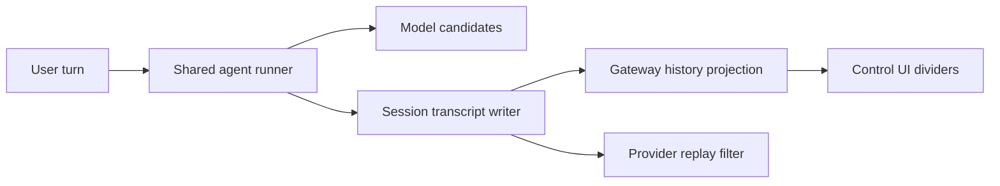

Codex review: blocked before merge.

## What this changes

This PR hides recoverable errors during active runs and adds persistent model-fallback and successful-return dividers to chat history.

**Example:** A turn falls back from openai/primary-large to openai/backup-large, and a later turn succeeds on the selected model.
- **Before:** Chat can retain a recovered overflow warning without a durable model-switch record.
- **After:** Chat shows fallback and return dividers while preserving the selected model.

## Review scores

| Measure | Result | What it means |
|---|---|---|
| **Overall readiness** | 🦪 silver shellfish **(2/6)** | Useful owner-directed work with inspected browser evidence, but the unresolved recording defect blocks correctness and stored-history upgrade compatibility remains unproven. |
| **Proof confidence** | 🐚 platinum hermit **(4/6)** | Collaborator authorship exempts ordinary contributor proof; inspected screenshots exercise the actual Control UI with synthetic history and a mocked Gateway, while persistence tests do not establish stable-release upgrade compatibility. |
| **Patch quality** | 🦪 silver shellfish **(2/6)** | 1 actionable review finding remain. |

## Product

**Kind:** Bug fix · **Worth it:** Yes · **Fix scope:** Complete
**User problem:** Chat can display a terminal-looking error while recovery continues and lacks a durable account of model fallback and return.
**Reason:** The recovery defect is concrete, existing owners are reused, and collaborator authorship supplies direction for the history dividers.

## Merge readiness

⛔ **Blocked before merge - 2 items remain**

Keep open: this collaborator-authored PR addresses a concrete chat-history problem, but the previously reported skipped-candidate recording defect remains unresolved.

**Priority:** P2
**Reviewed head:** `51599a05e140126ec52434412d5445dbffce6921`

## Before merge

- [ ] **Persist switches only when the destination candidate actually runs (P2)** - With an A → B → C chain, let A execute and fail while B is skipped for cached auth failure or cooldown. A's failure and B's skip both emit next_fallback, and this recorder accepts both because A already admitted the logical run. Chat therefore stores A → B and B → C dividers even though B never executed. This previously reported finding remains unresolved. Bind recording to actual destination execution and add a three-candidate skip regression through the shared runner.
- [ ] **Add data-model compatibility proof** - The review found that existing stored data may not work after upgrade. Show that existing data still loads and works with this change.

## Findings

- [P2] Persist switches only when the destination candidate actually runs — `src/agents/embedded-agent-runner/model-fallback-transcript.ts:90-92`

### Tests

- Low-value test `ui/src/pages/chat/chat-fallback-divider.node.test.ts`: Remove the reload=true variants: structuredClone repeats the same rendering contract without exercising reload or persistence.
- Missing end-to-end proof: No v2026.10.2-to-candidate upgrade run demonstrates existing history and model settings intact, new notices surviving reopening, and provider replay excluding those notices.

<strong>Agent review details</strong>

### How this fits together

The shared agent runner supplies fallback observations, the transcript writer persists notices, and Gateway history projection feeds Control UI dividers while replay filtering excludes notices from provider input.

### Technical review

Best possible solution:

Persist transitions when the destination actually executes through the shared runner, preserving canonical transcript writes, replay exclusion, and exact-run recovery projection.

Do we have a high-confidence way to reproduce the issue?

Current-main source exposes the overflow-copy and hidden-continuation paths illustrated by the supplied before screenshot; the skipped-candidate defect is traceable through the real fallback loop without executing target code.

Is this the best way to solve the issue?

The existing production owners fit the problem, but a fallback decision observation cannot establish that its destination model executed.

Full review comments:

- [P2] Persist switches only when the destination candidate actually runs — `src/agents/embedded-agent-runner/model-fallback-transcript.ts:90-92`
  With an A → B → C chain, let A execute and fail while B is skipped for cached auth failure or cooldown. A's failure and B's skip both emit next_fallback, and this recorder accepts both because A already admitted the logical run. Chat therefore stores A → B and B → C dividers even though B never executed. This previously reported finding remains unresolved. Bind recording to actual destination execution and add a three-candidate skip regression through the shared runner.
  Confidence: 0.99

Overall correctness: patch is incorrect
Overall confidence: 0.97

AGENTS.md: found and applied where relevant.

Codex review notes: model internal, reasoning medium; reviewed against [e871b5ea32da](https://github.com/openclaw/openclaw/commit/e871b5ea32dab41daf37f795eec1922236fa5d13).

### Provenance checked

- `Recovered-error visibility` keeps the original intent (f172f136350f428ad6cd31559696e83257d6a67a: Remove empty failed attempts only after a visible successful answer from the exact run, preserving raw diagnostics, partial output, and unresolved failures.)
- `Selected-model accounting` keeps the original intent (https://github.com/openclaw/openclaw/pull/122910: Separate selected model, turn-local fallback, and provider response identity so fallback success cannot overwrite session selection.)
- `Transcript-only replay filtering` keeps the original intent (https://github.com/openclaw/openclaw/pull/99504: Exclude marked delivery receipts even when historical reconstruction strips provider and model metadata.)
- `Shared fallback execution` keeps the original intent (https://github.com/openclaw/openclaw/pull/111608: Consolidate fallback lifecycle decisions across execution pipelines while retaining explicit caller-specific behavior.)
- `Command-style cron detection` keeps the original intent (https://github.com/openclaw/openclaw/pull/81868: Keep exact-command cron turns lightweight; the extracted predicate preserves its existing behavior.)

### Testing

Proof path: shipped entry point.

### Security

None.

### Evidence

Acceptance criteria:

- pnpm test src/agents/embedded-agent-runner/run-entry.fallback-transcript.test.ts --maxWorkers=1
- pnpm test src/auto-reply/reply/agent-runner-result-accounting.restoration.test.ts --maxWorkers=1
- pnpm test src/agents/embedded-agent-runner/replay-history.test.ts --maxWorkers=1
- pnpm test ui/src/pages/chat/chat-fallback-divider.node.test.ts --maxWorkers=1
- git diff --check

What I checked:

- **Unresolved prior finding:** The recorder accepts next_fallback observations before destination execution; comparison with the previously reviewed head confirms this code remains unchanged. ([`src/agents/embedded-agent-runner/model-fallback-transcript.ts:92`](https://github.com/openclaw/openclaw/blob/51599a05e140126ec52434412d5445dbffce6921/src/agents/embedded-agent-runner/model-fallback-transcript.ts#L92), [51599a05e140](https://github.com/openclaw/openclaw/commit/51599a05e140126ec52434412d5445dbffce6921))
- **Skipped candidates emit fallback observations:** Cached-auth and cooldown skips publish skip_candidate without executing the candidate, and buildFallbackStepFields maps those decisions to next_fallback when another candidate remains. ([`src/agents/model-fallback-runner.ts:385`](https://github.com/openclaw/openclaw/blob/51599a05e140126ec52434412d5445dbffce6921/src/agents/model-fallback-runner.ts#L385), [51599a05e140](https://github.com/openclaw/openclaw/commit/51599a05e140126ec52434412d5445dbffce6921))
- **Logical-run admission:** Prepared admission deliberately reuses the first executing runtime's authority across fallback candidates, so existing admission does not establish destination execution. ([`src/agents/admitted-run-context.ts:622`](https://github.com/openclaw/openclaw/blob/51599a05e140126ec52434412d5445dbffce6921/src/agents/admitted-run-context.ts#L622), [51599a05e140](https://github.com/openclaw/openclaw/commit/51599a05e140126ec52434412d5445dbffce6921))
- **Current-main behavior:** Fetched main still treats visible overflow copy as assistant output and every user row as a recovery boundary, and does not connect fallback observations to this recorder. ([`src/gateway/chat-display-projection.core.ts:306`](https://github.com/openclaw/openclaw/blob/e871b5ea32dab41daf37f795eec1922236fa5d13/src/gateway/chat-display-projection.core.ts#L306), [e871b5ea32da](https://github.com/openclaw/openclaw/commit/e871b5ea32dab41daf37f795eec1922236fa5d13))
- **Inspected visual evidence:** All three downloaded screenshots were inspected: they show the recovered overflow warning before, a fallback divider during recovery, and a return divider afterward; the body explicitly identifies synthetic browser data and a mocked Gateway. ([51599a05e140](https://github.com/openclaw/openclaw/commit/51599a05e140126ec52434412d5445dbffce6921))
- **Previous fixture defect repaired:** The runner fixture now publishes its runtime configuration before admission and clears it afterward. ([`src/agents/embedded-agent-runner/run-entry.fallback-transcript.test.ts:72`](https://github.com/openclaw/openclaw/blob/51599a05e140126ec52434412d5445dbffce6921/src/agents/embedded-agent-runner/run-entry.fallback-transcript.test.ts#L72), [51599a05e140](https://github.com/openclaw/openclaw/commit/51599a05e140126ec52434412d5445dbffce6921))

Likely related people:

- **Peter Steinberger:** Raw commit f172f136350f428ad6cd31559696e83257d6a67a adds src/gateway/chat-display-projection.core.ts:276 relative to its recorded parents. This identifies author metadata, not feature responsibility or a PR merger. (role: source-line author; confidence: high; commits: [f172f136350f](https://github.com/openclaw/openclaw/commit/f172f136350f428ad6cd31559696e83257d6a67a); files: `src/gateway/chat-display-projection.core.ts`)
- **maweibin:** Raw commit b8c7f318943cd67df21dcf17daba9c00508e6ce6 adds src/shared/transcript-only-openclaw-assistant.ts:19 relative to its recorded parents. This identifies author metadata, not feature responsibility or a PR merger. (role: source-line author; confidence: medium; commits: [b8c7f318943c](https://github.com/openclaw/openclaw/commit/b8c7f318943cd67df21dcf17daba9c00508e6ce6); files: `src/shared/transcript-only-openclaw-assistant.ts`)
- **Vincent Koc:** Raw commit db7286187f16ccc832ea945f9a88676d9eb6675d adds src/shared/transcript-only-openclaw-assistant.ts:6 relative to its recorded parents. This identifies author metadata, not feature responsibility or a PR merger. (role: source-line author; confidence: medium; commits: [db7286187f16](https://github.com/openclaw/openclaw/commit/db7286187f16ccc832ea945f9a88676d9eb6675d); files: `src/shared/transcript-only-openclaw-assistant.ts`)

### PR surface

Source +412, Tests +920, Docs +2, Other +1. Total +1335 across 37 files. Added test files: 4.

View PR surface stats

| Area | Files | Added | Removed | Net |
|---|---:|---:|---:|---:|
| Source | 20 | 428 | 16 | +412 |
| Tests | 15 | 944 | 24 | +920 |
| Docs | 1 | 3 | 1 | +2 |
| Config | 0 | 0 | 0 | 0 |
| Generated | 0 | 0 | 0 | 0 |
| Other | 1 | 1 | 0 | +1 |
| **Total** | **37** | **1376** | **41** | **+1335** |

### Labels

Label changes:

No label changes.

Label justifications:

- `P2`: Misleading recovery history and inaccurate switch notices affect chat clarity without establishing lost replies or broken model execution.
- `rating: 🦪 silver shellfish`: Overall readiness is 🦪 silver shellfish; proof is 🐚 platinum hermit and patch quality is 🦪 silver shellfish.
- `status: ⏳ waiting on author`: ClawSweeper has contributor-facing work open and is waiting for author action.
- `proof: 📸 screenshot`: Contributor real behavior proof includes screenshot evidence.

### Rating scale

6/6 🦀 challenger crab · 5/6 🦞 diamond lobster · 4/6 🐚 platinum hermit · 3/6 🦐 gold shrimp · 2/6 🦪 silver shellfish · 1/6 🧂 unranked krab. Overall follows the weaker of proof and patch quality; ✨ marks media proof (a screenshot, video, or linked artifact) that directly shows the changed behavior.

### Workflow

ClawSweeper edits this one comment on every review. Comment `@clawsweeper re-review` for a fresh review only. Repair and merge execution lanes are retired.

### History

Review history (3 earlier review cycles)

<!-- clawsweeper-review-history v=1 total=3 -->
- reviewed 2026-10-12T09:10:07.116Z sha ab70378ff764b4cf1762ab2c69b5cc0d66fa7dec :: blocked before merge. :: [P2] Persist switches only when the destination candidate actually runs
- reviewed 2026-10-12T20:47:13.742Z sha 6bc83c8bc323e38d0801ffb05bfde63741a30fb7 :: blocked before merge. :: [P2] Persist switches only when the destination candidate actually runs | [P2] Prepare runtime configuration in the new runner fixture
- reviewed 2026-10-12T21:37:03.129Z sha 0e4c70b8a3a0870324f05f18a1b8c15148c5a395 :: blocked before merge. :: [P2] Persist switches only when the destination candidate actually runs

_Reviewed October 12, 2026, 5:48 PM ET / 21:48 UTC (Revision 4)._

<!-- clawsweeper-verdict:needs-human item=169773 sha=51599a05e140126ec52434412d5445dbffce6921 confidence=high updated_at=2026-10-12T21:43:26Z reviewed_at=2026-10-12T21:48:10.495Z lease_owner=github-run-38312290934-1 lease_comment_id=6133154300 source_revision=b159d5fbccc1a3381a0fc73a9afe16c624b9538d52c90b5838158fc6f0619b91 hold=blocked findings=1 -->
<!-- clawsweeper-review-state:blocked item=169773 sha=51599a05e140126ec52434412d5445dbffce6921 v=1 -->

<!-- clawsweeper-review-version item=169773 reviewed_at=2026-10-12T21:48:10.495Z sha=51599a05e140126ec52434412d5445dbffce6921 source_revision=b159d5fbccc1a3381a0fc73a9afe16c624b9538d52c90b5838158fc6f0619b91 lease_owner=github-run-38312290934-1 lease_comment_id=6133154300 v=1 -->

<!-- clawsweeper-review item=169773 -->