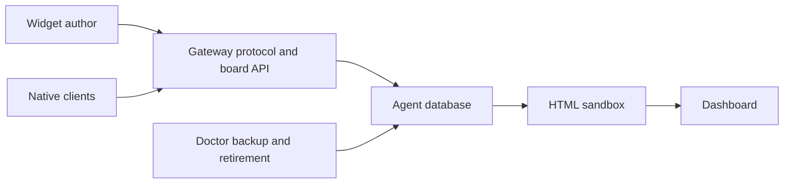

Codex review: blocked before merge.

## What this changes

Retires A2UI and registered widget hooks, repairs stored widgets after backup, and advances the Gateway protocol to v5.

**Example:** A dashboard contains an example:diagram widget with registered content ownership.
- **Before:** The plugin renders its saved diagram source.
- **After:** Doctor backs up the database and replaces the widget with an inert HTML preview preserving its source and metadata.

## Review scores

| Measure | Result | What it means |
|---|---|---|
| **Overall readiness** | 🦪 silver shellfish **(2/6)** | The approved design has meaningful regression coverage, but native consumers remain broken and the required upgrade compatibility proof is incomplete. |
| **Proof confidence** | 🦐 gold shrimp **(3/6)** | Real behavior proof is not required for maintainer- or bot-authored pull requests. |
| **Patch quality** | 🦪 silver shellfish **(2/6)** | 2 actionable review findings remain. |

## Product

**Kind:** Refactor · **Worth it:** Yes · **Fix scope:** Complete
**User problem:** Widget authors and plugin developers carry a second source format and renderer-specific API alongside HTML widgets.
**Reason:** The maintainer has explicitly chosen the retirement, and the patch removes the corresponding rendering and registration machinery while retaining existing HTML, native plugin, and MCP widget owners.

## Merge readiness

⛔ **Blocked before merge - 3 items remain**

Keep this PR open: the approved retirement is worthwhile, but two native validation defects still block merging.

**Priority:** P2
**Reviewed head:** `f35c249d1567321e0ad866bb190ea4439a55ba28`

## Before merge

- [ ] **Migrate the included native auth tests to the canonical constant (P2)** - Removing MAX_PROTOCOL_VERSION from gateway_ws.rs leaves this included test module referencing it here and at lines 337 and 406. The module imports super::*, but no definition remains, so cargo test --locked --all-targets cannot compile on either Linux or macOS. Replace all three references with PROTOCOL_VERSION. This was equally visible at reviewed head 8e6d5a2b5a27b702653a793cd606e8570f0cebcb and was missed in the earlier cycle; both files are unchanged since that head.
- [ ] **Update the native Quick Chat fixture to the current protocol (P2)** - This fixture still replies with hello.protocol 4. The updated native validate_hello requires PROTOCOL_VERSION, now 5, and rejects that response before Quick Chat can load agents or send a message. Consequently the native Quick Chat CI scenario cannot exercise its controls once the preceding build blocker is repaired. Make the fixture consume the canonical current protocol; this previous review finding remains unresolved.
- [ ] **Add data-model compatibility proof** - The review found that existing stored data may not work after upgrade. Show that existing data still loads and works with this change.

## Findings

- [P2] Migrate the included native auth tests to the canonical constant — `apps/linux/src-tauri/src/gateway_control_auth_owner_tests.rs:295`
- [P2] Update the native Quick Chat fixture to the current protocol — `apps/linux/tests/quick_chat.py:74`

### Tests

- Low-value test `src/boards/sqlite-board-codec.test.ts`: The replacement parameterized cases assert that three literal contentOwner values are copied by a helper; remove this redundant group because board-store coverage already exercises those ownership contracts.
- Missing end-to-end proof: Supply a v2026.10.6-to-candidate update through the shipped updater and Doctor, verifying fresh backups, retired-widget handling, preserved settings, and surviving dashboard reads and writes.

<strong>Agent review details</strong>

### How this fits together

Widget authoring enters the Gateway board API, persists in the agent database, and reaches dashboard sandbox frames; Doctor owns offline retirement, while native clients negotiate the Gateway protocol.

### Technical review

Best possible solution:

Complete the approved HTML-only cutover through the existing board, Doctor-backup, and protocol owners.

Do we have a high-confidence way to reproduce the issue?

No target code was executed; the reviewed head has unresolved Rust constant references and a protocol-v4 fixture rejected by its protocol-v5 client.

Is this the best way to solve the issue?

Removing the renderer, routes, registration machinery, and build pipeline together is a coherent cutover, and the required persisted-state repair appropriately reuses Doctor and its backup owner.

Full review comments:

- [P2] Migrate the included native auth tests to the canonical constant — `apps/linux/src-tauri/src/gateway_control_auth_owner_tests.rs:295`
  Removing MAX_PROTOCOL_VERSION from gateway_ws.rs leaves this included test module referencing it here and at lines 337 and 406. The module imports super::*, but no definition remains, so cargo test --locked --all-targets cannot compile on either Linux or macOS. Replace all three references with PROTOCOL_VERSION. This was equally visible at reviewed head 8e6d5a2b5a27b702653a793cd606e8570f0cebcb and was missed in the earlier cycle; both files are unchanged since that head.
  Confidence: 1
  Late finding: first raised on code an earlier review cycle already covered.
- [P2] Update the native Quick Chat fixture to the current protocol — `apps/linux/tests/quick_chat.py:74`
  This fixture still replies with hello.protocol 4. The updated native validate_hello requires PROTOCOL_VERSION, now 5, and rejects that response before Quick Chat can load agents or send a message. Consequently the native Quick Chat CI scenario cannot exercise its controls once the preceding build blocker is repaired. Make the fixture consume the canonical current protocol; this previous review finding remains unresolved.
  Confidence: 1

Overall correctness: patch is incorrect
Overall confidence: 0.98

AGENTS.md: found and applied where relevant.

Codex review notes: model internal, reasoning medium; reviewed against [971a24242d71](https://github.com/openclaw/openclaw/commit/971a24242d71bc90a425c925e006f42340aef2e5).

### Provenance checked

- `A2UI widgets and registered content hooks` changes intended behavior with a stated reason (https://github.com/openclaw/openclaw/pull/125803: Allow plugin-owned declarative source validation and rendering through the existing board sandbox and action bridge.)
- `Solid A2UI catalogs` changes intended behavior with a stated reason (https://github.com/openclaw/openclaw/pull/178583: Replace the upstream Lit renderer while preserving A2UI behavior; the subsequent v0.9 port followed the same contract.)
- `Widget content ownership` changes intended behavior with a stated reason (https://github.com/openclaw/openclaw/pull/128489: Prevent same-name updates from silently replacing a widget's content owner.)
- `Node protocol fallback and pairing metadata` keeps the original intent (https://github.com/openclaw/openclaw/pull/119981: Permit independently upgraded nodes and Gateways across the supported wire window without changing pairing identity or authorization.)
- `Canvas asset build cache` changes intended behavior with a stated reason (https://github.com/openclaw/openclaw/pull/171103: Reuse complete, verified A2UI bundle generations across deployment candidates.)
- `Doctor migration backup ownership` keeps the original intent (https://github.com/openclaw/openclaw/pull/175548: Reuse verified publication facts instead of rereading newly created backup artifacts.)

### Testing

Proof path: in-process harness.

### Security

None.

### Evidence

What I checked:

- **Approved retirement remains distinct from main:** The maintainer-authored PR explicitly accepts A2UI deletion after backup, registered-source preservation, API retirement, and the protocol bump; fetched main still registers the A2UI renderer and uses protocol v4. ([`extensions/canvas/index.ts:32`](https://github.com/openclaw/openclaw/blob/971a24242d71bc90a425c925e006f42340aef2e5/extensions/canvas/index.ts#L32), [971a24242d71](https://github.com/openclaw/openclaw/commit/971a24242d71bc90a425c925e006f42340aef2e5))
- **Previous registered-row finding repaired:** Retirement now selects registered owners and older source-bearing plugin descriptors, creates escaped previews, clears grants, and retains valid identity and layout; the regression covers registered-only databases and subsequent board reads. ([`src/commands/doctor-a2ui-widgets.ts:52`](https://github.com/openclaw/openclaw/blob/f35c249d1567321e0ad866bb190ea4439a55ba28/src/commands/doctor-a2ui-widgets.ts#L52), [f35c249d1567](https://github.com/openclaw/openclaw/commit/f35c249d1567321e0ad866bb190ea4439a55ba28))
- **Native authentication tests retain a removed constant:** The PR removes MAX_PROTOCOL_VERSION from gateway_ws.rs, but its included native_control_auth_tests module still references it at lines 295, 337, and 406. ([`apps/linux/src-tauri/src/gateway_control_auth_owner_tests.rs:295`](https://github.com/openclaw/openclaw/blob/f35c249d1567321e0ad866bb190ea4439a55ba28/apps/linux/src-tauri/src/gateway_control_auth_owner_tests.rs#L295), [f35c249d1567](https://github.com/openclaw/openclaw/commit/f35c249d1567321e0ad866bb190ea4439a55ba28))
- **Previous Quick Chat finding remains:** The native Quick Chat fixture returns protocol 4, while validate_hello now requires the canonical protocol 5; neither relevant file changed after the previous reviewed head. ([`apps/linux/tests/quick_chat.py:74`](https://github.com/openclaw/openclaw/blob/f35c249d1567321e0ad866bb190ea4439a55ba28/apps/linux/tests/quick_chat.py#L74), [f35c249d1567](https://github.com/openclaw/openclaw/commit/f35c249d1567321e0ad866bb190ea4439a55ba28))
- **Compatibility regression exercises the store directly:** The Doctor regression seeds current-schema databases and calls retireDoctorA2uiWidgets directly; it does not establish an update from the latest stable release through the shipped updater and candidate Doctor. ([`src/commands/doctor-a2ui-widgets.test.ts:16`](https://github.com/openclaw/openclaw/blob/f35c249d1567321e0ad866bb190ea4439a55ba28/src/commands/doctor-a2ui-widgets.test.ts#L16), [f35c249d1567](https://github.com/openclaw/openclaw/commit/f35c249d1567321e0ad866bb190ea4439a55ba28))
- **Authorization remains with existing owners:** Node surface issuance still filters against reconciled approved capabilities, and board document consumption rechecks ticket authority and current ingress access before exposing HTML. ([`src/gateway/board-widget-view.ts:30`](https://github.com/openclaw/openclaw/blob/f35c249d1567321e0ad866bb190ea4439a55ba28/src/gateway/board-widget-view.ts#L30), [f35c249d1567](https://github.com/openclaw/openclaw/commit/f35c249d1567321e0ad866bb190ea4439a55ba28))

Likely related people:

- **Vincent Koc:** Raw commit 587def9c9d56dc69dfd614cc28060b387696333b adds packages/gateway-client/src/client.ts:810 relative to its recorded parents. This identifies author metadata, not feature responsibility or a PR merger. (role: source-line author; confidence: high; commits: [587def9c9d56](https://github.com/openclaw/openclaw/commit/587def9c9d56dc69dfd614cc28060b387696333b); files: `packages/gateway-client/src/client.ts`)

### PR surface

PR surface statistics unavailable: the file list is incomplete.

### Labels

Label changes:

No label changes.

Label justifications:

- `P2`: This is an approved architectural retirement with focused native validation defects, without evidence of an urgent deployed regression.
- `merge-risk: 🚨 compatibility`: The maintainer explicitly accepts removing the public registration API, retiring stored widget formats, and requiring protocol v5 for general clients; incomplete consumer inventories do not establish zero external impact.
- `merge-risk: 🚨 automation`: The removed native constant breaks included authentication-test compilation, and the stale Quick Chat hello prevents the native CI scenario from connecting.
- `rating: 🦪 silver shellfish`: Overall readiness is 🦪 silver shellfish; proof is 🦐 gold shrimp and patch quality is 🦪 silver shellfish.
- `status: ⏳ waiting on author`: ClawSweeper has contributor-facing work open and is waiting for author action.

### Rating scale

6/6 🦀 challenger crab · 5/6 🦞 diamond lobster · 4/6 🐚 platinum hermit · 3/6 🦐 gold shrimp · 2/6 🦪 silver shellfish · 1/6 🧂 unranked krab. Overall follows the weaker of proof and patch quality; ✨ marks media proof (a screenshot, video, or linked artifact) that directly shows the changed behavior.

### Workflow

ClawSweeper edits this one comment on every review. Comment `@clawsweeper re-review` for a fresh review only. Repair and merge execution lanes are retired.

### History

Review history (2 earlier review cycles)

<!-- clawsweeper-review-history v=1 total=2 -->
- reviewed 2026-10-24T03:13:09.422Z sha 3fca37d9d9e014dbfc41d32d818ea3ecda971ce8 :: blocked before merge. :: [P1] Update the Linux client alongside the protocol bump | [P1] Preserve plugin features for supported v4 nodes | [P2] Migrate the remaining protocol fixture expectations | [P2] Migrate the MCP live proof client's protocol range
- reviewed 2026-10-24T03:55:12.892Z sha 8e6d5a2b5a27b702653a793cd606e8570f0cebcb :: blocked before merge. :: [P1] Migrate every persisted registered-content shape | [P2] Update the native Quick Chat fixture to the current protocol

_Reviewed October 24, 2026, 12:25 AM ET / 04:25 UTC (Revision 3)._

<!-- clawsweeper-verdict:needs-human item=182109 sha=f35c249d1567321e0ad866bb190ea4439a55ba28 confidence=high updated_at=2026-10-24T04:17:20Z reviewed_at=2026-10-24T04:25:33.432Z lease_owner=github-run-40061678360-1 lease_comment_id=6379744579 source_revision=aff131bd00bbadedae1aebf226a030b96b82248966b78914a533b8841ea629ae hold=blocked findings=2 -->
<!-- clawsweeper-review-state:blocked item=182109 sha=f35c249d1567321e0ad866bb190ea4439a55ba28 v=1 -->

<!-- clawsweeper-review-version item=182109 reviewed_at=2026-10-24T04:25:33.432Z sha=f35c249d1567321e0ad866bb190ea4439a55ba28 source_revision=aff131bd00bbadedae1aebf226a030b96b82248966b78914a533b8841ea629ae lease_owner=github-run-40061678360-1 lease_comment_id=6379744579 v=1 -->

<!-- clawsweeper-review item=182109 -->