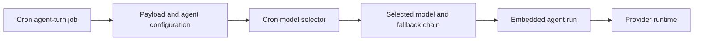

Codex review: needs maintainer review before merge. _Reviewed August 7, 2026, 2:43 AM ET / 06:43 UTC._

# ClawSweeper review

## What this changes

This PR makes isolated cron subagent selection prefer a configured global child model over a named agent’s primary model, matching native spawning and its fallback routing.

## Regression provenance

Possible regression — probable (reviewed change; known regression link). No predecessor PR is attributed.

## Merge readiness

⚠️ **Ready for maintainer review - 2 items remain**

Keep open: current main still gives isolated cron runs the opposite precedence from native spawning and the documented child-model default; this PR is the narrow owner-boundary repair, and its prior harness finding is resolved.

**Priority:** P2
**Reviewed head:** `80234aad4539cb594c1539126216ee02725d6d9c`

## Review scores

| Measure | Result | What it means |
|---|---|---|
| **Overall readiness** | 🐚 platinum hermit **(4/6)** | The focused repair now aligns both selection and fallback behavior with the established native contract and has relevant real-boundary proof. |
| **Proof confidence** | 🐚 platinum hermit **(4/6)** | Sufficient (terminal): A credential-free Testbox probe exercised the real cron selector and preflight builder with the affected configuration and observed the corrected model and fallback chain; the latest head adds only aligned harness coverage. |
| **Patch quality** | 🐚 platinum hermit **(4/6)** | No actionable review findings were identified. |

## Verification

| Check | Result | Evidence |
|---|---|---|
| **Real behavior** | Verified | Sufficient (terminal): A credential-free Testbox probe exercised the real cron selector and preflight builder with the affected configuration and observed the corrected model and fallback chain; the latest head adds only aligned harness coverage. |
| **Evidence reviewed** | 5 items | Current cron divergence: Current main orders per-agent subagent model, named-agent primary, then global subagent default, so the named primary masks the configured child default. Native contract and documentation: Native spawning orders per-agent subagent model, global subagent default, then agent primary; the public subagent docs describe the configured child model as the default. Shared fallback owner: Cron preflight obtains fallback candidates from the same selected subagent source, so the mismatch affects both the initial model and failover chain. |
| **Findings** | None | None. |
| **Security** | None | None. |

## How this fits together

Isolated cron agent turns resolve a model and fallback chain from their payload and agent configuration before executing an embedded agent run. That selection controls the provider/runtime route and candidate fallbacks for the scheduled run.

## Before merge

- [ ] **Resolve merge risk (P2)** - Merging intentionally changes isolated cron runs that set both a named-agent primary model and a global subagent model; those runs will switch to the documented child-model route and fallback chain.
- [ ] **Complete next step (P2)** - The branch has a coherent repair and no actionable review finding; remaining work is ordinary exact-head merge validation rather than an automation repair.

<strong>Agent review details</strong>

### Security

None.

### PR surface

Source +2, Tests +80. Total +82 across 6 files.

View PR surface stats

| Area | Files | Added | Removed | Net |
|---|---:|---:|---:|---:|
| Source | 2 | 5 | 3 | +2 |
| Tests | 4 | 87 | 7 | +80 |
| Docs | 0 | 0 | 0 | 0 |
| Config | 0 | 0 | 0 | 0 |
| Generated | 0 | 0 | 0 | 0 |
| Other | 0 | 0 | 0 | 0 |
| **Total** | **6** | **92** | **10** | **+82** |

### Review metrics

| Metric | Value | Why it matters |
|---|---|---|
| **Model-selection contract** | 1 precedence chain changed; 0 config keys added or removed | The patch changes which existing configured model and provider route wins for affected cron jobs without expanding configuration surface. |
| **Production versus test delta** | production +3/-1; tests +89/-9 | The small production delta is the shared precedence invariant; the remainder locks selection and fallback behavior. |

### Root-cause cluster

Relationship: `fixed_by_candidate`
Canonical: https://github.com/openclaw/openclaw/issues/58822
Summary: This PR is the concrete remaining cron-path candidate fix for the canonical reported precedence mismatch.

Members:
- `canonical`: https://github.com/openclaw/openclaw/issues/58822 - The open issue describes the same global-default-versus-named-agent-primary precedence failure that current cron source still exhibits.

Proposal only: this assessment does not dispatch repair, suppress jobs, mutate sibling items, close, or merge anything.

### Merge-risk options

**Maintainer options:**
1. **Merge with documented routing change (recommended)**  
   Accept the established native-spawn contract for cron after required exact-head checks complete, keeping the existing compatibility note visible to operators.
2. **Pause for contract reversal**  
   Keep the current cron precedence only if maintainers intentionally want cron to differ from native spawning, then update the public subagent documentation accordingly.

### Technical review

Best possible solution:

Land the shared-selector reorder with its focused fallback coverage, preserving explicit payload and per-agent overrides while retaining the stated upgrade note for configurations whose cron routing changes.

Do we have a high-confidence way to reproduce the issue?

Yes—current main deterministically reproduces the mismatch when a named cron agent has a primary model and a different global subagent model: cron selects the primary while native spawning selects the global child model.

Is this the best way to solve the issue?

Yes. The shared agent-scope selector owns both cron primary selection and its fallback policy, so reordering that existing chain is narrower and safer than adding another cron-specific path.

AGENTS.md: found and applied where relevant.

Codex review notes: model internal, reasoning high; reviewed against [675c60f56ea7](https://github.com/openclaw/openclaw/commit/675c60f56ea760c8b116a2051aa1ad098cc6b6b5).

### Labels

Label changes:

- add `rating: 🐚 platinum hermit`: Overall readiness is 🐚 platinum hermit; proof is 🐚 platinum hermit and patch quality is 🐚 platinum hermit.
- add `status: 👀 ready for maintainer look`: ClawSweeper has no concrete contributor-facing blocker left for this PR. Sufficient (terminal): A credential-free Testbox probe exercised the real cron selector and preflight builder with the affected configuration and observed the corrected model and fallback chain; the latest head adds only aligned harness coverage.
- remove `rating: 🦐 gold shrimp`: Current PR rating is `rating: 🐚 platinum hermit`, so this older rating label is no longer current.
- remove `status: ⏳ waiting on author`: Current PR status label is `status: 👀 ready for maintainer look`.

Label justifications:

- `P2`: The PR repairs configured model routing and failover for isolated cron subagent runs with limited blast radius.
- `merge-risk: 🚨 compatibility`: Existing configurations that set both a named-agent primary and global subagent model will resolve a different cron model after merge.
- `merge-risk: 🚨 auth-provider`: The selected model determines the provider/runtime policy and fallback candidates used by the scheduled run.
- `rating: 🐚 platinum hermit`: Overall readiness is 🐚 platinum hermit; proof is 🐚 platinum hermit and patch quality is 🐚 platinum hermit.
- `status: 👀 ready for maintainer look`: ClawSweeper has no concrete contributor-facing blocker left for this PR. Sufficient (terminal): A credential-free Testbox probe exercised the real cron selector and preflight builder with the affected configuration and observed the corrected model and fallback chain; the latest head adds only aligned harness coverage.
- `proof: sufficient`: Contributor real behavior proof is sufficient. A credential-free Testbox probe exercised the real cron selector and preflight builder with the affected configuration and observed the corrected model and fallback chain; the latest head adds only aligned harness coverage.

### Evidence

What I checked:

- **Current cron divergence:** Current main orders per-agent subagent model, named-agent primary, then global subagent default, so the named primary masks the configured child default. ([`src/agents/agent-scope.ts:461`](https://github.com/openclaw/openclaw/blob/675c60f56ea7/src/agents/agent-scope.ts#L461), [675c60f56ea7](https://github.com/openclaw/openclaw/commit/675c60f56ea7))
- **Native contract and documentation:** Native spawning orders per-agent subagent model, global subagent default, then agent primary; the public subagent docs describe the configured child model as the default. ([`src/agents/model-selection-config.ts:49`](https://github.com/openclaw/openclaw/blob/675c60f56ea7/src/agents/model-selection-config.ts#L49), [675c60f56ea7](https://github.com/openclaw/openclaw/commit/675c60f56ea7))
- **Shared fallback owner:** Cron preflight obtains fallback candidates from the same selected subagent source, so the mismatch affects both the initial model and failover chain. ([`src/cron/isolated-agent/run-fallback-policy.ts:27`](https://github.com/openclaw/openclaw/blob/675c60f56ea7/src/cron/isolated-agent/run-fallback-policy.ts#L27), [675c60f56ea7](https://github.com/openclaw/openclaw/commit/675c60f56ea7))
- **Prior finding addressed:** The PR-head harness and through-run fallback assertion now mirror the production precedence and verify the configured global fallback chain reaches the embedded run. ([`src/cron/isolated-agent/run.payload-fallbacks.test.ts:250`](https://github.com/openclaw/openclaw/blob/80234aad4539/src/cron/isolated-agent/run.payload-fallbacks.test.ts#L250), [80234aad4539](https://github.com/openclaw/openclaw/commit/80234aad4539))
- **Release/main status:** The latest shipped tag v2026.7.1-2 is an ancestor of current main, while current-main source still has the divergent cron order; the PR is not implemented on main. ([`src/agents/agent-scope.ts:465`](https://github.com/openclaw/openclaw/blob/675c60f56ea7/src/agents/agent-scope.ts#L465), [675c60f56ea7](https://github.com/openclaw/openclaw/commit/675c60f56ea7))

Likely related people:

- **joshavant:** Merged native-spawn correction established the global subagent default ahead of agent-primary fallback, which this cron path should match. (role: native selection contract contributor; confidence: high; commits: [2b04cedfb131](https://github.com/openclaw/openclaw/commit/2b04cedfb131d1e998b2b225a66ef86f2b6660e0); files: `src/agents/model-selection-config.ts`, `src/agents/model-selection.test.ts`)
- **steipete:** Merged the shared isolated-cron fallback selection that consumes the divergent agent-scope selector. (role: shared cron fallback refactor contributor; confidence: high; commits: [0ad3d25fb7cd](https://github.com/openclaw/openclaw/commit/0ad3d25fb7cd8597e92f1f1fc5c2bbe1b2c76cf4); files: `src/cron/isolated-agent/run-fallback-policy.ts`, `src/agents/agent-scope.ts`)
- **neeravmakwana:** Earlier merged precedence work is part of the history that placed the named agent primary before the global child default. (role: earlier precedence contributor; confidence: medium; commits: [e394262bd87e](https://github.com/openclaw/openclaw/commit/e394262bd87e55844c70bd6db203e1aeff8c801f); files: `src/agents/agent-scope.ts`)

### Rank-up moves

Optional improvements that raise the rating; they are not merge blockers.

- Refresh required checks against the current base before merge.

### Rating scale

| Score | Internal tier | Crab rank | Meaning |
|---:|:---:|---|---|
| **6/6** | S | 🦀 challenger crab | Exceptional readiness |
| **5/6** | A | 🦞 diamond lobster | Very strong readiness |
| **4/6** | B | 🐚 platinum hermit | Good normal PR; ordinary maintainer review |
| **3/6** | C | 🦐 gold shrimp | Useful, but confidence is limited |
| **2/6** | D | 🦪 silver shellfish | Proof or implementation needs work |
| **1/6** | F | 🧂 unranked krab | Not merge-ready |
| N/A | NA | 🌊 off-meta tidepool | Rating does not apply |

Overall follows the weaker of proof and patch quality.
Shiny media proof means a screenshot, video, or linked artifact directly shows the changed behavior. Runtime, network, CSP, and security claims still need visible diagnostics.

### Workflow

- ClawSweeper keeps one durable marker-backed review comment per issue or PR.
- Re-runs edit this comment so the latest verdict, findings, and automation markers stay together instead of adding duplicate bot comments.
- A fresh review can be triggered by eligible `@clawsweeper re-review` comments, exact-item GitHub events, scheduled/background review runs, or manual workflow dispatch.
- PR/issue authors and users with repository write access can comment `@clawsweeper re-review` or `@clawsweeper re-run` on an open PR or issue to request a fresh review only.
- Maintainers can also comment `@clawsweeper review` to request a fresh review only.
- Fresh-review commands do not start repair, autofix, rebase, CI repair, or automerge.
- Maintainer-only repair and merge flows require explicit commands such as `@clawsweeper autofix`, `@clawsweeper automerge`, `@clawsweeper fix ci`, or `@clawsweeper address review`.
- Maintainers can comment `@clawsweeper explain` to ask for more context, or `@clawsweeper stop` to stop active automation.

### History

Review history (14 earlier review cycles; latest 8 shown)

<!-- clawsweeper-review-history v=1 total=14 -->
- reviewed 2026-07-12T04:13:56.119Z sha 913d0ba36379e8c7071fe80f1802455f117c6773 :: needs maintainer review before merge. :: none
- reviewed 2026-07-29T12:48:41.538Z sha 7608d8bda438954910c599511801446500220eb8 :: needs maintainer review before merge. :: none
- reviewed 2026-07-30T01:52:51.501Z sha c503ab2529592c25056e588fb4288a48b26376ad :: needs maintainer review before merge. :: none
- reviewed 2026-08-01T14:23:30.069Z sha c503ab2529592c25056e588fb4288a48b26376ad :: needs maintainer review before merge. :: none
- reviewed 2026-08-02T19:15:37.323Z sha c503ab2529592c25056e588fb4288a48b26376ad :: needs changes before merge. :: [P3] Replace PR-history comment with a local invariant
- reviewed 2026-08-06T00:37:42.855Z sha 796e31141f58a562830ccd10d7b628615ab60cb4 :: needs real behavior proof before merge. :: none
- reviewed 2026-08-06T04:43:04.932Z sha 234215c5b3ecfe25df3e025d79b4d363005479da :: needs real behavior proof before merge. :: none
- reviewed 2026-08-06T11:35:14.161Z sha 234215c5b3ecfe25df3e025d79b4d363005479da :: needs changes before merge. :: [P2] Align the fallback harness with the new selection order

<!-- clawsweeper-verdict:needs-human item=58823 sha=80234aad4539cb594c1539126216ee02725d6d9c confidence=high updated_at=2026-08-07T06:39:44Z reviewed_at=2026-08-07T06:43:40.843Z lease_owner=github-run-31154666238-1 lease_comment_id=5213475608 source_revision=0d00303a776b318f31da7b5a45d869e0f3f23b2964afd3344747e27ba91959cc -->

<!-- clawsweeper-review-version item=58823 reviewed_at=2026-08-07T06:43:40.843Z sha=80234aad4539cb594c1539126216ee02725d6d9c source_revision=0d00303a776b318f31da7b5a45d869e0f3f23b2964afd3344747e27ba91959cc lease_owner=github-run-31154666238-1 lease_comment_id=5213475608 v=1 -->

<!-- clawsweeper-review item=58823 -->