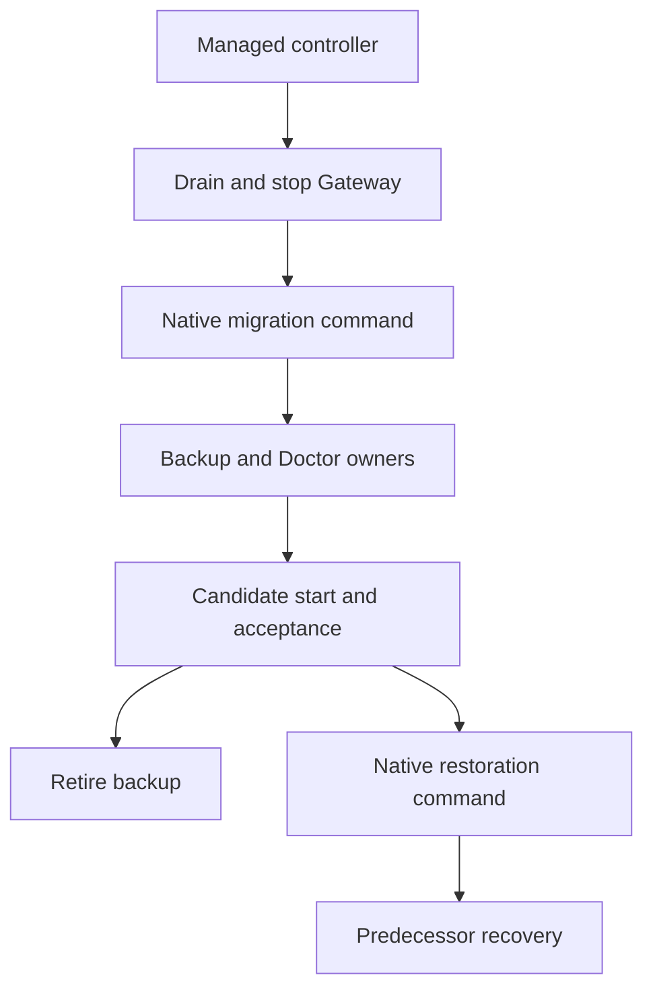

Codex review: blocked before merge.

## What this changes

This PR delegates managed schema migration and restoration to native OpenClaw owners and removes the controller’s edge-specific migration machinery.

**Example:** A managed update advances an agent database from schema 25 to 26.
- **Before:** The controller rejects the crossing as unsupported.
- **After:** The controller invokes the candidate’s native migration command and verifies activation or restores the predecessor.

## Review scores

| Measure | Result | What it means |
|---|---|---|
| **Overall readiness** | 🧂 unranked krab **(1/6)** | The owner consolidation has clear value, but a supported config remains blocked and unchecked rollback can discard accepted writes. |
| **Proof confidence** | 🦐 gold shrimp **(3/6)** | Ordinary contributor proof gating is exempt for this maintainer-authored PR; reported synthetic native Doctor and controller flows support the owning boundaries, but do not establish latest-stable installed-driver compatibility for the new recovery path. |
| **Patch quality** | 🧂 unranked krab **(1/6)** | 2 actionable review findings remain. |

## Product

**Kind:** Bug fix · **Worth it:** Yes · **Fix scope:** Complete
**User problem:** Managed updates reject supported schema crossings until the deployment controller learns each new edge.
**Reason:** The maintainer-authored direction completes the interim controller’s intended native handoff and removes substantial duplicate migration policy.

## Merge readiness

⛔ **Blocked before merge - 4 items remain**

Keep this PR open: the native-owner cutover is useful, but Doctor-repairable config remains blocked and rollback can discard writes accepted by the candidate; the earlier JSON-classification finding is fixed.

**Priority:** P2
**Reviewed head:** `de960fd14e5df518d289316329e3146cbed66862`

## Before merge

- [ ] **Admit Doctor-repairable config before invoking migration (P1)** - For agents.entries={ops:{},research:{default:true}}, the config reader returns valid=false because the shipped default marker requires Doctor. This call supplies neither a legacy plan nor candidate validation, so captureTargetDatabaseSchemaContext throws before backup capture and runDoctorHealthFlow. Managed schema crossings and explicit offline Doctor repair therefore cannot repair this supported input. Use the existing non-mutating legacy/candidate admission path, retain the authored preimage, and cover this input through the native migration owner.
- [ ] **Preserve candidate-accepted writes before restoring snapshots (P1)** - The controller starts the candidate before acceptance completes, and a fresh Gateway admits ordinary work. If a user message commits during that window and a later channel or model-marker check fails, rollback stops the candidate and reaches this call. Omitting expectedGenerations bypasses the existing native later-write refusal and replaces active databases with pre-update snapshots, removing that accepted session/transcript work; retaining displaced files only permits manual recovery. Reuse native write-generation safeguards and preserve current state when restoration would discard later writes. This is a late discovery: the unsafe restore call and controller path were equally visible at the earlier reviewed head 14b027246ea601358e346d0bf478ac8ac904f02b and remain unchanged.
- [ ] **Add data-model compatibility proof** - The review found that existing stored data may not work after upgrade. Show that existing data still loads and works with this change.
- [ ] **Explain or restore the original intent of Native restoration eligibility** - d780fdc672d3567b3fcb83a08c962958b767486e: Restoration preserved unaccounted writes by checking recorded generations and excluding candidates that had begun activation.

## Findings

- [P1] Admit Doctor-repairable config before invoking migration — `src/cli/update-cli/update-command-migrate.ts:137`
- [P1] Preserve candidate-accepted writes before restoring snapshots — `src/cli/update-cli/update-command-migrate.ts:282-287`

### Provenance

- `Native restoration eligibility` changes intended behavior without addressing why it exists (d780fdc672d3567b3fcb83a08c962958b767486e: Restoration preserved unaccounted writes by checking recorded generations and excluding candidates that had begun activation.)

### Tests

- Missing end-to-end proof: Show the v2026.10.2 installed-driver-to-candidate upgrade and recovery flow with existing settings, include bindings, agent ownership, and session data intact.

<strong>Agent review details</strong>

### How this fits together

The deployment controller owns service lifecycle, release pointers, and acceptance; native update commands receive stopped state and a backup root and use the existing backup, Doctor, and restoration owners.

### Technical review

Best possible solution:

Keep the native-owner cutover, admit repairable config without changing its preimage, and preserve writes accepted by the candidate during recovery.

Do we have a high-confidence way to reproduce the issue?

Source establishes main’s unsupported crossing, the head’s legacy-config refusal, and the unchecked restoration path after candidate startup; no target code was executed.

Is this the best way to solve the issue?

Delegating to existing native owners is the right approach, provided the adapter preserves their repairable-config admission and later-write recovery safeguards.

Full review comments:

- [P1] Admit Doctor-repairable config before invoking migration — `src/cli/update-cli/update-command-migrate.ts:137`
  For agents.entries={ops:{},research:{default:true}}, the config reader returns valid=false because the shipped default marker requires Doctor. This call supplies neither a legacy plan nor candidate validation, so captureTargetDatabaseSchemaContext throws before backup capture and runDoctorHealthFlow. Managed schema crossings and explicit offline Doctor repair therefore cannot repair this supported input. Use the existing non-mutating legacy/candidate admission path, retain the authored preimage, and cover this input through the native migration owner.
  Confidence: 0.99
- [P1] Preserve candidate-accepted writes before restoring snapshots — `src/cli/update-cli/update-command-migrate.ts:282-287`
  The controller starts the candidate before acceptance completes, and a fresh Gateway admits ordinary work. If a user message commits during that window and a later channel or model-marker check fails, rollback stops the candidate and reaches this call. Omitting expectedGenerations bypasses the existing native later-write refusal and replaces active databases with pre-update snapshots, removing that accepted session/transcript work; retaining displaced files only permits manual recovery. Reuse native write-generation safeguards and preserve current state when restoration would discard later writes. This is a late discovery: the unsafe restore call and controller path were equally visible at the earlier reviewed head 14b027246ea601358e346d0bf478ac8ac904f02b and remain unchanged.
  Confidence: 0.96
  Late finding: first raised on code an earlier review cycle already covered.

Overall correctness: patch is incorrect
Overall confidence: 0.96

AGENTS.md: found and applied where relevant.

Codex review notes: model internal, reasoning medium; reviewed against [fdbe95f5d1d6](https://github.com/openclaw/openclaw/commit/fdbe95f5d1d68c160d8d281560b7ea43894bf00d).

### Provenance checked

- `Controller migration admission and recovery` changes intended behavior with a stated reason (072215c388c00b1d7195af764d46b2606266b14d: The controller was imported as an interim deployment closure pending proven native migration and recovery support.)
- `Host-handoff preservation verification` changes intended behavior with a stated reason (072215c388c00b1d7195af764d46b2606266b14d: Imported copies were verified against original backups; this PR retains exact pre-Doctor verification and documents logical continuity afterward.)
- `Doctor verified snapshot reuse` keeps the original intent (2a1402cd3e3914352820a24961087f1de0c736d9: Doctor reused verified recovery coverage before migration; the new handoff supplies that coverage from the updater’s native capture.)

### Testing

Proof path: in-process harness.

### Security

None.

### Evidence

Acceptance criteria:

- pnpm test src/cli/update-cli/update-command-migrate.test.ts --maxWorkers=1
- pnpm test src/infra/update-database-restore.test.ts --maxWorkers=1
- pnpm test src/config/legacy.roster.test.ts --maxWorkers=1
- pnpm test src/cli/program/root-command-descriptions.test.ts --maxWorkers=1
- node --import ./.agents/skills/update-team-server/controller/test-environment.mjs --test ./.agents/skills/update-team-server/controller/frozen-continuation.test.mjs ./.agents/skills/update-team-server/controller/migration-admission.test.mjs

What I checked:

- **Legacy-config blocker remains:** The migration command still calls captureTargetDatabaseSchemaContext without candidate validation or a legacy plan; that helper rejects invalid snapshots before backup and Doctor execution. ([`src/cli/update-cli/update-command-migrate.ts:137`](https://github.com/openclaw/openclaw/blob/de960fd14e5df518d289316329e3146cbed66862/src/cli/update-cli/update-command-migrate.ts#L137), [de960fd14e5d](https://github.com/openclaw/openclaw/commit/de960fd14e5df518d289316329e3146cbed66862))
- **Supported Doctor-repairable input:** Existing coverage establishes that agents.entries={ops:{},research:{default:true}} requires Doctor and returns snapshot.valid=false while preserving source bytes; https://docs.openclaw.ai/gateway/doctor/config-migrations documents update-time ownership repair. ([`src/config/legacy.roster.test.ts:419`](https://github.com/openclaw/openclaw/blob/de960fd14e5df518d289316329e3146cbed66862/src/config/legacy.roster.test.ts#L419), [de960fd14e5d](https://github.com/openclaw/openclaw/commit/de960fd14e5df518d289316329e3146cbed66862))
- **Running candidate reaches snapshot restoration:** After candidate acceptance fails, rollback can suspend and stop a running candidate, then invoke native restoration; stopping settles writers but does not undo their already committed writes. ([`.agents/skills/update-team-server/controller/openclaw-release-deploy:1745`](https://github.com/openclaw/openclaw/blob/de960fd14e5df518d289316329e3146cbed66862/.agents/skills/update-team-server/controller/openclaw-release-deploy#L1745), [de960fd14e5d](https://github.com/openclaw/openclaw/commit/de960fd14e5df518d289316329e3146cbed66862))
- **Candidate admission opens before acceptance:** A new Gateway process initializes work admission as accepting; the controller publishes its start permit and starts the candidate before readiness and model-marker acceptance. ([`src/process/gateway-work-admission.ts:78`](https://github.com/openclaw/openclaw/blob/de960fd14e5df518d289316329e3146cbed66862/src/process/gateway-work-admission.ts#L78), [de960fd14e5d](https://github.com/openclaw/openclaw/commit/de960fd14e5df518d289316329e3146cbed66862))
- **Existing later-write refusal is omitted:** The new restore command supplies no expectedGenerations. The existing update adapter supplies recorded generations and treats a mismatch as a refusal that preserves current databases. ([`src/cli/update-cli/update-command-database-backup.ts:217`](https://github.com/openclaw/openclaw/blob/de960fd14e5df518d289316329e3146cbed66862/src/cli/update-cli/update-command-database-backup.ts#L217), [de960fd14e5d](https://github.com/openclaw/openclaw/commit/de960fd14e5df518d289316329e3146cbed66862))
- **Original restoration safety contract:** https://github.com/openclaw/openclaw/pull/158163 introduced restoration only for settled failures before candidate activation, with matching write fingerprints; unaccounted changes remain preserved for recovery. ([`src/infra/update-database-restore.ts:125`](https://github.com/openclaw/openclaw/blob/d780fdc672d3567b3fcb83a08c962958b767486e/src/infra/update-database-restore.ts#L125), [d780fdc672d3](https://github.com/openclaw/openclaw/commit/d780fdc672d3567b3fcb83a08c962958b767486e))

Likely related people:

- **Peter Steinberger:** Raw commit d780fdc672d3567b3fcb83a08c962958b767486e adds src/infra/update-database-restore.ts:94 relative to its recorded parents. This identifies author metadata, not feature responsibility or a PR merger. (role: source-line author; confidence: high; commits: [d780fdc672d3](https://github.com/openclaw/openclaw/commit/d780fdc672d3567b3fcb83a08c962958b767486e); files: `src/infra/update-database-restore.ts`)
- **Jason (Json):** Raw commit b66471a26d9a453b6b599eb7cb6f5bfb87269cda adds src/infra/update-database-restore.ts:257 relative to its recorded parents. This identifies author metadata, not feature responsibility or a PR merger. (role: source-line author; confidence: high; commits: [b66471a26d9a](https://github.com/openclaw/openclaw/commit/b66471a26d9a453b6b599eb7cb6f5bfb87269cda); files: `src/infra/update-database-restore.ts`)

### PR surface

Source +444, Tests -3542, Docs 0, Other -4098. Total -7196 across 30 files. Added test files: 2.

View PR surface stats

| Area | Files | Added | Removed | Net |
|---|---:|---:|---:|---:|
| Source | 7 | 447 | 3 | +444 |
| Tests | 18 | 700 | 4242 | -3542 |
| Docs | 2 | 87 | 87 | 0 |
| Config | 0 | 0 | 0 | 0 |
| Generated | 0 | 0 | 0 | 0 |
| Other | 3 | 443 | 4541 | -4098 |
| **Total** | **30** | **1677** | **8873** | **-7196** |

### Review metrics

| Metric | Value | Why it matters |
|---|---|---|
| **Production versus tests** | Production +890/-4,527; tests +697/-4,031 | The reduction removes competing migration and rehearsal policy; fixtures, test support, and Markdown are excluded. |
| **Internal command interface** | Three hidden commands, each requiring --backup-root | These supervisor interfaces add a CLI argument without adding a user configuration key, database schema version, or default. |

### Labels

Label changes:

- add `merge-risk: 🚨 session-state`: Snapshot rollback after candidate startup can remove subsequently accepted session and transcript writes from active state.
- add `rating: 🧂 unranked krab`: Overall readiness is 🧂 unranked krab; proof is 🦐 gold shrimp and patch quality is 🧂 unranked krab.
- remove `rating: 🦪 silver shellfish`: Current PR rating is `rating: 🧂 unranked krab`, so this older rating label is no longer current.

Label justifications:

- `P2`: This repairs supported schema crossings on a limited managed-operator update surface.
- `merge-risk: 🚨 compatibility`: A shipped legacy default-agent marker is rejected before its supported Doctor repair can run.
- `merge-risk: 🚨 session-state`: Snapshot rollback after candidate startup can remove subsequently accepted session and transcript writes from active state.
- `rating: 🧂 unranked krab`: Overall readiness is 🧂 unranked krab; proof is 🦐 gold shrimp and patch quality is 🧂 unranked krab.
- `status: ⏳ waiting on author`: ClawSweeper has contributor-facing work open and is waiting for author action.

### Rating scale

6/6 🦀 challenger crab · 5/6 🦞 diamond lobster · 4/6 🐚 platinum hermit · 3/6 🦐 gold shrimp · 2/6 🦪 silver shellfish · 1/6 🧂 unranked krab. Overall follows the weaker of proof and patch quality; ✨ marks media proof (a screenshot, video, or linked artifact) that directly shows the changed behavior.

### Workflow

ClawSweeper edits this one comment on every review. Comment `@clawsweeper re-review` for a fresh review only. Repair and merge execution lanes are retired.

### History

Review history (1 earlier review cycle)

<!-- clawsweeper-review-history v=1 total=1 -->
- reviewed 2026-10-12T08:27:08.120Z sha 14b027246ea601358e346d0bf478ac8ac904f02b :: blocked before merge. :: [P1] Admit Doctor-repairable config before invoking migration | [P2] Classify the new always-JSON update commands

_Reviewed October 12, 2026, 4:37 AM ET / 08:37 UTC (Revision 2)._

<!-- clawsweeper-verdict:needs-human item=169752 sha=de960fd14e5df518d289316329e3146cbed66862 confidence=high updated_at=2026-10-12T08:32:18Z reviewed_at=2026-10-12T08:37:39.470Z lease_owner=github-run-38224047968-1 lease_comment_id=6120636322 source_revision=09156cc9b08bffa3c13bed22f1b554dc8f6646c571f79f74e08bb9ffe761d215 hold=blocked findings=2 -->
<!-- clawsweeper-review-state:blocked item=169752 sha=de960fd14e5df518d289316329e3146cbed66862 v=1 -->

<!-- clawsweeper-review-version item=169752 reviewed_at=2026-10-12T08:37:39.470Z sha=de960fd14e5df518d289316329e3146cbed66862 source_revision=09156cc9b08bffa3c13bed22f1b554dc8f6646c571f79f74e08bb9ffe761d215 lease_owner=github-run-38224047968-1 lease_comment_id=6120636322 v=1 -->

<!-- clawsweeper-review item=169752 -->