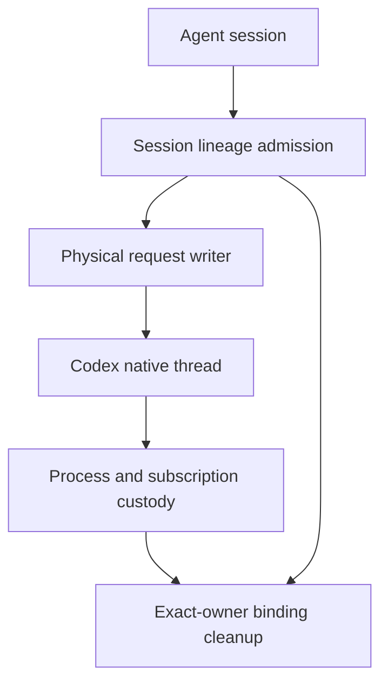

Codex review: blocked before merge. _Reviewed October 3, 2026, 10:11 AM ET / 14:11 UTC (Revision 9)._

# ClawSweeper review

## What this changes

The Codex plugin fences native requests, subscription retention, and delayed binding cleanup to the initiating session and physical client while retaining released harness interfaces.

## Merge readiness

⛔ **Blocked before merge - 2 items remain**

This remains a useful canonical repair that current main has not absorbed. No actionable correctness or security finding remains, and the previous generic configuration/upgrade blocker is unsupported by the introduced changes.

**Priority:** P1
**Reviewed head:** `f6c7aa64b0555165085a9c3c8b4aca12b8fd8ed8`

## Review scores

| Measure | Result | What it means |
|---|---|---|
| **Overall readiness** | 🐚 platinum hermit **(4/6)** | A useful, well-supported repair with no remaining actionable finding and preserved upgrade contracts. |
| **Proof confidence** | 🦞 diamond lobster **(5/6)** ✨ media proof bonus | Sufficient (linked_artifact): The registered attempt and real transport client exercise persisted-lineage replacement, real sandbox-process custody, revoked wire admission, and successor cleanup. Recorded after-fix outcomes cover allowed and stale owners, while earlier proof retains its tested revisions. No stored-data contract changes; encoding and released SDK compatibility remain intact. |
| **Patch quality** | 🐚 platinum hermit **(4/6)** | No actionable review findings were identified. |

## Verification

| Check | Result | Evidence |
|---|---|---|
| **Real behavior** | Verified | Sufficient (linked_artifact): The registered attempt and real transport client exercise persisted-lineage replacement, real sandbox-process custody, revoked wire admission, and successor cleanup. Recorded after-fix outcomes cover allowed and stale owners, while earlier proof retains its tested revisions. No stored-data contract changes; encoding and released SDK compatibility remain intact. |
| **Evidence reviewed** | 11 items | Pinned introduction and clean checkout: Reviewed the introduced merge-base-to-head delta and recovered the complete changed-path inventory locally. The checkout is the original PR head; the supplied test merge is stale and was not used to infer removal of current-main behavior. Final status remained clean. Authority reaches the physical writer: Worker-backed authority admits a synchronous write callback; that callback rechecks transport, cancellation, caller authority, and pending-request state before writing. Late grants cannot write cancelled attempts. Physical-client comparison survives CAS retries: Clear and patch mutations compare the captured client inside the mutation callback, including explicit absence for legacy bindings. Attempt cleanup passes initiating authority and exact physical-client identity. |
| **Findings** | None | None. |
| **Security** | None | None. |

## How this fits together

OpenClaw’s Codex plugin translates agent sessions into native Codex requests and manages their thread subscriptions. Session lineage, process custody, and physical-client ownership determine which requests and cleanup operations may proceed.

## Before merge

- [ ] **Review config compatibility** - Confirm compatibility and upgrade impact for the changed config or default surface before merge.
- [ ] **Add data-model compatibility proof** - Confirm migration or upgrade compatibility proof before merge.

<strong>Agent review details</strong>

### Security

None.

### PR surface

PR surface statistics unavailable: the file list is incomplete.

### Review metrics

| Metric | Value | Why it matters |
|---|---|---|
| **Production versus test growth** | production net +1,357; tests/support net +2,192 | The PR explicitly justifies production growth for worker authority, exact-owner custody, and retained released interfaces. |

### Stored data model

Persistent data-model change detected: `migration/backfill/repair: src/plugins/compat/session-persistence-records.ts`, `unknown-truncated-pull-files`. Confirm migration or upgrade compatibility proof before merge.

### Root-cause cluster

Relationship: `canonical`
Canonical: https://github.com/openclaw/openclaw/pull/164197
Summary: This maintainer-owned branch consolidates initiating-authority and exact-client cleanup repairs with positive boundary proof.

Members:
- `superseded`: https://github.com/openclaw/openclaw/pull/156940 - The current branch explicitly preserves and refreshes this original authority repair.
- `superseded`: https://github.com/openclaw/openclaw/pull/143201 - The current branch incorporates its physical-client cleanup repair into worker-backed authority.

Proposal only: this assessment does not dispatch repair, suppress jobs, mutate sibling items, close, or merge anything.

### Technical review

Best possible solution:

Keep one worker-backed lineage admission owner and exact physical-client cleanup owner, with released synchronous consumers supported through the documented deprecation window.

Do we have a high-confidence way to reproduce the issue?

Yes, the source establishes a focused reproduction path: replace initiating lineage while peer work remains on the same native thread, or replace the physical client before delayed cleanup. This review did not execute target code.

Is this the best way to solve the issue?

Yes. The patch strengthens existing admission, mutation, and physical-subscription owners while preserving released interfaces; the prior generic configuration blocker has no introduced trigger.

AGENTS.md: found and applied where relevant.

Codex review notes: model internal, reasoning medium; reviewed against [5e1ffe933799](https://github.com/openclaw/openclaw/commit/5e1ffe933799c17ef01f75c4ee39e05cb2b93fc8).

### Labels

Label changes:

No label changes.

Label justifications:

- `P1`: Stale native work can interfere with successor sessions during reset, takeover, compaction, and cleanup.
- `merge-risk: 🚨 compatibility`: Official harness authority APIs gain awaited V2 contracts; the accepted migration preserves released signatures and their documented removal gate.
- `rating: 🐚 platinum hermit`: Overall readiness is 🐚 platinum hermit; proof is 🦞 diamond lobster and patch quality is 🐚 platinum hermit.
- `status: 👀 ready for maintainer look`: ClawSweeper has no concrete contributor-facing blocker left for this PR. Sufficient (linked_artifact): The registered attempt and real transport client exercise persisted-lineage replacement, real sandbox-process custody, revoked wire admission, and successor cleanup. Recorded after-fix outcomes cover allowed and stale owners, while earlier proof retains its tested revisions. No stored-data contract changes; encoding and released SDK compatibility remain intact.
- `proof: sufficient`: Contributor real behavior proof is sufficient. The registered attempt and real transport client exercise persisted-lineage replacement, real sandbox-process custody, revoked wire admission, and successor cleanup. Recorded after-fix outcomes cover allowed and stale owners, while earlier proof retains its tested revisions. No stored-data contract changes; encoding and released SDK compatibility remain intact.

### Evidence

What I checked:

- **Pinned introduction and clean checkout:** Reviewed the introduced merge-base-to-head delta and recovered the complete changed-path inventory locally. The checkout is the original PR head; the supplied test merge is stale and was not used to infer removal of current-main behavior. Final status remained clean. ([f6c7aa64b055](https://github.com/openclaw/openclaw/commit/f6c7aa64b0555165085a9c3c8b4aca12b8fd8ed8))
- **Authority reaches the physical writer:** Worker-backed authority admits a synchronous write callback; that callback rechecks transport, cancellation, caller authority, and pending-request state before writing. Late grants cannot write cancelled attempts. ([`extensions/codex/src/app-server/request-admission.ts:16`](https://github.com/openclaw/openclaw/blob/f6c7aa64b0555165085a9c3c8b4aca12b8fd8ed8/extensions/codex/src/app-server/request-admission.ts#L16), [f6c7aa64b055](https://github.com/openclaw/openclaw/commit/f6c7aa64b0555165085a9c3c8b4aca12b8fd8ed8))
- **Physical-client comparison survives CAS retries:** Clear and patch mutations compare the captured client inside the mutation callback, including explicit absence for legacy bindings. Attempt cleanup passes initiating authority and exact physical-client identity. ([`extensions/codex/src/app-server/session-binding.ts:550`](https://github.com/openclaw/openclaw/blob/f6c7aa64b0555165085a9c3c8b4aca12b8fd8ed8/extensions/codex/src/app-server/session-binding.ts#L550), [f6c7aa64b055](https://github.com/openclaw/openclaw/commit/f6c7aa64b0555165085a9c3c8b4aca12b8fd8ed8))
- **Previous wire finding resolved:** The assignment-rotation regression verifies an attempted guarded unsubscribe, zero physical unsubscribe frames, no successor start, and unchanged bindings and assignments after revocation. This addresses the earlier concrete finding without weakening its observable boundary. ([`extensions/codex/src/app-server/thread-lifecycle.assignment-rotation.test.ts`](https://github.com/openclaw/openclaw/blob/f6c7aa64b0555165085a9c3c8b4aca12b8fd8ed8/extensions/codex/src/app-server/thread-lifecycle.assignment-rotation.test.ts), [f6c7aa64b055](https://github.com/openclaw/openclaw/commit/f6c7aa64b0555165085a9c3c8b4aca12b8fd8ed8))
- **Compatibility decision and released signatures:** The retained synchronous capture, resolver result, and two-argument mutation callbacks match the inspected v2026.9.8 generation module. Awaited authority uses separate V2 contracts, bundled callers migrate together, and documentation preserves the deprecation window and explicit breaking-release gate. Maintainer discussion accepts this compatibility arrangement. Public docs: [`docs/plugins/sdk-migration/compatibility-policy.md`](https://docs.openclaw.ai/plugins/sdk-migration/compatibility-policy). ([`docs/plugins/sdk-migration/compatibility-policy.md:160`](https://docs.openclaw.ai/plugins/sdk-migration/compatibility-policy), [fc23bc864e45](https://github.com/openclaw/openclaw/commit/fc23bc864e4553c2d215e479eeec47b67a0bf943))
- **No configuration or stored-format trigger:** The introduced scope has no package, lockfile, SQL schema, installation, or configuration-default change. Binding encoding is relocated with its existing schema-2 input and version-1 envelope; predecessor identity already exists in session state. Compatibility records describe API deprecation rather than a database migration. ([`extensions/codex/src/app-server/session-binding-codec.ts:72`](https://github.com/openclaw/openclaw/blob/f6c7aa64b0555165085a9c3c8b4aca12b8fd8ed8/extensions/codex/src/app-server/session-binding-codec.ts#L72), [f6c7aa64b055](https://github.com/openclaw/openclaw/commit/f6c7aa64b0555165085a9c3c8b4aca12b8fd8ed8))

Likely related people:

- **steipete:** Suggested for follow-up; no historical authorship or introduction is verified. (role: unverified routing candidate; confidence: low)
- **Sarah Fortune:** Suggested for follow-up; no historical authorship or introduction is verified. (role: unverified routing candidate; confidence: low)

### Rating scale

| Score | Internal tier | Crab rank | Meaning |
|---:|:---:|---|---|
| **6/6** | S | 🦀 challenger crab | Exceptional readiness |
| **5/6** | A | 🦞 diamond lobster | Very strong readiness |
| **4/6** | B | 🐚 platinum hermit | Good normal PR; ordinary maintainer review |
| **3/6** | C | 🦐 gold shrimp | Useful, but confidence is limited |
| **2/6** | D | 🦪 silver shellfish | Proof or implementation needs work |
| **1/6** | F | 🧂 unranked krab | Not merge-ready |
| N/A | NA | 🌊 off-meta tidepool | Rating does not apply |

Overall follows the weaker of proof and patch quality.
Shiny media proof means a screenshot, video, or linked artifact directly shows the changed behavior. Runtime, network, CSP, and security claims still need visible diagnostics.

### Workflow

- ClawSweeper keeps one durable marker-backed review comment per issue or PR.
- Re-runs edit this comment so the latest verdict, findings, and automation markers stay together instead of adding duplicate bot comments.
- A fresh review can be triggered by eligible `@clawsweeper re-review` comments, exact-item GitHub events, scheduled/background review runs, or manual workflow dispatch.
- PR/issue authors and users with repository write access can comment `@clawsweeper re-review` or `@clawsweeper re-run` on an open PR or issue to request a fresh review only.
- Maintainers can also comment `@clawsweeper review` to request a fresh review only.
- Fresh-review commands do not start repair, autofix, rebase, CI repair, or automerge.
- Maintainer-only repair and merge flows require explicit commands such as `@clawsweeper autofix`, `@clawsweeper automerge`, `@clawsweeper fix ci`, or `@clawsweeper address review`.
- Maintainers can comment `@clawsweeper explain` to ask for more context, or `@clawsweeper stop` to stop active automation.

### History

Review history (8 earlier review cycles)

<!-- clawsweeper-review-history v=1 total=8 -->
- reviewed 2026-10-03T09:03:47.821Z sha f88007e30e3647372b42b48ae7134cfb24ba5685 :: blocked before merge. :: none
- reviewed 2026-10-03T09:59:36.561Z sha 94cf2139471665cbcf52ccc1d340848f95bf7ccb :: blocked before merge. :: none
- reviewed 2026-10-03T10:05:39.956Z sha 94cf2139471665cbcf52ccc1d340848f95bf7ccb :: blocked before merge. :: [P2] Assert rejected unsubscribe frames at the wire boundary
- reviewed 2026-10-03T10:29:24.278Z sha 70e02b1deffc52f241443710d84e97d6073127a5 :: blocked before merge. :: none
- reviewed 2026-10-03T11:24:11.472Z sha 37d7901b7dd6bea60d8235dd6bb2875f26cfc122 :: blocked before merge. :: none
- reviewed 2026-10-03T12:44:19.571Z sha 7417eaf6bc4be6f92ed6b984c552d3ceee2a64e1 :: blocked before merge. :: none
- reviewed 2026-10-03T13:18:07.451Z sha 7417eaf6bc4be6f92ed6b984c552d3ceee2a64e1 :: blocked before merge. :: none
- reviewed 2026-10-03T13:59:06.002Z sha f6c7aa64b0555165085a9c3c8b4aca12b8fd8ed8 :: blocked before merge. :: none

<!-- clawsweeper-verdict:needs-human item=164197 sha=f6c7aa64b0555165085a9c3c8b4aca12b8fd8ed8 confidence=high updated_at=2026-10-03T14:07:43Z reviewed_at=2026-10-03T14:11:46.937Z lease_owner=github-run-37128476359-1 lease_comment_id=5969833873 source_revision=149511c5ef72ba2a74d6834af3ab05946278a5ae373535679ad70e8dea1329aa live_verification=absent -->
<!-- clawsweeper-review-state:blocked item=164197 sha=f6c7aa64b0555165085a9c3c8b4aca12b8fd8ed8 v=1 -->

<!-- clawsweeper-review-version item=164197 reviewed_at=2026-10-03T14:11:46.937Z sha=f6c7aa64b0555165085a9c3c8b4aca12b8fd8ed8 source_revision=149511c5ef72ba2a74d6834af3ab05946278a5ae373535679ad70e8dea1329aa lease_owner=github-run-37128476359-1 lease_comment_id=5969833873 v=1 -->

<!-- clawsweeper-review item=164197 -->