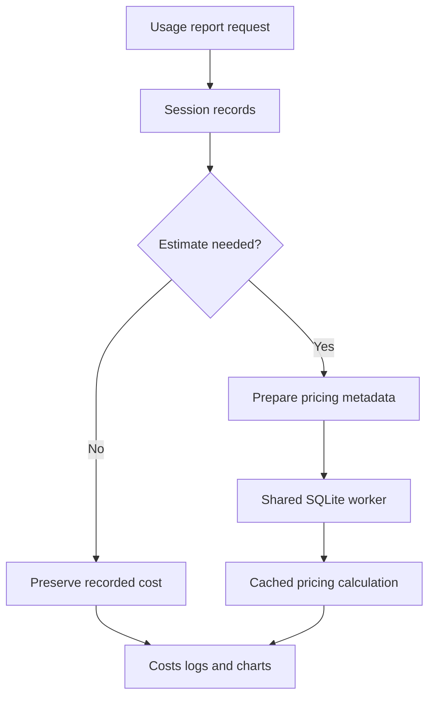

Codex review: needs maintainer review before merge. _Reviewed September 15, 2026, 1:24 AM ET / 05:24 UTC (Revision 6)._

# ClawSweeper review

## What this changes

Moves usage-pricing metadata and catalog reads into existing SQLite workers while preserving cost calculations, propagating cancellation, and scheduling database-owned tests once.

## Merge readiness

✅ **Ready for maintainer review**

This remains useful, maintainer-sponsored work that current main does not implement. The earlier cancellation defect is fixed, GitHub now reports the branch mergeable, and no new blocking defect was found.

**Priority:** P2
**Reviewed head:** `6180041e43f2c85a645ad1714878867a34fb21c4`

## Review scores

| Measure | Result | What it means |
|---|---|---|
| **Overall readiness** | 🐚 platinum hermit **(4/6)** | The patch reuses existing owners, preserves pricing semantics, and addresses the prior defect with meaningful regression coverage. |
| **Proof confidence** | 🌊 off-meta tidepool | Not applicable: The external-contributor gate does not apply to this MEMBER-authored PR. Its body records Node/Bun production pricing-entrypoint measurements and cancellation results at named revisions; no new authority boundary requires additional final-effect proof. |
| **Patch quality** | 🐚 platinum hermit **(4/6)** | No actionable review findings were identified. |

## Verification

| Check | Result | Evidence |
|---|---|---|
| **Real behavior** | Not applicable | Not applicable: The external-contributor gate does not apply to this MEMBER-authored PR. Its body records Node/Bun production pricing-entrypoint measurements and cancellation results at named revisions; no new authority boundary requires additional final-effect proof. |
| **Evidence reviewed** | 10 items | Current main still needs the change: Fetched main builds cold pricing contexts through synchronous metadata resolution and remote catalog access; it has no prepareModelPricingContext implementation. Latest release comparison: The supplied latest release, v2026.9.4, also uses synchronous cold pricing preparation. No shipped replacement was established. Existing owners and publication semantics: Pricing preparation retains its plugin-cache owner, rejects invalidated facts, checks retirement before publication, and preserves an already-published context. Remote preparation uses the existing shared-state worker and retains first-publication catalog selection. |
| **Findings** | None | None. |
| **Security** | None | None. |

## How this fits together

Usage reporting combines session records with configured and catalog prices to produce costs, logs, and charts. This change prepares pricing metadata through the shared database worker before synchronous calculations consume it.

## Before merge

None.

<strong>Agent review details</strong>

### Security

None.

### PR surface

Source +331, Tests +296, Other +6. Total +633 across 21 files.

View PR surface stats

| Area | Files | Added | Removed | Net |
|---|---:|---:|---:|---:|
| Source | 14 | 448 | 117 | +331 |
| Tests | 6 | 304 | 8 | +296 |
| Docs | 0 | 0 | 0 | 0 |
| Config | 0 | 0 | 0 | 0 |
| Generated | 0 | 0 | 0 | 0 |
| Other | 1 | 7 | 1 | +6 |
| **Total** | **21** | **759** | **126** | **+633** |

### Review metrics

| Metric | Value | Why it matters |
|---|---|---|
| **Production versus regression coverage** | Production net +331 lines; tests/support net +296; tooling net +6 | Production growth implements asynchronous preparation and cancellation handling within existing owners, with regression coverage for publication and selection semantics. |

### Root-cause cluster

Relationship: `partial_overlap`
Canonical: https://github.com/openclaw/openclaw/issues/144592
Summary: This PR implements the usage-pricing portion of the broader asynchronous-storage campaign.

Members:
- `canonical`: https://github.com/openclaw/openclaw/issues/144592 - The open campaign explicitly includes hidden synchronous reads behind prepared getters.
- `partial_overlap`: https://github.com/openclaw/openclaw/pull/148305 - The merged prerequisite supplies shared metadata preparation used by this distinct pricing cutover.
- `adjacent_distinct`: https://github.com/openclaw/openclaw/pull/148734 - Merged fixture cleanup addresses test lifecycle ordering, not usage-pricing preparation.
- `adjacent_distinct`: https://github.com/openclaw/openclaw/pull/148736 - Merged inspection diagnostics explain inherited test failures without implementing the pricing change.

Proposal only: this assessment does not dispatch repair, suppress jobs, mutate sibling items, close, or merge anything.

### Technical review

Best possible solution:

Keep pricing calculations synchronous over prepared facts, with SQLite reads and cancellation owned by the existing cache and database lifecycles.

Do we have a high-confidence way to reproduce the issue?

Yes, at source level: cold usage pricing on main reaches synchronous metadata and catalog reads. The reported Node/Bun measurements support that mechanism; this review did not execute it.

Is this the best way to solve the issue?

Yes. The patch prepares existing owners before calculation, preserves pricing precedence and stored formats, and fixes cancellation at the actual log entrypoint without adding configuration or a competing store.

AGENTS.md: found and applied where relevant.

Codex review notes: model internal, reasoning medium; reviewed against [d47f299c681a](https://github.com/openclaw/openclaw/commit/d47f299c681ab665a964b7f88516e41ea2b075cc).

### Labels

Label justifications:

- `P2`: This is a bounded Gateway responsiveness improvement for cold usage-pricing reads, without evidence of an urgent user-facing outage.
- `rating: 🐚 platinum hermit`: Overall readiness is 🐚 platinum hermit; proof is 🌊 off-meta tidepool and patch quality is 🐚 platinum hermit.
- `status: 👀 ready for maintainer look`: ClawSweeper has no concrete contributor-facing blocker left for this PR. Not applicable: The external-contributor gate does not apply to this MEMBER-authored PR. Its body records Node/Bun production pricing-entrypoint measurements and cancellation results at named revisions; no new authority boundary requires additional final-effect proof.

### Evidence

What I checked:

- **Current main still needs the change:** Fetched main builds cold pricing contexts through synchronous metadata resolution and remote catalog access; it has no prepareModelPricingContext implementation. ([`src/model-catalog/pricing.ts:64`](https://github.com/openclaw/openclaw/blob/d47f299c681ab665a964b7f88516e41ea2b075cc/src/model-catalog/pricing.ts#L64), [d47f299c681a](https://github.com/openclaw/openclaw/commit/d47f299c681ab665a964b7f88516e41ea2b075cc))
- **Latest release comparison:** The supplied latest release, v2026.9.4, also uses synchronous cold pricing preparation. No shipped replacement was established. ([`src/model-catalog/pricing.ts:64`](https://github.com/openclaw/openclaw/blob/3a9d69db306cd7f081e06254cb89c4bcc14a7107/src/model-catalog/pricing.ts#L64), [3a9d69db306c](https://github.com/openclaw/openclaw/commit/3a9d69db306cd7f081e06254cb89c4bcc14a7107))
- **Existing owners and publication semantics:** Pricing preparation retains its plugin-cache owner, rejects invalidated facts, checks retirement before publication, and preserves an already-published context. Remote preparation uses the existing shared-state worker and retains first-publication catalog selection. ([`src/model-catalog/pricing.ts:153`](https://github.com/openclaw/openclaw/blob/6180041e43f2c85a645ad1714878867a34fb21c4/src/model-catalog/pricing.ts#L153), [6180041e43f2](https://github.com/openclaw/openclaw/commit/6180041e43f2c85a645ad1714878867a34fb21c4))
- **Previous cancellation finding resolved:** The asynchronous pricing call is outside the malformed-record catch. The added log-entrypoint regression covers database-admission invalidation and plugin-cache retirement, followed by successful fresh reads preserving billed-zero and estimated costs. ([`src/infra/session-cost-usage-reporting.ts:377`](https://github.com/openclaw/openclaw/blob/6180041e43f2c85a645ad1714878867a34fb21c4/src/infra/session-cost-usage-reporting.ts#L377), [6180041e43f2](https://github.com/openclaw/openclaw/commit/6180041e43f2c85a645ad1714878867a34fb21c4))
- **Re-review continuity:** The inspected pricing, metadata, cache, worker, and cancellation-regression files are unchanged from the previous reviewed head. Its empty findings remain consistent with this review. ([6180041e43f2](https://github.com/openclaw/openclaw/commit/6180041e43f2c85a645ad1714878867a34fb21c4))
- **Current integration state:** The REST response confirms the pinned head remains open and unmerged, with mergeable=true and mergeable_state=blocked. The previous conflict warning is no longer current. The supplied stale test merge is not evidence of the final merged tree. ([6180041e43f2](https://github.com/openclaw/openclaw/commit/6180041e43f2c85a645ad1714878867a34fb21c4))

Likely related people:

- **steipete:** Suggested for follow-up; no historical authorship or introduction is verified. (role: unverified routing candidate; confidence: low)
- **Fabio Ribeiro:** Suggested for follow-up; no historical authorship or introduction is verified. (role: unverified routing candidate; confidence: low)

### Rating scale

| Score | Internal tier | Crab rank | Meaning |
|---:|:---:|---|---|
| **6/6** | S | 🦀 challenger crab | Exceptional readiness |
| **5/6** | A | 🦞 diamond lobster | Very strong readiness |
| **4/6** | B | 🐚 platinum hermit | Good normal PR; ordinary maintainer review |
| **3/6** | C | 🦐 gold shrimp | Useful, but confidence is limited |
| **2/6** | D | 🦪 silver shellfish | Proof or implementation needs work |
| **1/6** | F | 🧂 unranked krab | Not merge-ready |
| N/A | NA | 🌊 off-meta tidepool | Rating does not apply |

Overall follows the weaker of proof and patch quality.
Shiny media proof means a screenshot, video, or linked artifact directly shows the changed behavior. Runtime, network, CSP, and security claims still need visible diagnostics.

### Workflow

- ClawSweeper keeps one durable marker-backed review comment per issue or PR.
- Re-runs edit this comment so the latest verdict, findings, and automation markers stay together instead of adding duplicate bot comments.
- A fresh review can be triggered by eligible `@clawsweeper re-review` comments, exact-item GitHub events, scheduled/background review runs, or manual workflow dispatch.
- PR/issue authors and users with repository write access can comment `@clawsweeper re-review` or `@clawsweeper re-run` on an open PR or issue to request a fresh review only.
- Maintainers can also comment `@clawsweeper review` to request a fresh review only.
- Fresh-review commands do not start repair, autofix, rebase, CI repair, or automerge.
- Maintainer-only repair and merge flows require explicit commands such as `@clawsweeper autofix`, `@clawsweeper automerge`, `@clawsweeper fix ci`, or `@clawsweeper address review`.
- Maintainers can comment `@clawsweeper explain` to ask for more context, or `@clawsweeper stop` to stop active automation.

### History

Review history (5 earlier review cycles)

<!-- clawsweeper-review-history v=1 total=5 -->
- reviewed 2026-09-15T02:49:43.019Z sha f59f310a8eb6dad9b807a3a62f28e96e987d5455 :: needs changes before merge. :: [P2] Propagate pricing cancellation outside the malformed-record catch
- reviewed 2026-09-15T03:11:05.754Z sha 60b2cbebbf3a8e43c3179b5b54a24943ed595b3b :: needs changes before merge. :: [P2] Propagate pricing cancellation outside the malformed-record catch
- reviewed 2026-09-15T03:47:36.331Z sha 69687337eda2f724c89639235b5605a429e85f24 :: needs maintainer review before merge. :: none
- reviewed 2026-09-15T04:29:08.104Z sha 30406a9771bbb8b2a4c2217864791d7ae62411c4 :: needs maintainer review before merge. :: none
- reviewed 2026-09-15T05:07:58.527Z sha 503e834e19fc2805c4b3bb6c4a8ff0e9a896175c :: blocked before merge. :: none

<!-- clawsweeper-verdict:needs-human item=148709 sha=6180041e43f2c85a645ad1714878867a34fb21c4 confidence=high updated_at=2026-09-15T05:21:20Z reviewed_at=2026-09-15T05:24:21.238Z lease_owner=github-run-34932272512-1 lease_comment_id=5675172455 source_revision=ff101b5a3c4e988622e9164268c48c1d9862515ff60d8983babf8ca34d04ff84 live_verification=absent -->
<!-- clawsweeper-review-state:ready item=148709 sha=6180041e43f2c85a645ad1714878867a34fb21c4 v=1 -->

<!-- clawsweeper-review-version item=148709 reviewed_at=2026-09-15T05:24:21.238Z sha=6180041e43f2c85a645ad1714878867a34fb21c4 source_revision=ff101b5a3c4e988622e9164268c48c1d9862515ff60d8983babf8ca34d04ff84 lease_owner=github-run-34932272512-1 lease_comment_id=5675172455 v=1 -->

<!-- clawsweeper-review item=148709 -->