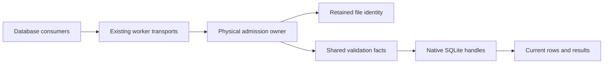

Codex review: needs changes before merge.

## What this changes

This PR shares physical-database validation facts across workers and reopened connections while preserving freshness, corruption refusal, and live authority checks.

**Example:** Reopen an admitted agent database after its idle connection closes.
- **Before:** The new connection repeats schema, ownership, and integrity admission queries.
- **After:** It reuses the physical file's admission; replacing the file requires fresh validation.

## Review scores

| Measure | Result | What it means |
|---|---|---|
| **Overall readiness** | 🐚 platinum hermit **(4/6)** | Useful, supported by recorded runtime and upgrade evidence, with no new discrete defect found; the reported conflict remains a workflow blocker. |
| **Proof confidence** | 🐚 platinum hermit **(4/6)** | Sufficient (live_output): The full body records final-head published-driver upgrade results and real Gateway SQL traces; production-path cases exercise creation refusal, replacement, revocation, and cross-worker publication. Raw Testbox logs were inaccessible through the review network, so the enclosing run's cancellation is distinguished from the recorded completed upgrade cell. |
| **Patch quality** | 🐚 platinum hermit **(4/6)** | No actionable review findings were identified. |

## Product

**Kind:** Performance · **Worth it:** Yes · **Fix scope:** Complete
**User problem:** Startup and routine database operations repeat validation already completed for the same physical file.
**Reason:** The measured reduction supports clear value, and the established area owner explicitly records the changed admission contract and its retained safeguards.

## Merge readiness

⛔ **Needs changes before merge - 1 item remains**

Keep open: this maintainer-owned optimization addresses repeated SQLite admission work, and no new actionable code defect was found in the inspected boundaries; GitHub now reports merge conflicts.

**Priority:** P2
**Reviewed head:** `57ffc8f51c8e3e13f24ba7e781ab76f9904700b5`

## Before merge

- [ ] **Complete next step** - Resolve GitHub's reported conflicts against main, preserve the admission and authority boundaries, and validate the affected integration changes.

## Findings

None.

<strong>Agent review details</strong>

### How this fits together

SQLite admission sits between native database opens and state, session, auth, memory, and plugin consumers, supplying validated format facts while their existing owners retain permission and row-freshness decisions.

### Technical review

Best possible solution:

Retain one physical-admission owner across workers and reopens, with explicit maintenance inspection and current authority checks preserved.

Do we have a high-confidence way to reproduce the issue?

Current-main admission paths establish repeated validation, and the supplied paired SQL measurements quantify its reduction; this read-only review executed no target code.

Is this the best way to solve the issue?

Sharing facts through existing native and worker owners addresses the repeated work coherently while retaining separate row freshness, corruption refusal, and explicit maintenance checks.

AGENTS.md: found and applied where relevant.

Codex review notes: model internal, reasoning medium; reviewed against [6866e219d8ed](https://github.com/openclaw/openclaw/commit/6866e219d8ed1cadd539e5de2a2db20ac1c1a095).

### Provenance checked

- `Schema admission and foreign-commit observation` changes intended behavior with a stated reason (bc6fedbe4633d3ccc0e4bb84ef323fa62794c6fd: Reuse admitted schema facts while detecting schema changes and retaining authorization freshness.)
- `Shared-state integrity reuse` changes intended behavior with a stated reason (e05265fc81261c91bfcaabedf0718c22c7f6d0d8: Reuse runtime integrity proof within a matching file generation while preserving explicit maintenance checks.)
- `Committed worker facts and settlement` keeps the original intent (da67a08b20eb3c16445c7d4cc469f96751736cf9: Preserve acknowledged database commits independently of publication or reply failure.)

### Testing

Proof path: shipped entry point.

### Security

None.

### Evidence

What I checked:

- **Current main still performs repeated schema observation:** Current-main readSqliteCacheDataVersion can compare schema markers after foreign commits; the candidate separates row freshness from process-scoped physical-format admission. ([`src/infra/sqlite-schema-facts.ts:432`](https://github.com/openclaw/openclaw/blob/6866e219d8ed1cadd539e5de2a2db20ac1c1a095/src/infra/sqlite-schema-facts.ts#L432), [6866e219d8ed](https://github.com/openclaw/openclaw/commit/6866e219d8ed1cadd539e5de2a2db20ac1c1a095))
- **Identity and publication lifecycle:** The new admission owner retains descriptors, distinguishes physical generations, shares revocable facts, stages transactional publications, and fences unsettled schema writers; cross-worker and replacement-file regressions exercise these boundaries. ([`src/infra/sqlite-database-admission.ts:105`](https://github.com/openclaw/openclaw/blob/57ffc8f51c8e3e13f24ba7e781ab76f9904700b5/src/infra/sqlite-database-admission.ts#L105), [57ffc8f51c8e](https://github.com/openclaw/openclaw/commit/57ffc8f51c8e3e13f24ba7e781ab76f9904700b5))
- **Creation authority reaches the filesystem boundary:** Host creation checks the captured request, access owner, and permitted target before synchronous creation; inspected cases verify that revoked, facts-only, wrong-target, unadmitted, and retired requests leave files absent. ([`src/infra/sqlite-worker-operation-admission.test.ts:245`](https://github.com/openclaw/openclaw/blob/57ffc8f51c8e3e13f24ba7e781ab76f9904700b5/src/infra/sqlite-worker-operation-admission.test.ts#L245), [57ffc8f51c8e](https://github.com/openclaw/openclaw/commit/57ffc8f51c8e3e13f24ba7e781ab76f9904700b5))
- **Recorded final-head upgrade compatibility:** The full maintainer-authored body records a published 2026.9.9 driver upgrading the exact head, preserving logical hashes, returning integrity ok and readiness HTTP 200, with shared state 19→20 and agent stores 24→25; https://github.com/openclaw/openclaw/actions/runs/38025966663 is the linked Testbox container, whose eventual cancelled status is not itself claimed as passing proof. ([57ffc8f51c8e](https://github.com/openclaw/openclaw/commit/57ffc8f51c8e3e13f24ba7e781ab76f9904700b5))
- **Earlier sidebar blocker is inherited:** GitHub annotations for candidate job 114137085808 and scheduled-main job 114133092633 show the same two expected-1-to-be-0 sidebar assertions; the relevant UI comparison is unchanged, resolving the previous review's attribution request. ([`ui/src/e2e/session-management.sidebar.e2e.test.ts:218`](https://github.com/openclaw/openclaw/blob/57ffc8f51c8e3e13f24ba7e781ab76f9904700b5/ui/src/e2e/session-management.sidebar.e2e.test.ts#L218), [57ffc8f51c8e](https://github.com/openclaw/openclaw/commit/57ffc8f51c8e3e13f24ba7e781ab76f9904700b5))
- **Current merge conflict:** A fresh REST read retains the reviewed head but reports mergeable=false and mergeable_state=dirty, superseding the supplied earlier mergeability snapshot. ([57ffc8f51c8e](https://github.com/openclaw/openclaw/commit/57ffc8f51c8e3e13f24ba7e781ab76f9904700b5))

### PR surface

PR surface statistics unavailable: the file list is incomplete.

### Labels

Label changes:

- add `proof: sufficient`: Contributor real behavior proof is sufficient.
- add `rating: 🐚 platinum hermit`: Overall readiness is 🐚 platinum hermit; proof is 🐚 platinum hermit and patch quality is 🐚 platinum hermit.
- remove `rating: 🦐 gold shrimp`: Current PR rating is `rating: 🐚 platinum hermit`, so this older rating label is no longer current.

Label justifications:

- `P2`: Repeated admission adds startup and runtime work, particularly for large databases, without establishing an urgent current outage.
- `merge-risk: 🚨 compatibility`: The change alters validation lifetime and SDK admission behavior; the maintainer records acceptance of the format-trust tradeoff and final-head upgrade preservation.
- `rating: 🐚 platinum hermit`: Overall readiness is 🐚 platinum hermit; proof is 🐚 platinum hermit and patch quality is 🐚 platinum hermit.
- `status: ⏳ waiting on author`: ClawSweeper has contributor-facing work open and is waiting for author action.
- `proof: sufficient`: Contributor real behavior proof is sufficient.

### Rating scale

6/6 🦀 challenger crab · 5/6 🦞 diamond lobster · 4/6 🐚 platinum hermit · 3/6 🦐 gold shrimp · 2/6 🦪 silver shellfish · 1/6 🧂 unranked krab. Overall follows the weaker of proof and patch quality; ✨ marks media proof (a screenshot, video, or linked artifact) that directly shows the changed behavior.

### Workflow

ClawSweeper edits this one comment on every review. Comment `@clawsweeper re-review` for a fresh review only; repair and merge need explicit maintainer commands such as `@clawsweeper autofix` or `@clawsweeper automerge`.

### History

Review history (13 earlier review cycles; latest 8 shown)

<!-- clawsweeper-review-history v=1 total=13 -->
- reviewed 2026-10-09T18:17:22.211Z sha cdb5143a0e03ac94ca9fb04982165bc792aba8a7 :: blocked before merge. :: none
- reviewed 2026-10-09T22:39:16.695Z sha a12c2b8a9e63a1727291418219309da566555ab5 :: blocked before merge. :: none
- reviewed 2026-10-10T01:24:12.026Z sha bbcbe383353addb0702a2f16ee4bdead191dbfe1 :: blocked before merge. :: none
- reviewed 2026-10-10T01:42:30.009Z sha bbcbe383353addb0702a2f16ee4bdead191dbfe1 :: blocked before merge. :: none
- reviewed 2026-10-10T04:21:40.765Z sha 1706a1a0978128af4cf57b4fa1a3151fa3100a11 :: blocked before merge. :: [P2] Restore the placement receipt module to the wrapper inventory | [P2] Preserve first-creation admission for reclamation workers
- reviewed 2026-10-10T04:31:21.004Z sha fddab02810603715e71401d93d68d1f6d6767dec :: blocked before merge. :: [P2] Preserve first-creation admission for reclamation workers
- reviewed 2026-10-10T04:42:22.655Z sha fddab02810603715e71401d93d68d1f6d6767dec :: needs changes before merge. :: [P2] Preserve first-creation admission for reclamation workers | [P2] Restore the unsettled-cursor expectation after decoding failure | [P2] Exercise cold integrity validation in the Doctor timing fixture
- reviewed 2026-10-10T05:09:37.211Z sha 57ffc8f51c8e3e13f24ba7e781ab76f9904700b5 :: blocked before merge. :: none

_Reviewed October 10, 2026, 1:36 AM ET / 05:36 UTC (Revision 14)._

<!-- clawsweeper-verdict:needs-human item=167739 sha=57ffc8f51c8e3e13f24ba7e781ab76f9904700b5 confidence=high updated_at=2026-10-10T05:29:25Z reviewed_at=2026-10-10T05:36:50.116Z lease_owner=github-run-38027602726-1 lease_comment_id=6094218857 source_revision=c3e6f002a5cda1e4bd58f5c41e9db758361a8c25156c2471059db207ac4d1bf0 live_verification=absent hold=blocked findings=0 -->
<!-- clawsweeper-review-state:needs-changes item=167739 sha=57ffc8f51c8e3e13f24ba7e781ab76f9904700b5 v=1 -->

<!-- clawsweeper-review-version item=167739 reviewed_at=2026-10-10T05:36:50.116Z sha=57ffc8f51c8e3e13f24ba7e781ab76f9904700b5 source_revision=c3e6f002a5cda1e4bd58f5c41e9db758361a8c25156c2471059db207ac4d1bf0 lease_owner=github-run-38027602726-1 lease_comment_id=6094218857 v=1 -->

<!-- clawsweeper-review item=167739 -->