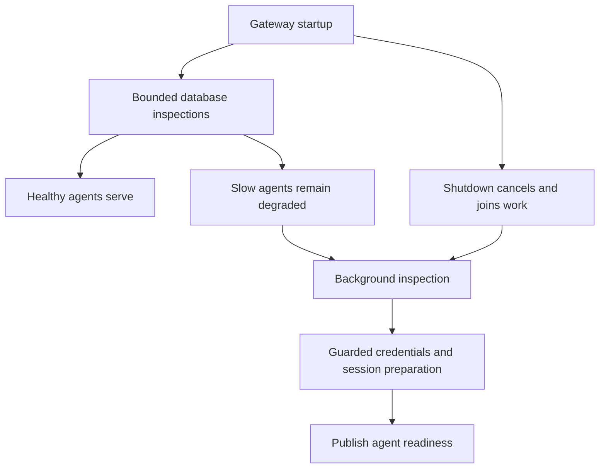

Codex review: blocked before merge. _Reviewed September 17, 2026, 6:05 AM ET / 10:05 UTC (Revision 2)._

# ClawSweeper review

## What this changes

The PR lets healthy agents serve while slow database checks continue, then restores deferred agents after guarded credential, session, and model preparation.

## Merge readiness

⛔ **Blocked before merge - 4 items remain**

This remains a useful, distinct fix beyond main’s larger inspection budgets and bounded concurrency. No concrete introduced correctness or security defect was found; the prior upgrade-validation concern remains unresolved.

**Priority:** P1
**Reviewed head:** `afe7cd506d9bac34615d686419b33e22a06eb063`
**Owner decision:** Required. See [Decision needed](#decision-needed).

## Review scores

| Measure | Result | What it means |
|---|---|---|
| **Overall readiness** | 🐚 platinum hermit **(4/6)** | A coherent owner-based repair with meaningful runtime boundary evidence and no actionable code finding. |
| **Proof confidence** | 🐚 platinum hermit **(4/6)** | Sufficient (live_output): The captured body reports real SQLite-child and HTTP boundary observations showing healthy service during pending admission, preparation before recovery, broker parenting, and joined cancellation; inspected source matches those scenarios. This establishes the changed runtime path, not published-driver upgrade compatibility. |
| **Patch quality** | 🐚 platinum hermit **(4/6)** | No actionable review findings were identified. |

## Verification

| Check | Result | Evidence |
|---|---|---|
| **Real behavior** | Verified | Sufficient (live_output): The captured body reports real SQLite-child and HTTP boundary observations showing healthy service during pending admission, preparation before recovery, broker parenting, and joined cancellation; inspected source matches those scenarios. This establishes the changed runtime path, not published-driver upgrade compatibility. |
| **Evidence reviewed** | 9 items | Pinned introduction and remaining need: The verified introduced delta is 9ee5c26f4080b4f63243897c904243802efbc3bf..afe7cd506d9bac34615d686419b33e22a06eb063. The base scheduler awaits all inspection workers and has no foreground-to-background handoff; earlier merged budget and worker-reuse changes therefore do not implement this PR’s central behavior. Recovery authority and migration boundary: Deferred preparation checks cancellation, Gateway ownership, refusal identity, deletion state, and file identity. Incompatible, failed, or migration-pending inspection results retain degradation instead of entering preparation. Publication and final-write fencing: Recovery validates configured database paths and credential snapshot revisions before session/model preparation. Canonical validation composes the current startup owner into worker write admission, and ordinary database operations retain agent admission checks. |
| **Findings** | None | None. |
| **Security** | None | None. |

## How this fits together

Gateway startup checks each agent’s SQLite database before allowing sessions and model execution. This change transfers unfinished checks into the Gateway lifecycle while keeping affected agents unavailable until preparation succeeds.

## Decision needed

| Question | Recommendation |
|---|---|
| Must this PR demonstrate the published updater and Windows supervisor handling deferred, migration-pending agents before merge, or receive a scoped exception? | **Complete retained-state upgrade validation:** Record published-driver × candidate evidence covering startup, deferred-agent recovery, and migration-required degradation. |

Why: Production-boundary recovery evidence does not establish the installed-driver contract required by root policy, and the neighboring PR’s exception cannot be transferred automatically.

## Before merge

- [ ] **Resolve merge risk (P1)** - Gateway liveness can now succeed while an existing agent remains unavailable; a deferred database requiring migration stays degraded and needs Doctor intervention. Published-updater and Windows-supervisor behavior on retained state has not been demonstrated for this change.
- [ ] **Complete next step (P2)** - Record published-driver × candidate retained-state validation, including the Windows supervisor path, or an explicit scoped maintainer exception.
- [ ] **Resolve maintainer decision** - Resolve the maintainer decision shown above before merge.
- [ ] **Add data-model compatibility proof** - Confirm migration or upgrade compatibility proof before merge.

<strong>Agent review details</strong>

### Security

None.

### PR surface

Source +894, Tests +1095, Docs +37, Other 0. Total +2026 across 38 files.

View PR surface stats

| Area | Files | Added | Removed | Net |
|---|---:|---:|---:|---:|
| Source | 26 | 1092 | 198 | +894 |
| Tests | 9 | 1113 | 18 | +1095 |
| Docs | 2 | 40 | 3 | +37 |
| Config | 0 | 0 | 0 | 0 |
| Generated | 0 | 0 | 0 | 0 |
| Other | 1 | 2 | 2 | 0 |
| **Total** | **38** | **2247** | **221** | **+2026** |

### Review metrics

| Metric | Value | Why it matters |
|---|---|---|
| **Production versus test growth** | Production net +894; tests net +1,095 | The body justifies production growth through lifetime transfer, guarded recovery, and inherited-store isolation while retaining the existing scheduler owner. |

### Stored data model

Persistent data-model change detected: `migration/backfill/repair: src/config/sessions/startup-migration.ts`, `migration/backfill/repair: src/gateway/server-startup-session-migration.ts`, `migration/backfill/repair: src/state/agent-database-admission.ts`, `serialized state: src/agents/auth-profiles/inherited-store.ts`, `serialized state: src/gateway/server-startup-session-migration.ts`, `unknown-data-model-change: src/agents/auth-profiles/inherited-store.ts`, and 1 more. Confirm migration or upgrade compatibility proof before merge.

### Root-cause cluster

Relationship: `fixed_by_candidate`
Canonical: https://github.com/openclaw/openclaw/issues/150574
Summary: This PR is the active candidate for the reported fatal startup-inspection timeout; the earlier submission was replaced without merging.

Members:
- `canonical`: https://github.com/openclaw/openclaw/issues/150574 - The PR explicitly links the report and addresses its fatal timeout mechanism.
- `superseded`: https://github.com/openclaw/openclaw/pull/150677 - The supplied body and timeline identify this closed-unmerged submission as the replaced candidate.
- `partial_overlap`: https://github.com/openclaw/openclaw/pull/150444 - The merged optimization reduces inspection overhead but does not provide background timeout recovery.

Proposal only: this assessment does not dispatch repair, suppress jobs, mutate sibling items, close, or merge anything.

### Merge-risk options

**Maintainer options:**
1. **Verify installed-driver recovery (recommended)**  
   Resolve how a published updater and retained Windows service setup handle a live Gateway whose agent still needs migration.
2. **Accept the bounded upgrade uncertainty**  
   Record an explicit exception for this PR while retaining the documented degraded-agent repair path.

### Technical review

Best possible solution:

Keep bounded background admission with guarded recovery, and establish retained-state upgrade compatibility or record a scoped maintainer exception before landing.

Do we have a high-confidence way to reproduce the issue?

Yes, from source: main awaits bounded inspection workers and propagates timeout failure, while the reported 1 ms budget-seam reproduction exercises that path. This read-only review did not run the reproduction.

Is this the best way to solve the issue?

Yes: transferring unfinished checks to the Gateway lifecycle addresses fatal waiting without weakening integrity checks or adding a timeout setting; installed-driver compatibility remains a separate validation requirement.

AGENTS.md: found and applied where relevant.

Codex review notes: model internal, reasoning medium; reviewed against [9ee5c26f4080](https://github.com/openclaw/openclaw/commit/9ee5c26f4080b4f63243897c904243802efbc3bf).

### Labels

Label justifications:

- `P1`: The linked report establishes an official-release Gateway startup failure on healthy databases under slow-storage contention.
- `merge-risk: 🚨 compatibility`: Installed-driver handling of successful Gateway liveness alongside migration-required agent degradation remains unverified.
- `rating: 🐚 platinum hermit`: Overall readiness is 🐚 platinum hermit; proof is 🐚 platinum hermit and patch quality is 🐚 platinum hermit.
- `status: 👀 ready for maintainer look`: ClawSweeper has no concrete contributor-facing blocker left for this PR. Sufficient (live_output): The captured body reports real SQLite-child and HTTP boundary observations showing healthy service during pending admission, preparation before recovery, broker parenting, and joined cancellation; inspected source matches those scenarios. This establishes the changed runtime path, not published-driver upgrade compatibility.
- `proof: sufficient`: Contributor real behavior proof is sufficient. The captured body reports real SQLite-child and HTTP boundary observations showing healthy service during pending admission, preparation before recovery, broker parenting, and joined cancellation; inspected source matches those scenarios. This establishes the changed runtime path, not published-driver upgrade compatibility.

### Evidence

What I checked:

- **Pinned introduction and remaining need:** The verified introduced delta is 9ee5c26f4080b4f63243897c904243802efbc3bf..afe7cd506d9bac34615d686419b33e22a06eb063. The base scheduler awaits all inspection workers and has no foreground-to-background handoff; earlier merged budget and worker-reuse changes therefore do not implement this PR’s central behavior. ([`src/state/openclaw-database-preflight-agent-scheduler.ts:22`](https://github.com/openclaw/openclaw/blob/9ee5c26f4080b4f63243897c904243802efbc3bf/src/state/openclaw-database-preflight-agent-scheduler.ts#L22), [9ee5c26f4080](https://github.com/openclaw/openclaw/commit/9ee5c26f4080b4f63243897c904243802efbc3bf))
- **Recovery authority and migration boundary:** Deferred preparation checks cancellation, Gateway ownership, refusal identity, deletion state, and file identity. Incompatible, failed, or migration-pending inspection results retain degradation instead of entering preparation. ([`src/state/agent-database-startup.ts:161`](https://github.com/openclaw/openclaw/blob/afe7cd506d9bac34615d686419b33e22a06eb063/src/state/agent-database-startup.ts#L161), [afe7cd506d9b](https://github.com/openclaw/openclaw/commit/afe7cd506d9bac34615d686419b33e22a06eb063))
- **Publication and final-write fencing:** Recovery validates configured database paths and credential snapshot revisions before session/model preparation. Canonical validation composes the current startup owner into worker write admission, and ordinary database operations retain agent admission checks. ([`src/gateway/server-agent-database-startup.ts:67`](https://github.com/openclaw/openclaw/blob/afe7cd506d9bac34615d686419b33e22a06eb063/src/gateway/server-agent-database-startup.ts#L67), [afe7cd506d9b](https://github.com/openclaw/openclaw/commit/afe7cd506d9bac34615d686419b33e22a06eb063))
- **Production-boundary behavior evidence:** The captured PR body reports real SQLite children and HTTP healthz=200 while an agent remains pending, successful credential/session/model preparation before readmission, broker parenting during preparation, and joined shutdown. The inspected boundary tests exercise these owners with deterministic pauses; the canonical-validation regression checks that revoked authority leaves pending rows uncertified. These checks were inspected, not executed during this review. ([`src/gateway/server-agent-database-startup.test.ts:126`](https://github.com/openclaw/openclaw/blob/afe7cd506d9bac34615d686419b33e22a06eb063/src/gateway/server-agent-database-startup.test.ts#L126), [afe7cd506d9b](https://github.com/openclaw/openclaw/commit/afe7cd506d9bac34615d686419b33e22a06eb063))
- **Broker cleanup composition:** The outer Linux broker cleanup now awaits the same admission stop operation even when core cleanup fails before reaching sidecars. Three held-cleanup cases cover failure before adoption, after adoption, and before sidecar shutdown. ([`src/gateway/server.ts:56`](https://github.com/openclaw/openclaw/blob/afe7cd506d9bac34615d686419b33e22a06eb063/src/gateway/server.ts#L56), [afe7cd506d9b](https://github.com/openclaw/openclaw/commit/afe7cd506d9bac34615d686419b33e22a06eb063))
- **Upgrade gate and prior-review continuity:** Root policy requires published-driver × candidate proof for startup, Doctor, and service-lifecycle changes. The captured body explicitly excludes shipped-driver respawn reproduction, and the prior review requested retained-state upgrade validation or a scoped exception. The exception recorded for https://github.com/openclaw/openclaw/pull/150444 applies to that separate optimization, not this PR. ([`AGENTS.md`](https://github.com/openclaw/openclaw/blob/afe7cd506d9bac34615d686419b33e22a06eb063/AGENTS.md), [afe7cd506d9b](https://github.com/openclaw/openclaw/commit/afe7cd506d9bac34615d686419b33e22a06eb063))

Likely related people:

- **steipete:** Suggested for follow-up; no historical authorship or introduction is verified. (role: unverified routing candidate; confidence: low)

### Rank-up moves

Optional improvements that raise the rating; they are not merge blockers.

- Record published-driver × candidate retained-state validation, or an explicit scoped maintainer exception for this PR.

### Rating scale

| Score | Internal tier | Crab rank | Meaning |
|---:|:---:|---|---|
| **6/6** | S | 🦀 challenger crab | Exceptional readiness |
| **5/6** | A | 🦞 diamond lobster | Very strong readiness |
| **4/6** | B | 🐚 platinum hermit | Good normal PR; ordinary maintainer review |
| **3/6** | C | 🦐 gold shrimp | Useful, but confidence is limited |
| **2/6** | D | 🦪 silver shellfish | Proof or implementation needs work |
| **1/6** | F | 🧂 unranked krab | Not merge-ready |
| N/A | NA | 🌊 off-meta tidepool | Rating does not apply |

Overall follows the weaker of proof and patch quality.
Shiny media proof means a screenshot, video, or linked artifact directly shows the changed behavior. Runtime, network, CSP, and security claims still need visible diagnostics.

### Workflow

- ClawSweeper keeps one durable marker-backed review comment per issue or PR.
- Re-runs edit this comment so the latest verdict, findings, and automation markers stay together instead of adding duplicate bot comments.
- A fresh review can be triggered by eligible `@clawsweeper re-review` comments, exact-item GitHub events, scheduled/background review runs, or manual workflow dispatch.
- PR/issue authors and users with repository write access can comment `@clawsweeper re-review` or `@clawsweeper re-run` on an open PR or issue to request a fresh review only.
- Maintainers can also comment `@clawsweeper review` to request a fresh review only.
- Fresh-review commands do not start repair, autofix, rebase, CI repair, or automerge.
- Maintainer-only repair and merge flows require explicit commands such as `@clawsweeper autofix`, `@clawsweeper automerge`, `@clawsweeper fix ci`, or `@clawsweeper address review`.
- Maintainers can comment `@clawsweeper explain` to ask for more context, or `@clawsweeper stop` to stop active automation.

### History

Review history (1 earlier review cycle)

<!-- clawsweeper-review-history v=1 total=1 -->
- reviewed 2026-09-17T09:05:10.237Z sha 3f2d72bbc84647c3d9d49e2a944f0c85969c3b1a :: blocked before merge. :: none

<!-- clawsweeper-verdict:needs-human item=150755 sha=afe7cd506d9bac34615d686419b33e22a06eb063 confidence=high updated_at=2026-09-17T10:02:20Z reviewed_at=2026-09-17T10:05:32.301Z lease_owner=github-run-35208159882-1 lease_comment_id=5712510172 source_revision=2576eb7b5c051e6df8bb45626e9d25b92bd0a670af5857f7ef5fb53e5178934a live_verification=absent -->
<!-- clawsweeper-review-state:blocked item=150755 sha=afe7cd506d9bac34615d686419b33e22a06eb063 v=1 -->

<!-- clawsweeper-review-version item=150755 reviewed_at=2026-09-17T10:05:32.301Z sha=afe7cd506d9bac34615d686419b33e22a06eb063 source_revision=2576eb7b5c051e6df8bb45626e9d25b92bd0a670af5857f7ef5fb53e5178934a lease_owner=github-run-35208159882-1 lease_comment_id=5712510172 v=1 -->

<!-- clawsweeper-review item=150755 -->