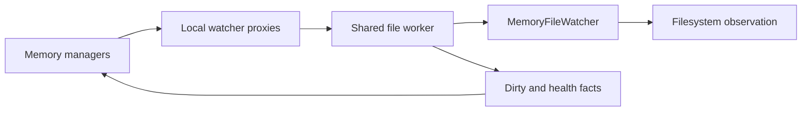

Codex review: needs changes before merge.

## What this changes

This PR moves local Memory filesystem discovery, observation, and settling into one shared worker while keeping indexing on the Gateway.

**Example:** Two agents watch the same memory directory containing 50,000 files.
- **Before:** Filesystem observation runs on the Gateway thread, where directory traversal can delay other work.
- **After:** A shared worker runs observation and sends each agent dirty notifications, settled changes, and health facts.

## Review scores

| Measure | Result | What it means |
|---|---|---|
| **Overall readiness** | 🦪 silver shellfish **(2/6)** | The direction is useful and ownership remains coherent, but two concrete repairs remain and successful execution evidence is pending. |
| **Proof confidence** | 🦪 silver shellfish **(2/6)** | The ordinary contributor proof gate is exempt for this maintainer-authored PR; its body still marks native scale measurements and execution pending, and CI annotations establish failures rather than a successful after-fix run. |
| **Patch quality** | 🦪 silver shellfish **(2/6)** | 2 actionable review findings remain. |

## Product

**Kind:** Performance · **Worth it:** Yes · **Fix scope:** Complete
**User problem:** Large Memory trees can stall unrelated Gateway work while filesystem observation traverses directories.
**Reason:** The maintainer-authored direction addresses measured residual work, reuses existing owners, and adds no user configuration or persisted format.

## Merge readiness

⛔ **Needs changes before merge - 2 items remain**

Keep open: moving filesystem observation off-thread addresses a documented Gateway stall source, but failed-transport recovery and the shared manager test fixture need repair.

**Priority:** P2
**Reviewed head:** `dac4cda68028b0056e8ab2a1e2497c0cfca64f2f`

## Before merge

- [ ] **\[P2\] Release the failed singleton after its worker exits (P2)** - After a worker startup error or unexpected exit, remove() takes this branch and join() rejects without clearing owner.transport. Every later LocalMemoryFileWatcher therefore reuses the dead transport and add() throws the old error, including watchers for newly created agents or a subsequent in-process lifecycle. The new replacement test explicitly pins this permanent failure. Once physical exit is confirmed, release the global transport slot while preserving rejected close results on the affected instances; a future watcher should be able to create a fresh worker.
- [ ] **\[P2\] Migrate the shared manager fixture across the worker boundary (P2)** - Switching every local manager to this proxy leaves the shared indexing fixture behind: test-runtime-mocks.ts still mocks file-access-runtime in the Vitest process to suppress physical observation, but that mock cannot reach the new worker. The patch adapts three watcher suites individually while manager-index.test-support.ts consumers still launch uncontrolled real workers. Exact-head CI reports worker exit failures during keyword retrieval, temporal ranking, shadow-write, and chunking-upgrade manager preparation. Update the shared explicit-sync fixture to retain its controlled observation contract, as the adapted watcher suites do, and keep actual worker execution in the dedicated integration test.

## Findings

- [P2] [P2] Release the failed singleton after its worker exits — `extensions/memory-core/src/memory/local-file-watcher.ts:79-81`
- [P2] [P2] Migrate the shared manager fixture across the worker boundary — `extensions/memory-core/src/memory/manager-watch-ops.ts:72`

### Tests

- Missing end-to-end proof: The posted evidence contains no completed large-tree Gateway run demonstrating off-thread observation, edit-driven indexing, and joined shutdown at this head.

<strong>Agent review details</strong>

### How this fits together

Memory managers send workspace paths and watcher settings through a local message port; the existing MemoryFileWatcher observes files and returns facts that drive Gateway-owned indexing.

### Technical review

Best possible solution:

Keep the shared-worker design, release exited transports for future watcher instances, and migrate the shared manager fixture to the new observation boundary.

Do we have a high-confidence way to reproduce the issue?

Current main constructs observation on the Gateway thread, and prior measured evidence establishes remaining initial-scan work; the failed-transport path is source-reproducible and existing manager failures appear in exact-head CI annotations.

Is this the best way to solve the issue?

Reusing the existing watcher inside a shared file worker is a focused solution that preserves root sharing and host-owned indexing, provided failure retirement and test fixtures complete the cutover.

Full review comments:

- [P2] [P2] Release the failed singleton after its worker exits — `extensions/memory-core/src/memory/local-file-watcher.ts:79-81`
  After a worker startup error or unexpected exit, remove() takes this branch and join() rejects without clearing owner.transport. Every later LocalMemoryFileWatcher therefore reuses the dead transport and add() throws the old error, including watchers for newly created agents or a subsequent in-process lifecycle. The new replacement test explicitly pins this permanent failure. Once physical exit is confirmed, release the global transport slot while preserving rejected close results on the affected instances; a future watcher should be able to create a fresh worker.
  Confidence: 0.99
- [P2] [P2] Migrate the shared manager fixture across the worker boundary — `extensions/memory-core/src/memory/manager-watch-ops.ts:72`
  Switching every local manager to this proxy leaves the shared indexing fixture behind: test-runtime-mocks.ts still mocks file-access-runtime in the Vitest process to suppress physical observation, but that mock cannot reach the new worker. The patch adapts three watcher suites individually while manager-index.test-support.ts consumers still launch uncontrolled real workers. Exact-head CI reports worker exit failures during keyword retrieval, temporal ranking, shadow-write, and chunking-upgrade manager preparation. Update the shared explicit-sync fixture to retain its controlled observation contract, as the adapted watcher suites do, and keep actual worker execution in the dedicated integration test.
  Confidence: 0.94

Overall correctness: patch is incorrect
Overall confidence: 0.94

AGENTS.md: found and applied where relevant.

Codex review notes: model internal, reasoning medium; reviewed against [82d97d2fada9](https://github.com/openclaw/openclaw/commit/82d97d2fada961b765957fb4ff862e81816d7a6f).

### Provenance checked

- `Standalone watcher and packaged Memory worker` keeps the original intent (https://github.com/openclaw/openclaw/pull/152631: Separate filesystem watching from indexing so local managers and workspace workers can reuse one implementation; the packaged worker followed in https://github.com/openclaw/openclaw/pull/153124.)
- `Shared roots and unchanged-selection reuse` keeps the original intent (68166d8e61e94ce46aeeed9fe439e82e7da7114f: Avoid repeated scans of common roots while preserving individual selections, failure isolation, and joined final close; subsequent unchanged-selection reuse remains intact.)
- `Dirty delivery and indexing completion` changes intended behavior with a stated reason (9b19fe8e296f16c8ab0e4d25a13c98d41b417392: Preserve edits arriving during indexing and join accepted work; this PR explains its asynchronous notification delivery and newer-dirty invalidation of queued settled readiness.)

### Testing

Proof path: none.

### Security

None.

### Evidence

Acceptance criteria:

- pnpm test extensions/memory-core/src/memory/local-file-watcher.test.ts --maxWorkers=1
- pnpm test extensions/memory-core/src/memory/local-file-watcher.integration.test.ts --maxWorkers=1
- pnpm test extensions/memory-core/src/memory/manager-keyword-retrieval.test.ts extensions/memory-core/src/memory/manager-temporal-ranking.test.ts extensions/memory-core/src/memory/manager-shadow-write.test.ts extensions/memory-core/src/chunking-upgrade-real-transport.test.ts --maxWorkers=1
- pnpm check:changed
- git diff --check

What I checked:

- **Introduced change and current-main boundary:** The pinned introduced diff replaces direct MemoryFileWatcher construction with LocalMemoryFileWatcher; fetched main still constructs the watcher directly. ([`extensions/memory-core/src/memory/manager-watch-ops.ts:72`](https://github.com/openclaw/openclaw/blob/dac4cda68028b0056e8ab2a1e2497c0cfca64f2f/extensions/memory-core/src/memory/manager-watch-ops.ts#L72), [dac4cda68028](https://github.com/openclaw/openclaw/commit/dac4cda68028b0056e8ab2a1e2497c0cfca64f2f))
- **Failed transport remains globally installed:** Failure-path removal returns join() without clearing owner.transport, and join() rejects after confirmed exit; the added test explicitly expects a replacement watcher to inherit that failure. ([`extensions/memory-core/src/memory/local-file-watcher.ts:79`](https://github.com/openclaw/openclaw/blob/dac4cda68028b0056e8ab2a1e2497c0cfca64f2f/extensions/memory-core/src/memory/local-file-watcher.ts#L79), [dac4cda68028](https://github.com/openclaw/openclaw/commit/dac4cda68028b0056e8ab2a1e2497c0cfca64f2f))
- **Existing manager fixture loses observation control:** test-runtime-mocks.ts provides an in-process observation mock for explicit-sync tests, but the new worker cannot receive that mock; only three watcher suites are adapted by this patch. ([`extensions/memory-core/src/memory/test-runtime-mocks.ts:10`](https://github.com/openclaw/openclaw/blob/dac4cda68028b0056e8ab2a1e2497c0cfca64f2f/extensions/memory-core/src/memory/test-runtime-mocks.ts#L10), [dac4cda68028](https://github.com/openclaw/openclaw/commit/dac4cda68028b0056e8ab2a1e2497c0cfca64f2f))
- **CI exercises the introduced failure:** Exact-head annotations report Memory file worker exited unexpectedly (1) during keyword retrieval, temporal ranking, shadow-write, and chunking-upgrade manager preparation; an example is https://github.com/openclaw/openclaw/actions/runs/39006602171/job/117320497705. ([`extensions/memory-core/src/memory/local-file-watcher.ts:46`](https://github.com/openclaw/openclaw/blob/dac4cda68028b0056e8ab2a1e2497c0cfca64f2f/extensions/memory-core/src/memory/local-file-watcher.ts#L46), [dac4cda68028](https://github.com/openclaw/openclaw/commit/dac4cda68028b0056e8ab2a1e2497c0cfca64f2f))
- **Earlier optimization leaves initial scanning:** https://github.com/openclaw/openclaw/pull/174616 documents measured synchronous filesystem work during initial setup after removing redundant membership rescans; this PR addresses that remaining execution boundary. ([`extensions/memory-core/src/memory/file-watcher.ts:158`](https://github.com/openclaw/openclaw/blob/1c09c1c3f064c5517f871878a688f4a5099df66e/extensions/memory-core/src/memory/file-watcher.ts#L158), [1c09c1c3f064](https://github.com/openclaw/openclaw/commit/1c09c1c3f064c5517f871878a688f4a5099df66e))
- **Accepted scheduling tradeoffs:** The maintainer-authored body explicitly accepts asynchronous dirty delivery and worker-side settling during host indexing; these choices do not require another product decision. ([`extensions/memory-core/src/memory/local-file-watcher.ts:202`](https://github.com/openclaw/openclaw/blob/dac4cda68028b0056e8ab2a1e2497c0cfca64f2f/extensions/memory-core/src/memory/local-file-watcher.ts#L202), [dac4cda68028](https://github.com/openclaw/openclaw/commit/dac4cda68028b0056e8ab2a1e2497c0cfca64f2f))

Likely related people:

- **Peter Steinberger:** Raw commit 1c09c1c3f064c5517f871878a688f4a5099df66e adds extensions/memory-core/src/memory/file-watcher.ts:130 relative to its recorded parents. This identifies author metadata, not feature responsibility or a PR merger. (role: source-line author; confidence: high; commits: [1c09c1c3f064](https://github.com/openclaw/openclaw/commit/1c09c1c3f064c5517f871878a688f4a5099df66e); files: `extensions/memory-core/src/memory/file-watcher.ts`)
- **Eric Cai:** Raw commit 68166d8e61e94ce46aeeed9fe439e82e7da7114f adds extensions/memory-core/src/memory/file-watcher.ts:130 relative to its recorded parents. This identifies author metadata, not feature responsibility or a PR merger. (role: source-line author; confidence: high; commits: [68166d8e61e9](https://github.com/openclaw/openclaw/commit/68166d8e61e94ce46aeeed9fe439e82e7da7114f); files: `extensions/memory-core/src/memory/file-watcher.ts`)
- **Vincent Koc:** Raw commit 9b19fe8e296f16c8ab0e4d25a13c98d41b417392 adds extensions/memory-core/src/memory/manager-watch-ops.ts:71 relative to its recorded parents. This identifies author metadata, not feature responsibility or a PR merger. (role: source-line author; confidence: high; commits: [9b19fe8e296f](https://github.com/openclaw/openclaw/commit/9b19fe8e296f16c8ab0e4d25a13c98d41b417392); files: `extensions/memory-core/src/memory/manager-watch-ops.ts`)

### PR surface

Source +435, Tests +753, Docs +7. Total +1195 across 15 files. Added test files: 3.

View PR surface stats

| Area | Files | Added | Removed | Net |
|---|---:|---:|---:|---:|
| Source | 8 | 451 | 16 | +435 |
| Tests | 6 | 753 | 0 | +753 |
| Docs | 1 | 7 | 0 | +7 |
| Config | 0 | 0 | 0 | 0 |
| Generated | 0 | 0 | 0 | 0 |
| Other | 0 | 0 | 0 | 0 |
| **Total** | **15** | **1211** | **16** | **+1195** |

### Review metrics

| Metric | Value | Why it matters |
|---|---|---|
| **Production versus test LOC** | Production +451/-16; tests +753 | Growth implements the local message transport and lifecycle while retaining one filesystem observation owner; the tests cover distinct client, server, and native-worker boundaries. |

### Labels

Label changes:

- add `P2`: This is a useful performance improvement with focused transport-recovery and test-fixture defects; search-triggered refresh remains available after watcher failure.
- add `rating: 🦪 silver shellfish`: Overall readiness is 🦪 silver shellfish; proof is 🦪 silver shellfish and patch quality is 🦪 silver shellfish.
- add `status: ⏳ waiting on author`: ClawSweeper has contributor-facing work open and is waiting for author action.

Label justifications:

- `P2`: This is a useful performance improvement with focused transport-recovery and test-fixture defects; search-triggered refresh remains available after watcher failure.
- `rating: 🦪 silver shellfish`: Overall readiness is 🦪 silver shellfish; proof is 🦪 silver shellfish and patch quality is 🦪 silver shellfish.
- `status: ⏳ waiting on author`: ClawSweeper has contributor-facing work open and is waiting for author action.

### Rating scale

6/6 🦀 challenger crab · 5/6 🦞 diamond lobster · 4/6 🐚 platinum hermit · 3/6 🦐 gold shrimp · 2/6 🦪 silver shellfish · 1/6 🧂 unranked krab. Overall follows the weaker of proof and patch quality; ✨ marks media proof (a screenshot, video, or linked artifact) that directly shows the changed behavior.

### Workflow

ClawSweeper edits this one comment on every review. Comment `@clawsweeper re-review` for a fresh review only. Repair and merge execution lanes are retired.

_Reviewed October 17, 2026, 1:48 AM ET / 05:48 UTC._

<!-- clawsweeper-verdict:needs-changes item=175157 sha=dac4cda68028b0056e8ab2a1e2497c0cfca64f2f confidence=high updated_at=2026-10-17T05:43:16Z reviewed_at=2026-10-17T05:48:01.051Z lease_owner=github-run-39007233101-1 lease_comment_id=6230305612 source_revision=6695f60e5004af0e10b8a4bebc6a9246fb132957c8f45af70b5b1ed43d4e5e62 -->
<!-- clawsweeper-review-state:needs-changes item=175157 sha=dac4cda68028b0056e8ab2a1e2497c0cfca64f2f v=1 -->

<!-- clawsweeper-review-version item=175157 reviewed_at=2026-10-17T05:48:01.051Z sha=dac4cda68028b0056e8ab2a1e2497c0cfca64f2f source_revision=6695f60e5004af0e10b8a4bebc6a9246fb132957c8f45af70b5b1ed43d4e5e62 lease_owner=github-run-39007233101-1 lease_comment_id=6230305612 v=1 -->

<!-- clawsweeper-review item=175157 -->