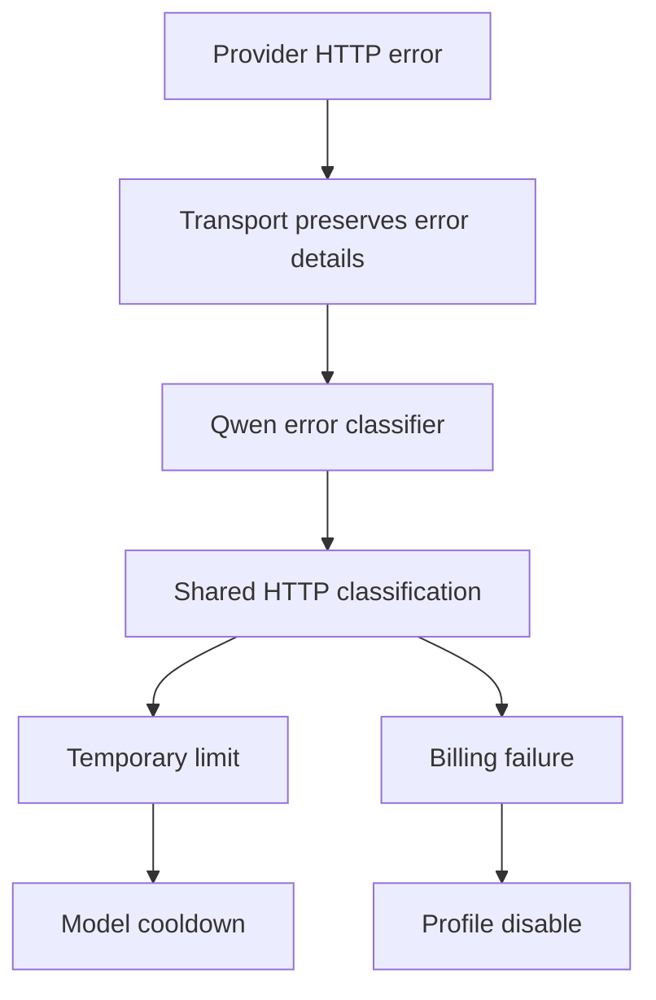

Codex review: needs maintainer review before merge. _Reviewed September 19, 2026, 11:24 AM ET / 15:24 UTC (Revision 3)._

# ClawSweeper review

## What this changes

The PR distinguishes Qwen token throttling from billing failures so temporary limits cool down the affected model instead of disabling its saved profile.

## Merge readiness

✅ **Ready for maintainer review**

This fix remains necessary on current main. The earlier OpenRouter finding is resolved, the production-path evidence supports the correction, and no remaining actionable defect was found.

**Priority:** P1
**Reviewed head:** `b254db6952bff42aa0148a6b6debaa841f5257ef`

## Review scores

| Measure | Result | What it means |
|---|---|---|
| **Overall readiness** | 🐚 platinum hermit **(4/6)** | A focused, well-supported fix with the prior compatibility defect corrected and no remaining blocking finding. |
| **Proof confidence** | 🦞 diamond lobster **(5/6)** | Sufficient (terminal): Current-head loopback HTTP evidence exercises registered Qwen/OpenRouter providers through the real transport, failure owner, and profile writer/readers, showing model-scoped throttling and preserved billing controls. Earlier complete Qwen agentCommand traces additionally establish automatic provider loading and persisted session outcomes; they are historical, not a claimed current-head rerun. |
| **Patch quality** | 🐚 platinum hermit **(4/6)** | No actionable review findings were identified. |

## Verification

| Check | Result | Evidence |
|---|---|---|
| **Real behavior** | Verified | Sufficient (terminal): Current-head loopback HTTP evidence exercises registered Qwen/OpenRouter providers through the real transport, failure owner, and profile writer/readers, showing model-scoped throttling and preserved billing controls. Earlier complete Qwen agentCommand traces additionally establish automatic provider loading and persisted session outcomes; they are historical, not a claimed current-head rerun. |
| **Evidence reviewed** | 9 items | Introduced production change: The pinned merge-base-to-head change adds a Qwen classifier registered for Qwen, Qwen Token Plan, and legacy Bailian Token Plan. It requires HTTP 429 and recognized structured evidence before refining allocation errors. Prior finding resolved: The GitHub commit patch confirms the correction restricts provider precedence to billing or rate_limit. Current tests cover OpenRouter’s generic timeout hook, nested upstream billing, and explicit key-budget billing without local profile-health writes. Current main still needs the fix: Fetched main retains the generic HTTP 429 billing precedence and has no Qwen classification hook in its provider registrations. |
| **Findings** | None | None. |
| **Security** | None | None. |

## How this fits together

Provider errors feed OpenClaw’s failover classifier, which determines retry and saved-profile health. The Qwen plugin supplies vendor-specific error meanings while shared recovery code applies cooldowns or billing disables.

## Before merge

None.

<strong>Agent review details</strong>

### Security

None.

### PR surface

Source +48, Tests +551. Total +599 across 6 files.

View PR surface stats

| Area | Files | Added | Removed | Net |
|---|---:|---:|---:|---:|
| Source | 3 | 48 | 0 | +48 |
| Tests | 3 | 551 | 0 | +551 |
| Docs | 0 | 0 | 0 | 0 |
| Config | 0 | 0 | 0 | 0 |
| Generated | 0 | 0 | 0 | 0 |
| Other | 0 | 0 | 0 | 0 |
| **Total** | **6** | **599** | **0** | **+599** |

### Review metrics

None.

### Root-cause cluster

Relationship: `fixed_by_candidate`
Canonical: https://github.com/openclaw/openclaw/issues/148236
Summary: This PR is a candidate fix for the reported Qwen allocation-throttling misclassification; another open PR addresses the same cause through shared core rules.

Members:
- `canonical`: https://github.com/openclaw/openclaw/issues/148236 - Defines the exact provider response and incorrect profile-disable outcome.
- `same_root_cause`: https://github.com/openclaw/openclaw/pull/148275 - Addresses the same report using a different classification boundary and remains unmerged.

Proposal only: this assessment does not dispatch repair, suppress jobs, mutate sibling items, close, or merge anything.

### Technical review

Best possible solution:

Keep Qwen error semantics in its existing provider hook and reuse shared cooldown handling while preserving genuine billing and OpenRouter behavior.

Do we have a high-confidence way to reproduce the issue?

Yes, source establishes the failure path: a documented Qwen HTTP 429 insufficient_quota response reaches generic billing classification and profile disable. This read-only review did not execute a current-main reproduction.

Is this the best way to solve the issue?

Yes. The patch uses the existing provider-owned classification hook and a narrow shared precedence correction, with controls for genuine billing and other providers.

AGENTS.md: found and applied where relevant.

Codex review notes: model internal, reasoning medium; reviewed against [779e6cfc04bc](https://github.com/openclaw/openclaw/commit/779e6cfc04bc8b8435b8f8466d68dbe73ab96e2c).

### Labels

Label justifications:

- `P1`: Documented temporary Qwen limits can currently disable otherwise usable profiles and interrupt agent replies.
- `rating: 🐚 platinum hermit`: Overall readiness is 🐚 platinum hermit; proof is 🦞 diamond lobster and patch quality is 🐚 platinum hermit.
- `status: 👀 ready for maintainer look`: ClawSweeper has no concrete contributor-facing blocker left for this PR. Sufficient (terminal): Current-head loopback HTTP evidence exercises registered Qwen/OpenRouter providers through the real transport, failure owner, and profile writer/readers, showing model-scoped throttling and preserved billing controls. Earlier complete Qwen agentCommand traces additionally establish automatic provider loading and persisted session outcomes; they are historical, not a claimed current-head rerun.
- `proof: sufficient`: Contributor real behavior proof is sufficient. Current-head loopback HTTP evidence exercises registered Qwen/OpenRouter providers through the real transport, failure owner, and profile writer/readers, showing model-scoped throttling and preserved billing controls. Earlier complete Qwen agentCommand traces additionally establish automatic provider loading and persisted session outcomes; they are historical, not a claimed current-head rerun.

### Evidence

What I checked:

- **Introduced production change:** The pinned merge-base-to-head change adds a Qwen classifier registered for Qwen, Qwen Token Plan, and legacy Bailian Token Plan. It requires HTTP 429 and recognized structured evidence before refining allocation errors. ([`extensions/qwen/failover.ts:7`](https://github.com/openclaw/openclaw/blob/b254db6952bff42aa0148a6b6debaa841f5257ef/extensions/qwen/failover.ts#L7), [b254db6952bf](https://github.com/openclaw/openclaw/commit/b254db6952bff42aa0148a6b6debaa841f5257ef))
- **Prior finding resolved:** The GitHub commit patch confirms the correction restricts provider precedence to billing or rate_limit. Current tests cover OpenRouter’s generic timeout hook, nested upstream billing, and explicit key-budget billing without local profile-health writes. ([`src/agents/failover/classification-rules.ts:213`](https://github.com/openclaw/openclaw/blob/b254db6952bff42aa0148a6b6debaa841f5257ef/src/agents/failover/classification-rules.ts#L213), [b254db6952bf](https://github.com/openclaw/openclaw/commit/b254db6952bff42aa0148a6b6debaa841f5257ef))
- **Current main still needs the fix:** Fetched main retains the generic HTTP 429 billing precedence and has no Qwen classification hook in its provider registrations. ([`src/agents/failover/classification-rules.ts:212`](https://github.com/openclaw/openclaw/blob/779e6cfc04bc8b8435b8f8466d68dbe73ab96e2c/src/agents/failover/classification-rules.ts#L212), [779e6cfc04bc](https://github.com/openclaw/openclaw/commit/779e6cfc04bc8b8435b8f8466d68dbe73ab96e2c))
- **Latest release comparison:** The v2026.9.5 file retrieved through GitHub’s contents API also retains the old HTTP 429 branch; this review does not identify a shipped fix. ([`src/agents/failover/classification-rules.ts`](https://github.com/openclaw/openclaw/blob/ec9c1a13db8938e5a3eaa51fca2e981cde2395a9/src/agents/failover/classification-rules.ts), [ec9c1a13db89](https://github.com/openclaw/openclaw/commit/ec9c1a13db8938e5a3eaa51fca2e981cde2395a9))
- **Vendor error contract:** The [Alibaba error reference](https://www.alibabacloud.com/help/en/model-studio/error-code) identifies the matched allocation messages as TPS/TPM throttling, separately distinguishes exhausted free allocation, and documents both overdue-bill codes under HTTP 429.
- **Inspected runtime evidence:** Read the complete PR body and verified SHA-256 794fb4c61cdfe22d38d3d8ac97d7f302622df63ec2be2d2edc6e4a9548cd5b09 matches the supplied snapshot. Its current-head evidence reports 12 real HTTP/failure/state cases and 8 classifier cases passing. The source uses registered providers, the production transport, failure controller, and independent SQLite/profile readback. Earlier complete agentCommand evidence remains explicitly historical; no contributor scripts or tests were executed during this review. ([`test/plugins/qwen-dashscope-throttle.integration.test.ts:97`](https://github.com/openclaw/openclaw/blob/b254db6952bff42aa0148a6b6debaa841f5257ef/test/plugins/qwen-dashscope-throttle.integration.test.ts#L97), [b254db6952bf](https://github.com/openclaw/openclaw/commit/b254db6952bff42aa0148a6b6debaa841f5257ef))

Likely related people:

- **unknown:** The claimed source-line change could not be verified from bounded local history. (role: source history unknown; confidence: low)
- **obviyus:** Suggested for follow-up; no historical authorship or introduction is verified. (role: unverified routing candidate; confidence: low)

### Rating scale

| Score | Internal tier | Crab rank | Meaning |
|---:|:---:|---|---|
| **6/6** | S | 🦀 challenger crab | Exceptional readiness |
| **5/6** | A | 🦞 diamond lobster | Very strong readiness |
| **4/6** | B | 🐚 platinum hermit | Good normal PR; ordinary maintainer review |
| **3/6** | C | 🦐 gold shrimp | Useful, but confidence is limited |
| **2/6** | D | 🦪 silver shellfish | Proof or implementation needs work |
| **1/6** | F | 🧂 unranked krab | Not merge-ready |
| N/A | NA | 🌊 off-meta tidepool | Rating does not apply |

Overall follows the weaker of proof and patch quality.
Shiny media proof means a screenshot, video, or linked artifact directly shows the changed behavior. Runtime, network, CSP, and security claims still need visible diagnostics.

### Workflow

- ClawSweeper keeps one durable marker-backed review comment per issue or PR.
- Re-runs edit this comment so the latest verdict, findings, and automation markers stay together instead of adding duplicate bot comments.
- A fresh review can be triggered by eligible `@clawsweeper re-review` comments, exact-item GitHub events, scheduled/background review runs, or manual workflow dispatch.
- PR/issue authors and users with repository write access can comment `@clawsweeper re-review` or `@clawsweeper re-run` on an open PR or issue to request a fresh review only.
- Maintainers can also comment `@clawsweeper review` to request a fresh review only.
- Fresh-review commands do not start repair, autofix, rebase, CI repair, or automerge.
- Maintainer-only repair and merge flows require explicit commands such as `@clawsweeper autofix`, `@clawsweeper automerge`, `@clawsweeper fix ci`, or `@clawsweeper address review`.
- Maintainers can comment `@clawsweeper explain` to ask for more context, or `@clawsweeper stop` to stop active automation.

### History

Review history (2 earlier review cycles)

<!-- clawsweeper-review-history v=1 total=2 -->
- reviewed 2026-09-19T05:04:33.207Z sha 533c63e17af70624b7de28b96221b929d3f2cc23 :: blocked before merge. :: [P2] Preserve OpenRouter’s 429 handling when its generic hook returns timeout
- reviewed 2026-09-19T09:42:19.055Z sha b254db6952bff42aa0148a6b6debaa841f5257ef :: needs maintainer review before merge. :: none

<!-- clawsweeper-verdict:needs-human item=152521 sha=b254db6952bff42aa0148a6b6debaa841f5257ef confidence=high updated_at=2026-09-19T15:21:03Z reviewed_at=2026-09-19T15:24:12.700Z lease_owner=github-run-35451444946-1 lease_comment_id=5743012535 source_revision=d9370631e9e3ecf58c2cccee4adee7b93fe3a61b66dd102ee894cbd69024528e live_verification=absent -->
<!-- clawsweeper-review-state:ready item=152521 sha=b254db6952bff42aa0148a6b6debaa841f5257ef v=1 -->

<!-- clawsweeper-review-version item=152521 reviewed_at=2026-09-19T15:24:12.700Z sha=b254db6952bff42aa0148a6b6debaa841f5257ef source_revision=d9370631e9e3ecf58c2cccee4adee7b93fe3a61b66dd102ee894cbd69024528e lease_owner=github-run-35451444946-1 lease_comment_id=5743012535 v=1 -->

<!-- clawsweeper-review item=152521 -->