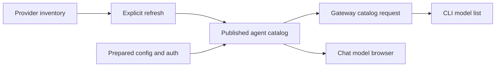

Codex review: blocked before merge. _Reviewed September 8, 2026, 7:12 AM ET / 11:12 UTC._

# ClawSweeper review

## What this changes

Model browsing reads published Gateway inventory, explicit refresh acquires provider models, and the CLI’s separate catalog and passive promotion paths are removed.

## Merge readiness

⛔ **Blocked before merge - 4 items remain**

This remains useful work: current main still maintains the separate CLI inventory pipeline. The earlier findings are addressed, and no new blocking defect was identified. The documented compatibility cutover remains intentional.

**Priority:** P2
**Reviewed head:** `f7e534024fdc8c62775d8c6249a1626d34e2362c`

## Review scores

| Measure | Result | What it means |
|---|---|---|
| **Overall readiness** | 🐚 platinum hermit **(4/6)** | A coherent consolidation with relevant real-run observations, retained boundary coverage, and no outstanding actionable finding. |
| **Proof confidence** | 🐚 platinum hermit **(4/6)** | Sufficient (live_output): The captured real Gateway and CLI observations exercise passive reads, explicit acquisition, failure retention, successful empty results, selected-agent isolation, and capability rejection through the changed production owners. The compiled continuation predates only two test edits and an unused export removal; separate raw traces were not supplied for independent inspection. |
| **Patch quality** | 🐚 platinum hermit **(4/6)** | No actionable review findings were identified. |

## Verification

| Check | Result | Evidence |
|---|---|---|
| **Real behavior** | Verified | Sufficient (live_output): The captured real Gateway and CLI observations exercise passive reads, explicit acquisition, failure retention, successful empty results, selected-agent isolation, and capability rejection through the changed production owners. The compiled continuation predates only two test edits and an unused export removal; separate raw traces were not supplied for independent inspection. |
| **Evidence reviewed** | 11 items | Current main still needs the change: The fetched main revision retains the CLI registry, row-composition, and passive promotion pipelines; its advertised capabilities omit published-model-catalog. Published reads and currentness: Discovery is conditional on explicit refresh, ordinary requests read the published owner, requester-profile projection remains present, and the result rejects a superseded owner before returning. Earlier findings resolved: Explicit CLI refresh now receives a 210-second acquisition deadline, and the plugin-runtime test places its catalog loader inside the Gateway context. The latest commit changes two tests and removes an unused export, consistent with carrying forward the earlier compiled production proof. |
| **Findings** | None | None. |
| **Security** | None | None. |

## How this fits together

The model catalog combines provider inventory with an agent’s prepared configuration and authentication facts. The Gateway publishes that inventory to CLI and chat readers, which project model choices without starting ordinary discovery.

## Before merge

- [ ] **Resolve merge risk (P1)** - Updating the CLI before the selected Gateway makes models list fail capability negotiation, including against v2026.9.2; the documented rollout requires Gateway-first deployment.
- [ ] **Resolve merge risk (P1)** - CLI JSON consumers relying on the removed missing field must accommodate the new output contract.
- [ ] **Review config compatibility** - Confirm compatibility and upgrade impact for the changed config or default surface before merge.
- [ ] **Add data-model compatibility proof** - Confirm migration or upgrade compatibility proof before merge.

<strong>Agent review details</strong>

### Security

None.

### PR surface

PR surface statistics unavailable: the file list is incomplete.

### Review metrics

| Metric | Value | Why it matters |
|---|---|---|
| **Catalog interface changes** | 1 CLI flag, 2 RPC inputs, 2 optional result fields | The refresh control and richer Gateway inventory establish the capability-negotiated client contract. |

### Stored data model

Persistent data-model change detected: `database schema: src/infra/clawhub-promotions.ts`, `serialized state: config/assertion-safety-baseline.txt`, `serialized state: src/commands/models/list.auth-index.ts`, `serialized state: src/commands/models/list.scoped-catalog.ts`, `unknown-data-model-change: src/commands/models/list.auth-index.ts`, `unknown-data-model-change: src/commands/models/list.scoped-catalog.ts`, and 1 more. Confirm migration or upgrade compatibility proof before merge.

### Merge-risk options

**Maintainer options:**
1. **Use the documented immediate cutover (recommended)**  
   Retain the stated Gateway-first rollout and communicate the CLI JSON change without restoring a competing local inventory fallback.

### Technical review

Best possible solution:

Keep one published catalog owner for browsing and explicit acquisition, with the documented Gateway-first upgrade order and CLI output changes carried into rollout.

Do we have a high-confidence way to reproduce the issue?

Yes: current-main source retains discovery-capable browse paths and separate CLI inventory, and the supplied baseline observations report provider requests during cold browsing. This review did not execute that path.

Is this the best way to solve the issue?

Yes: reusing the published owner removes competing inventory construction while preserving paired auth and currentness checks; the compatibility change is explicitly documented.

AGENTS.md: found and applied where relevant.

Codex review notes: model internal, reasoning medium; reviewed against [6aeb8e46c089](https://github.com/openclaw/openclaw/commit/6aeb8e46c0898841dbb31de4b4fd2b9dd012e039).

### Labels

Label justifications:

- `P2`: This is a bounded catalog consistency and discovery improvement without an established urgent production outage.
- `merge-risk: 🚨 compatibility`: The CLI requires a newly advertised Gateway capability and removes the former missing field from JSON output.
- `rating: 🐚 platinum hermit`: Overall readiness is 🐚 platinum hermit; proof is 🐚 platinum hermit and patch quality is 🐚 platinum hermit.
- `status: 👀 ready for maintainer look`: ClawSweeper has no concrete contributor-facing blocker left for this PR. Sufficient (live_output): The captured real Gateway and CLI observations exercise passive reads, explicit acquisition, failure retention, successful empty results, selected-agent isolation, and capability rejection through the changed production owners. The compiled continuation predates only two test edits and an unused export removal; separate raw traces were not supplied for independent inspection.
- `proof: sufficient`: Contributor real behavior proof is sufficient. The captured real Gateway and CLI observations exercise passive reads, explicit acquisition, failure retention, successful empty results, selected-agent isolation, and capability rejection through the changed production owners. The compiled continuation predates only two test edits and an unused export removal; separate raw traces were not supplied for independent inspection.
- `proof: telegram-e2e`: This PR needs Telegram Test Server proof with the repository E2E skill. The shared /models command changes displayed inventory and adds explicit not-ready and retry replies observable in Telegram.

### Evidence

What I checked:

- **Current main still needs the change:** The fetched main revision retains the CLI registry, row-composition, and passive promotion pipelines; its advertised capabilities omit published-model-catalog. ([`src/commands/models/list.list-command.ts:1`](https://github.com/openclaw/openclaw/blob/6aeb8e46c0898841dbb31de4b4fd2b9dd012e039/src/commands/models/list.list-command.ts#L1), [6aeb8e46c089](https://github.com/openclaw/openclaw/commit/6aeb8e46c0898841dbb31de4b4fd2b9dd012e039))
- **Published reads and currentness:** Discovery is conditional on explicit refresh, ordinary requests read the published owner, requester-profile projection remains present, and the result rejects a superseded owner before returning. ([`src/gateway/server-methods/models-list-result.ts:252`](https://github.com/openclaw/openclaw/blob/f7e534024fdc8c62775d8c6249a1626d34e2362c/src/gateway/server-methods/models-list-result.ts#L252), [f7e534024fdc](https://github.com/openclaw/openclaw/commit/f7e534024fdc8c62775d8c6249a1626d34e2362c))
- **Earlier findings resolved:** Explicit CLI refresh now receives a 210-second acquisition deadline, and the plugin-runtime test places its catalog loader inside the Gateway context. The latest commit changes two tests and removes an unused export, consistent with carrying forward the earlier compiled production proof. ([`src/commands/models/list.list-command.ts:24`](https://github.com/openclaw/openclaw/blob/f7e534024fdc8c62775d8c6249a1626d34e2362c/src/commands/models/list.list-command.ts#L24), [f7e534024fdc](https://github.com/openclaw/openclaw/commit/f7e534024fdc8c62775d8c6249a1626d34e2362c))
- **Captured real behavior observations:** The supplied body at sourceRevision d0c04b278d7faef95f13f871b9538ab012e2ac4832ca18cc00e24137cf0ca940 reports actual Gateway cold reads changing from three synthetic-provider requests to zero, explicit acquisition, retained rows after failure, and empty results after successful empty acquisition. It also reports real selected-agent and standalone CLI runs, including missing-capability rejection before a catalog request. The compiled continuation used f12624aed3ee3bf2b67b63db0cc8769fc77d7e45; the earlier timed-out invocation remains disclosed. No separate raw observation artifact was available in the supplied scratch directory. ([f12624aed3ee](https://github.com/openclaw/openclaw/commit/f12624aed3ee3bf2b67b63db0cc8769fc77d7e45))
- **Stable-release compatibility boundary:** The v2026.9.2 capability list lacks published-model-catalog. The new CLI therefore rejects that selected Gateway with update/restart guidance, matching the body’s explicit Gateway-first cutover and docs/cli/models.md. ([`packages/gateway-protocol/src/server-capabilities.ts:2`](https://github.com/openclaw/openclaw/blob/3928bad9badfcb6c7d140530435e806fb8092190/packages/gateway-protocol/src/server-capabilities.ts#L2), [3928bad9badf](https://github.com/openclaw/openclaw/commit/3928bad9badfcb6c7d140530435e806fb8092190))
- **Native dependency signal and retained controls:** This changed test imports the Codex plugin and exercises account/read, model/list, account updates, rejected profile locks, disconnects, and registry replacement. That establishes the dependency signal for inspecting the actual Codex protocol; these synthetic-server tests remain supplemental proof. ([`test/plugins/codex-model-catalog.gateway.test.ts:12`](https://github.com/openclaw/openclaw/blob/f7e534024fdc8c62775d8c6249a1626d34e2362c/test/plugins/codex-model-catalog.gateway.test.ts#L12), [f7e534024fdc](https://github.com/openclaw/openclaw/commit/f7e534024fdc8c62775d8c6249a1626d34e2362c))

Likely related people:

- **obviyus:** Suggested for follow-up; no historical authorship or introduction is verified. (role: unverified routing candidate; confidence: low)
- **steipete:** Suggested for follow-up; no historical authorship or introduction is verified. (role: unverified routing candidate; confidence: low)

### Rating scale

| Score | Internal tier | Crab rank | Meaning |
|---:|:---:|---|---|
| **6/6** | S | 🦀 challenger crab | Exceptional readiness |
| **5/6** | A | 🦞 diamond lobster | Very strong readiness |
| **4/6** | B | 🐚 platinum hermit | Good normal PR; ordinary maintainer review |
| **3/6** | C | 🦐 gold shrimp | Useful, but confidence is limited |
| **2/6** | D | 🦪 silver shellfish | Proof or implementation needs work |
| **1/6** | F | 🧂 unranked krab | Not merge-ready |
| N/A | NA | 🌊 off-meta tidepool | Rating does not apply |

Overall follows the weaker of proof and patch quality.
Shiny media proof means a screenshot, video, or linked artifact directly shows the changed behavior. Runtime, network, CSP, and security claims still need visible diagnostics.

### Workflow

- ClawSweeper keeps one durable marker-backed review comment per issue or PR.
- Re-runs edit this comment so the latest verdict, findings, and automation markers stay together instead of adding duplicate bot comments.
- A fresh review can be triggered by eligible `@clawsweeper re-review` comments, exact-item GitHub events, scheduled/background review runs, or manual workflow dispatch.
- PR/issue authors and users with repository write access can comment `@clawsweeper re-review` or `@clawsweeper re-run` on an open PR or issue to request a fresh review only.
- Maintainers can also comment `@clawsweeper review` to request a fresh review only.
- Fresh-review commands do not start repair, autofix, rebase, CI repair, or automerge.
- Maintainer-only repair and merge flows require explicit commands such as `@clawsweeper autofix`, `@clawsweeper automerge`, `@clawsweeper fix ci`, or `@clawsweeper address review`.
- Maintainers can comment `@clawsweeper explain` to ask for more context, or `@clawsweeper stop` to stop active automation.

### History

Review history (4 earlier review cycles)

<!-- clawsweeper-review-history v=1 total=4 -->
- reviewed 2026-09-08T09:32:49.740Z sha 0ce026c830015b7fdb915da89a027b921f332d59 :: blocked before merge. :: [P2] Allow explicit refresh to complete within the acquisition lifetime | [P2] Move the loader override inside the Gateway context
- reviewed 2026-09-08T09:42:56.282Z sha 7bc2d1d22d0d64f77d3272161398e8d10f1fe89c :: blocked before merge. :: [P2] Allow explicit refresh to complete within the acquisition lifetime | [P2] Move the loader override inside the Gateway context
- reviewed 2026-09-08T10:21:45.424Z sha f12624aed3ee3bf2b67b63db0cc8769fc77d7e45 :: blocked before merge. :: none
- reviewed 2026-09-08T10:43:46.841Z sha f7e534024fdc8c62775d8c6249a1626d34e2362c :: blocked before merge. :: none

<!-- clawsweeper-verdict:needs-human item=142063 sha=f7e534024fdc8c62775d8c6249a1626d34e2362c confidence=high updated_at=2026-09-08T11:08:20Z reviewed_at=2026-09-08T11:12:15.747Z lease_owner=github-run-34218964429-1 lease_comment_id=5584193414 source_revision=d0c04b278d7faef95f13f871b9538ab012e2ac4832ca18cc00e24137cf0ca940 live_verification=absent -->
<!-- clawsweeper-review-state:blocked item=142063 sha=f7e534024fdc8c62775d8c6249a1626d34e2362c v=1 -->

<!-- clawsweeper-review-version item=142063 reviewed_at=2026-09-08T11:12:15.747Z sha=f7e534024fdc8c62775d8c6249a1626d34e2362c source_revision=d0c04b278d7faef95f13f871b9538ab012e2ac4832ca18cc00e24137cf0ca940 lease_owner=github-run-34218964429-1 lease_comment_id=5584193414 v=1 -->

<!-- clawsweeper-review item=142063 -->