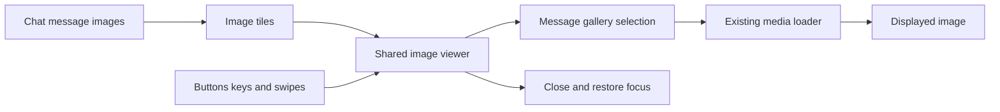

Codex review: needs maintainer review before merge. _Reviewed September 18, 2026, 3:07 PM ET / 19:07 UTC (Revision 3)._

# ClawSweeper review

## What this changes

Adds buttons, keyboard navigation, touch swipes, and a position counter for browsing one chat message’s images in the existing image viewer.

## Merge readiness

✅ **Ready for maintainer review**

This PR remains useful: current main lacks message-image navigation. The reviewed implementation and visual evidence support the change, and no blocking correctness or security finding was identified.

**Priority:** P3
**Reviewed head:** `a90e30fd107fde034e027f31ecce84311e124061`

## Review scores

| Measure | Result | What it means |
|---|---|---|
| **Overall readiness** | 🐚 platinum hermit **(4/6)** | A focused implementation with strong visual evidence, meaningful regression coverage, and no identified blocking defect. |
| **Proof confidence** | 🦞 diamond lobster **(5/6)** ✨ media proof bonus | Sufficient (screenshot): Inspected production-bundle desktop and mobile before/after screenshots show the shared viewer’s new navigation controls and counter. Browser and lifecycle tests supplement that visual proof; linked recordings were not independently inspected, and the body explicitly excludes physical-device coverage. |
| **Patch quality** | 🐚 platinum hermit **(4/6)** | No actionable review findings were identified. |

## Verification

| Check | Result | Evidence |
|---|---|---|
| **Real behavior** | Verified | Sufficient (screenshot): Inspected production-bundle desktop and mobile before/after screenshots show the shared viewer’s new navigation controls and counter. Browser and lifecycle tests supplement that visual proof; linked recordings were not independently inspected, and the body explicitly excludes physical-device coverage. |
| **Evidence reviewed** | 8 items | Verified review scope: Reviewed the pinned merge-base-to-head changes, not endpoint drift. The checkout is a90e30fd107fde034e027f31ecce84311e124061; the supplied stale test merge was not used to infer merge removals. Initial and final working-tree status were clean. Still necessary on main and latest release: Current main’s shared viewer accepts a single source and has no gallery navigation. Its file is unchanged from the supplied latest release, v2026.9.4. The linked open feature request remains the specific work this PR addresses. Message boundary and existing loading owner: The message renderer supplies its image list; opening a tile constructs loaders for that list. Gallery reads reuse existing managed-image and attachment-availability owners and the safe URL resolver. |
| **Findings** | None | None. |
| **Security** | None | None. |

## How this fits together

Control UI turns chat attachments into image tiles backed by the existing media loader. Opening a tile now supplies its message’s image list to the shared viewer, which manages selection, zoom, and neighboring image resources.

## Before merge

None.

<strong>Agent review details</strong>

### Security

None.

### PR surface

Source +562, Tests +570, Docs +8. Total +1140 across 30 files.

View PR surface stats

| Area | Files | Added | Removed | Net |
|---|---:|---:|---:|---:|
| Source | 25 | 1079 | 517 | +562 |
| Tests | 4 | 574 | 4 | +570 |
| Docs | 1 | 8 | 0 | +8 |
| Config | 0 | 0 | 0 | 0 |
| Generated | 0 | 0 | 0 | 0 |
| Other | 0 | 0 | 0 | 0 |
| **Total** | **30** | **1661** | **521** | **+1140** |

### Review metrics

| Metric | Value | Why it matters |
|---|---|---|
| **Production versus test growth** | Production +562 net lines; tests +570 net lines | Production growth implements gallery interaction and resource lifecycle; the body explains the accompanying style, transport, and type extractions. |

### Root-cause cluster

Relationship: `fixed_by_candidate`
Canonical: https://github.com/openclaw/openclaw/issues/151981
Summary: This PR implements the linked open gallery-navigation request; the merged video-overlay work is adjacent and distinct.

Members:
- `canonical`: https://github.com/openclaw/openclaw/issues/151981 - Defines the same message-scoped navigation behavior and is explicitly linked by this PR.
- `adjacent_distinct`: https://github.com/openclaw/openclaw/pull/132131 - Merged video expansion shares the overlay but does not provide image-gallery navigation.

Proposal only: this assessment does not dispatch repair, suppress jobs, mutate sibling items, close, or merge anything.

### Technical review

Best possible solution:

Keep message-scoped navigation in the existing viewer, with media loading and access decisions retained by their current owners.

Do we have a high-confidence way to reproduce the issue?

Not applicable as a defect reproduction: this adds a capability, and current-main source confirms the existing viewer lacks gallery navigation.

Is this the best way to solve the issue?

Yes. Extending the shared viewer and reusing the media loader is a focused solution that avoids a second preview or access-control implementation.

AGENTS.md: found and applied where relevant.

Codex review notes: model internal, reasoning medium; reviewed against [a2505062600c](https://github.com/openclaw/openclaw/commit/a2505062600c86e0c8873ec4e66735def01faf9e).

### Labels

Label justifications:

- `P3`: This improves image-browsing ergonomics without addressing a blocked core workflow.
- `rating: 🐚 platinum hermit`: Overall readiness is 🐚 platinum hermit; proof is 🦞 diamond lobster and patch quality is 🐚 platinum hermit.
- `status: 👀 ready for maintainer look`: ClawSweeper has no concrete contributor-facing blocker left for this PR. Sufficient (screenshot): Inspected production-bundle desktop and mobile before/after screenshots show the shared viewer’s new navigation controls and counter. Browser and lifecycle tests supplement that visual proof; linked recordings were not independently inspected, and the body explicitly excludes physical-device coverage.
- `proof: sufficient`: Contributor real behavior proof is sufficient. Inspected production-bundle desktop and mobile before/after screenshots show the shared viewer’s new navigation controls and counter. Browser and lifecycle tests supplement that visual proof; linked recordings were not independently inspected, and the body explicitly excludes physical-device coverage.
- `proof: 📸 screenshot`: Contributor real behavior proof includes screenshot evidence. Inspected production-bundle desktop and mobile before/after screenshots show the shared viewer’s new navigation controls and counter. Browser and lifecycle tests supplement that visual proof; linked recordings were not independently inspected, and the body explicitly excludes physical-device coverage.

### Evidence

What I checked:

- **Verified review scope:** Reviewed the pinned merge-base-to-head changes, not endpoint drift. The checkout is a90e30fd107fde034e027f31ecce84311e124061; the supplied stale test merge was not used to infer merge removals. Initial and final working-tree status were clean. ([a90e30fd107f](https://github.com/openclaw/openclaw/commit/a90e30fd107fde034e027f31ecce84311e124061))
- **Still necessary on main and latest release:** Current main’s shared viewer accepts a single source and has no gallery navigation. Its file is unchanged from the supplied latest release, v2026.9.4. The linked open feature request remains the specific work this PR addresses. ([`ui/src/components/image-lightbox.ts:35`](https://github.com/openclaw/openclaw/blob/a2505062600c86e0c8873ec4e66735def01faf9e/ui/src/components/image-lightbox.ts#L35), [a2505062600c](https://github.com/openclaw/openclaw/commit/a2505062600c86e0c8873ec4e66735def01faf9e))
- **Message boundary and existing loading owner:** The message renderer supplies its image list; opening a tile constructs loaders for that list. Gallery reads reuse existing managed-image and attachment-availability owners and the safe URL resolver. ([`ui/src/pages/chat/components/chat-message-images.ts:390`](https://github.com/openclaw/openclaw/blob/a90e30fd107fde034e027f31ecce84311e124061/ui/src/pages/chat/components/chat-message-images.ts#L390), [a90e30fd107f](https://github.com/openclaw/openclaw/commit/a90e30fd107fde034e027f31ecce84311e124061))
- **Resource lifecycle:** The gallery rejects late selection changes after reset or disposal, releases loaded neighbors on eviction or close, and preserves the current image when a neighbor fails. The opener retains responsibility for the initial image. ([`ui/src/components/image-lightbox-gallery.ts:19`](https://github.com/openclaw/openclaw/blob/a90e30fd107fde034e027f31ecce84311e124061/ui/src/components/image-lightbox-gallery.ts#L19), [a90e30fd107f](https://github.com/openclaw/openclaw/commit/a90e30fd107fde034e027f31ecce84311e124061))
- **Inspected visual proof:** Inspected all four downloaded PR screenshots. Desktop and mobile before/after pairs visibly show the added arrows and 2 / 5 counter while preserving the image and existing controls. The captured body identifies production bundles and synthetic fixtures. The prepared manifest contains screenshots only; the linked recordings were not independently inspected. ([a90e30fd107f](https://github.com/openclaw/openclaw/commit/a90e30fd107fde034e027f31ecce84311e124061))
- **Behavioral coverage and review continuity:** Read the focused controller, message-loading, shared-overlay, and browser tests. They cover message boundaries, endpoints, focus restoration, touch cancellation, pinch, RTL, retries, and late metadata. The previous completed review covers the same head and recorded no findings or published rank-up moves. Tests were not executed during this read-only review; git diff --check passed. ([`ui/src/e2e/chat-image-lightbox.e2e.test.ts:429`](https://github.com/openclaw/openclaw/blob/a90e30fd107fde034e027f31ecce84311e124061/ui/src/e2e/chat-image-lightbox.e2e.test.ts#L429), [a90e30fd107f](https://github.com/openclaw/openclaw/commit/a90e30fd107fde034e027f31ecce84311e124061))

Likely related people:

- **vyctorbrzezowski:** Suggested for follow-up; no historical authorship or introduction is verified. (role: unverified routing candidate; confidence: low)
- **Peter Steinberger:** Suggested for follow-up; no historical authorship or introduction is verified. (role: unverified routing candidate; confidence: low)

### Rating scale

| Score | Internal tier | Crab rank | Meaning |
|---:|:---:|---|---|
| **6/6** | S | 🦀 challenger crab | Exceptional readiness |
| **5/6** | A | 🦞 diamond lobster | Very strong readiness |
| **4/6** | B | 🐚 platinum hermit | Good normal PR; ordinary maintainer review |
| **3/6** | C | 🦐 gold shrimp | Useful, but confidence is limited |
| **2/6** | D | 🦪 silver shellfish | Proof or implementation needs work |
| **1/6** | F | 🧂 unranked krab | Not merge-ready |
| N/A | NA | 🌊 off-meta tidepool | Rating does not apply |

Overall follows the weaker of proof and patch quality.
Shiny media proof means a screenshot, video, or linked artifact directly shows the changed behavior. Runtime, network, CSP, and security claims still need visible diagnostics.

### Workflow

- ClawSweeper keeps one durable marker-backed review comment per issue or PR.
- Re-runs edit this comment so the latest verdict, findings, and automation markers stay together instead of adding duplicate bot comments.
- A fresh review can be triggered by eligible `@clawsweeper re-review` comments, exact-item GitHub events, scheduled/background review runs, or manual workflow dispatch.
- PR/issue authors and users with repository write access can comment `@clawsweeper re-review` or `@clawsweeper re-run` on an open PR or issue to request a fresh review only.
- Maintainers can also comment `@clawsweeper review` to request a fresh review only.
- Fresh-review commands do not start repair, autofix, rebase, CI repair, or automerge.
- Maintainer-only repair and merge flows require explicit commands such as `@clawsweeper autofix`, `@clawsweeper automerge`, `@clawsweeper fix ci`, or `@clawsweeper address review`.
- Maintainers can comment `@clawsweeper explain` to ask for more context, or `@clawsweeper stop` to stop active automation.

### History

Review history (2 earlier review cycles)

<!-- clawsweeper-review-history v=1 total=2 -->
- reviewed 2026-09-18T18:06:07.737Z sha 1f045ed83f587eac10dce739244d25da99d8da89 :: needs maintainer review before merge. :: none
- reviewed 2026-09-18T18:53:26.551Z sha a90e30fd107fde034e027f31ecce84311e124061 :: needs maintainer review before merge. :: none

<!-- clawsweeper-verdict:needs-human item=152027 sha=a90e30fd107fde034e027f31ecce84311e124061 confidence=high updated_at=2026-09-18T19:05:06Z reviewed_at=2026-09-18T19:07:53.995Z lease_owner=github-run-35383759348-1 lease_comment_id=5734864434 source_revision=4066688f152858d02ef6e11a0dbf5de58e88900f9569d858c8b30982271ed2ae live_verification=absent -->
<!-- clawsweeper-review-state:ready item=152027 sha=a90e30fd107fde034e027f31ecce84311e124061 v=1 -->

<!-- clawsweeper-review-version item=152027 reviewed_at=2026-09-18T19:07:53.995Z sha=a90e30fd107fde034e027f31ecce84311e124061 source_revision=4066688f152858d02ef6e11a0dbf5de58e88900f9569d858c8b30982271ed2ae lease_owner=github-run-35383759348-1 lease_comment_id=5734864434 v=1 -->

<!-- clawsweeper-review item=152027 -->