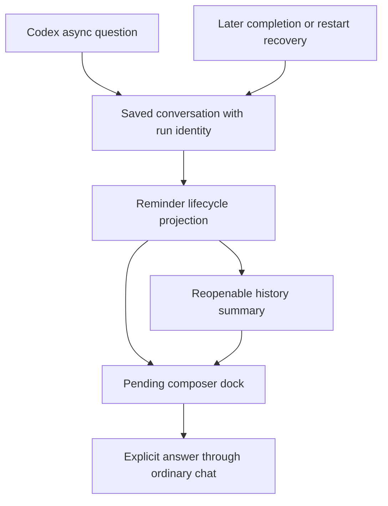

Codex review: needs changes before merge. _Reviewed September 20, 2026, 11:03 PM ET / September 21, 2026, 03:03 UTC (Revision 3)._

# ClawSweeper review

## What this changes

The PR moves older async question reminders into reopenable chat history after later successful work and preserves their originating run when saving Codex messages.

## Merge readiness

⛔ **Needs changes before merge - 1 item remains**

This remains a useful, maintainer-sponsored change absent from current main. No blocking correctness defect was found, and the inspected screenshots support the visible improvement.

**Priority:** P2
**Reviewed head:** `30497ef6f9fb7fa825ea35dfea7934ef5ba9fe3f`

## Review scores

| Measure | Result | What it means |
|---|---|---|
| **Overall readiness** | 🐚 platinum hermit **(4/6)** | A coherent implementation with convincing visual evidence and focused regressions; the required test-cost record remains incomplete. |
| **Proof confidence** | 🦞 diamond lobster **(5/6)** ✨ media proof bonus | Sufficient (screenshot): Inspected before/after browser screenshots show the changed reminder projection removing the dock after restart recovery while retaining a reopenable history summary; the PR also reports focused browser interaction coverage. This demonstrates visible UI behavior, not live Codex execution. |
| **Patch quality** | 🐚 platinum hermit **(4/6)** | No actionable review findings were identified. |

## Verification

| Check | Result | Evidence |
|---|---|---|
| **Real behavior** | Verified | Sufficient (screenshot): Inspected before/after browser screenshots show the changed reminder projection removing the dock after restart recovery while retaining a reopenable history summary; the PR also reports focused browser interaction coverage. This demonstrates visible UI behavior, not live Codex execution. |
| **Evidence reviewed** | 9 items | Introduced change and merge ownership: Reviewed the pinned merge-base-to-head hunks across all introduced files. The verified test merge records the pinned base followed by the exact PR head; its delta contains the same feature files, without the unrelated update-system base changes. Still necessary on current main: Current main collects every async question and filters only locally submitted or skipped drafts; it has no completion-derived archival. The async persistence caller also still omits run ownership. No merged replacement is established by the supplied related-item context. Lifecycle and compatibility: The projection excludes async messages, commentary, failed terminals, and overlapping known runs from successful successor boundaries. Legacy unowned questions have ordinary-turn and canonical restart-recovery paths. Reopening preserves drafts, and failed or in-flight submissions remain pending. Persistence reuses existing optional run metadata without rewriting older rows or changing a schema. |
| **Findings** | None | None. |
| **Security** | None | None. |

## How this fits together

The Control UI reconstructs async question reminders from saved conversation messages. Run ownership and completion records determine whether questions appear above the composer or remain available in history.

## Before merge

- [ ] **Complete next step (P2)** - Add measured focused-test wall times and available CI durations to the PR Evidence section, as required by the repository’s test-cost policy.

<strong>Agent review details</strong>

### Security

None.

### PR surface

Source +207, Tests +528, Docs +8. Total +743 across 13 files.

View PR surface stats

| Area | Files | Added | Removed | Net |
|---|---:|---:|---:|---:|
| Source | 5 | 229 | 22 | +207 |
| Tests | 7 | 795 | 267 | +528 |
| Docs | 1 | 10 | 2 | +8 |
| Config | 0 | 0 | 0 | 0 |
| Generated | 0 | 0 | 0 | 0 |
| Other | 0 | 0 | 0 | 0 |
| **Total** | **13** | **1034** | **291** | **+743** |

### Review metrics

| Metric | Value | Why it matters |
|---|---|---|
| **Production versus regression coverage** | Production net +207 lines; tests and test support net +528 lines | Production growth implements transcript-derived lifecycle handling; test growth includes legacy recovery and race coverage plus extraction of existing mirror fixtures. |

### Root-cause cluster

Relationship: `fixed_by_candidate`
Canonical: https://github.com/openclaw/openclaw/issues/153827
Summary: This PR implements the linked reminder-lifecycle request; saved-answer recognition is adjacent work.

Members:
- `canonical`: https://github.com/openclaw/openclaw/issues/153827 - Specifies archival after later successful work and explicit reopening.
- `adjacent_distinct`: https://github.com/openclaw/openclaw/pull/154312 - Recognizes explicit persisted answers independently of later completion.
- `adjacent_distinct`: https://github.com/openclaw/openclaw/pull/153418 - Merged work established the persistent composer dock; it did not implement reminder retirement.

Proposal only: this assessment does not dispatch repair, suppress jobs, mutate sibling items, close, or merge anything.

### Technical review

Best possible solution:

Keep reminder archival derived from canonical conversation boundaries, preserve explicit reopening, and leave answer submission and blocking-question resolution with their existing owners.

Do we have a high-confidence way to reproduce the issue?

Yes, from source: current main retains an unanswered async question after later successful work because completion never affects its pending filter; the supplied browser evidence shows that scenario.

Is this the best way to solve the issue?

Yes. Extending the existing presentation owner and supplying existing run metadata avoids a separate dismissal store, timer policy, or changes to question authorization.

AGENTS.md: found and applied where relevant.

Codex review notes: model internal, reasoning medium; reviewed against [7b1e6eb6656d](https://github.com/openclaw/openclaw/commit/7b1e6eb6656d95b006c59b574f71f60983476cd7).

### Labels

Label justifications:

- `P2`: Stale reminders create bounded chat friction while the composer and existing answer paths remain usable.
- `rating: 🐚 platinum hermit`: Overall readiness is 🐚 platinum hermit; proof is 🦞 diamond lobster and patch quality is 🐚 platinum hermit.
- `status: 👀 ready for maintainer look`: ClawSweeper has no concrete contributor-facing blocker left for this PR. Sufficient (screenshot): Inspected before/after browser screenshots show the changed reminder projection removing the dock after restart recovery while retaining a reopenable history summary; the PR also reports focused browser interaction coverage. This demonstrates visible UI behavior, not live Codex execution.
- `proof: sufficient`: Contributor real behavior proof is sufficient. Inspected before/after browser screenshots show the changed reminder projection removing the dock after restart recovery while retaining a reopenable history summary; the PR also reports focused browser interaction coverage. This demonstrates visible UI behavior, not live Codex execution.
- `proof: 📸 screenshot`: Contributor real behavior proof includes screenshot evidence. Inspected before/after browser screenshots show the changed reminder projection removing the dock after restart recovery while retaining a reopenable history summary; the PR also reports focused browser interaction coverage. This demonstrates visible UI behavior, not live Codex execution.

### Evidence

What I checked:

- **Introduced change and merge ownership:** Reviewed the pinned merge-base-to-head hunks across all introduced files. The verified test merge records the pinned base followed by the exact PR head; its delta contains the same feature files, without the unrelated update-system base changes. ([13fa14948810](https://github.com/openclaw/openclaw/commit/13fa14948810f83f12e6b11a1eb002fdcf9ca728))
- **Still necessary on current main:** Current main collects every async question and filters only locally submitted or skipped drafts; it has no completion-derived archival. The async persistence caller also still omits run ownership. No merged replacement is established by the supplied related-item context. ([`ui/src/pages/chat/components/chat-async-question.ts:51`](https://github.com/openclaw/openclaw/blob/7b1e6eb6656d95b006c59b574f71f60983476cd7/ui/src/pages/chat/components/chat-async-question.ts#L51), [7b1e6eb6656d](https://github.com/openclaw/openclaw/commit/7b1e6eb6656d95b006c59b574f71f60983476cd7))
- **Lifecycle and compatibility:** The projection excludes async messages, commentary, failed terminals, and overlapping known runs from successful successor boundaries. Legacy unowned questions have ordinary-turn and canonical restart-recovery paths. Reopening preserves drafts, and failed or in-flight submissions remain pending. Persistence reuses existing optional run metadata without rewriting older rows or changing a schema. ([`ui/src/pages/chat/components/chat-async-question.ts:44`](https://github.com/openclaw/openclaw/blob/30497ef6f9fb7fa825ea35dfea7934ef5ba9fe3f/ui/src/pages/chat/components/chat-async-question.ts#L44), [30497ef6f9fb](https://github.com/openclaw/openclaw/commit/30497ef6f9fb7fa825ea35dfea7934ef5ba9fe3f))
- **Codex dependency signal:** The changed async persistence owner consumes Codex app-server messages and now supplies the same run identity and turn prefix already used by final transcript mirroring. This establishes a concrete Codex protocol dependency, whose source was inspected separately. ([`extensions/codex/src/app-server/transcript-mirror.ts:340`](https://github.com/openclaw/openclaw/blob/30497ef6f9fb7fa825ea35dfea7934ef5ba9fe3f/extensions/codex/src/app-server/transcript-mirror.ts#L340), [30497ef6f9fb](https://github.com/openclaw/openclaw/commit/30497ef6f9fb7fa825ea35dfea7934ef5ba9fe3f))
- **Upstream async question contract:** The sibling checkout's cache origin was verified as openai/codex. Its handler emits an async AgentMessage with question metadata and a final-answer phase while returning immediately; therefore the UI correctly distinguishes async delivery from actual run completion. ([`codex-rs/core/src/tools/handlers/request_user_input_async.rs:122`](https://github.com/openai/codex/blob/6b9826e3aa83b1a5947db50f4332cb9c65f1b340/codex-rs/core/src/tools/handlers/request_user_input_async.rs#L122), [6b9826e3aa83](https://github.com/openai/codex/commit/6b9826e3aa83b1a5947db50f4332cb9c65f1b340))
- **Inspected visual proof:** Both prepared PR images were opened locally. Before shows the obsolete question dock beneath completed restart recovery; after shows no dock and retains the original question with No longer pending and an Answer button. The captured body reports originating-chat delivery and 12 bundled-browser scenarios. These are synthetic browser proofs, not a live Gateway run.

Likely related people:

- **unknown:** The claimed source-line change could not be verified from bounded local history. (role: source history unknown; confidence: low)

### Rank-up moves

Optional improvements that raise the rating; they are not merge blockers.

- Record measured per-file focused-test wall times and available CI durations in the PR Evidence section.

### Rating scale

| Score | Internal tier | Crab rank | Meaning |
|---:|:---:|---|---|
| **6/6** | S | 🦀 challenger crab | Exceptional readiness |
| **5/6** | A | 🦞 diamond lobster | Very strong readiness |
| **4/6** | B | 🐚 platinum hermit | Good normal PR; ordinary maintainer review |
| **3/6** | C | 🦐 gold shrimp | Useful, but confidence is limited |
| **2/6** | D | 🦪 silver shellfish | Proof or implementation needs work |
| **1/6** | F | 🧂 unranked krab | Not merge-ready |
| N/A | NA | 🌊 off-meta tidepool | Rating does not apply |

Overall follows the weaker of proof and patch quality.
Shiny media proof means a screenshot, video, or linked artifact directly shows the changed behavior. Runtime, network, CSP, and security claims still need visible diagnostics.

### Workflow

- ClawSweeper keeps one durable marker-backed review comment per issue or PR.
- Re-runs edit this comment so the latest verdict, findings, and automation markers stay together instead of adding duplicate bot comments.
- A fresh review can be triggered by eligible `@clawsweeper re-review` comments, exact-item GitHub events, scheduled/background review runs, or manual workflow dispatch.
- PR/issue authors and users with repository write access can comment `@clawsweeper re-review` or `@clawsweeper re-run` on an open PR or issue to request a fresh review only.
- Maintainers can also comment `@clawsweeper review` to request a fresh review only.
- Fresh-review commands do not start repair, autofix, rebase, CI repair, or automerge.
- Maintainer-only repair and merge flows require explicit commands such as `@clawsweeper autofix`, `@clawsweeper automerge`, `@clawsweeper fix ci`, or `@clawsweeper address review`.
- Maintainers can comment `@clawsweeper explain` to ask for more context, or `@clawsweeper stop` to stop active automation.

### History

Review history (2 earlier review cycles)

<!-- clawsweeper-review-history v=1 total=2 -->
- reviewed 2026-09-20T16:43:43.217Z sha 19cce3bdf8bce9022f40fc2b9f9ed71dd4d5ada8 :: needs changes before merge. :: none
- reviewed 2026-09-20T16:54:08.120Z sha 17e9553493fb7a4ad1904a90562b9306b7019174 :: needs maintainer review before merge. :: none

<!-- clawsweeper-verdict:needs-human item=153849 sha=30497ef6f9fb7fa825ea35dfea7934ef5ba9fe3f confidence=high updated_at=2026-09-21T02:59:26Z reviewed_at=2026-09-21T03:03:16.899Z lease_owner=github-run-35555847464-1 lease_comment_id=5754805694 source_revision=9c45a9876b30aacaea378553cbffe4e4447b8238f826fd8c1e2973154231a6c6 live_verification=absent -->
<!-- clawsweeper-review-state:needs-changes item=153849 sha=30497ef6f9fb7fa825ea35dfea7934ef5ba9fe3f v=1 -->

<!-- clawsweeper-review-version item=153849 reviewed_at=2026-09-21T03:03:16.899Z sha=30497ef6f9fb7fa825ea35dfea7934ef5ba9fe3f source_revision=9c45a9876b30aacaea378553cbffe4e4447b8238f826fd8c1e2973154231a6c6 lease_owner=github-run-35555847464-1 lease_comment_id=5754805694 v=1 -->

<!-- clawsweeper-review item=153849 -->