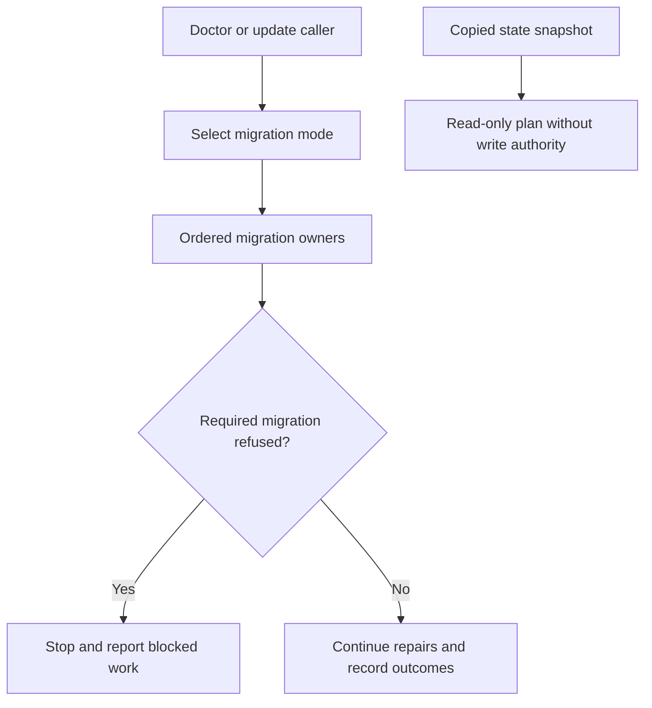

Codex review: blocked before merge. _Reviewed September 6, 2026, 3:05 AM ET / 07:05 UTC._

# ClawSweeper review

## What this changes

Doctor preserves migration selection and ordered outcomes, stops repairs after required refusals, adds copied-state inspection, and preserves another writer’s files when snapshot publication fails.

## Merge readiness

⛔ **Blocked before merge - 7 items remain**

This PR remains necessary: current main still builds automatic-mode steps after Doctor-mode detection. The earlier lock findings remain addressed, and no new actionable defect was identified in the publication-cleanup correction. Maintainer authorship and the protected label also preclude cleanup closure.

**Priority:** P2
**Reviewed head:** `98dd65039879b5da3930c70c0dd8401500661da9`
**Owner decision:** Required. See [Decision needed](#decision-needed).

## Review scores

| Measure | Result | What it means |
|---|---|---|
| **Overall readiness** | 🐚 platinum hermit **(4/6)** | Useful, well-supported repairs with no new actionable finding; ownership confirmation and the remaining dependency-contract review are still needed. |
| **Proof confidence** | 🦞 diamond lobster **(5/6)** | Sufficient (terminal): Recorded Linux CLI/auth/API runs demonstrate migration execution, refusal, and copied-state preservation; later Darwin observations cover uncached caller locks and replacement-file preservation after publication refusal. Their original source identities and platform limits are retained. Local video inspection failed because ffprobe was unavailable, and the web fallback failed; this reviewer limitation does not downgrade the separate captured observations. |
| **Patch quality** | 🐚 platinum hermit **(4/6)** | No actionable review findings were identified. |

## Verification

| Check | Result | Evidence |
|---|---|---|
| **Real behavior** | Verified | Sufficient (terminal): Recorded Linux CLI/auth/API runs demonstrate migration execution, refusal, and copied-state preservation; later Darwin observations cover uncached caller locks and replacement-file preservation after publication refusal. Their original source identities and platform limits are retained. Local video inspection failed because ffprobe was unavailable, and the web fallback failed; this reviewer limitation does not downgrade the separate captured observations. |
| **Evidence reviewed** | 11 items | Central defect remains on current main: The fetched main implementation derives Doctor mode for detection but still supplies mode: automatic to the migration step builder. The supplied merged related PRs concern skill preferences and a Gateway test fixture, not this repair. Release-tag source inspection was unavailable, so no release-fix claim is made. Unified mode and refusal propagation: The execution owner derives one mode, closes subsequent step receipts after refusal, and the Doctor preflight throws only after collecting settled receipts. Recoverable warnings retain a separate disposition. Latest introduced cleanup correction: The exact head’s recorded parent is 2277f59d7a30fc476f1697a1b92e5975042e57bb. Its two-file correction removes cleanup authority inferred from later pathname observations, records successful publication identity before durability validation, and adds replacement-preservation controls. |
| **Findings** | None | None. |
| **Security** | None | None. |

## How this fits together

Doctor repairs legacy configuration and state during explicit repair and update flows. Its migration owner selects work, invokes existing storage and plugin owners, and returns outcomes that determine whether later repairs may proceed.

## Decision needed

| Question | Recommendation |
|---|---|
| Has a listed openclaw-secops owner authored, explicitly requested, or joined review of the two auth-profile inspection changes? | **Confirm listed-owner involvement:** Have the listed security team review these changes or identify the existing qualifying request or review. |

Why: Repository policy requires this involvement, and task-scoped landing authorization does not establish it.

## Before merge

- [ ] **Resolve merge risk (P1)** - Existing Doctor runs can now stop after a required migration refusal or descriptor mismatch; operators must resolve the reported failure before later repairs proceed. The discussion explicitly accepts this compatibility change.
- [ ] **Resolve merge risk (P1)** - Listed security-owner involvement for the auth-profile changes is not established by the supplied task-authorization statements.
- [ ] **Resolve merge risk (P1)** - The reviewer could not inspect the pinned fs-safe publisher implementation, so the dependency-backed cleanup contract still needs direct verification.
- [ ] **Complete next step (P2)** - Confirm listed security-owner involvement for the two auth-profile changes and complete direct inspection of the pinned filesystem publisher’s cleanup contract.
- [ ] **Resolve maintainer decision** - Resolve the maintainer decision shown above before merge.
- [ ] **Review config compatibility** - Confirm compatibility and upgrade impact for the changed config or default surface before merge.
- [ ] **Add data-model compatibility proof** - Confirm migration or upgrade compatibility proof before merge.

<strong>Agent review details</strong>

### Security

None.

### PR surface

PR surface statistics unavailable: the file list is incomplete.

### Review metrics

| Metric | Value | Why it matters |
|---|---|---|
| **Diagnostic CLI surface** | 1 hidden command with 3 required snapshot-path options | The new command reports plans but deliberately cannot authorize migration execution. |
| **Production versus test growth** | Production +5,090/-896; tests and support +7,994/-1,062 | The body justifies production growth as ordered migration descriptions and copied-state inspection; raw test totals include file splits. |

### Stored data model

Persistent data-model change detected: `database schema: src/state/openclaw-agent-db-registry-listing.ts`, `migration/backfill/repair: config/assertion-safety-baseline.txt`, `migration/backfill/repair: extensions/acpx/openclaw.plugin.json`, `migration/backfill/repair: extensions/codex/openclaw.plugin.json`, `migration/backfill/repair: extensions/matrix/openclaw.plugin.json`, `migration/backfill/repair: scripts/lib/vitest-build-prerequisites.mts`, and 20 more. Confirm migration or upgrade compatibility proof before merge.

### Root-cause cluster

Relationship: `canonical`
Canonical: https://github.com/openclaw/openclaw/pull/139683
Summary: The discussion identifies this PR as the approved replacement for the earlier Doctor migration branch; it addresses only part of the broader update-transaction request.

Members:
- `superseded`: https://github.com/openclaw/openclaw/pull/136529 - The current PR explicitly continues this still-open branch as its credited replacement; neither item is closed by this assessment.
- `partial_overlap`: https://github.com/openclaw/openclaw/issues/124396 - Migration selection and refusal outcomes overlap, while whole-product activation, checkpointing, and rollback remain outside this PR.
- `adjacent_distinct`: https://github.com/openclaw/openclaw/pull/138730 - The merged optional-skill preference repair is explicitly excluded from this branch’s purpose.

Proposal only: this assessment does not dispatch repair, suppress jobs, mutate sibling items, close, or merge anything.

### Merge-risk options

**Maintainer options:**
1. **Retain the accepted refusal contract (recommended)**  
   Proceed with the documented stop-on-required-refusal behavior while preserving recoverable warnings and legacy live plugin declarations.

### Technical review

Best possible solution:

Keep migration execution with existing owners, preserve advisory and legacy-plugin compatibility, and ensure copied plans and failed publications never acquire authority over unrelated state.

Do we have a high-confidence way to reproduce the issue?

Yes: current-main source still selects automatic migration steps after Doctor detection, and the supplied observations describe concrete refusal and lock failures. This read-only review did not execute the runtime.

Is this the best way to solve the issue?

Yes for the inspected repair boundaries: unified mode selection, settled refusal propagation, and publisher-owned cleanup address the causes directly. Independent verification of the pinned filesystem publisher remains incomplete.

AGENTS.md: found and applied where relevant.

Codex review notes: model internal, reasoning medium; reviewed against [f2ba79354177](https://github.com/openclaw/openclaw/commit/f2ba79354177e844ce69e19a56a7e55367c8cc66).

### Labels

Label justifications:

- `P2`: This repairs concrete Doctor migration and snapshot-preservation behavior without evidence of a new fleet-wide emergency.
- `merge-risk: 🚨 compatibility`: Required migration failures and plugin descriptor mismatches now stop later repairs, changing operator recovery behavior.
- `rating: 🐚 platinum hermit`: Overall readiness is 🐚 platinum hermit; proof is 🦞 diamond lobster and patch quality is 🐚 platinum hermit.
- `status: 👀 ready for maintainer look`: ClawSweeper has no concrete contributor-facing blocker left for this PR. Sufficient (terminal): Recorded Linux CLI/auth/API runs demonstrate migration execution, refusal, and copied-state preservation; later Darwin observations cover uncached caller locks and replacement-file preservation after publication refusal. Their original source identities and platform limits are retained. Local video inspection failed because ffprobe was unavailable, and the web fallback failed; this reviewer limitation does not downgrade the separate captured observations.
- `proof: sufficient`: Contributor real behavior proof is sufficient. Recorded Linux CLI/auth/API runs demonstrate migration execution, refusal, and copied-state preservation; later Darwin observations cover uncached caller locks and replacement-file preservation after publication refusal. Their original source identities and platform limits are retained. Local video inspection failed because ffprobe was unavailable, and the web fallback failed; this reviewer limitation does not downgrade the separate captured observations.

### Evidence

What I checked:

- **Central defect remains on current main:** The fetched main implementation derives Doctor mode for detection but still supplies mode: automatic to the migration step builder. The supplied merged related PRs concern skill preferences and a Gateway test fixture, not this repair. Release-tag source inspection was unavailable, so no release-fix claim is made. ([`src/infra/state-migrations.doctor.ts:1344`](https://github.com/openclaw/openclaw/blob/f2ba79354177e844ce69e19a56a7e55367c8cc66/src/infra/state-migrations.doctor.ts#L1344), [f2ba79354177](https://github.com/openclaw/openclaw/commit/f2ba79354177e844ce69e19a56a7e55367c8cc66))
- **Unified mode and refusal propagation:** The execution owner derives one mode, closes subsequent step receipts after refusal, and the Doctor preflight throws only after collecting settled receipts. Recoverable warnings retain a separate disposition. ([`src/infra/state-migrations.doctor.ts:3032`](https://github.com/openclaw/openclaw/blob/98dd65039879b5da3930c70c0dd8401500661da9/src/infra/state-migrations.doctor.ts#L3032), [98dd65039879](https://github.com/openclaw/openclaw/commit/98dd65039879b5da3930c70c0dd8401500661da9))
- **Latest introduced cleanup correction:** The exact head’s recorded parent is 2277f59d7a30fc476f1697a1b92e5975042e57bb. Its two-file correction removes cleanup authority inferred from later pathname observations, records successful publication identity before durability validation, and adds replacement-preservation controls. ([`src/infra/sqlite-snapshot.ts:464`](https://github.com/openclaw/openclaw/blob/98dd65039879b5da3930c70c0dd8401500661da9/src/infra/sqlite-snapshot.ts#L464), [98dd65039879](https://github.com/openclaw/openclaw/commit/98dd65039879b5da3930c70c0dd8401500661da9))
- **Earlier findings remain resolved:** The auth inspection helpers, isolated shared-state reader, and snapshot-worker launcher are unchanged from the previous reviewed head. Current source retains child-process snapshot preparation; the full-planner regression checks competing DELETE/WAL operations before planning, afterward, and after actual caller close. ([`src/state/openclaw-state-db-readonly.ts:143`](https://github.com/openclaw/openclaw/blob/98dd65039879b5da3930c70c0dd8401500661da9/src/state/openclaw-state-db-readonly.ts#L143), [98dd65039879](https://github.com/openclaw/openclaw/commit/98dd65039879b5da3930c70c0dd8401500661da9))
- **Plugin compatibility boundary:** Descriptor arrays support metadata-only planning while legacy boolean declarations retain live contract loading. External artifacts remain outside copied-plan authority. The discussion explicitly accepts stopping required refusals while preserving advisory warnings and legacy live declarations. Public docs: [`docs/plugins/sdk-migration.md`](https://docs.openclaw.ai/plugins/sdk-migration). ([`docs/plugins/sdk-migration.md:147`](https://docs.openclaw.ai/plugins/sdk-migration), [98dd65039879](https://github.com/openclaw/openclaw/commit/98dd65039879b5da3930c70c0dd8401500661da9))
- **Recorded real behavior and correction evidence:** The supplied PR body retains Linux packaged CLI/auth/API observations at source base 561d6556d3c5081eb64f8f184a5b8fe92917c060, authored tree 8d9beb66dd4c3a5b8f48de8662deff83302ff53c, and package SHA256 f7bd2b2926e3c51cc61a7848a41fa0a5d8aa7a6c384e1913b6f6cf9053133465. https://github.com/openclaw/openclaw/pull/139683#issuecomment-5557304647 records corrected canonical-path lock observations; https://github.com/openclaw/openclaw/pull/139683#issuecomment-5557608672 records replacement bytes surviving the latest publication refusal. These are qualified Linux and Darwin observations, not executions of the entire final head or proof of real Windows inode reuse.

Likely related people:

- **openclaw/openclaw-secops:** Suggested for follow-up; no historical authorship or introduction is verified. (role: unverified routing candidate; confidence: low)
- **Peter Steinberger:** Suggested for follow-up; no historical authorship or introduction is verified. (role: unverified routing candidate; confidence: low)
- **Vincent Koc:** Suggested for follow-up; no historical authorship or introduction is verified. (role: unverified routing candidate; confidence: low)

### Rank-up moves

Optional improvements that raise the rating; they are not merge blockers.

- Confirm listed security-owner involvement for the auth-profile inspection changes.
- Inspect the pinned fs-safe 0.8.1 publication and failure-cleanup contract directly before landing.

### Rating scale

| Score | Internal tier | Crab rank | Meaning |
|---:|:---:|---|---|
| **6/6** | S | 🦀 challenger crab | Exceptional readiness |
| **5/6** | A | 🦞 diamond lobster | Very strong readiness |
| **4/6** | B | 🐚 platinum hermit | Good normal PR; ordinary maintainer review |
| **3/6** | C | 🦐 gold shrimp | Useful, but confidence is limited |
| **2/6** | D | 🦪 silver shellfish | Proof or implementation needs work |
| **1/6** | F | 🧂 unranked krab | Not merge-ready |
| N/A | NA | 🌊 off-meta tidepool | Rating does not apply |

Overall follows the weaker of proof and patch quality.
Shiny media proof means a screenshot, video, or linked artifact directly shows the changed behavior. Runtime, network, CSP, and security claims still need visible diagnostics.

### Workflow

- ClawSweeper keeps one durable marker-backed review comment per issue or PR.
- Re-runs edit this comment so the latest verdict, findings, and automation markers stay together instead of adding duplicate bot comments.
- A fresh review can be triggered by eligible `@clawsweeper re-review` comments, exact-item GitHub events, scheduled/background review runs, or manual workflow dispatch.
- PR/issue authors and users with repository write access can comment `@clawsweeper re-review` or `@clawsweeper re-run` on an open PR or issue to request a fresh review only.
- Maintainers can also comment `@clawsweeper review` to request a fresh review only.
- Fresh-review commands do not start repair, autofix, rebase, CI repair, or automerge.
- Maintainer-only repair and merge flows require explicit commands such as `@clawsweeper autofix`, `@clawsweeper automerge`, `@clawsweeper fix ci`, or `@clawsweeper address review`.
- Maintainers can comment `@clawsweeper explain` to ask for more context, or `@clawsweeper stop` to stop active automation.

### History

Review history (5 earlier review cycles)

<!-- clawsweeper-review-history v=1 total=5 -->
- reviewed 2026-09-06T03:40:05.219Z sha aeaea0c8361afc67143d0cd21587be781fef28f7 :: blocked before merge. :: [P2] Isolate snapshot hashing from caller-held SQLite locks
- reviewed 2026-09-06T05:02:26.813Z sha 0812ffa2f1de387664d1052ed467651a5b42875f :: blocked before merge. :: [P2] Isolate database inspection when caller handles are uncached
- reviewed 2026-09-06T06:01:58.351Z sha 7d93ec0ba130bf4ae6e1004087b6aa93deb8a7bb :: blocked before merge. :: none
- reviewed 2026-09-06T06:16:41.213Z sha 03a522adb421c1dd703551db836b100202abb3f5 :: blocked before merge. :: none
- reviewed 2026-09-06T06:34:19.981Z sha 6314d2bad3a061798a9f9a9367a3157d991f7940 :: blocked before merge. :: none

<!-- clawsweeper-verdict:needs-human item=139683 sha=98dd65039879b5da3930c70c0dd8401500661da9 confidence=high updated_at=2026-09-06T07:01:58Z reviewed_at=2026-09-06T07:05:32.506Z lease_owner=github-run-34017973823-1 lease_comment_id=5557613737 source_revision=05c34b37352294b6a662c7a7927e8ab0dea78635f7c226f956d5419e0aa7b043 live_verification=absent -->
<!-- clawsweeper-review-state:blocked item=139683 sha=98dd65039879b5da3930c70c0dd8401500661da9 v=1 -->

<!-- clawsweeper-review-version item=139683 reviewed_at=2026-09-06T07:05:32.506Z sha=98dd65039879b5da3930c70c0dd8401500661da9 source_revision=05c34b37352294b6a662c7a7927e8ab0dea78635f7c226f956d5419e0aa7b043 lease_owner=github-run-34017973823-1 lease_comment_id=5557613737 v=1 -->

<!-- clawsweeper-review item=139683 -->