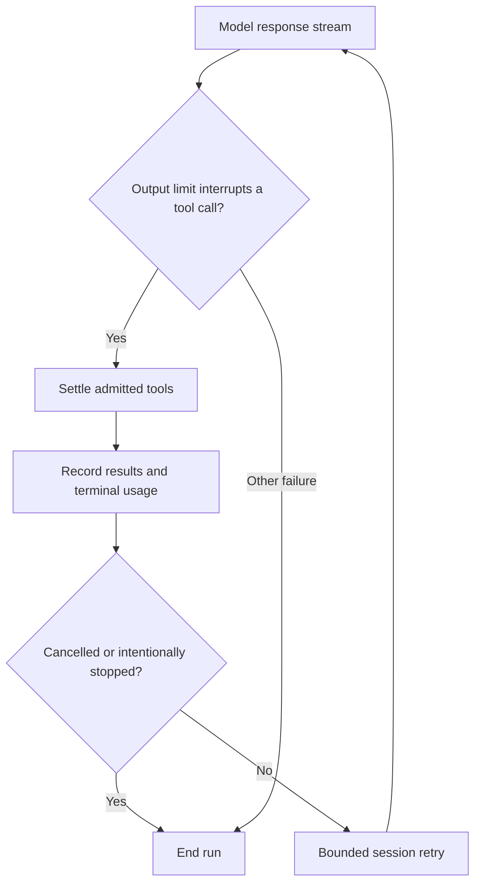

Codex review: needs maintainer review before merge. _Reviewed September 14, 2026, 4:49 PM ET / 20:49 UTC (Revision 4)._

# ClawSweeper review

## What this changes

The PR lets output-limited OpenAI Responses requests continue from settled tool results, preserves cancellation and retry accounting, and adds regression coverage and documentation.

## Merge readiness

✅ **Ready for maintainer review**

The fix remains necessary: current main and the latest release lack this recovery classification. No actionable correctness or security defect was found in the introduced changes; this maintainer-authored PR should remain open for normal landing.

**Priority:** P2
**Reviewed head:** `b401f47679e38d251eba8343121ef7edab4feed4`

## Review scores

| Measure | Result | What it means |
|---|---|---|
| **Overall readiness** | 🐚 platinum hermit **(4/6)** | A focused recovery repair with meaningful cancellation, accounting, and retry-limit coverage and no blocking findings. |
| **Proof confidence** | 🌊 off-meta tidepool | Not applicable: The maintainer-authored PR is exempt from the external-contributor proof gate. Available coverage connects the real Responses parser to session recovery using deterministic fixtures; it does not establish live provider truncation. |
| **Patch quality** | 🐚 platinum hermit **(4/6)** | No actionable review findings were identified. |

## Verification

| Check | Result | Evidence |
|---|---|---|
| **Real behavior** | Not applicable | Not applicable: The maintainer-authored PR is exempt from the external-contributor proof gate. Available coverage connects the real Responses parser to session recovery using deterministic fixtures; it does not establish live provider truncation. |
| **Evidence reviewed** | 10 items | Pinned PR identity: The live REST response confirms the PR remains open and unmerged at the reviewed head, with base 867e655d51d892c47ee68fc7f02c7e8ca0a5628d. Review used the merge-base-to-head changes, not current-main endpoint drift. Current main still needs the fix: Current main delegates exclusively to the generic retry classifier and removes a trailing assistant message; it lacks the output-limit-specific continuation path. Latest release check: The retry owner at the supplied latest release, v2026.9.4, likewise lacks the new output-limit classification. No shipped replacement was established. |
| **Findings** | None | None. |
| **Security** | None | None. |

## How this fits together

OpenClaw’s built-in agent loop turns model responses into tool executions and recorded results. The session recovery owner uses those results to continue an interrupted task without replaying the original request.

## Before merge

None.

<strong>Agent review details</strong>

### Security

None.

### PR surface

Source +51, Tests +374, Docs +6. Total +431 across 14 files.

View PR surface stats

| Area | Files | Added | Removed | Net |
|---|---:|---:|---:|---:|
| Source | 7 | 95 | 44 | +51 |
| Tests | 6 | 471 | 97 | +374 |
| Docs | 1 | 6 | 0 | +6 |
| Config | 0 | 0 | 0 | 0 |
| Generated | 0 | 0 | 0 | 0 |
| Other | 0 | 0 | 0 | 0 |
| **Total** | **14** | **572** | **141** | **+431** |

### Review metrics

| Metric | Value | Why it matters |
|---|---|---|
| **Production versus regression coverage** | Production +51 net lines; tests +374 net lines | Production growth implements bounded recovery classification and settlement ordering; most growth protects failure-path behavior. |

### Technical review

Best possible solution:

Keep bounded continuation in the session owner, preserving settled results, durable failure history, cancellation, and existing tool admission checks.

Do we have a high-confidence way to reproduce the issue?

Yes, from source: an incomplete-tool terminal caused by max_output_tokens bypasses current main’s session retry classifier. The regression fixtures model that path; this review did not execute it.

Is this the best way to solve the issue?

Yes. Reusing session continuation preserves completed work without adding another retry owner or weakening the outer replay guard.

AGENTS.md: found and applied where relevant.

Codex review notes: model internal, reasoning medium; reviewed against [5d461f09667b](https://github.com/openclaw/openclaw/commit/5d461f09667b1d7474f7b963d2d1267c836a83f5).

### Labels

Label justifications:

- `P2`: This repairs a bounded agent-recovery failure triggered by output-limited tool generation.
- `rating: 🐚 platinum hermit`: Overall readiness is 🐚 platinum hermit; proof is 🌊 off-meta tidepool and patch quality is 🐚 platinum hermit.
- `status: 👀 ready for maintainer look`: ClawSweeper has no concrete contributor-facing blocker left for this PR. Not applicable: The maintainer-authored PR is exempt from the external-contributor proof gate. Available coverage connects the real Responses parser to session recovery using deterministic fixtures; it does not establish live provider truncation.

### Evidence

What I checked:

- **Pinned PR identity:** The live REST response confirms the PR remains open and unmerged at the reviewed head, with base 867e655d51d892c47ee68fc7f02c7e8ca0a5628d. Review used the merge-base-to-head changes, not current-main endpoint drift. ([b401f47679e3](https://github.com/openclaw/openclaw/commit/b401f47679e38d251eba8343121ef7edab4feed4))
- **Current main still needs the fix:** Current main delegates exclusively to the generic retry classifier and removes a trailing assistant message; it lacks the output-limit-specific continuation path. ([`src/agents/sessions/agent-session-execution.ts:28`](https://github.com/openclaw/openclaw/blob/5d461f09667b1d7474f7b963d2d1267c836a83f5/src/agents/sessions/agent-session-execution.ts#L28), [5d461f09667b](https://github.com/openclaw/openclaw/commit/5d461f09667b1d7474f7b963d2d1267c836a83f5))
- **Latest release check:** The retry owner at the supplied latest release, v2026.9.4, likewise lacks the new output-limit classification. No shipped replacement was established. ([`src/agents/sessions/agent-session-execution.ts:32`](https://github.com/openclaw/openclaw/blob/3a9d69db306cd7f081e06254cb89c4bcc14a7107/src/agents/sessions/agent-session-execution.ts#L32), [3a9d69db306c](https://github.com/openclaw/openclaw/commit/3a9d69db306cd7f081e06254cb89c4bcc14a7107))
- **Settlement and cancellation ordering:** Output-limit handling waits for admitted executions before recording the original usage-bearing terminal. External cancellation changes that terminal to aborted; unanimous tool termination prevents retry. Existing tool preparation and final source-start admission checks remain in place. ([`packages/agent-core/src/agent-stream-response.ts:368`](https://github.com/openclaw/openclaw/blob/b401f47679e38d251eba8343121ef7edab4feed4/packages/agent-core/src/agent-stream-response.ts#L368), [b401f47679e3](https://github.com/openclaw/openclaw/commit/b401f47679e38d251eba8343121ef7edab4feed4))
- **Recovery boundary and regression coverage:** The session tests exercise the real Responses parser with synthetic events and mocked model requests. They check retained results, no unfinished-call execution, retry exhaustion, cancellation, disabled retries, filtering, and intentional termination. This is OpenClaw’s own parser/session implementation; no Codex dependency contract is asserted. ([`src/agents/sessions/agent-session-responses-eof.test.ts:24`](https://github.com/openclaw/openclaw/blob/b401f47679e38d251eba8343121ef7edab4feed4/src/agents/sessions/agent-session-responses-eof.test.ts#L24), [b401f47679e3](https://github.com/openclaw/openclaw/commit/b401f47679e38d251eba8343121ef7edab4feed4))
- **Bounded diagnostic classification:** Continuation requires an error with incomplete_tool_call, a max_output_tokens incomplete terminal, and no provider-refusal diagnostic. The terminal producer retains only enumerated incomplete reasons, mapping unknown values to unknown. ([`packages/ai/src/providers/openai-responses-terminal-usage.ts:15`](https://github.com/openclaw/openclaw/blob/b401f47679e38d251eba8343121ef7edab4feed4/packages/ai/src/providers/openai-responses-terminal-usage.ts#L15), [b401f47679e3](https://github.com/openclaw/openclaw/commit/b401f47679e38d251eba8343121ef7edab4feed4))

Likely related people:

- **unknown:** The claimed source-line change could not be verified from bounded local history. (role: source history unknown; confidence: low)

### Rating scale

| Score | Internal tier | Crab rank | Meaning |
|---:|:---:|---|---|
| **6/6** | S | 🦀 challenger crab | Exceptional readiness |
| **5/6** | A | 🦞 diamond lobster | Very strong readiness |
| **4/6** | B | 🐚 platinum hermit | Good normal PR; ordinary maintainer review |
| **3/6** | C | 🦐 gold shrimp | Useful, but confidence is limited |
| **2/6** | D | 🦪 silver shellfish | Proof or implementation needs work |
| **1/6** | F | 🧂 unranked krab | Not merge-ready |
| N/A | NA | 🌊 off-meta tidepool | Rating does not apply |

Overall follows the weaker of proof and patch quality.
Shiny media proof means a screenshot, video, or linked artifact directly shows the changed behavior. Runtime, network, CSP, and security claims still need visible diagnostics.

### Workflow

- ClawSweeper keeps one durable marker-backed review comment per issue or PR.
- Re-runs edit this comment so the latest verdict, findings, and automation markers stay together instead of adding duplicate bot comments.
- A fresh review can be triggered by eligible `@clawsweeper re-review` comments, exact-item GitHub events, scheduled/background review runs, or manual workflow dispatch.
- PR/issue authors and users with repository write access can comment `@clawsweeper re-review` or `@clawsweeper re-run` on an open PR or issue to request a fresh review only.
- Maintainers can also comment `@clawsweeper review` to request a fresh review only.
- Fresh-review commands do not start repair, autofix, rebase, CI repair, or automerge.
- Maintainer-only repair and merge flows require explicit commands such as `@clawsweeper autofix`, `@clawsweeper automerge`, `@clawsweeper fix ci`, or `@clawsweeper address review`.
- Maintainers can comment `@clawsweeper explain` to ask for more context, or `@clawsweeper stop` to stop active automation.

### History

Review history (3 earlier review cycles)

<!-- clawsweeper-review-history v=1 total=3 -->
- reviewed 2026-09-14T18:35:50.773Z sha e963845641d6436992afd941661ff28e287706a1 :: needs maintainer review before merge. :: none
- reviewed 2026-09-14T19:15:00.010Z sha 41ddd2a60db5bbfad3fafb3e04833c14e186357e :: needs maintainer review before merge. :: none
- reviewed 2026-09-14T20:39:42.874Z sha a6cb27a115355ac07b5b32f3370d870d648dc5ef :: needs maintainer review before merge. :: none

<!-- clawsweeper-verdict:needs-human item=148440 sha=b401f47679e38d251eba8343121ef7edab4feed4 confidence=high updated_at=2026-09-14T20:46:14Z reviewed_at=2026-09-14T20:49:19.184Z lease_owner=github-run-34894718999-1 lease_comment_id=5670573646 source_revision=541d0b1f6da696ce5533661fb23cc98dc086a3aabd5b3a6bf92c51692af806e7 live_verification=absent -->
<!-- clawsweeper-review-state:ready item=148440 sha=b401f47679e38d251eba8343121ef7edab4feed4 v=1 -->

<!-- clawsweeper-review-version item=148440 reviewed_at=2026-09-14T20:49:19.184Z sha=b401f47679e38d251eba8343121ef7edab4feed4 source_revision=541d0b1f6da696ce5533661fb23cc98dc086a3aabd5b3a6bf92c51692af806e7 lease_owner=github-run-34894718999-1 lease_comment_id=5670573646 v=1 -->

<!-- clawsweeper-review item=148440 -->