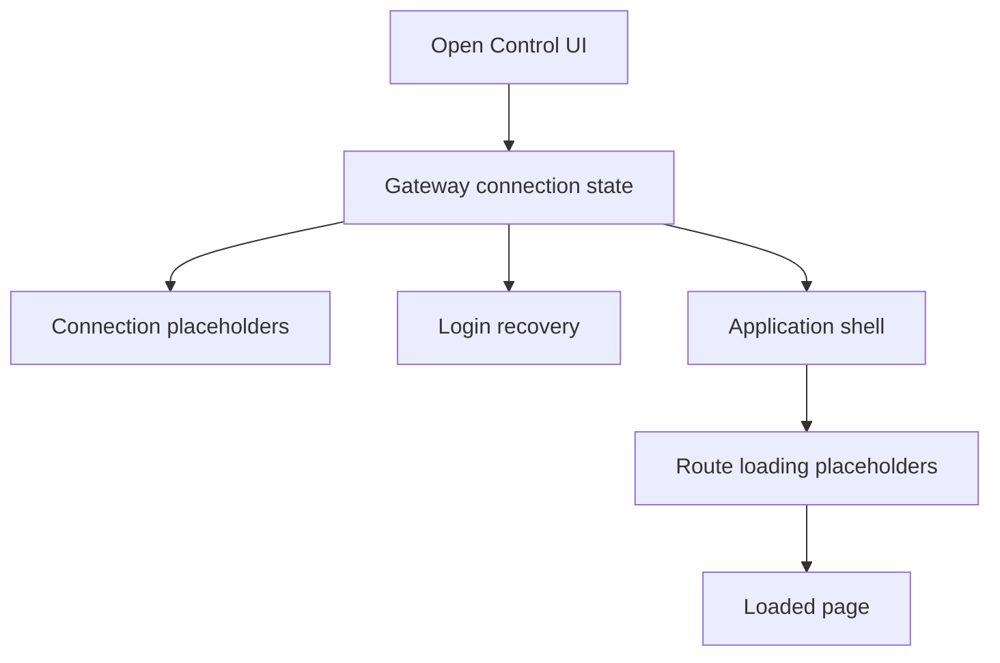

Codex review: needs maintainer review before merge. _Reviewed September 5, 2026, 8:46 PM ET / September 6, 2026, 00:46 UTC._

# ClawSweeper review

## What this changes

Replace Control UI connection and route-loading mascots with shared, theme-aware shimmer placeholders that preserve startup status and respect reduced-motion preferences.

## Merge readiness

✅ **Ready for maintainer review**

This remains a useful, focused presentation improvement that current main does not provide. No actionable patch defect was found, and the recorded visual verification supports ordinary maintainer review without another proof request.

**Priority:** P3
**Reviewed head:** `749f0e8475f8df30044e987bba1149dd8f82f9a0`

## Review scores

| Measure | Result | What it means |
|---|---|---|
| **Overall readiness** | 🐚 platinum hermit **(4/6)** | A focused implementation with recorded visual verification, relevant boundary coverage, and no actionable correctness finding. |
| **Proof confidence** | 🐚 platinum hermit **(4/6)** ✨ media proof bonus | Sufficient (screenshot): The captured PR records inspected before/after desktop and mobile browser images of the changed connection placeholders, with deferred-route and reduced-motion browser checks as supplemental evidence. Direct image retrieval was unavailable here; the recorded maintainer visual verification remains valid. |
| **Patch quality** | 🐚 platinum hermit **(4/6)** | No actionable review findings were identified. |

## Verification

| Check | Result | Evidence |
|---|---|---|
| **Real behavior** | Verified | Sufficient (screenshot): The captured PR records inspected before/after desktop and mobile browser images of the changed connection placeholders, with deferred-route and reduced-motion browser checks as supplemental evidence. Direct image retrieval was unavailable here; the recorded maintainer visual verification remains valid. |
| **Evidence reviewed** | 8 items | Introduced change is bounded: The verified merge-base-to-head patch changes loading presentation, associated tests, and documentation. The host-verified test merge preserves the unrelated base-branch work. Current main still uses the mascot: The fetched main revision renders the thinking mascot in the shared route-loading surface, so the proposed presentation remains distinct. Latest release comparison: The supplied latest release, v2026.9.2, also renders the mascot in the shared loading surface. |
| **Findings** | None | None. |
| **Security** | None | None. |

## How this fits together

The Control UI displays loading surfaces while its Gateway connection or route content becomes ready. These placeholders occupy the waiting view before the application shows its content or login recovery.

## Before merge

None.

<strong>Agent review details</strong>

### Security

None.

### PR surface

Source +139, Tests -3, Docs +2. Total +138 across 9 files.

View PR surface stats

| Area | Files | Added | Removed | Net |
|---|---:|---:|---:|---:|
| Source | 5 | 160 | 21 | +139 |
| Tests | 3 | 44 | 47 | -3 |
| Docs | 1 | 2 | 0 | +2 |
| Config | 0 | 0 | 0 | 0 |
| Generated | 0 | 0 | 0 | 0 |
| Other | 0 | 0 | 0 | 0 |
| **Total** | **9** | **206** | **68** | **+138** |

### Review metrics

| Metric | Value | Why it matters |
|---|---|---|
| **Production versus test growth** | Production +139 net lines; tests -3 net lines | The production growth implements the shared placeholder markup and responsive layout while reusing the existing shimmer engine. |

### Technical review

Best possible solution:

Use one shared loading layout backed by existing animation tokens while preserving accessible startup announcements and established recovery transitions.

Do we have a high-confidence way to reproduce the issue?

Not applicable as a defect reproduction: this is presentation polish, and inspected main and release source confirm the existing mascot behavior.

Is this the best way to solve the issue?

Yes. A shared template using existing shimmer and reduced-motion primitives is a narrow solution that leaves loading-state ownership intact.

AGENTS.md: found and applied where relevant.

Codex review notes: model internal, reasoning medium; reviewed against [582af8d31ae2](https://github.com/openclaw/openclaw/commit/582af8d31ae2642b7082162c08eeb761cda5d51c).

### Labels

Label justifications:

- `P3`: This improves loading presentation without changing the underlying connection or routing workflow.
- `rating: 🐚 platinum hermit`: Overall readiness is 🐚 platinum hermit; proof is 🐚 platinum hermit and patch quality is 🐚 platinum hermit.
- `status: 👀 ready for maintainer look`: ClawSweeper has no concrete contributor-facing blocker left for this PR. Sufficient (screenshot): The captured PR records inspected before/after desktop and mobile browser images of the changed connection placeholders, with deferred-route and reduced-motion browser checks as supplemental evidence. Direct image retrieval was unavailable here; the recorded maintainer visual verification remains valid.
- `proof: sufficient`: Contributor real behavior proof is sufficient. The captured PR records inspected before/after desktop and mobile browser images of the changed connection placeholders, with deferred-route and reduced-motion browser checks as supplemental evidence. Direct image retrieval was unavailable here; the recorded maintainer visual verification remains valid.
- `proof: 📸 screenshot`: Contributor real behavior proof includes screenshot evidence. The captured PR records inspected before/after desktop and mobile browser images of the changed connection placeholders, with deferred-route and reduced-motion browser checks as supplemental evidence. Direct image retrieval was unavailable here; the recorded maintainer visual verification remains valid.

### Evidence

What I checked:

- **Introduced change is bounded:** The verified merge-base-to-head patch changes loading presentation, associated tests, and documentation. The host-verified test merge preserves the unrelated base-branch work. ([`ui/src/components/loading-skeleton.ts:4`](https://github.com/openclaw/openclaw/blob/749f0e8475f8df30044e987bba1149dd8f82f9a0/ui/src/components/loading-skeleton.ts#L4), [749f0e8475f8](https://github.com/openclaw/openclaw/commit/749f0e8475f8df30044e987bba1149dd8f82f9a0))
- **Current main still uses the mascot:** The fetched main revision renders the thinking mascot in the shared route-loading surface, so the proposed presentation remains distinct. ([`ui/src/components/loading-state.ts:13`](https://github.com/openclaw/openclaw/blob/582af8d31ae2642b7082162c08eeb761cda5d51c/ui/src/components/loading-state.ts#L13), [582af8d31ae2](https://github.com/openclaw/openclaw/commit/582af8d31ae2642b7082162c08eeb761cda5d51c))
- **Latest release comparison:** The supplied latest release, v2026.9.2, also renders the mascot in the shared loading surface. ([`ui/src/components/loading-state.ts:13`](https://github.com/openclaw/openclaw/blob/3928bad9badfcb6c7d140530435e806fb8092190/ui/src/components/loading-state.ts#L13), [3928bad9badf](https://github.com/openclaw/openclaw/commit/3928bad9badfcb6c7d140530435e806fb8092190))
- **Existing presentation primitives reused:** The new layout uses existing skeleton classes, theme tokens, and reduced-motion rules. Its decorative content is hidden from assistive technology, while the status region remains available and is not permanently marked busy. ([`ui/src/components/loading-skeleton.ts:26`](https://github.com/openclaw/openclaw/blob/749f0e8475f8df30044e987bba1149dd8f82f9a0/ui/src/components/loading-skeleton.ts#L26), [749f0e8475f8](https://github.com/openclaw/openclaw/commit/749f0e8475f8df30044e987bba1149dd8f82f9a0))
- **Boundary coverage:** Inspected browser tests exercise deferred connection and chat-module loading, replacement with loaded content, mobile overflow, reduced motion, rejected credentials, startup progress, and reload with a stored device token. Tests were inspected, not executed during this read-only review. ([`ui/src/e2e/initial-connect-splash.e2e.test.ts:159`](https://github.com/openclaw/openclaw/blob/749f0e8475f8df30044e987bba1149dd8f82f9a0/ui/src/e2e/initial-connect-splash.e2e.test.ts#L159), [749f0e8475f8](https://github.com/openclaw/openclaw/commit/749f0e8475f8df30044e987bba1149dd8f82f9a0))
- **Recorded visual proof and review continuity:** Captured context sourceRevision a703c52cab75a3c6843b346b171691bd1d8eda13f9774c66e1701b87ff9e1a9a includes before, desktop-after, and mobile-after PNG links and explicit maintainer inspection of the originals. It identifies deterministic local browser captures, not a live deployment. Attachment retrieval returned cache misses in this review; that reviewer limitation does not invalidate the recorded inspection. The completed same-head review lists no findings or published rank-up moves. ([749f0e8475f8](https://github.com/openclaw/openclaw/commit/749f0e8475f8df30044e987bba1149dd8f82f9a0))

Likely related people:

- **Peter Steinberger:** Suggested for follow-up; no historical authorship or introduction is verified. (role: unverified routing candidate; confidence: low)

### Rating scale

| Score | Internal tier | Crab rank | Meaning |
|---:|:---:|---|---|
| **6/6** | S | 🦀 challenger crab | Exceptional readiness |
| **5/6** | A | 🦞 diamond lobster | Very strong readiness |
| **4/6** | B | 🐚 platinum hermit | Good normal PR; ordinary maintainer review |
| **3/6** | C | 🦐 gold shrimp | Useful, but confidence is limited |
| **2/6** | D | 🦪 silver shellfish | Proof or implementation needs work |
| **1/6** | F | 🧂 unranked krab | Not merge-ready |
| N/A | NA | 🌊 off-meta tidepool | Rating does not apply |

Overall follows the weaker of proof and patch quality.
Shiny media proof means a screenshot, video, or linked artifact directly shows the changed behavior. Runtime, network, CSP, and security claims still need visible diagnostics.

### Workflow

- ClawSweeper keeps one durable marker-backed review comment per issue or PR.
- Re-runs edit this comment so the latest verdict, findings, and automation markers stay together instead of adding duplicate bot comments.
- A fresh review can be triggered by eligible `@clawsweeper re-review` comments, exact-item GitHub events, scheduled/background review runs, or manual workflow dispatch.
- PR/issue authors and users with repository write access can comment `@clawsweeper re-review` or `@clawsweeper re-run` on an open PR or issue to request a fresh review only.
- Maintainers can also comment `@clawsweeper review` to request a fresh review only.
- Fresh-review commands do not start repair, autofix, rebase, CI repair, or automerge.
- Maintainer-only repair and merge flows require explicit commands such as `@clawsweeper autofix`, `@clawsweeper automerge`, `@clawsweeper fix ci`, or `@clawsweeper address review`.
- Maintainers can comment `@clawsweeper explain` to ask for more context, or `@clawsweeper stop` to stop active automation.

### History

Review history (3 earlier review cycles)

<!-- clawsweeper-review-history v=1 total=3 -->
- reviewed 2026-09-06T00:01:17.507Z sha 8a95ffd775f1c94f9e5851162aa78bb87b16b17a :: blocked before merge. :: none
- reviewed 2026-09-06T00:21:07.175Z sha 749f0e8475f8df30044e987bba1149dd8f82f9a0 :: blocked before merge. :: none
- reviewed 2026-09-06T00:35:07.533Z sha 749f0e8475f8df30044e987bba1149dd8f82f9a0 :: needs maintainer review before merge. :: none

<!-- clawsweeper-verdict:needs-human item=139525 sha=749f0e8475f8df30044e987bba1149dd8f82f9a0 confidence=high updated_at=2026-09-06T00:44:37Z reviewed_at=2026-09-06T00:46:35.226Z lease_owner=github-run-34002024680-1 lease_comment_id=5555867442 source_revision=a703c52cab75a3c6843b346b171691bd1d8eda13f9774c66e1701b87ff9e1a9a live_verification=absent -->
<!-- clawsweeper-review-state:ready item=139525 sha=749f0e8475f8df30044e987bba1149dd8f82f9a0 v=1 -->

<!-- clawsweeper-review-version item=139525 reviewed_at=2026-09-06T00:46:35.226Z sha=749f0e8475f8df30044e987bba1149dd8f82f9a0 source_revision=a703c52cab75a3c6843b346b171691bd1d8eda13f9774c66e1701b87ff9e1a9a lease_owner=github-run-34002024680-1 lease_comment_id=5555867442 v=1 -->

<!-- clawsweeper-review item=139525 -->