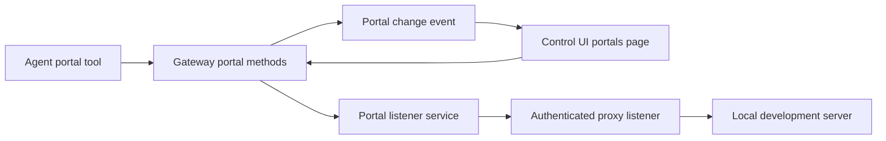

Codex review: needs maintainer review before merge. _Reviewed August 13, 2026, 3:17 AM ET / 07:17 UTC._

# ClawSweeper review

## What this changes

This PR adds authenticated Gateway proxy listeners, an agent portal tool, protocol methods, Control UI previews, and docs for viewing local agent-run development servers.

## Merge readiness

⚠️ **Needs maintainer review before merge - 4 items remain**

Keep open for maintainer product-direction and security-boundary review: this is a new core Gateway capability, and the protected maintainer label prevents automated cleanup.

**Priority:** P2
**Reviewed head:** `ea9dc250c18af34369164cc7c2d38904e52d31a8`
**Owner decision:** Required. See [Decision needed](#decision-needed).

## Review scores

| Measure | Result | What it means |
|---|---|---|
| **Overall readiness** | 🦐 gold shrimp **(3/6)** | The real behavior evidence is strong, while the new core security-sensitive surface still needs exact-head source review and maintainer sponsorship. |
| **Proof confidence** | 🦞 diamond lobster **(5/6)** ✨ media proof bonus | Sufficient (recording): The PR body supplies a real isolated-Gateway/Vite recording and screenshots covering portal opening, live reload, authorization, and closure; locally prepared media contained only unrelated CodeSmith buttons, and GitHub media retrieval was unavailable. |
| **Patch quality** | 🦐 gold shrimp **(3/6)** | No actionable review findings were identified. |

## Verification

| Check | Result | Evidence |
|---|---|---|
| **Real behavior** | Verified | Sufficient (recording): The PR body supplies a real isolated-Gateway/Vite recording and screenshots covering portal opening, live reload, authorization, and closure; locally prepared media contained only unrelated CodeSmith buttons, and GitHub media retrieval was unavailable. |
| **Evidence reviewed** | 6 items | Current-main behavior: Current main has no portal RPCs, portal listener directory, or portal event; the central capability is therefore not already implemented or released. Adjacent security architecture: Current Gateway code treats a separate listener as an isolation boundary that must never serve Control UI or authenticated Gateway data, the same boundary this feature extends. Existing Control UI origin contract: The current UI derives HTTP/HTTPS origins from the configured Gateway URL, which is the caller path the new portal URL resolver must preserve. |
| **Findings** | None | None. |
| **Security** | None | None. |

## How this fits together

The agent tool and Control UI call Gateway portal methods to create temporary listeners for local development servers. Those listeners proxy HTTP and WebSocket traffic, while the Control UI receives portal-change events and renders an operator preview.

## Decision needed

| Question | Recommendation |
|---|---|
| Should OpenClaw make temporary operator-accessible development-server proxies a core Gateway and Control UI capability despite the additional listener and remote-routing constraints? | **Sponsor the core portal surface:** Keep the Gateway-owned listener design and complete exact-head security, compatibility, and CI verification before merge. |

Why: VISION.md prefers a lean core and plugin seams, while the current tree has no plugin seam that can safely own Gateway listener lifecycle, operator scopes, and Control UI integration.

## Before merge

- [ ] **Resolve merge risk (P1)** - The exact PR head is unavailable in this checkout because the promisor remote cannot resolve github.com, so its final code and tests still need a line-level exact-head audit.
- [ ] **Resolve merge risk (P1)** - Independent listener ports remain unavailable through Tailscale Serve or reverse proxies that expose only the Gateway port; the PR detects this and shows recovery UI, but maintainers must accept that product limitation.
- [ ] **Resolve merge risk (P1)** - Exact-head CI is still incomplete in the supplied state.

<strong>Agent review details</strong>

### Security

None.

### Review metrics

| Metric | Value | Why it matters |
|---|---|---|
| **Production versus test LOC** | production/test split unavailable; aggregate +3,376/-38 | The PR head is unavailable locally, so the mandatory production-versus-test classification cannot be independently recalculated from the exact diff. |
| **Gateway protocol surface** | 3 methods added, 1 event added | New cross-client Gateway methods and broadcasts require compatibility verification beyond unit tests. |
| **New declaration surface** | 1 optional workspace declaration documented | The new .openclaw/portals.json convention adds an operator-visible configuration-style contract. |

### Stored data model

Persistent data-model change detected: `database schema: packages/gateway-protocol/src/schema/portals.test.ts`, `migration/backfill/repair: src/gateway/portals/portal-http-proxy.ts`, `unknown-data-model-change: packages/gateway-protocol/src/schema/portals.test.ts`, `unknown-data-model-change: packages/gateway-protocol/src/schema/portals.ts`, `unknown-truncated-pull-files`. Confirm migration or upgrade compatibility proof before merge.

### Merge-risk options

**Maintainer options:**
1. **Sponsor and verify the core surface (recommended)**  
   Accept the new core capability only after an exact-head review confirms listener lifecycle, browser-origin behavior, and the documented proxy limitation.
2. **Pause for a plugin-capable design**  
   Do not merge if maintainers prefer a future extension seam over a permanently bundled Gateway listener and Control UI route.

### Technical review

Best possible solution:

Retain a Gateway-owned implementation only if maintainers sponsor this as core product surface, with the separate-origin, token-redaction, cookie-isolation, and no-referrer invariants confirmed on the exact head before merge.

Do we have a high-confidence way to reproduce the issue?

Not applicable as a defect report. The PR supplies a detailed isolated-Gateway and real-Vite demonstration, but this reviewer environment could not retrieve the linked portal media or exact branch object for independent replay.

Is this the best way to solve the issue?

Unclear. A Gateway-owned listener is plausible because current plugin seams do not expose this lifecycle and authorization boundary, but VISION.md requires a maintainer decision before adding this optional capability to core.

AGENTS.md: found and applied where relevant.

Codex review notes: model internal, reasoning high; reviewed against [7eaf2fccf7ca](https://github.com/openclaw/openclaw/commit/7eaf2fccf7ca9f2c22215324e3b5a04e19ac02e6).

### Labels

Label changes:

- add `proof: sufficient`: Contributor real behavior proof is sufficient. The PR body supplies a real isolated-Gateway/Vite recording and screenshots covering portal opening, live reload, authorization, and closure; locally prepared media contained only unrelated CodeSmith buttons, and GitHub media retrieval was unavailable.
- add `proof: 🎥 video`: Contributor real behavior proof includes video or recording evidence. The PR body supplies a real isolated-Gateway/Vite recording and screenshots covering portal opening, live reload, authorization, and closure; locally prepared media contained only unrelated CodeSmith buttons, and GitHub media retrieval was unavailable.
- add `feature: ✨ showcase`: ClawSweeper spotlight: unusually compelling feature idea for maintainer attention. A first-class live preview path materially improves the operator workflow when agents build or repair web applications.
- add `status: 👀 ready for maintainer look`: ClawSweeper has no concrete contributor-facing blocker left for this PR. Sufficient (recording): The PR body supplies a real isolated-Gateway/Vite recording and screenshots covering portal opening, live reload, authorization, and closure; locally prepared media contained only unrelated CodeSmith buttons, and GitHub media retrieval was unavailable.
- remove `status: ⏳ waiting on author`: Current PR status label is `status: 👀 ready for maintainer look`.

Label justifications:

- `P2`: This is a substantial but non-emergency operator-facing Gateway feature requiring normal maintainer review.
- `merge-risk: 🚨 compatibility`: The PR adds Gateway protocol methods, a Control UI route, native-client artifacts, and a workspace declaration convention.
- `merge-risk: 🚨 security-boundary`: Temporary authenticated reverse-proxy listeners must continue isolating Gateway credentials, bearer URLs, and agent-run targets.
- `rating: 🦐 gold shrimp`: Overall readiness is 🦐 gold shrimp; proof is 🦞 diamond lobster and patch quality is 🦐 gold shrimp.
- `feature: ✨ showcase`: ClawSweeper spotlight: unusually compelling feature idea for maintainer attention. A first-class live preview path materially improves the operator workflow when agents build or repair web applications.
- `status: 👀 ready for maintainer look`: ClawSweeper has no concrete contributor-facing blocker left for this PR. Sufficient (recording): The PR body supplies a real isolated-Gateway/Vite recording and screenshots covering portal opening, live reload, authorization, and closure; locally prepared media contained only unrelated CodeSmith buttons, and GitHub media retrieval was unavailable.
- `proof: sufficient`: Contributor real behavior proof is sufficient. The PR body supplies a real isolated-Gateway/Vite recording and screenshots covering portal opening, live reload, authorization, and closure; locally prepared media contained only unrelated CodeSmith buttons, and GitHub media retrieval was unavailable.
- `proof: 🎥 video`: Contributor real behavior proof includes video or recording evidence. The PR body supplies a real isolated-Gateway/Vite recording and screenshots covering portal opening, live reload, authorization, and closure; locally prepared media contained only unrelated CodeSmith buttons, and GitHub media retrieval was unavailable.

### Evidence

What I checked:

- **Current-main behavior:** Current main has no portal RPCs, portal listener directory, or portal event; the central capability is therefore not already implemented or released. ([`src/gateway/server-runtime-state.ts:267`](https://github.com/openclaw/openclaw/blob/7eaf2fccf7ca/src/gateway/server-runtime-state.ts#L267), [7eaf2fccf7ca](https://github.com/openclaw/openclaw/commit/7eaf2fccf7ca))
- **Adjacent security architecture:** Current Gateway code treats a separate listener as an isolation boundary that must never serve Control UI or authenticated Gateway data, the same boundary this feature extends. ([`src/gateway/mcp-app-sandbox-http.ts:55`](https://github.com/openclaw/openclaw/blob/7eaf2fccf7ca/src/gateway/mcp-app-sandbox-http.ts#L55), [7eaf2fccf7ca](https://github.com/openclaw/openclaw/commit/7eaf2fccf7ca))
- **Existing Control UI origin contract:** The current UI derives HTTP/HTTPS origins from the configured Gateway URL, which is the caller path the new portal URL resolver must preserve. ([`ui/src/components/sandbox-host.ts:1`](https://github.com/openclaw/openclaw/blob/7eaf2fccf7ca/ui/src/components/sandbox-host.ts#L1), [7eaf2fccf7ca](https://github.com/openclaw/openclaw/commit/7eaf2fccf7ca))
- **Feature-history provenance:** The adjacent dedicated sandbox-host and Control UI origin code is attributed to Peter Steinberger, providing a concrete current-main ownership trail for the new listener design. ([`src/gateway/mcp-app-sandbox-http.ts:55`](https://github.com/openclaw/openclaw/blob/e4e558df215a/src/gateway/mcp-app-sandbox-http.ts#L55), [e4e558df215a](https://github.com/openclaw/openclaw/commit/e4e558df215a))
- **Exact-head inspection gap:** The checked-out repository is clean at main, but the PR head object is absent and the configured promisor remote could not resolve github.com, so a final line-level audit of the exact branch cannot be completed locally. ([ea9dc250c18a](https://github.com/openclaw/openclaw/commit/ea9dc250c18a))
- **Review-driven hardening:** The discussion records that the latest commit pins Referrer-Policy to no-referrer and strips token-bearing Referer values after prior review found the bearer-query leak path. ([`src/gateway/portals/portal-http-proxy.ts`](https://github.com/openclaw/openclaw/blob/ea9dc250c18a/src/gateway/portals/portal-http-proxy.ts), [ea9dc250c18a](https://github.com/openclaw/openclaw/commit/ea9dc250c18a))

Likely related people:

- **steipete:** Peter Steinberger authored the current dedicated sandbox-host and Control UI origin code and authored this portal feature and its security hardening. (role: feature and adjacent security-boundary owner; confidence: high; commits: [e4e558df215a](https://github.com/openclaw/openclaw/commit/e4e558df215a009fb24faa4471c4ee8dc7730151), [ea9dc250c18a](https://github.com/openclaw/openclaw/commit/ea9dc250c18af34369164cc7c2d38904e52d31a8); files: `src/gateway/mcp-app-sandbox-http.ts`, `ui/src/components/sandbox-host.ts`, `src/gateway/portals/portal-http-proxy.ts`)

### Rank-up moves

Optional improvements that raise the rating; they are not merge blockers.

- Complete a line-level security and compatibility audit against the exact PR head.
- Resolve the core-versus-extension product decision before merge.

### Rating scale

| Score | Internal tier | Crab rank | Meaning |
|---:|:---:|---|---|
| **6/6** | S | 🦀 challenger crab | Exceptional readiness |
| **5/6** | A | 🦞 diamond lobster | Very strong readiness |
| **4/6** | B | 🐚 platinum hermit | Good normal PR; ordinary maintainer review |
| **3/6** | C | 🦐 gold shrimp | Useful, but confidence is limited |
| **2/6** | D | 🦪 silver shellfish | Proof or implementation needs work |
| **1/6** | F | 🧂 unranked krab | Not merge-ready |
| N/A | NA | 🌊 off-meta tidepool | Rating does not apply |

Overall follows the weaker of proof and patch quality.
Shiny media proof means a screenshot, video, or linked artifact directly shows the changed behavior. Runtime, network, CSP, and security claims still need visible diagnostics.

### Workflow

- ClawSweeper keeps one durable marker-backed review comment per issue or PR.
- Re-runs edit this comment so the latest verdict, findings, and automation markers stay together instead of adding duplicate bot comments.
- A fresh review can be triggered by eligible `@clawsweeper re-review` comments, exact-item GitHub events, scheduled/background review runs, or manual workflow dispatch.
- PR/issue authors and users with repository write access can comment `@clawsweeper re-review` or `@clawsweeper re-run` on an open PR or issue to request a fresh review only.
- Maintainers can also comment `@clawsweeper review` to request a fresh review only.
- Fresh-review commands do not start repair, autofix, rebase, CI repair, or automerge.
- Maintainer-only repair and merge flows require explicit commands such as `@clawsweeper autofix`, `@clawsweeper automerge`, `@clawsweeper fix ci`, or `@clawsweeper address review`.
- Maintainers can comment `@clawsweeper explain` to ask for more context, or `@clawsweeper stop` to stop active automation.

### History

Review history (22 earlier review cycles; latest 8 shown)

<!-- clawsweeper-review-history v=1 total=22 -->
- reviewed 2026-08-12T22:38:36.625Z sha 2eaf2168a56d97c5486df48b65c79974bbc749a6 :: found issues before merge. :: [P2] Clarify how development-server variables are supplied
- reviewed 2026-08-12T23:10:00.314Z sha 9e4b49ded9ee0d78844e55f3848ffaa450fcbb3c :: found issues before merge. :: [P2] Align the quick start with the actual execution contract
- reviewed 2026-08-13T00:21:08.995Z sha f72c71e61ae6e92f7956b2cefaafce262950817d :: found issues before merge. :: [P2] Align the quick start with the execution contract
- reviewed 2026-08-13T00:35:43.304Z sha 85cc3c92577eb2d74fcfe741512dc2bf9be8c637 :: needs maintainer review before merge. :: none
- reviewed 2026-08-13T03:19:01.382Z sha e54f06620c69d5aa9088c3a76b8dbd3099aa4e94 :: found issues before merge. :: [P1] Prevent portal URLs from leaking through target referrer policy
- reviewed 2026-08-13T04:27:00.605Z sha 69c3022f0abf4e56a6eecce2b0b7411136691f43 :: found issues before merge. :: [P1] Enforce a proxy-owned no-referrer policy
- reviewed 2026-08-13T05:18:48.817Z sha 90400d487c8bdbd164aeb3b0a4cd03d131934940 :: needs maintainer review before merge. :: none
- reviewed 2026-08-13T06:21:29.320Z sha 7098e9a88985faefcb8d7dffdb7dd7b215c038a4 :: needs maintainer review before merge. :: none

<!-- clawsweeper-verdict:needs-human item=122536 sha=ea9dc250c18af34369164cc7c2d38904e52d31a8 confidence=high updated_at=2026-08-13T07:13:38Z reviewed_at=2026-08-13T07:17:12.285Z lease_owner=github-run-31676821849-1 lease_comment_id=5277226560 source_revision=8c05e06752cfb414f3c72f11dd1754ba7bc1dd1e77f424f193b7ffadc234ca23 -->

<!-- clawsweeper-review-version item=122536 reviewed_at=2026-08-13T07:17:12.285Z sha=ea9dc250c18af34369164cc7c2d38904e52d31a8 source_revision=8c05e06752cfb414f3c72f11dd1754ba7bc1dd1e77f424f193b7ffadc234ca23 lease_owner=github-run-31676821849-1 lease_comment_id=5277226560 v=1 -->

<!-- clawsweeper-review item=122536 -->