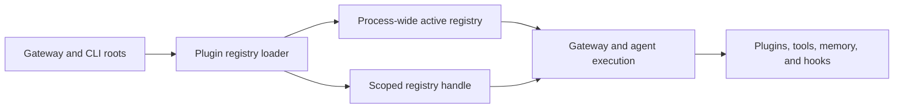

Codex review: needs real behavior proof before merge. _Reviewed August 1, 2026, 7:07 PM ET / 23:07 UTC._

# ClawSweeper review

## What this changes

This PR separates plugin-registry installation owned by gateway and CLI process roots from scoped registry handles passed through agent, memory, tool, TUI, node-host, and setup runtime paths.

## Merge readiness

⛔ **Blocked until real behavior proof is added - 5 items remain**

Keep this PR open. The requested architecture is not obsolete on current main, but the exact PR head, live discussion/proof artifacts, and the required sibling Codex source were unavailable, so a merge or cleanup verdict would not be safe.

**Priority:** P2
**Reviewed head:** `290f353d474b1075314477dbd75c6ae8b57099c0`

## Review scores

| Measure | Result | What it means |
|---|---|---|
| **Overall readiness** | 🧂 unranked krab **(1/6)** | The architectural intent is substantial, but unavailable exact source, dependency evidence, and real after-fix proof prevent a merge-ready assessment. |
| **Proof confidence** | 🧂 unranked krab **(1/6)** | Needs real behavior proof before merge: No inspectable redacted after-fix gateway or CLI transcript demonstrates that a scoped load preserves the root registry; provide that evidence without private paths, endpoints, IPs, or credentials. After adding proof, update the PR body; ClawSweeper should re-review automatically. If it does not, the PR author or someone with repository write access can comment `@clawsweeper re-review`. |
| **Patch quality** | 🦐 gold shrimp **(3/6)** | No actionable review findings were identified. |

## Verification

| Check | Result | Evidence |
|---|---|---|
| **Real behavior** | Needs proof | Needs real behavior proof before merge: No inspectable redacted after-fix gateway or CLI transcript demonstrates that a scoped load preserves the root registry; provide that evidence without private paths, endpoints, IPs, or credentials. After adding proof, update the PR body; ClawSweeper should re-review automatically. If it does not, the PR author or someone with repository write access can comment `@clawsweeper re-review`. |
| **Evidence reviewed** | 5 items | Current-main behavior: Current main still exposes `ensureRuntimePluginsLoaded`, which delegates to the standalone loader, and that loader installs a newly loaded registry into process-wide active state unless a caller selects one of the narrow no-install branches. This confirms the central refactor is not already implemented on main. Affected caller surfaces remain: Current main has standalone-loading callers in prepared model runtime facts, memory runtime, and plugin tool resolution, so the proposed change spans real shared lifecycle paths rather than obsolete code. Current-path provenance: Blame attributes the current process-wide installation path in the affected loader to commit `9aceb1620d4fc21753e12247d745ef1f3244ac60`; local history was incomplete because this checkout is promisor-backed and the required older objects could not be fetched while GitHub DNS was unavailable. |
| **Findings** | None | None. |
| **Security** | None | None. |

## How this fits together

Plugin registries assemble plugin-provided harnesses, tools, memory capabilities, hooks, and gateway routes. Gateway and CLI roots establish runtime state, while agent runs and request handlers consume those capabilities during execution.

## Before merge

- [ ] **Add real behavior proof** - Needs real behavior proof before merge: No inspectable redacted after-fix gateway or CLI transcript demonstrates that a scoped load preserves the root registry; provide that evidence without private paths, endpoints, IPs, or credentials. After adding proof, update the PR body; ClawSweeper should re-review automatically. If it does not, the PR author or someone with repository write access can comment `@clawsweeper re-review`.
- [ ] **Resolve merge risk (P1)** - The exact 131-file PR head cannot be reviewed from this checkout, so no line-level correctness conclusion is safe.
- [ ] **Resolve merge risk (P1)** - The required direct Codex protocol/runtime inspection is blocked because `../codex` is absent.
- [ ] **Resolve merge risk (P1)** - The supplied context reports automated validation but does not provide inspectable redacted after-fix gateway or CLI evidence that a scoped load preserves the root-installed registry.
- [ ] **Complete next step (P2)** - A healthy review environment must provide the exact branch, direct Codex source, and inspectable real-behavior proof before this PR can be judged or safely repaired.

<strong>Agent review details</strong>

### Security

None.

### Review metrics

None.

### Stored data model

Persistent data-model change detected: `durable storage schema: src/gateway/worker-environments/inference-runtime.test.ts`, `migration/backfill/repair: src/plugins/migration-provider-runtime.test.ts`, `migration/backfill/repair: src/plugins/migration-provider-runtime.ts`, `persistent cache schema: src/plugins/loader.runtime-registry.test.ts`, `persistent cache schema: src/plugins/runtime/standalone-runtime-registry-loader.ts`, `serialized state: src/agents/prepared-model-runtime.owner.ts`, and 10 more. Confirm migration or upgrade compatibility proof before merge.

### Merge-risk options

**Maintainer options:**
1. **Refresh source and proof before merge (recommended)**  
   Review the exact head with direct Codex-source inspection and a redacted real runtime transcript before considering merge.
2. **Pause the landing candidate**  
   Leave this PR open without merging until its source, dependency contract, and runtime proof are inspectable.

### Technical review

Best possible solution:

Review the exact PR head in an environment with live GitHub access and sibling `../codex`, then require a redacted after-fix gateway or CLI transcript proving that a scoped runtime load does not replace the root registry.

Do we have a high-confidence way to reproduce the issue?

Not applicable as a bug reproduction: this is an internal refactor PR. The relevant behavioral proof is a real gateway or CLI run showing a scoped load preserves the root registry, but that artifact is unavailable here.

Is this the best way to solve the issue?

Unclear. The requested ownership split matches the repository preference for immutable or request-scoped handles, but the exact patch and Codex-backed behavior could not be inspected.

AGENTS.md: found and applied where relevant.

Codex review notes: model internal, reasoning high; reviewed against [eb8c22ed13f9](https://github.com/openclaw/openclaw/commit/eb8c22ed13f9865e07c0e363706183188e2a8fd1).

### Labels

Label justifications:

- `P2`: This broad internal runtime refactor has material compatibility implications but no demonstrated urgent user-facing regression in the available evidence.
- `merge-risk: 🚨 compatibility`: The PR changes plugin registry activation and lookup behavior used by existing plugin and runtime paths.
- `merge-risk: 🚨 availability`: Incorrect registry-handle propagation could leave plugin-backed hooks, tools, memory, or harnesses unavailable at runtime.
- `rating: 🧂 unranked krab`: Overall readiness is 🧂 unranked krab; proof is 🧂 unranked krab and patch quality is 🦐 gold shrimp.
- `status: 📣 needs proof`: The PR needs real behavior proof before ClawSweeper can clear the contributor ask. Needs real behavior proof before merge: No inspectable redacted after-fix gateway or CLI transcript demonstrates that a scoped load preserves the root registry; provide that evidence without private paths, endpoints, IPs, or credentials. After adding proof, update the PR body; ClawSweeper should re-review automatically. If it does not, the PR author or someone with repository write access can comment `@clawsweeper re-review`.

### Evidence

What I checked:

- **Current-main behavior:** Current main still exposes `ensureRuntimePluginsLoaded`, which delegates to the standalone loader, and that loader installs a newly loaded registry into process-wide active state unless a caller selects one of the narrow no-install branches. This confirms the central refactor is not already implemented on main. ([`src/agents/runtime-plugins.ts:32`](https://github.com/openclaw/openclaw/blob/eb8c22ed13f9/src/agents/runtime-plugins.ts#L32), [eb8c22ed13f9](https://github.com/openclaw/openclaw/commit/eb8c22ed13f9))
- **Affected caller surfaces remain:** Current main has standalone-loading callers in prepared model runtime facts, memory runtime, and plugin tool resolution, so the proposed change spans real shared lifecycle paths rather than obsolete code. ([`src/plugins/tools.ts:1143`](https://github.com/openclaw/openclaw/blob/eb8c22ed13f9/src/plugins/tools.ts#L1143), [eb8c22ed13f9](https://github.com/openclaw/openclaw/commit/eb8c22ed13f9))
- **Current-path provenance:** Blame attributes the current process-wide installation path in the affected loader to commit `9aceb1620d4fc21753e12247d745ef1f3244ac60`; local history was incomplete because this checkout is promisor-backed and the required older objects could not be fetched while GitHub DNS was unavailable. ([`src/plugins/runtime/standalone-runtime-registry-loader.ts:52`](https://github.com/openclaw/openclaw/blob/9aceb1620d4f/src/plugins/runtime/standalone-runtime-registry-loader.ts#L52), [9aceb1620d4f](https://github.com/openclaw/openclaw/commit/9aceb1620d4f))
- **Exact PR source unavailable:** The checkout is clean on current main, but the PR head `290f353d474b1075314477dbd75c6ae8b57099c0` is not locally available. GitHub access also failed, so the full diff, comments, checks, and proof artifacts could not be refreshed. ([eb8c22ed13f9](https://github.com/openclaw/openclaw/commit/eb8c22ed13f9))
- **Codex review gate unavailable:** The repository policy requires direct inspection of sibling `../codex` before a verdict on the PR's Codex-related runtime behavior. That checkout is absent and could not be cloned in this read-only, network-unavailable environment. ([`AGENTS.md:18`](https://github.com/openclaw/openclaw/blob/eb8c22ed13f9/AGENTS.md#L18), [eb8c22ed13f9](https://github.com/openclaw/openclaw/commit/eb8c22ed13f9))

Likely related people:

- **steipete:** The supplied PR history attributes this registry-ownership series and the preceding merged bundle-contributions refactor to this contributor. (role: feature owner; confidence: medium; commits: [0a899bbfee71](https://github.com/openclaw/openclaw/commit/0a899bbfee71ba122ca2a0bdb5b09a5a4c551010), [290f353d474b](https://github.com/openclaw/openclaw/commit/290f353d474b1075314477dbd75c6ae8b57099c0), [e4d1b7e0d38c](https://github.com/openclaw/openclaw/commit/e4d1b7e0d38cfabc0ce07adb3f30c2159cfcad45); files: `src/plugins/loader.ts`, `src/agents/runtime-plugins.ts`, `src/plugins/runtime/standalone-runtime-registry-loader.ts`)
- **Jesse Merhi:** Current-main blame attributes the active standalone registry loading path to this contributor's commit, making them a relevant reviewer for compatibility with the existing behavior. (role: recent area contributor; confidence: medium; commits: [9aceb1620d4f](https://github.com/openclaw/openclaw/commit/9aceb1620d4fc21753e12247d745ef1f3244ac60); files: `src/agents/runtime-plugins.ts`, `src/plugins/runtime/standalone-runtime-registry-loader.ts`)

### Rank-up moves

Optional improvements that raise the rating; they are not merge blockers.

- Add a redacted gateway or CLI transcript showing a scoped runtime load leaves the root registry intact.
- Re-run review where the exact PR head and sibling `../codex` sources are available.

### Rating scale

| Score | Internal tier | Crab rank | Meaning |
|---:|:---:|---|---|
| **6/6** | S | 🦀 challenger crab | Exceptional readiness |
| **5/6** | A | 🦞 diamond lobster | Very strong readiness |
| **4/6** | B | 🐚 platinum hermit | Good normal PR; ordinary maintainer review |
| **3/6** | C | 🦐 gold shrimp | Useful, but confidence is limited |
| **2/6** | D | 🦪 silver shellfish | Proof or implementation needs work |
| **1/6** | F | 🧂 unranked krab | Not merge-ready |
| N/A | NA | 🌊 off-meta tidepool | Rating does not apply |

Overall follows the weaker of proof and patch quality.
Shiny media proof means a screenshot, video, or linked artifact directly shows the changed behavior. Runtime, network, CSP, and security claims still need visible diagnostics.

### Workflow

- ClawSweeper keeps one durable marker-backed review comment per issue or PR.
- Re-runs edit this comment so the latest verdict, findings, and automation markers stay together instead of adding duplicate bot comments.
- A fresh review can be triggered by eligible `@clawsweeper re-review` comments, exact-item GitHub events, scheduled/background review runs, or manual workflow dispatch.
- PR/issue authors and users with repository write access can comment `@clawsweeper re-review` or `@clawsweeper re-run` on an open PR or issue to request a fresh review only.
- Maintainers can also comment `@clawsweeper review` to request a fresh review only.
- Fresh-review commands do not start repair, autofix, rebase, CI repair, or automerge.
- Maintainer-only repair and merge flows require explicit commands such as `@clawsweeper autofix`, `@clawsweeper automerge`, `@clawsweeper fix ci`, or `@clawsweeper address review`.
- Maintainers can comment `@clawsweeper explain` to ask for more context, or `@clawsweeper stop` to stop active automation.

### History

Review history (6 earlier review cycles)

<!-- clawsweeper-review-history v=1 total=6 -->
- reviewed 2026-08-01T19:25:44.882Z sha 9215b911cbee2ae0c64377028a7c821295120f70 :: needs real behavior proof before merge. :: none
- reviewed 2026-08-01T19:30:37.535Z sha 9215b911cbee2ae0c64377028a7c821295120f70 :: needs real behavior proof before merge. :: none
- reviewed 2026-08-01T19:37:23.904Z sha c5aa52651bd4a9706e249695ae161bb203393064 :: needs real behavior proof before merge. :: none
- reviewed 2026-08-01T20:31:24.199Z sha 9ca5fd3ab6e63270cb49f260b8f7046e8d62aa1a :: needs real behavior proof before merge. :: none
- reviewed 2026-08-01T22:12:08.167Z sha 44d17971cc0a664681a28b7481c82a4ae6c30fd8 :: needs real behavior proof before merge. :: none
- reviewed 2026-08-01T22:39:02.184Z sha 0cf313a0215a05677d9a1038bd83245b258eb1ba :: needs real behavior proof before merge. :: none

<!-- clawsweeper-verdict:needs-human item=117587 sha=290f353d474b1075314477dbd75c6ae8b57099c0 confidence=low updated_at=2026-08-01T23:05:06Z reviewed_at=2026-08-01T23:07:18.317Z lease_owner=github-run-30722591890-1 lease_comment_id=5153902088 source_revision=a55c79f4d6fc200644dfc5b72ef7a74e3f7df85064d96fc8fd4628f818a63a62 -->

<!-- clawsweeper-review-version item=117587 reviewed_at=2026-08-01T23:07:18.317Z sha=290f353d474b1075314477dbd75c6ae8b57099c0 source_revision=a55c79f4d6fc200644dfc5b72ef7a74e3f7df85064d96fc8fd4628f818a63a62 lease_owner=github-run-30722591890-1 lease_comment_id=5153902088 v=1 -->

<!-- clawsweeper-review item=117587 -->