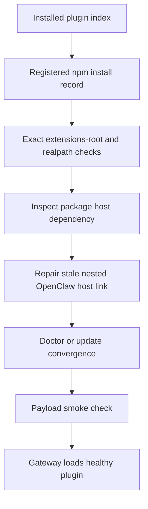

Codex review: needs maintainer review before merge. _Reviewed August 2, 2026, 8:43 PM ET / August 3, 2026, 00:43 UTC._

# ClawSweeper review

## What this changes

Repairs stale nested `openclaw` host packages for registered npm plugins during Doctor, plugin updates, and post-core-update convergence without touching developer-owned or out-of-root installations.

## Merge readiness

⚠️ **Ready for maintainer review - 3 items remain**

Keep open. Current main repairs host links only inside managed npm project roots, while this PR adds the missing registered legacy `state/extensions/&lt;pluginId>` repair path and resolves the prior arbitrary-path mutation finding with exact record, root, and realpath checks. The protected `maintainer` label and upgrade-time filesystem mutation still require a maintainer security-boundary decision before landing.

**Priority:** P1
**Reviewed head:** `c7547e2d7f68765d09e25a7cc2c8ba75a0697669`
**Owner decision:** Required. See [Decision needed](#decision-needed).

## Review scores

| Measure | Result | What it means |
|---|---|---|
| **Overall readiness** | 🐚 platinum hermit **(4/6)** | The patch has focused source and ownership-boundary coverage plus reported real-install proof; the remaining gate is maintainer acceptance of automatic legacy-state repair semantics. |
| **Proof confidence** | 🐚 platinum hermit **(4/6)** | Sufficient (live_output): The PR body provides after-fix real packaged npm-install evidence and states that the final head exercised two real local-registry installs plus filesystem repair scenarios; redact private paths or registry details if additional evidence is posted. |
| **Patch quality** | 🐚 platinum hermit **(4/6)** | No actionable review findings were identified. |

## Verification

| Check | Result | Evidence |
|---|---|---|
| **Real behavior** | Verified | Sufficient (live_output): The PR body provides after-fix real packaged npm-install evidence and states that the final head exercised two real local-registry installs plus filesystem repair scenarios; redact private paths or registry details if additional evidence is posted. |
| **Evidence reviewed** | 7 items | Current-main gap: Current main's post-core convergence repairs only managed npm project roots via `relinkOpenClawPeerDependenciesInManagedNpmRoot`; it has no registered extensions-root reconciliation, so the reported legacy install remains uncovered. Canonical repair boundary: The PR accepts only npm records whose resolved install path exactly equals the plugin-id-derived directory, whose realpath stays inside the extensions root, and whose realpath is exactly the expected path before it can inspect or relink a host dependency. Post-update owner uses the constrained reconciler: The PR routes legacy registered installs through the same constrained reconciler before the active-plugin payload smoke check, while retaining the existing managed-npm-root repair path. |
| **Findings** | None | None. |
| **Security** | None | None. |

## How this fits together

OpenClaw stores installed-plugin records in its state index and loads plugin packages from managed roots. Doctor and update convergence inspect those records, repair a stale plugin-local host package when the installation is proven to be OpenClaw-managed, then run payload checks before the gateway uses the plugin.

## Decision needed

| Question | Recommendation |
|---|---|
| Does the exact registered npm record plus expected extensions-root realpath predicate provide the intended authorization boundary for replacing a stale nested `openclaw` package during Doctor and update repair? | **Confirm the constrained repair boundary:** Accept repair only for authoritative npm records at their exact canonical extensions-root path, then merge after normal current-head checks complete. |

Why: The patch performs destructive repair of user-local plugin directories; source review shows the requested narrowing, but repository policy reserves larger ownership and security-boundary changes for maintainer judgment, and Codex-specific source validation could not be completed locally.

## Before merge

- [ ] **Resolve merge risk (P1)** - This intentionally changes upgrade-time filesystem repair: a stale copied nested `openclaw` directory may be replaced with a canonical host link, so maintainers must accept the exact registered-root and realpath predicate as the ownership boundary.
- [ ] **Resolve merge risk (P1)** - The affected report concerns the Codex plugin, but the sibling Codex checkout required by repository policy was unavailable and GitHub DNS prevented obtaining it; the remaining Codex-specific runtime contract check needs an environment with that source available.

<strong>Agent review details</strong>

### Security

None.

### PR surface

Source +250, Tests +734. Total +984 across 17 files.

View PR surface stats

| Area | Files | Added | Removed | Net |
|---|---:|---:|---:|---:|
| Source | 10 | 553 | 303 | +250 |
| Tests | 7 | 795 | 61 | +734 |
| Docs | 0 | 0 | 0 | 0 |
| Config | 0 | 0 | 0 | 0 |
| Generated | 0 | 0 | 0 | 0 |
| Other | 0 | 0 | 0 | 0 |
| **Total** | **17** | **1348** | **364** | **+984** |

### Review metrics

None.

### Stored data model

Persistent data-model change detected: `migration/backfill/repair: src/commands/doctor-config-flow.test.ts`, `migration/backfill/repair: src/commands/doctor-plugin-host-links.test.ts`, `migration/backfill/repair: src/commands/doctor-plugin-host-links.ts`, `migration/backfill/repair: src/commands/doctor-plugin-registry.ts`, `migration/backfill/repair: src/commands/doctor/repair-sequencing.test.ts`, `migration/backfill/repair: src/commands/doctor/repair-sequencing.ts`, and 10 more. Confirm migration or upgrade compatibility proof before merge.

### Root-cause cluster

Relationship: `fixed_by_candidate`
Canonical: https://github.com/openclaw/openclaw/issues/108705
Summary: This PR is a concrete candidate repair for the open stale-host-package regression described in the linked issue; current main still lacks the registered legacy-install repair path.

Members:
- `canonical`: https://github.com/openclaw/openclaw/issues/108705 - The PR body uses closing linkage and its source change targets the stale nested host-package failure described there.

Proposal only: this assessment does not dispatch repair, suppress jobs, mutate sibling items, close, or merge anything.

### Merge-risk options

**Maintainer options:**
1. **Confirm exact-root repair semantics before merge (recommended)**  
   Accept the upgrade repair only if maintainers agree that a registered npm record plus canonical root and realpath checks establishes OpenClaw ownership of the nested host package.
2. **Keep repair explicit-only**  
   If automatic replacement is too broad for legacy installations, narrow the change to Doctor's explicit repair path and document the operator-visible recovery.

### Technical review

Best possible solution:

Land the canonical SQLite-record and exact-realpath repair only after a maintainer confirms that registered npm installs at the exact `state/extensions/<pluginId>` path are OpenClaw-owned upgrade state and accepts the bounded replacement behavior.

Do we have a high-confidence way to reproduce the issue?

Yes, source reproducibly shows the gap: current main repairs managed npm project roots but not registered legacy npm installs under the extensions root; the PR adds focused filesystem regressions for that state.

Is this the best way to solve the issue?

Yes, subject to the maintainer ownership decision: routing all legacy repair paths through the SQLite-record-derived exact-root reconciler is safer than the earlier arbitrary install-path loop and keeps developer-owned installs out of scope.

AGENTS.md: found and applied where relevant.

Codex review notes: model internal, reasoning high; reviewed against [18c9f27e2de3](https://github.com/openclaw/openclaw/commit/18c9f27e2de3cb1d3ac6555588a356d56c6fd9bb).

### Labels

Label changes:

- add `rating: 🐚 platinum hermit`: Overall readiness is 🐚 platinum hermit; proof is 🐚 platinum hermit and patch quality is 🐚 platinum hermit.
- add `status: 👀 ready for maintainer look`: ClawSweeper has no concrete contributor-facing blocker left for this PR. Sufficient (live_output): The PR body provides after-fix real packaged npm-install evidence and states that the final head exercised two real local-registry installs plus filesystem repair scenarios; redact private paths or registry details if additional evidence is posted.
- remove `rating: 🦐 gold shrimp`: Current PR rating is `rating: 🐚 platinum hermit`, so this older rating label is no longer current.
- remove `status: ⏳ waiting on author`: Current PR status label is `status: 👀 ready for maintainer look`.

Label justifications:

- `P1`: A stale host package can make an upgraded provider plugin fail before an agent reply, affecting an existing user workflow.
- `merge-risk: 🚨 compatibility`: The PR changes post-upgrade and unchanged-version plugin repair behavior for existing local installations.
- `merge-risk: 🚨 security-boundary`: The repair can replace a local nested package, so correctness depends on the new ledger, canonical-root, and realpath ownership checks.
- `rating: 🐚 platinum hermit`: Overall readiness is 🐚 platinum hermit; proof is 🐚 platinum hermit and patch quality is 🐚 platinum hermit.
- `status: 👀 ready for maintainer look`: ClawSweeper has no concrete contributor-facing blocker left for this PR. Sufficient (live_output): The PR body provides after-fix real packaged npm-install evidence and states that the final head exercised two real local-registry installs plus filesystem repair scenarios; redact private paths or registry details if additional evidence is posted.
- `proof: sufficient`: Contributor real behavior proof is sufficient. The PR body provides after-fix real packaged npm-install evidence and states that the final head exercised two real local-registry installs plus filesystem repair scenarios; redact private paths or registry details if additional evidence is posted.

### Evidence

What I checked:

- **Current-main gap:** Current main's post-core convergence repairs only managed npm project roots via `relinkOpenClawPeerDependenciesInManagedNpmRoot`; it has no registered extensions-root reconciliation, so the reported legacy install remains uncovered. ([`src/cli/update-cli/post-core-plugin-convergence.ts:63`](https://github.com/openclaw/openclaw/blob/18c9f27e2de3/src/cli/update-cli/post-core-plugin-convergence.ts#L63), [18c9f27e2de3](https://github.com/openclaw/openclaw/commit/18c9f27e2de3))
- **Canonical repair boundary:** The PR accepts only npm records whose resolved install path exactly equals the plugin-id-derived directory, whose realpath stays inside the extensions root, and whose realpath is exactly the expected path before it can inspect or relink a host dependency. ([`src/plugins/plugin-peer-link.ts:391`](https://github.com/openclaw/openclaw/blob/c7547e2d7f68/src/plugins/plugin-peer-link.ts#L391), [c7547e2d7f68](https://github.com/openclaw/openclaw/commit/c7547e2d7f68))
- **Post-update owner uses the constrained reconciler:** The PR routes legacy registered installs through the same constrained reconciler before the active-plugin payload smoke check, while retaining the existing managed-npm-root repair path. ([`src/cli/update-cli/post-core-plugin-convergence.ts:69`](https://github.com/openclaw/openclaw/blob/c7547e2d7f68/src/cli/update-cli/post-core-plugin-convergence.ts#L69), [c7547e2d7f68](https://github.com/openclaw/openclaw/commit/c7547e2d7f68))
- **Prior review finding addressed:** The follow-up commit is explicitly titled `fix(plugins): constrain host repair to registered install roots`; its implementation replaces the formerly broad post-update repair ownership with the exact-root reconciliation above. ([`src/plugins/plugin-peer-link.ts:428`](https://github.com/openclaw/openclaw/blob/c7547e2d7f68/src/plugins/plugin-peer-link.ts#L428), [c7547e2d7f68](https://github.com/openclaw/openclaw/commit/c7547e2d7f68))
- **Feature-history routing:** Local history identifies Vincent Koc's merged `fix(plugins): relink host runtime dependencies` commit as the earlier mainline owner trail; Peter Steinberger has the largest local shortlog footprint across the affected plugin files and authored the current repair series. ([`src/plugins/plugin-peer-link.ts:391`](https://github.com/openclaw/openclaw/blob/355295bfef4a/src/plugins/plugin-peer-link.ts#L391), [355295bfef4a](https://github.com/openclaw/openclaw/commit/355295bfef4a))
- **Release status:** The candidate repair commit is not on current main and therefore cannot be in the current release; the checked-out main head is `18c9f27e2de3cb1d3ac6555588a356d56c6fd9bb`. ([`src/cli/update-cli/post-core-plugin-convergence.ts:63`](https://github.com/openclaw/openclaw/blob/18c9f27e2de3/src/cli/update-cli/post-core-plugin-convergence.ts#L63), [18c9f27e2de3](https://github.com/openclaw/openclaw/commit/18c9f27e2de3))

Likely related people:

- **Peter Steinberger:** Local shortlog shows the strongest contribution trail across the affected plugin repair files, and the current three-commit repair series is authored by him. (role: recent area contributor and current repair author; confidence: high; commits: [c7547e2d7f68](https://github.com/openclaw/openclaw/commit/c7547e2d7f68765d09e25a7cc2c8ba75a0697669), [7951bf9ad511](https://github.com/openclaw/openclaw/commit/7951bf9ad511dfe5c8c2bbc944d73758258b0875), [fa8a1335c265](https://github.com/openclaw/openclaw/commit/fa8a1335c26529b6fbe1ef9620b0ac028777af95); files: `src/plugins/plugin-peer-link.ts`, `src/commands/doctor-plugin-host-links.ts`, `src/cli/update-cli/post-core-plugin-convergence.ts`)
- **Vincent Koc:** Local feature history identifies the merged `fix(plugins): relink host runtime dependencies` commit as an earlier owner of the managed host-link behavior this PR extends. (role: earlier host-link implementation contributor; confidence: medium; commits: [355295bfef4a](https://github.com/openclaw/openclaw/commit/355295bfef4abadeb94286dce2b911d12531b98b); files: `src/plugins/plugin-peer-link.ts`, `src/plugins/update-config.ts`)

### Rating scale

| Score | Internal tier | Crab rank | Meaning |
|---:|:---:|---|---|
| **6/6** | S | 🦀 challenger crab | Exceptional readiness |
| **5/6** | A | 🦞 diamond lobster | Very strong readiness |
| **4/6** | B | 🐚 platinum hermit | Good normal PR; ordinary maintainer review |
| **3/6** | C | 🦐 gold shrimp | Useful, but confidence is limited |
| **2/6** | D | 🦪 silver shellfish | Proof or implementation needs work |
| **1/6** | F | 🧂 unranked krab | Not merge-ready |
| N/A | NA | 🌊 off-meta tidepool | Rating does not apply |

Overall follows the weaker of proof and patch quality.
Shiny media proof means a screenshot, video, or linked artifact directly shows the changed behavior. Runtime, network, CSP, and security claims still need visible diagnostics.

### Workflow

- ClawSweeper keeps one durable marker-backed review comment per issue or PR.
- Re-runs edit this comment so the latest verdict, findings, and automation markers stay together instead of adding duplicate bot comments.
- A fresh review can be triggered by eligible `@clawsweeper re-review` comments, exact-item GitHub events, scheduled/background review runs, or manual workflow dispatch.
- PR/issue authors and users with repository write access can comment `@clawsweeper re-review` or `@clawsweeper re-run` on an open PR or issue to request a fresh review only.
- Maintainers can also comment `@clawsweeper review` to request a fresh review only.
- Fresh-review commands do not start repair, autofix, rebase, CI repair, or automerge.
- Maintainer-only repair and merge flows require explicit commands such as `@clawsweeper autofix`, `@clawsweeper automerge`, `@clawsweeper fix ci`, or `@clawsweeper address review`.
- Maintainers can comment `@clawsweeper explain` to ask for more context, or `@clawsweeper stop` to stop active automation.

### History

Review history (1 earlier review cycle)

<!-- clawsweeper-review-history v=1 total=1 -->
- reviewed 2026-08-02T23:52:30.688Z sha 7951bf9ad511dfe5c8c2bbc944d73758258b0875 :: found issues before merge. :: [P1] Constrain post-update host repairs to registered install roots

<!-- clawsweeper-verdict:needs-human item=118304 sha=c7547e2d7f68765d09e25a7cc2c8ba75a0697669 confidence=high updated_at=2026-08-03T00:40:27Z reviewed_at=2026-08-03T00:43:01.710Z lease_owner=github-run-30774994949-1 lease_comment_id=5161164167 source_revision=d68a41000fcd234db138f1c916b111b497d84d0d82faabec3e15dd75b7d80160 -->

<!-- clawsweeper-review-version item=118304 reviewed_at=2026-08-03T00:43:01.710Z sha=c7547e2d7f68765d09e25a7cc2c8ba75a0697669 source_revision=d68a41000fcd234db138f1c916b111b497d84d0d82faabec3e15dd75b7d80160 lease_owner=github-run-30774994949-1 lease_comment_id=5161164167 v=1 -->

<!-- clawsweeper-review item=118304 -->