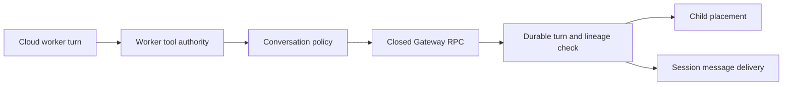

Codex review: found issues before merge. _Reviewed August 11, 2026, 5:01 AM ET / 09:01 UTC._

# ClawSweeper review

## What this changes

This PR lets managed cloud-worker sessions create nested cloud children and exchange messages through bounded Gateway RPCs tied to durable session lineage.

## Merge readiness

⚠️ **Ready for maintainer review - 7 items remain**

Keep open: the current head still strips the advertised `sessions_send` RPC from every nested cloud worker, and it eagerly creates optional worker-operation tables on every state-database open.

**Priority:** P2
**Reviewed head:** `c6c3d816745e3cd47dec4ca48181104edccc9e11`
**Owner decision:** Required. See [Decision needed](#decision-needed).

## Review scores

| Measure | Result | What it means |
|---|---|---|
| **Overall readiness** | 🦐 gold shrimp **(3/6)** | The implementation has substantial targeted coverage but retains one feature-blocking policy defect and one persistent-state ownership defect. |
| **Proof confidence** | 🌊 off-meta tidepool | Not applicable: This maintainer-authored PR is not subject to the external-contributor real-behavior-proof gate; its reported deterministic coverage remains supplemental to the correctness findings. |
| **Patch quality** | 🦐 gold shrimp **(3/6)** | 2 actionable review findings remain. |

## Verification

| Check | Result | Evidence |
|---|---|---|
| **Real behavior** | Not applicable | Not applicable: This maintainer-authored PR is not subject to the external-contributor real-behavior-proof gate; its reported deterministic coverage remains supplemental to the correctness findings. |
| **Evidence reviewed** | 7 items | Nested-worker policy strips session send: The worker authority path projects its candidate tool list through the common conversation policy; the subagent policy permanently denies `sessions_send`, so a child worker never receives the newly advertised tool. Persisted child envelopes receive the deny policy: The requester policy assigns `resolveSubagentToolPolicyForSession` to subagent-envelope sessions before the conversation pipeline applies it. Current main has no worker session-tool surface: Current main defines only local worker tools, confirming the feature is neither already implemented nor shipped from this checkout. |
| **Findings** | 2 actionable findings | [P1] Preserve closed session RPCs through nested-worker policy [P2] Lazily create worker session-operation tables |
| **Security** | None | None. |

## How this fits together

A cloud worker runs an agent turn in a managed environment while the Gateway retains authority over sessions, placement, and persisted state. The new RPCs would let the worker ask the Gateway to create a child or deliver a message after authority and lineage checks.

## Decision needed

| Question | Recommendation |
|---|---|
| Should closed cloud-worker session RPCs receive a narrowly scoped exception to the generic subagent session-send denial while ordinary subagents remain denied? | **Scoped closed-RPC exception:** Allow only `sessions_spawn` and `sessions_send` at trusted cloud-worker authority resolution while preserving all generic and configured policy denials. |

Why: This chooses the permanent authority boundary for a privileged new worker capability; a broad policy bypass would weaken existing subagent restrictions.

## Before merge

- [ ] **Preserve closed session RPCs through nested-worker policy (P1)** - The new worker candidates still pass through `projectConversationToolNames`, whose subagent policy always denies `sessions_send`. Every cloud child therefore loses the advertised RPC. Add a typed closed-worker exception that retains ordinary, configured, inherited, sandbox, and `toolsAllow` restrictions.
- [ ] **Lazily create worker session-operation tables (P2)** - Calling the new table ensure from global additive-state setup creates both tables during every writable shared-state open, even without cloud workers. Keep them optional in the same-version schema contract and ensure them immediately before the first durable worker-session operation.
- [ ] **Resolve merge risk (P1)** - A cloud child loses `sessions_send` during policy projection, so the advertised parent/child/sibling messaging capability is unavailable after merge.
- [ ] **Resolve merge risk (P1)** - The new durable operation tables would be created for every writable shared-state open even when cloud session tools are never used.
- [ ] **Resolve merge risk (P1)** - Any correction must preserve the generic subagent denial for normal `sessions_send`; only the exact closed worker RPC may receive a narrowly scoped exception.
- [ ] **Complete next step (P2)** - This protected maintainer PR needs the owner to choose and implement the closed-RPC policy boundary before another exact-head review.

## Findings

- [P1] Preserve closed session RPCs through nested-worker policy — `src/gateway/worker-environments/worker-tool-authority.ts:88-92`
- [P2] Lazily create worker session-operation tables — `src/state/openclaw-state-db-schema-additive.ts:155`

<strong>Agent review details</strong>

### Security

None.

### PR surface

Source +2134, Tests +1881, Generated +28. Total +4043 across 73 files.

View PR surface stats

| Area | Files | Added | Removed | Net |
|---|---:|---:|---:|---:|
| Source | 49 | 2317 | 183 | +2134 |
| Tests | 22 | 1919 | 38 | +1881 |
| Docs | 0 | 0 | 0 | 0 |
| Config | 0 | 0 | 0 | 0 |
| Generated | 2 | 225 | 197 | +28 |
| Other | 0 | 0 | 0 | 0 |
| **Total** | **73** | **4461** | **418** | **+4043** |

### Review metrics

| Metric | Value | Why it matters |
|---|---|---|
| **Classified LOC** | visible production +1,706/-183; tests +1,902/-36; generated baseline +197/-197 | The feature materially expands Gateway authority, worker lifecycle, and persistent state, so the two remaining owner-boundary defects should be resolved before this large surface is merged. |

### Stored data model

Persistent data-model change detected: `database schema: src/state/openclaw-state-db-schema-additive.ts`, `database schema: src/state/openclaw-state-db.test.ts`, `database schema: src/state/openclaw-state-schema.sql`, `durable storage schema: packages/gateway-protocol/src/schema/worker-admission.test.ts`, `durable storage schema: src/gateway/worker-environments/admission.test.ts`, `durable storage schema: src/gateway/worker-environments/admission.ts`, and 75 more. Confirm migration or upgrade compatibility proof before merge.

### Merge-risk options

**Maintainer options:**
1. **Repair the closed worker boundary (recommended)**  
   Preserve ordinary subagent denials, add the narrow cloud-worker policy path, and move table creation to first durable worker-session use with child/grandchild and fresh-state regression coverage.
2. **Pause the messaging capability**  
   Keep the generic deny policy and remove or defer cloud-child messaging if maintainers do not want a dedicated closed-RPC exception.

### Technical review

Best possible solution:

Keep normal subagent denials intact, add a typed closed-worker exception that still honors configured, inherited, sandbox, and `toolsAllow` restrictions, and lazily ensure operation tables immediately before their first durable worker-session write.

Do we have a high-confidence way to reproduce the issue?

Yes, source-reproducible: a nested worker's candidate tools pass through the persisted subagent policy, which unconditionally removes `sessions_send`.

Is this the best way to solve the issue?

No: the current path cannot deliver its advertised messaging capability and eagerly mutates unused state databases; a typed worker-only policy exception plus first-use schema ensure is safer.

Full review comments:

- [P1] Preserve closed session RPCs through nested-worker policy — `src/gateway/worker-environments/worker-tool-authority.ts:88-92`
  The new worker candidates still pass through `projectConversationToolNames`, whose subagent policy always denies `sessions_send`. Every cloud child therefore loses the advertised RPC. Add a typed closed-worker exception that retains ordinary, configured, inherited, sandbox, and `toolsAllow` restrictions.
  Confidence: 0.97
- [P2] Lazily create worker session-operation tables — `src/state/openclaw-state-db-schema-additive.ts:155`
  Calling the new table ensure from global additive-state setup creates both tables during every writable shared-state open, even without cloud workers. Keep them optional in the same-version schema contract and ensure them immediately before the first durable worker-session operation.
  Confidence: 0.95

Overall correctness: patch is incorrect
Overall confidence: 0.92

AGENTS.md: found and applied where relevant.

Codex review notes: model internal, reasoning high; reviewed against [d91b3970b47f](https://github.com/openclaw/openclaw/commit/d91b3970b47f3df9ebd36bb93c5074b24515dd82).

### Labels

Label changes:

- add `rating: 🦐 gold shrimp`: Overall readiness is 🦐 gold shrimp; proof is 🌊 off-meta tidepool and patch quality is 🦐 gold shrimp.
- remove `rating: 🦪 silver shellfish`: Current PR rating is `rating: 🦐 gold shrimp`, so this older rating label is no longer current.

Label justifications:

- `P2`: The feature is valuable but currently fails its central nested-worker messaging path and needs bounded maintainer repair.
- `merge-risk: 🚨 compatibility`: The PR adds same-version persistent SQLite tables and changes database-open behavior for existing installations.
- `merge-risk: 🚨 session-state`: The new operations bind child lineage and durable turn claims to persisted session state.
- `merge-risk: 🚨 security-boundary`: The PR exposes privileged session operations from workers and needs a narrowly preserved least-privilege policy boundary.
- `rating: 🦐 gold shrimp`: Overall readiness is 🦐 gold shrimp; proof is 🌊 off-meta tidepool and patch quality is 🦐 gold shrimp.
- `status: ⏳ waiting on author`: ClawSweeper has contributor-facing work open and is waiting for author action. Not applicable: This maintainer-authored PR is not subject to the external-contributor real-behavior-proof gate; its reported deterministic coverage remains supplemental to the correctness findings.

### Evidence

What I checked:

- **Nested-worker policy strips session send:** The worker authority path projects its candidate tool list through the common conversation policy; the subagent policy permanently denies `sessions_send`, so a child worker never receives the newly advertised tool. ([`src/agents/agent-tools.policy.ts:57`](https://github.com/openclaw/openclaw/blob/d91b3970b47f/src/agents/agent-tools.policy.ts#L57), [d91b3970b47f](https://github.com/openclaw/openclaw/commit/d91b3970b47f))
- **Persisted child envelopes receive the deny policy:** The requester policy assigns `resolveSubagentToolPolicyForSession` to subagent-envelope sessions before the conversation pipeline applies it. ([`src/agents/requester-tool-policy.ts:199`](https://github.com/openclaw/openclaw/blob/d91b3970b47f/src/agents/requester-tool-policy.ts#L199), [d91b3970b47f](https://github.com/openclaw/openclaw/commit/d91b3970b47f))
- **Current main has no worker session-tool surface:** Current main defines only local worker tools, confirming the feature is neither already implemented nor shipped from this checkout. ([`src/worker/tool-authority.ts:1`](https://github.com/openclaw/openclaw/blob/d91b3970b47f/src/worker/tool-authority.ts#L1), [d91b3970b47f](https://github.com/openclaw/openclaw/commit/d91b3970b47f))
- **PR head makes optional tables eager:** The supplied exact-head diff adds `ensureWorkerSessionToolStateSchema()` as the first operation in global additive-state setup, which the current state opener invokes on ordinary writable opens. ([`src/state/openclaw-state-db-schema-additive.ts:155`](https://github.com/openclaw/openclaw/blob/c6c3d816745e/src/state/openclaw-state-db-schema-additive.ts#L155), [c6c3d816745e](https://github.com/openclaw/openclaw/commit/c6c3d816745e))
- **Existing state contract requires first-use tables:** Post-v6 tables remain optional until a feature-local lazy ensure runs, while the shared-state opener calls global additive setup for current-version databases. ([`src/state/openclaw-state-db-contract.ts:15`](https://github.com/openclaw/openclaw/blob/d91b3970b47f/src/state/openclaw-state-db-contract.ts#L15), [d91b3970b47f](https://github.com/openclaw/openclaw/commit/d91b3970b47f))
- **Likely policy owner provenance:** Available blame attributes the persistent `sessions_send` subagent denial to Peter Steinberger; the shallow local history does not establish its original introduction. ([`src/agents/agent-tools.policy.ts:57`](https://github.com/openclaw/openclaw/blob/eb2896452235/src/agents/agent-tools.policy.ts#L57), [eb2896452235](https://github.com/openclaw/openclaw/commit/eb2896452235))

Likely related people:

- **steipete:** Available blame ties the generic subagent denial to this area, and the supplied PR context identifies steipete as the assigned maintainer author of the cloud-worker feature. (role: current policy contributor and active feature owner; confidence: medium; commits: [eb2896452235](https://github.com/openclaw/openclaw/commit/eb28964522354b09cc16af33e07793a2034fda64); files: `src/agents/agent-tools.policy.ts`, `src/gateway/worker-environments/worker-tool-authority.ts`)

### Rank-up moves

Optional improvements that raise the rating; they are not merge blockers.

- Add the scoped cloud-worker policy exception and prove it for child and grandchild workers while normal subagents remain denied.
- Move table creation to feature-local first use and prove an ordinary current-version database open leaves both tables absent.

### Rating scale

| Score | Internal tier | Crab rank | Meaning |
|---:|:---:|---|---|
| **6/6** | S | 🦀 challenger crab | Exceptional readiness |
| **5/6** | A | 🦞 diamond lobster | Very strong readiness |
| **4/6** | B | 🐚 platinum hermit | Good normal PR; ordinary maintainer review |
| **3/6** | C | 🦐 gold shrimp | Useful, but confidence is limited |
| **2/6** | D | 🦪 silver shellfish | Proof or implementation needs work |
| **1/6** | F | 🧂 unranked krab | Not merge-ready |
| N/A | NA | 🌊 off-meta tidepool | Rating does not apply |

Overall follows the weaker of proof and patch quality.
Shiny media proof means a screenshot, video, or linked artifact directly shows the changed behavior. Runtime, network, CSP, and security claims still need visible diagnostics.

### Workflow

- ClawSweeper keeps one durable marker-backed review comment per issue or PR.
- Re-runs edit this comment so the latest verdict, findings, and automation markers stay together instead of adding duplicate bot comments.
- A fresh review can be triggered by eligible `@clawsweeper re-review` comments, exact-item GitHub events, scheduled/background review runs, or manual workflow dispatch.
- PR/issue authors and users with repository write access can comment `@clawsweeper re-review` or `@clawsweeper re-run` on an open PR or issue to request a fresh review only.
- Maintainers can also comment `@clawsweeper review` to request a fresh review only.
- Fresh-review commands do not start repair, autofix, rebase, CI repair, or automerge.
- Maintainer-only repair and merge flows require explicit commands such as `@clawsweeper autofix`, `@clawsweeper automerge`, `@clawsweeper fix ci`, or `@clawsweeper address review`.
- Maintainers can comment `@clawsweeper explain` to ask for more context, or `@clawsweeper stop` to stop active automation.

### History

Review history (3 earlier review cycles)

<!-- clawsweeper-review-history v=1 total=3 -->
- reviewed 2026-08-11T04:00:05.074Z sha 7ff4c10afa3f4294c76e4062b505d50f6dfb7991 :: found issues before merge. :: [P2] Bound RPC inputs by the enclosing request frame
- reviewed 2026-08-11T07:53:01.529Z sha e5f5415a5d690430e21d0767ea1d5a2b6493a8ac :: found issues before merge. :: [P1] Project session send through nested-worker policy | [P1] Wait for re-admission before retrying session RPCs | [P2] Keep optional worker state lazy
- reviewed 2026-08-11T08:50:51.721Z sha 200f9774f30883935604371483b20d8e40aefc95 :: needs changes before merge. :: [P1] Project session send through nested-worker policy | [P2] Keep worker operation tables lazy

<!-- clawsweeper-verdict:needs-human item=121846 sha=c6c3d816745e3cd47dec4ca48181104edccc9e11 confidence=high updated_at=2026-08-11T08:57:02Z reviewed_at=2026-08-11T09:01:44.312Z lease_owner=github-run-31475323805-1 lease_comment_id=5251069360 source_revision=642f13ffd261ea9cec58b20d113a53ace9f3818874155e5ba3a5e6c429e45aa4 -->

<!-- clawsweeper-review-version item=121846 reviewed_at=2026-08-11T09:01:44.312Z sha=c6c3d816745e3cd47dec4ca48181104edccc9e11 source_revision=642f13ffd261ea9cec58b20d113a53ace9f3818874155e5ba3a5e6c429e45aa4 lease_owner=github-run-31475323805-1 lease_comment_id=5251069360 v=1 -->

<!-- clawsweeper-review item=121846 -->