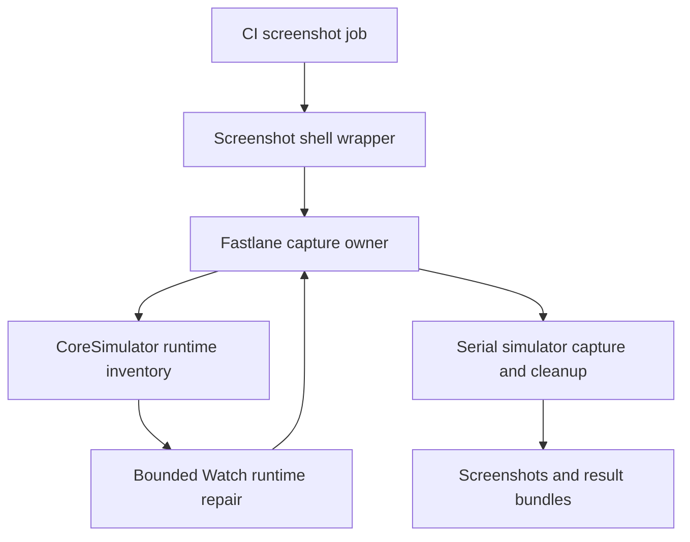

Codex review: needs changes before merge.

## What this changes

This PR provisions missing watchOS runtimes and replaces a broken CI runtime once before retrying Watch simulator creation.

**Example:** CoreSimulator advertises watchOS 27.0 but Watch creation reports error 401 and “runtime path not found.”
- **Before:** Capture stops after eight iPhone and iPad screenshots.
- **After:** CI replaces the uniquely matched runtime image, verifies its mounted path, and retries creation once to complete all nine screenshots.

## Review scores

| Measure | Result | What it means |
|---|---|---|
| **Overall readiness** | 🐚 platinum hermit **(4/6)** | A focused repair with hosted end-to-end evidence, resolved prior feedback, and no new code findings. |
| **Proof confidence** | 🦞 diamond lobster **(5/6)** ✨ media proof bonus | Sufficient (linked_artifact): The supplied exact-head hosted trace exercises the screenshot entry point on Xcode 27: failed Watch creation, image replacement, mounted-path verification, one successful retry, capture, and cleanup. GitHub independently confirms the successful job and matching artifact; raw logs were inaccessible through the sandbox storage-host allowlist. |
| **Patch quality** | 🐚 platinum hermit **(4/6)** | No actionable review findings were identified. |

## Product

**Kind:** Bug fix · **Worth it:** Yes · **Fix scope:** Complete
**User problem:** Native screenshot automation stops without the required Watch image even after phone and tablet captures succeed.
**Reason:** The maintainer-authored direction repairs a demonstrated CI failure while preserving all nine required screenshots, existing options, and serial simulator ownership.

## Merge readiness

⛔ **Needs changes before merge - 1 item remains**

The previous Watch-skip finding is fixed, and no new patch defect was found; keep this PR open while the recorded merge pause and unresolved screenshot CI remain.

**Priority:** P2
**Reviewed head:** `85c971fec7bf7eb0bc0386623f5bdc646045efd7`

## Before merge

- [ ] **Complete next step** - Review the active exact-head screenshot attempt and resolve or establish the cause of the earlier iPad readiness failure before lifting the recorded merge pause.

## Findings

None.

<strong>Agent review details</strong>

### How this fits together

The screenshot shell wrapper prepares CI tooling, then Fastlane owns simulator selection, creation, capture, and cleanup; its outputs feed release screenshot evidence collection.

### Technical review

Best possible solution:

Keep the bounded repair in the existing capture owner, preserve phone-only capture, and settle the outstanding CI failure before landing.

Do we have a high-confidence way to reproduce the issue?

Current-main source requires pre-created Watch devices and propagates stale-runtime creation failures; supplied hosted traces establish the concrete runtime-path failure, but no current-main execution was performed during this read-only review.

Is this the best way to solve the issue?

The repair addresses the failed runtime at simulator creation, limits replacement to the observed CI Watch error, and preserves existing capture and cleanup ownership; no smaller complete alternative was established.

AGENTS.md: found and applied where relevant.

Codex review notes: model internal, reasoning medium; reviewed against [a792fa10dd96](https://github.com/openclaw/openclaw/commit/a792fa10dd96257d01e1ca3b4d99ea28882d3e31).

### Provenance checked

- `Watch simulator discovery` changes intended behavior with a stated reason (21e3cfa5e9207bd76952d6359cc306c6f214dde0: The original Watch screenshot pipeline selected an existing named device with an Ultra fallback.)
- `Simulator creation and cleanup` keeps the original intent (03f92a56beca5f453d36c87bf996bbbdb33d7488: Use fresh, task-owned simulators serially and preserve cleanup and primary failures.)
- `Watch build reuse and evidence cleanup` keeps the original intent (67480b59ae5d543ded35c5359ef8624cfdaa9b6a: Reuse the combined screenshot build while standalone Watch capture builds freshly and clears stale evidence before compilation.)
- `Combined screenshot pipeline` keeps the original intent (f123f32a0181ad962c624321e545eadff3167019: Capture all device families from one native build while retaining complete screenshot and XCTest evidence.)

### Testing

Proof path: shipped entry point.

### Security

None.

### Evidence

What I checked:

- **Pinned introduced change:** Reviewed the merge-base-to-head hunks and original behavior; current main retains pre-created Watch-device discovery and lacks this runtime replacement path. ([`apps/ios/fastlane/Fastfile:219`](https://github.com/openclaw/openclaw/blob/85c971fec7bf7eb0bc0386623f5bdc646045efd7/apps/ios/fastlane/Fastfile#L219), [85c971fec7bf](https://github.com/openclaw/openclaw/commit/85c971fec7bf7eb0bc0386623f5bdc646045efd7))
- **Prior finding resolved:** The wrapper now checks OPENCLAW_SNAPSHOT_SKIP_WATCH before any Xcode or runtime preparation, and the executable wrapper fixture covers omission of all Watch probes and downloads. ([`scripts/ios-screenshots.sh:7`](https://github.com/openclaw/openclaw/blob/85c971fec7bf7eb0bc0386623f5bdc646045efd7/scripts/ios-screenshots.sh#L7), [85c971fec7bf](https://github.com/openclaw/openclaw/commit/85c971fec7bf7eb0bc0386623f5bdc646045efd7))
- **Exact-head hosted behavior:** GitHub confirms the dedicated screenshot job succeeded at the reviewed head. The supplied trace records initial error 401, runtime replacement, successful retry, Watch capture, and cleanup: https://github.com/openclaw/openclaw/actions/runs/39210245549/job/117921799152. ([85c971fec7bf](https://github.com/openclaw/openclaw/commit/85c971fec7bf7eb0bc0386623f5bdc646045efd7))
- **Published capture artifact:** GitHub confirms an unexpired artifact bound to the reviewed head; the supplied evidence records nine valid PNGs and inspection of the 422×514 Watch image: https://github.com/openclaw/openclaw/actions/runs/39210245549/artifacts/12167792246. ([85c971fec7bf](https://github.com/openclaw/openclaw/commit/85c971fec7bf7eb0bc0386623f5bdc646045efd7))
- **CI disposition remains open:** The initial exact-head screenshot job failed during iPad readiness before Watch creation. Live GitHub reads show attempt 2 in progress and openclaw/ci-gate still failing; neither diff causation nor an inherited-main failure is established. The author explicitly requested no merge. ([85c971fec7bf](https://github.com/openclaw/openclaw/commit/85c971fec7bf7eb0bc0386623f5bdc646045efd7))
- **Inspection limits:** Raw job-log retrieval was blocked at GitHub's Azure storage redirect, so detailed recovery observations rely on the supplied maintainer evidence, corroborated by exact-head job and artifact metadata. Wrapper follow-history also stops at an unavailable creation-parent object; the central Watch and lifecycle introduction commits were independently readable. ([85c971fec7bf](https://github.com/openclaw/openclaw/commit/85c971fec7bf7eb0bc0386623f5bdc646045efd7))

Likely related people:

- **Josh Avant:** Raw commit 03f92a56beca5f453d36c87bf996bbbdb33d7488 adds apps/ios/fastlane/Fastfile:258 relative to its recorded parents. This identifies author metadata, not feature responsibility or a PR merger. (role: source-line author; confidence: high; commits: [03f92a56beca](https://github.com/openclaw/openclaw/commit/03f92a56beca5f453d36c87bf996bbbdb33d7488); files: `apps/ios/fastlane/Fastfile`)
- **Vincent Koc:** Raw commit 67480b59ae5d543ded35c5359ef8624cfdaa9b6a adds apps/ios/fastlane/Fastfile:483 relative to its recorded parents. This identifies author metadata, not feature responsibility or a PR merger. (role: source-line author; confidence: high; commits: [67480b59ae5d](https://github.com/openclaw/openclaw/commit/67480b59ae5d543ded35c5359ef8624cfdaa9b6a); files: `apps/ios/fastlane/Fastfile`)
- **Peter Steinberger:** Raw commit 340cb1c8402ad1630ac350dc0a4b31daeb238cfa adds apps/ios/fastlane/Fastfile:2517 relative to its recorded parents. This identifies author metadata, not feature responsibility or a PR merger. (role: source-line author; confidence: high; commits: [340cb1c8402a](https://github.com/openclaw/openclaw/commit/340cb1c8402ad1630ac350dc0a4b31daeb238cfa); files: `apps/ios/fastlane/Fastfile`)

### PR surface

Source +38, Tests +196, Docs +2, Other +18. Total +254 across 5 files. Added test files: 1.

View PR surface stats

| Area | Files | Added | Removed | Net |
|---|---:|---:|---:|---:|
| Source | 1 | 52 | 14 | +38 |
| Tests | 2 | 197 | 1 | +196 |
| Docs | 1 | 2 | 0 | +2 |
| Config | 0 | 0 | 0 | 0 |
| Generated | 0 | 0 | 0 | 0 |
| Other | 1 | 18 | 0 | +18 |
| **Total** | **5** | **269** | **15** | **+254** |

### Review metrics

| Metric | Value | Why it matters |
|---|---|---|
| **Production versus regression coverage** | Production +70/-14; tests +197/-1 | Growth is focused on runtime discovery, bounded image repair, and distinct preparation, failure-propagation, skip-mode, and lifecycle regressions. |

### Labels

Label changes:

- add `proof: sufficient`: Contributor real behavior proof is sufficient.
- add `rating: 🐚 platinum hermit`: Overall readiness is 🐚 platinum hermit; proof is 🦞 diamond lobster and patch quality is 🐚 platinum hermit.
- remove `rating: 🦪 silver shellfish`: Current PR rating is `rating: 🐚 platinum hermit`, so this older rating label is no longer current.
- remove `merge-risk: 🚨 automation`: Current PR review selected no merge-risk labels.

Label justifications:

- `P2`: Repairs an observed native screenshot automation failure without changing shipped app behavior.
- `rating: 🐚 platinum hermit`: Overall readiness is 🐚 platinum hermit; proof is 🦞 diamond lobster and patch quality is 🐚 platinum hermit.
- `status: ⏳ waiting on author`: ClawSweeper has contributor-facing work open and is waiting for author action.
- `proof: sufficient`: Contributor real behavior proof is sufficient.

### Rating scale

6/6 🦀 challenger crab · 5/6 🦞 diamond lobster · 4/6 🐚 platinum hermit · 3/6 🦐 gold shrimp · 2/6 🦪 silver shellfish · 1/6 🧂 unranked krab. Overall follows the weaker of proof and patch quality; ✨ marks media proof (a screenshot, video, or linked artifact) that directly shows the changed behavior.

### Workflow

ClawSweeper edits this one comment on every review. Comment `@clawsweeper re-review` for a fresh review only. Repair and merge execution lanes are retired.

### History

Review history (1 earlier review cycle)

<!-- clawsweeper-review-history v=1 total=1 -->
- reviewed 2026-10-19T05:47:49.562Z sha e0d982ba44172858343f14d4914bedc396e62b75 :: needs changes before merge. :: [P2] Honor Watch-skip mode before preparing its runtime

_Reviewed October 19, 2026, 2:53 AM ET / 06:53 UTC (Revision 2)._

<!-- clawsweeper-verdict:needs-changes item=176958 sha=85c971fec7bf7eb0bc0386623f5bdc646045efd7 confidence=high updated_at=2026-10-19T06:49:36Z reviewed_at=2026-10-19T06:53:14.037Z lease_owner=github-run-39212081289-1 lease_comment_id=6261426698 source_revision=860492cf271409b509f4f0ebb22735f8bed3d769497babaea1ee63551c3aa381 -->
<!-- clawsweeper-review-state:needs-changes item=176958 sha=85c971fec7bf7eb0bc0386623f5bdc646045efd7 v=1 -->

<!-- clawsweeper-review-version item=176958 reviewed_at=2026-10-19T06:53:14.037Z sha=85c971fec7bf7eb0bc0386623f5bdc646045efd7 source_revision=860492cf271409b509f4f0ebb22735f8bed3d769497babaea1ee63551c3aa381 lease_owner=github-run-39212081289-1 lease_comment_id=6261426698 v=1 -->

<!-- clawsweeper-review item=176958 -->