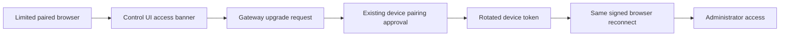

Codex review: needs maintainer review before merge. _Reviewed August 12, 2026, 9:15 PM ET / August 13, 2026, 01:15 UTC._

# ClawSweeper review

## What this changes

Adds Gateway and Control UI support for a limited paired browser to request administrator scopes through existing device-pairing approval, persist the rotated token, and reconnect.

## Merge readiness

⚠️ **Ready for maintainer review - 2 items remain**

Keep open for maintainer approval and exact-head CI. The prior browser-origin blocker is addressed: the latest head carries the existing paired origin into the new request, and the Gateway regression covers same-origin approved recovery plus origin enforcement.

**Priority:** P1
**Reviewed head:** `3350620e6b3b69a6e7763a83ddcd9def2b7a77b3`
**Owner decision:** Required. See [Decision needed](#decision-needed).

## Review scores

| Measure | Result | What it means |
|---|---|---|
| **Overall readiness** | 🐚 platinum hermit **(4/6)** | The latest head addresses the prior origin-binding blocker with focused boundary coverage; remaining readiness depends on maintainer contract approval and exact-head CI. |
| **Proof confidence** | 🌊 off-meta tidepool | Not applicable: Repository context identifies this as a maintainer-owned PR, so the external-contributor proof gate does not apply; focused Gateway and browser E2E evidence is supplied in the PR body. |
| **Patch quality** | 🐚 platinum hermit **(4/6)** | No actionable review findings were identified. |

## Verification

| Check | Result | Evidence |
|---|---|---|
| **Real behavior** | Not applicable | Not applicable: Repository context identifies this as a maintainer-owned PR, so the external-contributor proof gate does not apply; focused Gateway and browser E2E evidence is supplied in the PR body. |
| **Evidence reviewed** | 5 items | Current-main baseline: Current main intentionally rejects a broader reconnect from a read-scoped paired device and creates a normal pending pairing request; it has no live `device.scopes.requestUpgrade` or `device.scopes.waitUpgrade` recovery method. Origin binding repaired at the request owner: The request handler reuses the authenticated paired record's `browserOrigin` while also requiring the same device ID and public key before it can file an upgrade. Credential handoff remains identity-bound: The coordinator rejects a waiter whose device ID or public key differs, then rereads durable pairing state before returning a rotated token. |
| **Findings** | None | None. |
| **Security** | None | None. |

## How this fits together

The Gateway owns paired-device identity, scope approval, and token rotation; the Control UI consumes that connection and presents recovery actions to limited browsers. The new flow turns a previously rejected broader reconnect into an explicit, approval-bound request and reconnect.

## Decision needed

| Question | Recommendation |
|---|---|
| Should OpenClaw permanently expose the additive `device.scopes.requestUpgrade` and `device.scopes.waitUpgrade` Gateway contract for limited-browser recovery? | **Sponsor the additive recovery contract:** Approve the two-method browser recovery path, retaining existing device-pair approval as the sole scope-widening authority. |

Why: This is a new public Gateway and credential-delivery capability, not a repair to an already documented API; source review can validate the implementation but cannot choose the permanent product contract.

## Before merge

- [ ] **Resolve merge risk (P1)** - This introduces two public read-scoped Gateway methods that can return a rotated administrator credential after approval, so the permanent protocol and credential-delivery contract needs maintainer sign-off before merge.

<strong>Agent review details</strong>

### Security

None.

### PR surface

Source +1091, Tests +882, Docs +11, Config +8, Generated 0, Other +140. Total +2132 across 65 files.

View PR surface stats

| Area | Files | Added | Removed | Net |
|---|---:|---:|---:|---:|
| Source | 31 | 1188 | 97 | +1091 |
| Tests | 11 | 887 | 5 | +882 |
| Docs | 2 | 11 | 0 | +11 |
| Config | 2 | 9 | 1 | +8 |
| Generated | 17 | 17 | 17 | 0 |
| Other | 2 | 140 | 0 | +140 |
| **Total** | **65** | **2252** | **120** | **+2132** |

### Review metrics

| Metric | Value | Why it matters |
|---|---|---|
| **Production versus test delta** | production +1,183/-95; tests and test support +896/-8; generated/docs +173/-17 | The feature adds a substantial Gateway, protocol, native-client, and Control UI surface, so the new public contract merits owner review beyond passing focused tests. |
| **Public Gateway methods** | 2 added, 0 removed | The new read-scoped request and wait methods become an additive protocol contract for Gateway clients. |

### Stored data model

Persistent data-model change detected: `migration/backfill/repair: docs/gateway/operator-scopes.md`, `migration/backfill/repair: docs/web/control-ui.md`, `migration/backfill/repair: packages/gateway-client/package.json`, `migration/backfill/repair: packages/gateway-client/src/index.ts`, `migration/backfill/repair: packages/gateway-client/src/scope-upgrade.test.ts`, `migration/backfill/repair: packages/gateway-client/src/scope-upgrade.ts`, and 22 more. Confirm migration or upgrade compatibility proof before merge.

### Root-cause cluster

Relationship: `fixed_by_candidate`
Canonical: https://github.com/openclaw/openclaw/issues/121381
Summary: This PR is the explicit scope-upgrade slice of the broader session-start design.

Members:
- `canonical`: https://github.com/openclaw/openclaw/issues/121381 - The PR body explicitly identifies this as part of the broader operator-grant and limited-browser recovery design.

Proposal only: this assessment does not dispatch repair, suppress jobs, mutate sibling items, close, or merge anything.

### Merge-risk options

**Maintainer options:**
1. **Confirm the public recovery contract (recommended)**  
   Obtain maintainer approval for the new Gateway methods and token-return boundary, then merge only after exact-head checks are green.
2. **Defer the capability**  
   Pause the PR if maintainers want the parent session-start design to establish a different long-term operator-grant interface.

### Technical review

Best possible solution:

Retain the existing pairing approval as the sole scope-widening authority, land the browser recovery path only after maintainers accept the new Gateway contract, and require exact-head CI to complete successfully.

Do we have a high-confidence way to reproduce the issue?

Not applicable as a defect reproduction: this is an additive feature. Current-main source and tests establish the rejected broader-reconnect behavior that the PR turns into an explicit approval path.

Is this the best way to solve the issue?

Yes, conditionally: reusing the existing durable pairing approval is the narrowest owner-boundary design, provided maintainers accept the new public Gateway contract.

AGENTS.md: found and applied where relevant.

Codex review notes: model internal, reasoning high; reviewed against [add6b20bd28a](https://github.com/openclaw/openclaw/commit/add6b20bd28abe30b7e9c6af9f064596c71c71bd).

### Labels

Label changes:

- add `merge-risk: 🚨 security-boundary`: The added methods cross the device-identity and scope-approval boundary before returning a credential.
- add `rating: 🐚 platinum hermit`: Overall readiness is 🐚 platinum hermit; proof is 🌊 off-meta tidepool and patch quality is 🐚 platinum hermit.
- add `status: 👀 ready for maintainer look`: ClawSweeper has no concrete contributor-facing blocker left for this PR. Not applicable: Repository context identifies this as a maintainer-owned PR, so the external-contributor proof gate does not apply; focused Gateway and browser E2E evidence is supplied in the PR body.
- remove `rating: 🦪 silver shellfish`: Current PR rating is `rating: 🐚 platinum hermit`, so this older rating label is no longer current.
- remove `status: ⏳ waiting on author`: Current PR status label is `status: 👀 ready for maintainer look`.

Label justifications:

- `P1`: The PR changes the operator recovery path when a limited browser needs administrator access.
- `merge-risk: 🚨 compatibility`: Existing paired browser credentials gain a new upgrade and reconnect path that must preserve current pairing behavior.
- `merge-risk: 🚨 auth-provider`: The flow persists and reconnects with a rotated device token after pairing approval.
- `merge-risk: 🚨 security-boundary`: The added methods cross the device-identity and scope-approval boundary before returning a credential.
- `rating: 🐚 platinum hermit`: Overall readiness is 🐚 platinum hermit; proof is 🌊 off-meta tidepool and patch quality is 🐚 platinum hermit.
- `status: 👀 ready for maintainer look`: ClawSweeper has no concrete contributor-facing blocker left for this PR. Not applicable: Repository context identifies this as a maintainer-owned PR, so the external-contributor proof gate does not apply; focused Gateway and browser E2E evidence is supplied in the PR body.

### Evidence

What I checked:

- **Current-main baseline:** Current main intentionally rejects a broader reconnect from a read-scoped paired device and creates a normal pending pairing request; it has no live `device.scopes.requestUpgrade` or `device.scopes.waitUpgrade` recovery method. ([`src/gateway/server.silent-scope-upgrade-reconnect.poc.test.ts:156`](https://github.com/openclaw/openclaw/blob/add6b20bd28a/src/gateway/server.silent-scope-upgrade-reconnect.poc.test.ts#L156), [add6b20bd28a](https://github.com/openclaw/openclaw/commit/add6b20bd28a))
- **Origin binding repaired at the request owner:** The request handler reuses the authenticated paired record's `browserOrigin` while also requiring the same device ID and public key before it can file an upgrade. ([`src/gateway/server-methods/device-scope-upgrade.ts:60`](https://github.com/openclaw/openclaw/blob/3350620e6b3b/src/gateway/server-methods/device-scope-upgrade.ts#L60), [3350620e6b3b](https://github.com/openclaw/openclaw/commit/3350620e6b3b))
- **Credential handoff remains identity-bound:** The coordinator rejects a waiter whose device ID or public key differs, then rereads durable pairing state before returning a rotated token. ([`src/gateway/device-scope-upgrade.ts:98`](https://github.com/openclaw/openclaw/blob/3350620e6b3b/src/gateway/device-scope-upgrade.ts#L98), [3350620e6b3b](https://github.com/openclaw/openclaw/commit/3350620e6b3b))
- **Regression coverage:** The Gateway test verifies that approval retains the browser origin, permits the approved token from that same origin, and continues rejecting a mismatched origin. ([`src/gateway/server.device-scope-upgrade.test.ts:152`](https://github.com/openclaw/openclaw/blob/3350620e6b3b/src/gateway/server.device-scope-upgrade.test.ts#L152), [3350620e6b3b](https://github.com/openclaw/openclaw/commit/3350620e6b3b))
- **Latest-head provenance:** The latest commit specifically records the browser-origin repair and is not contained by the checked-out main branch or a local release tag. ([`src/gateway/server-methods/device-scope-upgrade.ts:103`](https://github.com/openclaw/openclaw/blob/3350620e6b3b/src/gateway/server-methods/device-scope-upgrade.ts#L103), [3350620e6b3b](https://github.com/openclaw/openclaw/commit/3350620e6b3b))

Likely related people:

- **steipete:** Authored the broader scope-grant proposal and the latest browser-origin repair in this Gateway and Control UI flow. (role: feature owner and recent area contributor; confidence: high; commits: [399836d7ad8b](https://github.com/openclaw/openclaw/commit/399836d7ad8b64d8bbcdad5a7838873078510b3a), [3350620e6b3b](https://github.com/openclaw/openclaw/commit/3350620e6b3b69a6e7763a83ddcd9def2b7a77b3); files: `src/gateway/server-methods/device-scope-upgrade.ts`, `src/gateway/server.device-scope-upgrade.test.ts`, `ui/src/app/device-scope-upgrade.runtime.ts`)

### Rank-up moves

Optional improvements that raise the rating; they are not merge blockers.

- Obtain explicit maintainer approval for the new public Gateway credential-recovery contract.
- Let exact-head required checks complete successfully.

### Rating scale

| Score | Internal tier | Crab rank | Meaning |
|---:|:---:|---|---|
| **6/6** | S | 🦀 challenger crab | Exceptional readiness |
| **5/6** | A | 🦞 diamond lobster | Very strong readiness |
| **4/6** | B | 🐚 platinum hermit | Good normal PR; ordinary maintainer review |
| **3/6** | C | 🦐 gold shrimp | Useful, but confidence is limited |
| **2/6** | D | 🦪 silver shellfish | Proof or implementation needs work |
| **1/6** | F | 🧂 unranked krab | Not merge-ready |
| N/A | NA | 🌊 off-meta tidepool | Rating does not apply |

Overall follows the weaker of proof and patch quality.
Shiny media proof means a screenshot, video, or linked artifact directly shows the changed behavior. Runtime, network, CSP, and security claims still need visible diagnostics.

### Workflow

- ClawSweeper keeps one durable marker-backed review comment per issue or PR.
- Re-runs edit this comment so the latest verdict, findings, and automation markers stay together instead of adding duplicate bot comments.
- A fresh review can be triggered by eligible `@clawsweeper re-review` comments, exact-item GitHub events, scheduled/background review runs, or manual workflow dispatch.
- PR/issue authors and users with repository write access can comment `@clawsweeper re-review` or `@clawsweeper re-run` on an open PR or issue to request a fresh review only.
- Maintainers can also comment `@clawsweeper review` to request a fresh review only.
- Fresh-review commands do not start repair, autofix, rebase, CI repair, or automerge.
- Maintainer-only repair and merge flows require explicit commands such as `@clawsweeper autofix`, `@clawsweeper automerge`, `@clawsweeper fix ci`, or `@clawsweeper address review`.
- Maintainers can comment `@clawsweeper explain` to ask for more context, or `@clawsweeper stop` to stop active automation.

### History

Review history (38 earlier review cycles; latest 8 shown)

<!-- clawsweeper-review-history v=1 total=38 -->
- reviewed 2026-08-12T16:05:38.960Z sha cb3ca5873c623485a3a58e32a05fa99986a46162 :: needs changes before merge. :: [P1] Preserve the paired browser-origin binding
- reviewed 2026-08-12T17:04:41.135Z sha 8fb7ab08c686eb1fcad566af7d989b82f705cbe3 :: found issues before merge. :: [P1] Preserve the paired browser-origin binding
- reviewed 2026-08-12T18:03:29.028Z sha 940d60283bb70f6143e4892d2354959de78ebbd1 :: found issues before merge. :: [P1] Preserve the paired browser-origin binding
- reviewed 2026-08-12T19:17:22.959Z sha fc3d6d16c2ac13d289c8d692222c50412017253e :: needs changes before merge. :: [P1] Preserve the paired browser-origin binding
- reviewed 2026-08-12T21:11:32.064Z sha 96c9c014e6c596b1de18fcb0a8b1ab87f9202e37 :: needs changes before merge. :: [P1] Preserve the paired browser-origin binding
- reviewed 2026-08-12T22:03:48.576Z sha 8c19ccfec38939a6946913bdf0ad2decf0b54add :: needs changes before merge. :: [P1] Preserve the paired browser-origin binding
- reviewed 2026-08-13T00:08:26.795Z sha 4d134ff6c83c8f75d70786327b5e119f27e24fd1 :: found issues before merge. :: [P1] Preserve the paired browser-origin binding
- reviewed 2026-08-13T00:35:15.583Z sha a67505c38dbe2d8bbe837562872ad1076d179ba2 :: found issues before merge. :: [P1] Preserve the paired browser-origin binding

<!-- clawsweeper-verdict:needs-human item=121459 sha=3350620e6b3b69a6e7763a83ddcd9def2b7a77b3 confidence=high updated_at=2026-08-13T01:11:58Z reviewed_at=2026-08-13T01:15:35.985Z lease_owner=github-run-31656886741-1 lease_comment_id=5274712519 source_revision=904c861144f8ef6debd0720f01a0cc723b4b1837661b0c616b18b8410705a28a -->

<!-- clawsweeper-review-version item=121459 reviewed_at=2026-08-13T01:15:35.985Z sha=3350620e6b3b69a6e7763a83ddcd9def2b7a77b3 source_revision=904c861144f8ef6debd0720f01a0cc723b4b1837661b0c616b18b8410705a28a lease_owner=github-run-31656886741-1 lease_comment_id=5274712519 v=1 -->

<!-- clawsweeper-review item=121459 -->