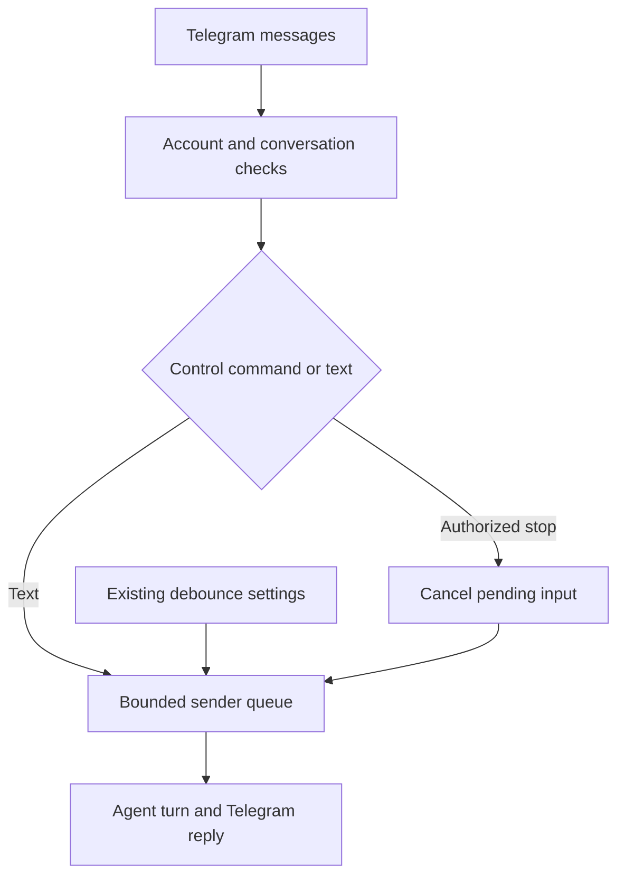

Codex review: blocked before merge. _Reviewed September 22, 2026, 2:47 PM ET / 18:47 UTC (Revision 5)._

# ClawSweeper review

## What this changes

Telegram combines rapid short and long text chunks in one bounded queue, introduces a 300 ms ordinary-text default, and updates documentation and supporting tests.

## Merge readiness

⛔ **Blocked before merge - 1 item remains**

The fix remains useful, with no blocking correctness findings. The verified maintainer confirmation resolves the previous compatibility question, and the supplied Telegram observations support the changed behavior.

**Priority:** P2
**Reviewed head:** `4adafee4b75e2a3cac81e1d41c53c3621cad1940`

## Review scores

| Measure | Result | What it means |
|---|---|---|
| **Overall readiness** | 🐚 platinum hermit **(4/6)** | A focused owner-level repair with relevant Telegram proof, compatibility coverage, and no blocking findings. |
| **Proof confidence** | 🦞 diamond lobster **(5/6)** | Sufficient (live_output): Supplied Test Server observations exercise the changed Telegram batching owner through real inbound delivery and visible replies, showing one mixed-burst turn and successful stop/fresh-input recovery. The batching owners are unchanged at the reviewed head; no stored-data contract changes require migration proof. |
| **Patch quality** | 🐚 platinum hermit **(4/6)** | No actionable review findings were identified. |

## Verification

| Check | Result | Evidence |
|---|---|---|
| **Real behavior** | Verified | Sufficient (live_output): Supplied Test Server observations exercise the changed Telegram batching owner through real inbound delivery and visible replies, showing one mixed-burst turn and successful stop/fresh-input recovery. The batching owners are unchanged at the reviewed head; no stored-data contract changes require migration proof. |
| **Evidence reviewed** | 10 items | Pinned change reviewed: Reviewed the introduced changes between the supplied merge base and exact head. The stale test-merge reference was not used to infer removal of current-main behavior. Existing settings retain precedence: The Telegram owner selects 300 ms only when both existing settings are absent. Explicit zero retains near-limit assembly; commands bypass collection, and batches remain separated by account, conversation, and sender. Compatibility tradeoff accepted: The supplied comment https://github.com/openclaw/openclaw/pull/155842#issuecomment-5781541335 explicitly accepts the default delay and grouping of intentionally separate rapid messages for this head. GitHub independently reports obviyus with role_name maintain. This resolves the previous compatibility request without waiving CI or merge gates. |
| **Findings** | None | None. |
| **Security** | None | None. |

## How this fits together

Telegram’s inbound pipeline assembles incoming messages before handing them to the agent. Its shared batching queue controls collection timing, dispatch order, and cancellation while retaining source-message context.

## Before merge

- [ ] **Review config compatibility** - Confirm compatibility and upgrade impact for the changed config or default surface before merge.

<strong>Agent review details</strong>

### Security

None.

### PR surface

Source -236, Tests +27, Docs +19, Generated 0, Other -1. Total -191 across 33 files.

View PR surface stats

| Area | Files | Added | Removed | Net |
|---|---:|---:|---:|---:|
| Source | 9 | 127 | 363 | -236 |
| Tests | 18 | 1136 | 1109 | +27 |
| Docs | 4 | 25 | 6 | +19 |
| Config | 0 | 0 | 0 | 0 |
| Generated | 1 | 2 | 2 | 0 |
| Other | 1 | 0 | 1 | -1 |
| **Total** | **33** | **1290** | **1481** | **-191** |

### Review metrics

| Metric | Value | Why it matters |
|---|---|---|
| **Default timing** | Unconfigured ordinary Telegram text: 0 → 300 ms | This changes turn timing for existing unconfigured installations; the maintainer explicitly accepted the tradeoff. |

### Technical review

Best possible solution:

Keep one bounded batching owner that preserves explicit settings, message context, dispatch order, and authorized cancellation.

Do we have a high-confidence way to reproduce the issue?

Yes: current main’s separate collectors explain why a rapid short/near-limit/tail burst produces separate turns, matching the supplied baseline Telegram observations. No current-main runtime reproduction was executed during this review.

Is this the best way to solve the issue?

Yes: extending the existing keyed queue removes competing collectors while retaining configuration precedence and source context; the intentional default change has explicit maintainer acceptance.

AGENTS.md: found and applied where relevant.

Codex review notes: model internal, reasoning medium; reviewed against [ab4c2cd05829](https://github.com/openclaw/openclaw/commit/ab4c2cd05829d56822d57828cdbb8a403eb54c8c).

### Labels

Label changes:

No label changes.

Label justifications:

- `P2`: The fix addresses partial prompts and multiple replies from rapid Telegram chunks with a bounded channel-level change.
- `merge-risk: 🚨 compatibility`: The default can delay or combine previously separate turns, an explicitly accepted tradeoff; existing configured values retain precedence.
- `rating: 🐚 platinum hermit`: Overall readiness is 🐚 platinum hermit; proof is 🦞 diamond lobster and patch quality is 🐚 platinum hermit.
- `status: 👀 ready for maintainer look`: ClawSweeper has no concrete contributor-facing blocker left for this PR. Sufficient (live_output): Supplied Test Server observations exercise the changed Telegram batching owner through real inbound delivery and visible replies, showing one mixed-burst turn and successful stop/fresh-input recovery. The batching owners are unchanged at the reviewed head; no stored-data contract changes require migration proof.
- `proof: sufficient`: Contributor real behavior proof is sufficient. Supplied Test Server observations exercise the changed Telegram batching owner through real inbound delivery and visible replies, showing one mixed-burst turn and successful stop/fresh-input recovery. The batching owners are unchanged at the reviewed head; no stored-data contract changes require migration proof.
- `proof: telegram-e2e`: This PR needs Telegram Test Server proof with the repository E2E skill. Turn grouping and reply counts are visible Telegram behavior; the supplied Test Server evidence covers those changes.

### Evidence

What I checked:

- **Pinned change reviewed:** Reviewed the introduced changes between the supplied merge base and exact head. The stale test-merge reference was not used to infer removal of current-main behavior. ([4adafee4b75e](https://github.com/openclaw/openclaw/commit/4adafee4b75e2a3cac81e1d41c53c3621cad1940))
- **Existing settings retain precedence:** The Telegram owner selects 300 ms only when both existing settings are absent. Explicit zero retains near-limit assembly; commands bypass collection, and batches remain separated by account, conversation, and sender. ([`extensions/telegram/src/bot-handlers.inbound-buffer.ts:86`](https://github.com/openclaw/openclaw/blob/4adafee4b75e2a3cac81e1d41c53c3621cad1940/extensions/telegram/src/bot-handlers.inbound-buffer.ts#L86), [4adafee4b75e](https://github.com/openclaw/openclaw/commit/4adafee4b75e2a3cac81e1d41c53c3621cad1940))
- **Compatibility tradeoff accepted:** The supplied comment https://github.com/openclaw/openclaw/pull/155842#issuecomment-5781541335 explicitly accepts the default delay and grouping of intentionally separate rapid messages for this head. GitHub independently reports obviyus with role_name maintain. This resolves the previous compatibility request without waiving CI or merge gates. ([4adafee4b75e](https://github.com/openclaw/openclaw/commit/4adafee4b75e2a3cac81e1d41c53c3621cad1940))
- **Real Telegram observations:** The captured body, sourceRevision d4b2240b2edbb90c10fad6ce0f92c1f899c7746cc79e2a85241d53889f60a56a, describes Test Server user → bot → Gateway → deterministic provider runs observed through TDLib. A 3,999 + 4,096 + 200-character burst changes from two turns/replies to one; near-limit assembly remains intact; native stop prevents buffered input reaching the provider and fresh input succeeds. These are contributor-supplied observations, not reviewer execution.
- **Proof continuity:** Both batching owners are unchanged between the initial implementation commit and the reviewed head. The same files also have no changes since the previous reviewed head, preserving the relevance of the original behavior proof. ([`extensions/telegram/src/bot-handlers.inbound-buffer.ts`](https://github.com/openclaw/openclaw/blob/4adafee4b75e2a3cac81e1d41c53c3621cad1940/extensions/telegram/src/bot-handlers.inbound-buffer.ts), [4adafee4b75e](https://github.com/openclaw/openclaw/commit/4adafee4b75e2a3cac81e1d41c53c3621cad1940))
- **Current main still has separate collectors:** Fetched main still routes fragment entries separately from ordinary debounce entries. The existing configuration can delay ordinary text but does not provide the proposed unified mixed-size collection behavior. ([`extensions/telegram/src/bot-handlers.inbound-buffer.ts`](https://github.com/openclaw/openclaw/blob/ab4c2cd05829d56822d57828cdbb8a403eb54c8c/extensions/telegram/src/bot-handlers.inbound-buffer.ts), [ab4c2cd05829](https://github.com/openclaw/openclaw/commit/ab4c2cd05829d56822d57828cdbb8a403eb54c8c))

Likely related people:

- **unknown:** The claimed source-line change could not be verified from bounded local history. (role: source history unknown; confidence: low)
- **unknown:** The claimed source-line change could not be verified from bounded local history. (role: source history unknown; confidence: low)

### Rating scale

| Score | Internal tier | Crab rank | Meaning |
|---:|:---:|---|---|
| **6/6** | S | 🦀 challenger crab | Exceptional readiness |
| **5/6** | A | 🦞 diamond lobster | Very strong readiness |
| **4/6** | B | 🐚 platinum hermit | Good normal PR; ordinary maintainer review |
| **3/6** | C | 🦐 gold shrimp | Useful, but confidence is limited |
| **2/6** | D | 🦪 silver shellfish | Proof or implementation needs work |
| **1/6** | F | 🧂 unranked krab | Not merge-ready |
| N/A | NA | 🌊 off-meta tidepool | Rating does not apply |

Overall follows the weaker of proof and patch quality.
Shiny media proof means a screenshot, video, or linked artifact directly shows the changed behavior. Runtime, network, CSP, and security claims still need visible diagnostics.

### Workflow

- ClawSweeper keeps one durable marker-backed review comment per issue or PR.
- Re-runs edit this comment so the latest verdict, findings, and automation markers stay together instead of adding duplicate bot comments.
- A fresh review can be triggered by eligible `@clawsweeper re-review` comments, exact-item GitHub events, scheduled/background review runs, or manual workflow dispatch.
- PR/issue authors and users with repository write access can comment `@clawsweeper re-review` or `@clawsweeper re-run` on an open PR or issue to request a fresh review only.
- Maintainers can also comment `@clawsweeper review` to request a fresh review only.
- Fresh-review commands do not start repair, autofix, rebase, CI repair, or automerge.
- Maintainer-only repair and merge flows require explicit commands such as `@clawsweeper autofix`, `@clawsweeper automerge`, `@clawsweeper fix ci`, or `@clawsweeper address review`.
- Maintainers can comment `@clawsweeper explain` to ask for more context, or `@clawsweeper stop` to stop active automation.

### History

Review history (4 earlier review cycles)

<!-- clawsweeper-review-history v=1 total=4 -->
- reviewed 2026-09-22T17:03:04.544Z sha 5008e64873682d25aeb11d72c819788e9694ec01 :: blocked before merge. :: none
- reviewed 2026-09-22T17:53:04.759Z sha 1e0f03f7e3c58c40c644cd2469064bea067da0e3 :: blocked before merge. :: none
- reviewed 2026-09-22T18:16:07.428Z sha 1e0f03f7e3c58c40c644cd2469064bea067da0e3 :: blocked before merge. :: none
- reviewed 2026-09-22T18:35:24.442Z sha e320fc865430db418cb4d0b2bb27002ca9121641 :: blocked before merge. :: none

<!-- clawsweeper-verdict:needs-human item=155842 sha=4adafee4b75e2a3cac81e1d41c53c3621cad1940 confidence=high updated_at=2026-09-22T18:44:32Z reviewed_at=2026-09-22T18:47:47.470Z lease_owner=github-run-35768974510-1 lease_comment_id=5782023167 source_revision=d4b2240b2edbb90c10fad6ce0f92c1f899c7746cc79e2a85241d53889f60a56a live_verification=absent -->
<!-- clawsweeper-review-state:blocked item=155842 sha=4adafee4b75e2a3cac81e1d41c53c3621cad1940 v=1 -->

<!-- clawsweeper-review-version item=155842 reviewed_at=2026-09-22T18:47:47.470Z sha=4adafee4b75e2a3cac81e1d41c53c3621cad1940 source_revision=d4b2240b2edbb90c10fad6ce0f92c1f899c7746cc79e2a85241d53889f60a56a lease_owner=github-run-35768974510-1 lease_comment_id=5782023167 v=1 -->

<!-- clawsweeper-review item=155842 -->